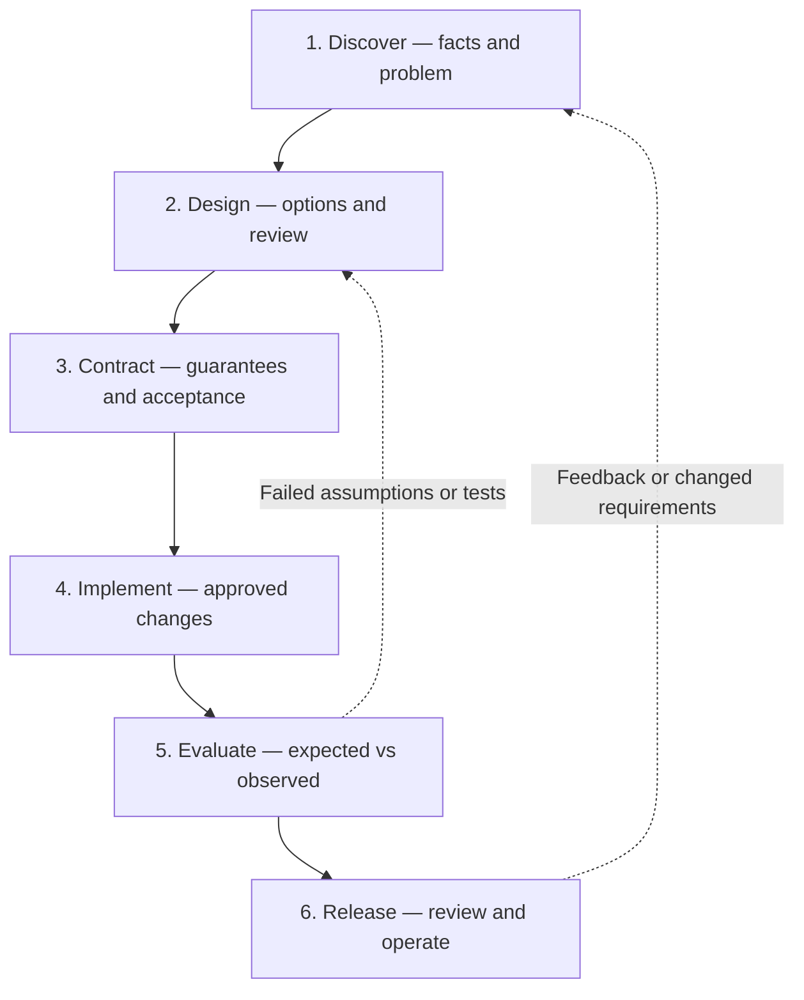
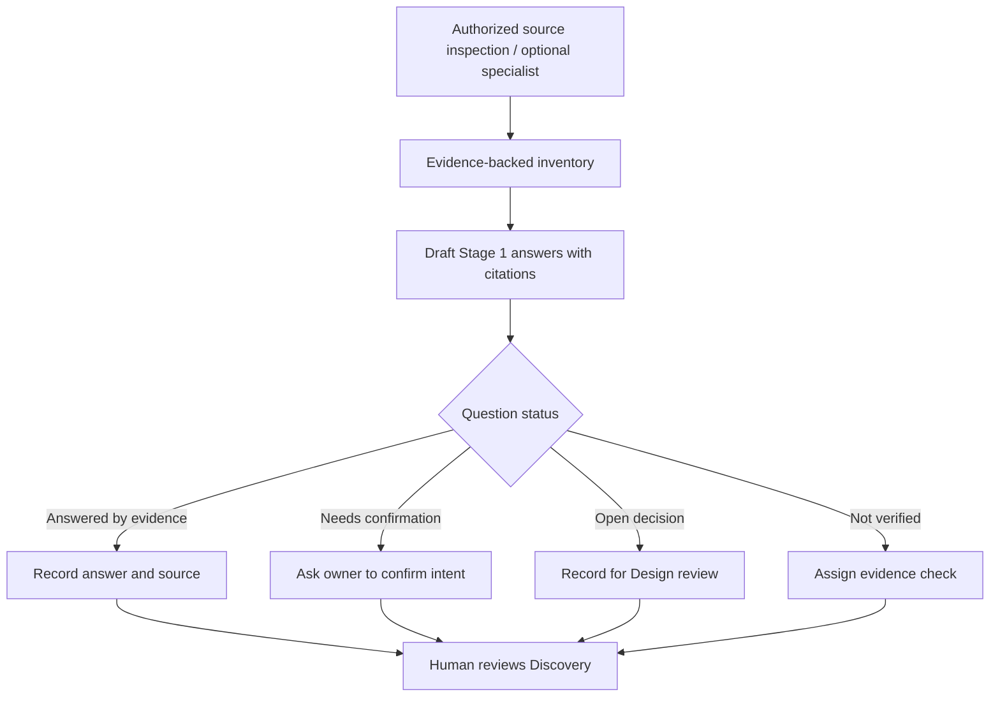

# DFRDE — Engineering Review Template
## [Project, capability, integration, or change]

> **Purpose:** One reusable, living engineering record for a skill, tool, agent, harness, application, service, data system, or infrastructure change.
>
> **Method:** Discover → Design → Contract → Implement → Evaluate → Release, with human review at meaningful decision points. Use SDI reasoning where architecture complexity warrants it.
>
> **Use:** Copy this file into the approved project workspace and rename the copy for the work item. Keep this template generic. Delete irrelevant prompts and reduce ceremony for small, reversible changes.

**Project/goal:** [Describe]  
**Domain(s):** [Skill / tool / agent / harness / app / infrastructure / other]  
**Scope / non-goals:** [Describe]  
**Record owner:** [Name/role or UNASSIGNED]  
**Current stage:** 1. Discover — NOT STARTED  
**Source revision / environment:** [Commit, tag, version, location, or NOT VERIFIED]  
**Next checkpoint:** [One action; owner; date if known]

### How to use this record

- **Before a meeting:** Ask an authorized agent or reviewer to inspect the available sources and prefill Stage 1 where evidence exists. For agent-skill targets, `audit-skill` can produce the Stage 1 handoff; for other domains, use the appropriate approved source and tools. Never invent facts to make the template look complete.
- **During discussion:** Confirm findings, challenge assumptions, compare options, and note what remains unresolved. You can record/transcribe with participant consent and organization-approved tools.
- **After discussion:** Have AI draft a *proposed* update from the meeting transcript, with timestamp/source references where available. A human confirms decisions before marking them approved or saving changes to the canonical file.
- **Maintain one canonical record per change.** Keep transcripts and sensitive source artifacts in their approved access-controlled locations; link rather than copying confidential content into a public repo.
- **Separate four things:** action checkboxes = work done; reference information = evidence and proposed ideas; deliverables = artifacts produced; review gate = human approval. A completed checkbox is not an approval.
- **Evidence states:** `DOCUMENTED` (source says so), `IMPLEMENTED CHECK` (code/test exists), `OBSERVED RESULT` (authorized run/trace demonstrates it), `INFERRED`, `UNVERIFIED`, `PROPOSED`, `NOT RUN`. Always give source links/lines when available.
- **Question statuses:** `ANSWERED BY EVIDENCE`, `NEEDS CONFIRMATION`, `OPEN DECISION`, `NOT VERIFIED`. A question answered from documentation can still require runtime confirmation.
- **Stage statuses:** `NOT STARTED`, `IN PROGRESS`, `REVIEW REQUIRED`, `APPROVED`, `BLOCKED`, `COMPLETED`, `NOT APPLICABLE`. No stage automatically advances because an AI generated text.
- **Permissions:** Documentation and read-only source analysis are not permission to run specialists, modify repositories, call live tools, test against production, or release. Seek explicit approval for the exact effects.

### Lifecycle at a glance

### Progress tracker

| Stage | Status | Required outcome | Evidence / reviewer |
| --- | --- | --- | --- |
| 1. Discover | NOT STARTED | Problem, scope, current state, constraints, important unknowns confirmed | [Link / owner] |
| 2. Design | NOT STARTED | Alternatives and preferred direction reviewed | [Link / owner] |
| 3. Contract | NOT STARTED | Responsibilities, interfaces, acceptance and safety boundaries approved | [Link / owner] |
| 4. Implement | NOT STARTED | Authorized change and deviations recorded | [Link / owner] |
| 5. Evaluate | NOT STARTED | Behavior, safety and regression evidence reviewed | [Link / owner] |
| 6. Release | NOT STARTED | Go/no-go, ownership, rollout and rollback decided | [Link / owner] |

---

## 1. Discover — What problem and existing reality are we working with?

**Why:** Understand the task *before* choosing a solution. For existing systems, prefer evidence about present behavior; for greenfield work, document user needs and explicitly mark existing-state analysis NOT APPLICABLE.

**SDI lens:** Step 1 — understand requirements, scope and constraints.

### What to do

- [ ] **Establish source access and scope.** Identify repositories, version/branch, documentation, runtime, users and approved read-only access.
- [ ] **Prefill from evidence.** Inspect existing behavior, decisions, participants, dependencies, tools, tests and failure paths. Cite paths/lines or trace IDs. Mark missing evidence NOT VERIFIED.
- [ ] **Draft the problem statement.** Describe the user/business pain, intended outcomes and why the work is needed; do not present an integration or implementation as the problem itself.
- [ ] **Capture requirements and constraints.** Fill in known FR/NFRs, non-goals, users, standards, trust/permission limits, candidate success measures and existing conventions.
- [ ] **Identify question status.** Separate answered facts from items to confirm, architectural decisions for Stage 2, and evidence that needs investigation.
- [ ] **Seek human confirmation.** Review the proposed problem, intended scope and priorities before marking Stage 1 ready.

### Guided walkthrough — optional audit-assisted prefill

For existing **agent skills**, use the existing `audit-skill` read-only review of one or more skills. Ask for a **DFRDE Stage 1 — Discover handoff**. For another domain, use its own relevant inspector, diagrams and tests; do not assume a skill-specific audit applies to all domains.

**Stage 1 questions to prefill**

| ID | Discovery question | Draft answer / hypothesis | Source and evidence state | Question status | Owner / next action |
| --- | --- | --- | --- | --- | --- |
| S1-Q01 | Who is experiencing what problem? What outcome would help? | [PROPOSED unless confirmed] | [Meeting/source or UNVERIFIED] | NEEDS CONFIRMATION | [Owner] |
| S1-Q02 | What exists today, and which relevant parts have been inspected? | [As-is summary or GREENFIELD] | [Files, lines, revision] | NOT VERIFIED | [Evidence check] |
| S1-Q03 | What triggers the current work? Who are its users and participants? | [Prefill] | [Citation or UNVERIFIED] | NOT VERIFIED | [Owner] |
| S1-Q04 | What inputs, outputs, dependencies, data and external integrations are involved? | [Prefill] | [Citation or UNVERIFIED] | NOT VERIFIED | [Owner] |
| S1-Q05 | What are the major decision points, contracts, handoffs and ownership boundaries? | [Prefill; identify overlap if multiple components] | [Citation or UNVERIFIED] | NOT VERIFIED | [Owner] |
| S1-Q06 | Which existing guards, tests, traces and observed failure paths exist? | [Do not infer a run from documentation] | [Citation / NOT RUN] | NOT VERIFIED | [Owner] |
| S1-Q07 | What trust, authorization, privacy, runtime and portability constraints apply? | [Distinguish instructions from enforcement] | [Citation or UNVERIFIED] | NOT VERIFIED | [Owner] |
| S1-Q08 | What functional/nonfunctional requirements, non-goals and success measures are agreed? | [Separate observed need from proposed metric] | [Approved source or UNVERIFIED] | NEEDS CONFIRMATION | [Owner] |
| S1-Q09 | Can we reuse an existing component or simpler deterministic workflow? | [Alternative hypothesis] | [Evidence or proposed analysis] | OPEN DECISION | [For Stage 2] |
| S1-Q10 | What are the biggest unknowns and what evidence would resolve each? | [Prioritized list] | [Evidence gap] | NOT VERIFIED | [Owner] |

**Current-state evidence map** (omit or mark N/A for greenfield):

| Component / claim | Observed/documented behavior | Source revision and location | Evidence state | Consequence if uncertain |
| --- | --- | --- | --- | --- |
| [Item] | [What we know] | [Path:line / trace] | UNVERIFIED | [Impact] |

**Draft problem statement — HUMAN CONFIRMATION REQUIRED**

> [What problem exists, whom it affects, what success would look like, and important constraints. Do not confuse the proposed solution with the actual problem.]

**Known scope:** [In scope]  
**Non-goals:** [Explicitly excluded]  
**FRs / user journeys:** [With sources; proposed where not agreed]  
**NFRs / constraints:** [Security, reliability, performance, cost, operational constraints as applicable]  
**Measurable success criteria:** [Proposed or approved with owner]  
**Simpler existing alternatives to investigate:** [Optional]  
**As-is diagram:** [Add a source-backed Mermaid diagram or link; do not claim runtime evidence from static text]

### Questions for collaborators

**Ask only the questions that remain after prefill.** Don't repeat repository facts as open-ended questions; where intent differs from documented behavior, request confirmation instead.

| Priority | Question needing human input | Why audit/source evidence cannot settle it | Suggested reviewer / decision owner |
| --- | --- | --- | --- |
| [P1] | [Needs confirmation] | [Evidence and uncertainty] | [Owner] |
| [P1] | [Open decision — defer detailed alternatives to Stage 2] | [Trade-off/ownership] | [Owner] |
| [P2] | [Not verified — arrange test/access] | [Missing evidence] | [Owner] |

### Deliverables

| Required output | Status | Evidence / location |
| --- | --- | --- |
| Problem and success measures, confirmed by owner | REVIEW REQUIRED | [Link] |
| Current-state inventory / source version or GREENFIELD context | NOT STARTED | [Link] |
| Requirements, constraints and non-goals | NOT STARTED | [Link] |
| Answered/confirmation/decision/evidence question register | NOT STARTED | [Link] |
| Stage 1 review decision and Stage 2 inputs | NOT STARTED | [Link] |

### Review gate

**HUMAN REVIEW REQUIRED — Discovery:** Confirm the problem, scope, evidence limitations, responsible owners and next design questions. Record approval or unresolved blockers in the Decision Log. **An AI prefill or a static audit is not Stage 1 approval.**

---

## 2. Design — What approach best fits the requirements?

**Why:** Compare defensible approaches, not just the first solution an agent proposes. **SDI lens:** Steps 2–4 (high-level design, critical components, bottlenecks and trade-offs).

### What to do

- [ ] Review confirmed Stage 1 problem, assumptions and constraints.
- [ ] Draw or reference the **as-is** design and create a clearly labeled **PROPOSED** to-be architecture when useful.
- [ ] Compare keep-as-is / simplest adequate approach and material alternatives.
- [ ] Evaluate responsibility boundaries, complexity, coupling, reliability, cost, operability and portability as applicable.
- [ ] Record a reviewed design direction, objections, rejected alternatives and decision owner.

### Guided walkthrough

Identify the smallest architecture that addresses the confirmed problem. Deep dive only into high-impact components; route unresolved foundational questions back to Discover. Record sketches and diagrams as **PROPOSED** until reviewed.

### Questions for collaborators

| Question | Decision / evidence to capture |
| --- | --- |
| What are the viable approaches and why choose one? | Options, constraints and trade-offs |
| What existing patterns or subsystems should we preserve? | Inspected source links |
| What could fail, scale poorly or expand authority? | Risks and alternatives |
| Who agrees to the design direction? | Owner, date, decision ID |

### Deliverables

| Output | Status / evidence |
| --- | --- |
| Current vs proposed design and meaningful alternatives | [OPEN / link] |
| Trade-off comparison and decision rationale | [OPEN / link] |
| Design approval or explicitly unresolved choice | [REVIEW REQUIRED / owner] |

### Review gate

**HUMAN REVIEW REQUIRED — Design:** Agree on a preferred approach and who owns it. Do not infer approval from AI recommendations or meeting discussion.

---

## 3. Contract — What must participants and components guarantee?

**Why:** Turn design choices into explicit, testable expectations. **SDI lens:** Component deep dive and trade-offs (Steps 3–4); this stage formalizes agreements, not speculative internals.

### What to do

- [ ] Identify producers, consumers, owners and versioned interfaces/handoffs.
- [ ] Specify functional requirements, NFRs, input/output constraints, state transitions, invariants and acceptance criteria.
- [ ] Define trust boundaries, authorization, approved effects, escalation and human override.
- [ ] Define failures: missing data, timeouts, retries, duplicates, partial success, incompatibility and recovery.
- [ ] Draft success, failure, misuse and regression tests **before implementation**; identify safe baseline when applicable.
- [ ] Review and approve contract scope, decision owners and quality gates.

### Guided walkthrough

A **contract** states what a participant promises; an **invariant** is a property that must hold across states (including errors). Verify if a host/service enforces a security rule rather than relying on the rule appearing in a prompt.

### Questions for collaborators

| Question | Record |
| --- | --- |
| Who owns each guarantee and how is it verified? | Contract owner, version, acceptance |
| What must be supplied and returned for every handoff? | Required/optional fields or interface behavior |
| What should always be true, including partial failures? | Invariants and failure semantics |
| Which restrictions are technically enforced? | Identity, tool/server/host policy evidence |
| What is the minimum agreed evaluation gate? | Cases, observable outcomes, reviewer |

### Deliverables

| Output | Status / evidence |
| --- | --- |
| Interface / ownership / handoff contracts | [PROPOSED / link] |
| Invariants, trust and permission boundaries | [REVIEW REQUIRED / link] |
| Failure/recovery rules and acceptance tests | [NOT RUN / link] |
| Approved contract baseline | [REVIEW REQUIRED / owner] |

### Review gate

**HUMAN REVIEW REQUIRED — Contract:** Record explicit agreement on responsibilities, guarantees, authorization, failure behavior and acceptance checks. Reopen Design if the contract invalidates the chosen architecture.

---

## 4. Implement — Make only the reviewed change

### What to do

- [ ] Obtain explicit approval for the exact files, tools, environments and possible side effects.
- [ ] Verify approved architecture/contract, source version and existing implementation conventions.
- [ ] Implement the smallest approved change; retain baseline/backward compatibility where required.
- [ ] Log material deviations and return for design/contract review when necessary.
- [ ] Record reviewable diff/commit/PR evidence and the rollback plan.

### Guided walkthrough

A design approval **does not** grant write permissions. If you're only planning, mark implementation **NOT RUN** and keep commands/proposals as examples.

### Questions for collaborators

| Question | Record |
| --- | --- |
| Which artifacts may change and who authorizes it? | Scope, authorization, source revision |
| Which dependencies or consumers must not break? | Regression constraints |
| What would trigger a pause and redesign? | Deviation and stop rules |

### Deliverables

| Output | Status / evidence |
| --- | --- |
| Explicit implementation approval | [REVIEW REQUIRED] |
| Bounded changes and revision references | [NOT STARTED / commit] |
| Deviations and rollback evidence | [OPEN / link] |

### Review gate

**HUMAN REVIEW REQUIRED — Implementation scope:** Do not edit, deploy or modify external state without specific authorization. Pause on material changes to approved design/contract.

---

## 5. Evaluate — Do observed results satisfy the contract?

### What to do

- [ ] Identify safe pre-change baseline evidence when available; note unavailable baseline honestly.
- [ ] Use approved isolated fixtures and the agreed eval/test plan appropriate to the domain.
- [ ] Record expected vs observed outcomes, tool actions, side effects and failure evidence separately.
- [ ] Evaluate functional, security, authorization, resilience, performance and regression behavior as applicable.
- [ ] Diagnose unexpected results, classify source/tool/model/harness/test failures and reopen earlier stages if needed.
- [ ] Present evidence and residual risk for review.

### Guided walkthrough

A passing structural validator does not prove runtime reliability. A failed safety condition cannot be averaged away by other successes. An unrun test is **NOT RUN**, not PASS.

### Questions for collaborators

| Question | Record |
| --- | --- |
| What evidence demonstrates the user journey actually works? | Traces, tests, artifacts, outcomes |
| Were restrictions and failure paths tested? | Negative/security cases |
| Did any previously working behavior regress? | Comparable baseline and environment |
| What remains unverified or blocking? | Risk/coverage register |

### Deliverables

| Case ID | Expectation | Observed result | Evidence | Status |
| --- | --- | --- | --- | --- |
| E-01 | [Normal path] | [—] | [—] | NOT RUN |
| E-02 | [Failure / ambiguity] | [—] | [—] | NOT RUN |
| E-03 | [Trust/permission or regression] | [—] | [—] | NOT RUN |

### Review gate

**HUMAN REVIEW REQUIRED — Evaluation:** Confirm coverage, real results, safety and residual risks. Failed assumptions may return the work to Discover, Design or Contract.

---

## 6. Release — Approve, operate and improve

### What to do

- [ ] Review agreed scope, implementation changes, eval evidence, known risks and blockers.
- [ ] Obtain an accountable human go/no-go decision before merge, publish or deploy.
- [ ] Verify supported versions/environments, rollout strategy, monitoring, incident ownership and rollback.
- [ ] Record actual release evidence or a BLOCKED/DEFERRED disposition.
- [ ] Assign feedback/maintenance owner and conditions that trigger reevaluation.

### Guided walkthrough

For some work, "release" means an accepted design or internal documentation—not production deployment. Describe the actual outcome without implying an unperformed release.

### Questions for collaborators

| Question | Record |
| --- | --- |
| Is the evidence sufficient for the intended release scope? | Decision and residual risk |
| Who owns operations and rollback? | Names/roles and instructions |
| What should be monitored, and when do we review again? | Feedback loop / SLOs as applicable |

### Deliverables

| Output | Status / evidence |
| --- | --- |
| Human release decision and residual risks | [REVIEW REQUIRED] |
| Rollout, monitoring, ownership and rollback | [OPEN / link] |
| Observed release or documented deferral | [NOT STARTED / link] |

### Review gate

**HUMAN REVIEW REQUIRED — Release:** No publishing, deployment or external changes without explicit authorization, effective permissions and real resulting evidence.

---

## Cross-cutting engineering criteria

Use only criteria relevant to the domain; document when a criterion is NOT APPLICABLE.

| Lens | Ask throughout the work |
| --- | --- |
| Intent / simplicity | Are we solving an agreed problem with the smallest adequate solution? |
| Existing architecture | Have we verified established patterns, dependencies and sources of truth? |
| Correctness | Can we test critical acceptance criteria and invariants? |
| Trust / permission | Is untrusted context separated from authority, and are write effects enforced? |
| Observability | Can we prove what ran, what changed, and why it failed? |
| Lifecycle | Can we version, review, roll back and support the result? |
| Portability | Are compatibility claims verified per runtime/environment rather than inferred from format? |
| Human ownership | Who makes and approves the consequential decisions? |

## Decision log — authoritative human-reviewed choices

| ID | Decision or unresolved question | Alternatives / rationale | Owner | Evidence / meeting reference | Status |
| --- | --- | --- | --- | --- | --- |
| D-01 | [Question] | [Options] | [Owner] | [Source] | OPEN |

Record `APPROVED` only when confirmed by an accountable reviewer; transcript inference is not approval.

## Meeting notes — capture, organize, confirm

| Date / participants | Stage(s) | Transcript reference (approved storage) | Draft findings | Confirmed decisions / open items |
| --- | --- | --- | --- | --- |
| [Date] | [Stage] | [Link, timestamp] | [Summary] | [D-ID / owner] |

**Post-meeting transcription instruction:** Extract statements and evidence, label proposals and disagreements, draft Stage-specific updates and new D-IDs, cite timestamps if available, and show the proposed Markdown diff for human confirmation **before saving** the canonical document.

## Evidence / open-question backlog

| ID | Unknown or missing evidence | Impact if unanswered | How to verify safely | Owner | Status |
| --- | --- | --- | --- | --- | --- |
| U-01 | [Unverified] | [Impact] | [Approved read-only inspection or future test] | [Owner] | OPEN |

## References

- Engineering methodology: [Apply DFRDE](../../skills/apply-dfrde/SKILL.md)
- Detailed stage guidance: [Lifecycle reference](../../skills/apply-dfrde/references/lifecycle.md)
- Domain adaptation: [Domain-specific lenses](../../skills/apply-dfrde/references/domain-adaptation.md)
