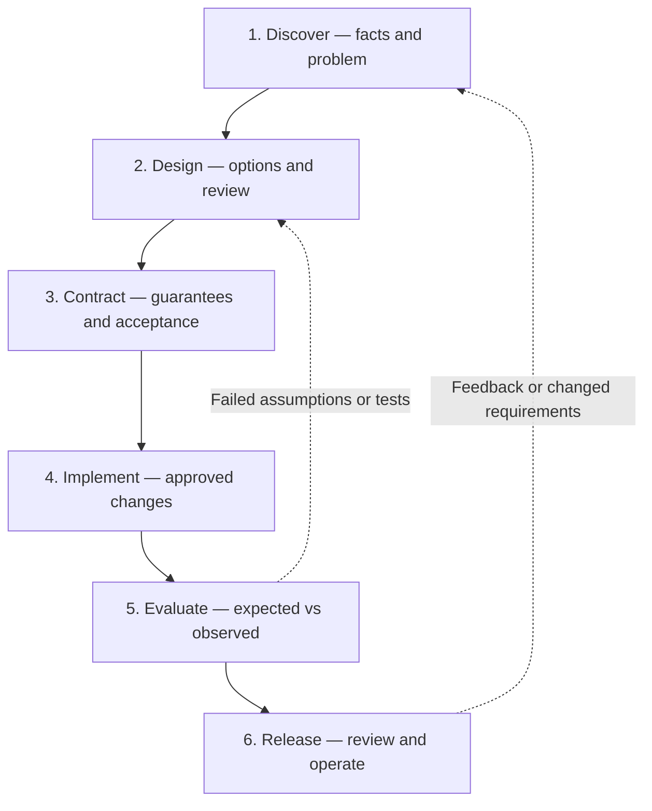
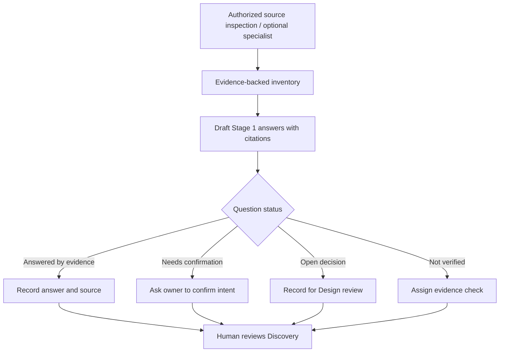

# DFRDE — Engineering Review Template
## [Project, capability, integration, or change]

> **Purpose:** One reusable, living engineering record for a skill, tool, agent, harness, application, service, data system, or infrastructure change.
>
> **Method:** Discover → Design → Contract → Implement → Evaluate → Release, with human review at meaningful decision points. Use SDI reasoning where architecture complexity warrants it.
>
> **Use:** Copy this file into the approved project workspace and rename the copy for the work item. Keep this template generic. Delete irrelevant prompts and reduce ceremony for small, reversible changes.

**Project/goal:** [Describe]  
**Domain(s):** [Skill / tool / agent / harness / app / infrastructure / other]  
**Scope / non-goals:** [Describe]  
**Record owner:** [Name/role or UNASSIGNED]  
**Current stage:** 1. Discover — NOT STARTED  
**Source revision / environment:** [Commit, tag, version, location, or NOT VERIFIED]  
**Next checkpoint:** [One action; owner; date if known]

### Table of contents

- [How to use this record](#how-to-use-this-record)
- [Lifecycle at a glance](#lifecycle-at-a-glance)
- [Progress tracker](#progress-tracker)
- [Audit Skill — At a Glance (optional)](#audit-skill--at-a-glance-optional-for-skill-reviews)
- [1. Discover](#1-discover--what-problem-and-existing-reality-are-we-working-with)
- [2. Design](#2-design--what-approach-best-fits-the-requirements)
- [3. Contract](#3-contract--what-must-participants-and-components-guarantee)
- [4. Implement](#4-implement--make-only-the-reviewed-change)
- [5. Evaluate](#5-evaluate--do-observed-results-satisfy-the-contract)
- [6. Release](#6-release--approve-operate-and-improve)
- [Cross-cutting criteria](#cross-cutting-engineering-criteria)
- [Decision log](#decision-log--authoritative-human-reviewed-choices)
- [Meeting notes](#meeting-notes--capture-organize-confirm)
- [Evidence and open questions](#evidence--open-question-backlog)
- [References](#references)

### How to use this record

- **Before a meeting:** Ask an authorized agent or reviewer to inspect the available sources and prefill **Stages 1–3 where evidence permits**. For agent-skill targets, `audit-skill` can draft Discovery answers, design options and candidate contracts; for other domains, use appropriate approved sources and tools. Stages 2–3 stay **CONDITIONAL / PROPOSED** until their human reviews; never invent facts to make the template look complete.
- **Industry standards are references, not replacement questions:** The 21 Stage 1–3 questions are a practical DFRDE checklist, **not** an official ISO/IEC/IEEE questionnaire. Use relevant [standards references](#references) to inform requirements, architecture descriptions, and lifecycle decisions. Keep the questions that apply to the project; do not claim compliance merely because they were answered.
- **During discussion:** Confirm findings, challenge assumptions, compare options, and note what remains unresolved. You can record/transcribe with participant consent and organization-approved tools.
- **After discussion:** Have AI draft a *proposed* update from the meeting transcript, with timestamp/source references where available. A human confirms decisions before marking them approved or saving changes to the canonical file.
- **Maintain one canonical record per change.** Keep transcripts and sensitive source artifacts in their approved access-controlled locations; link rather than copying confidential content into a public repo.
- **Keep the table of contents current.** Every generated DFRDE review record should have a clickable TOC near the top. Include only sections in the actual document; update links when headings change or sections are removed.
- **Separate four things:** action checkboxes = work done; reference information = evidence and proposed ideas; deliverables = artifacts produced; review gate = human approval. A completed checkbox is not an approval.
- **Evidence states:** `DOCUMENTED` (source says so), `IMPLEMENTED CHECK` (code/test exists), `OBSERVED RESULT` (authorized run/trace demonstrates it), `INFERRED`, `UNVERIFIED`, `PROPOSED`, `NOT RUN`. **Link the exact source file and relevant lines directly beside each supported claim** (prefer commit-pinned links). Do not use evidence keys or a separate evidence lookup table. If evidence is unavailable, state `UNVERIFIED` or `NOT RUN` rather than inventing a link.
- **Skill audits:** Use the optional **Audit Skill — At a Glance** section before Stage 1. Keep the overview, workflow, ten-dimension dashboard, skill format check, compatibility, and main open questions concise. No ranked findings or proposed evaluation cases here. Written rules do not prove tested behavior or technical enforcement.
- **Question statuses:** `ANSWERED BY EVIDENCE`, `NEEDS CONFIRMATION`, `OPEN DECISION`, `NOT VERIFIED`. A question answered from documentation can still require runtime confirmation.
- **Stage statuses:** `NOT STARTED`, `IN PROGRESS`, `REVIEW REQUIRED`, `APPROVED`, `BLOCKED`, `COMPLETED`, `NOT APPLICABLE`. No stage automatically advances because an AI generated text.
- **Permissions:** Documentation and read-only source analysis are not permission to run specialists, modify repositories, call live tools, test against production, or release. Seek explicit approval for the exact effects.

### Lifecycle at a glance

### Progress tracker

| Stage | Status | Required outcome | Evidence / reviewer |
| --- | --- | --- | --- |
| 1. Discover | NOT STARTED | Problem, scope, current state, constraints, important unknowns confirmed | [Link / owner] |
| 2. Design | NOT STARTED | Alternatives and preferred direction reviewed | [Link / owner] |
| 3. Contract | NOT STARTED | Responsibilities, interfaces, acceptance and safety boundaries approved | [Link / owner] |
| 4. Implement | NOT STARTED | Authorized change and deviations recorded | [Link / owner] |
| 5. Evaluate | NOT STARTED | Behavior, safety and regression evidence reviewed | [Link / owner] |
| 6. Release | NOT STARTED | Go/no-go, ownership, rollout and rollback decided | [Link / owner] |

---

## Audit Skill — At a Glance (optional for skill reviews)

Use this section when a skill is being reviewed with `audit-skill`. **Write for a developer new to agent skills:** explain what exists, link to the source beside each finding, and state what remains unknown. No evidence-key table or separate source index. Keep it short; do not add ranked findings or proposed evaluation cases. Delete this section for non-skill reviews.

### Skill overview

- **Purpose:** [One sentence with direct source link]
- **Inputs:** [Direct source link]
  - [Input 1]
  - [Input 2 or required code/tool access; mark missing access NOT VERIFIED]
- **Workflow:** [Direct source link]
  1. **Step 1:** [Action]
  2. **Step 2:** [Action; add only real steps]
- **Outputs:** **One [report/artifact]** containing the following items, not separate files unless documented. [Direct source link]
  - **[Section/item 1]:** [Brief description]
  - **[Section/item 2]:** [Brief description and any status]
- **Boundaries:** [Direct source link]
  - [Forbidden actions]
  - [Documented restrictions versus technically enforced restrictions]
- **Review limit:** [What was inspected and what was not observed]

**Formatting rule:** Use separate indented bullets or numbered steps for individual inputs, workflow actions, and report sections. Do not combine distinct items into one comma-separated sentence. Clearly distinguish parts of **one report** from separate artifacts.

### Documented workflow

[Add a small Mermaid diagram from the skill instructions **if it helps**. This shows the written process, not a recorded execution.]

### Ten-dimension review dashboard

**About this dashboard:** The Audit Skill uses these ten review areas to give a quick picture of an agent skill: its purpose, activation, inputs, workflow, outputs, trust boundaries, permissions, failure handling, existing evaluation evidence, and portability. The dashboard shows **what is documented, what is missing, and what still needs verification**. It is not ten additional DFRDE stages or a score out of ten.

This is a **project-specific engineering review rubric** that brings together software engineering, AI reliability, security and trust, and lifecycle concerns. The underlying ideas also appear in practices such as NIST AI RMF, OWASP guidance, and the Agent Skills specification, but **the ten-dimension dashboard itself is not an official industry standard, compliance assessment, or certification**. Keep this explanation in generated skill-review documents; omit the dashboard for reviews where it does not apply.

**How to read it:** The middle column states **what the audit found or could not check**, as a short, complete sentence—not a verdict label such as `PASS (static)`, `Documented (not tested)`, `Needs verification`, `Partial gap`, or `Evidence gap`. Examples: “Written instructions were inspected,” “Actual behavior was not tested,” and “Tool failure handling is not fully described.” The final column briefly explains the finding and links directly to relevant source lines. Never treat written instructions as proof of actual behavior or technical enforcement; do not invent links or results.

| Area | What we found (plain sentence) | Explanation, direct source / next check |
| --- | --- | --- |
| **Q-01 Purpose & boundaries** | [Written instructions were inspected.] | [What the skill does and must not do; direct link to source lines] |
| **Q-02 Activation & discovery** | [The activation instructions exist; host activation was not tested.] | [How the host discovers/activates it; what was tested] |
| **Q-03 Inputs & dependencies** | [Required inputs are described; actual access was not checked.] | [Required inputs, code/tool access and environment evidence] |
| **Q-04 Workflow & decisions** | [Workflow steps were inspected; runtime behavior was not tested.] | [Steps, decisions, observed adherence if tested] |
| **Q-05 Contracts & outputs** | [The expected output is described; machine-reading was not tested.] | [Output sections/statuses and whether downstream parsing was tested] |
| **Q-06 Context & trust** | [Trust rules are documented; actual behavior was not tested.] | [How trusted facts and untrusted inputs are distinguished; tested behavior] |
| **Q-07 Permissions & effects** | [Written permission limits were found; technical enforcement was not checked.] | [Written rules versus actual host/tool permission enforcement] |
| **Q-08 Failure & stopping** | [Some failure paths are described; others need clarification.] | [Missing data, errors, timeouts, safe stopping and recovery] |
| **Q-09 Evals & observability** | [No skill-specific run or test results were found in the inspected sources.] | [Skill-specific results: direct links to existing test/trace, or NOT VERIFIED / NOT RUN] |
| **Q-10 Lifecycle & portability** | [Setup instructions exist; cross-platform behavior was not tested.] | [Versioning and supported hosts: direct links to setup/tests; separate documentation from observations] |

**Review rule:** Keep dashboard findings in plain-English sentences instead of shorthand status codes, while honestly saying what was not checked or run. This is not a score out of 10 or proof of production readiness/compliance. Use findings to inform Stages 1–3, and leave evaluation cases for later authorized work.

### Agent Skills specification — file structure only

Check the format, **not the skill's behavior**.

| Check | Result | Source or explanation |
| --- | --- | --- |
| Required `SKILL.md`, name, and description | [Found / Missing / Not checked] | [Source link] |
| Instructions in Markdown | [Found / Missing / Not checked] | [Source link] |
| Optional folders | [Optional / Present] | [Brief note if relevant] |
| Skill-format validator | [Run / Not run] | [Result or limitation] |

### Cross-platform compatibility

| Question | [Platform A] | [Platform B] |
| --- | --- | --- |
| Setup instructions available? | [Documented / Not found] | [Documented / Not found] |
| Skill activation and needed tools checked? | [Checked / Not checked] | [Checked / Not checked] |
| Actual tool restrictions checked? | [Checked / Not checked] | [Checked / Not checked] |

### Key gaps and open questions

List **only the few material unknowns** that affect understanding or the next human discussion. Use plain-language questions with links where available. Do not repeat every dashboard row or add test-case proposals here.

- [Main unknown and why it matters]
- [Main unknown and why it matters]
- [Main unknown and why it matters]

---

## 1. Discover — What problem and existing reality are we working with?

**Why:** Understand the task *before* choosing a solution. For existing systems, prefer evidence about present behavior; for greenfield work, document user needs and explicitly mark existing-state analysis NOT APPLICABLE.

**SDI lens:** Step 1 — understand requirements, scope and constraints.

### What to do

- [ ] **Establish source access and scope.** Identify repositories, version/branch, documentation, runtime, users and approved read-only access.
- [ ] **Prefill from evidence.** Inspect existing behavior, decisions, participants, dependencies, tools, tests and failure paths. Cite paths/lines or trace IDs. Mark missing evidence NOT VERIFIED.
- [ ] **Draft the problem statement.** Describe the user/business pain, intended outcomes and why the work is needed; do not present an integration or implementation as the problem itself.
- [ ] **Capture requirements and constraints.** Fill in known FR/NFRs, non-goals, users, standards, trust/permission limits, candidate success measures and existing conventions.
- [ ] **Identify question status.** Separate answered facts from items to confirm, architectural decisions for Stage 2, and evidence that needs investigation.
- [ ] **Seek human confirmation.** Review the proposed problem, intended scope and priorities before marking Stage 1 ready.

### Guided walkthrough — optional audit-assisted prefill

For existing **agent skills**, use the existing `audit-skill` read-only review of one or more skills. Ask for a **DFRDE Stages 1–3 prefill**: Stage 1 evidence-backed Discovery, Stage 2 conditional architecture options, and Stage 3 conditional contracts. Fill this stage first with the Stage 1 portion; keep later draft answers explicitly pending review. For another domain, use its own relevant inspector, diagrams and tests; do not assume a skill-specific audit applies to all domains.

**Stage 1 questions to prefill**

| ID | Discovery question | Draft answer / hypothesis | Source and evidence state | Question status | Owner / next action |
| --- | --- | --- | --- | --- | --- |
| S1-Q01 | Who is experiencing what problem? What outcome would help? | [PROPOSED unless confirmed] | [Meeting/source or UNVERIFIED] | NEEDS CONFIRMATION | [Owner] |
| S1-Q02 | What exists today, and which relevant parts have been inspected? | [As-is summary or GREENFIELD] | [Files, lines, revision] | NOT VERIFIED | [Evidence check] |
| S1-Q03 | What triggers the current work? Who are its users and participants? | [Prefill] | [Citation or UNVERIFIED] | NOT VERIFIED | [Owner] |
| S1-Q04 | What inputs, outputs, dependencies, data and external integrations are involved? | [Prefill] | [Citation or UNVERIFIED] | NOT VERIFIED | [Owner] |
| S1-Q05 | What are the major decision points, contracts, handoffs and ownership boundaries? | [Prefill; identify overlap if multiple components] | [Citation or UNVERIFIED] | NOT VERIFIED | [Owner] |
| S1-Q06 | Which existing guards, tests, traces and observed failure paths exist? | [Do not infer a run from documentation] | [Citation / NOT RUN] | NOT VERIFIED | [Owner] |
| S1-Q07 | What trust, authorization, privacy, runtime and portability constraints apply? | [Distinguish instructions from enforcement] | [Citation or UNVERIFIED] | NOT VERIFIED | [Owner] |
| S1-Q08 | What functional/nonfunctional requirements, non-goals and success measures are agreed? | [Separate observed need from proposed metric] | [Approved source or UNVERIFIED] | NEEDS CONFIRMATION | [Owner] |
| S1-Q09 | Can we reuse an existing component or simpler deterministic workflow? | [Alternative hypothesis] | [Evidence or proposed analysis] | OPEN DECISION | [For Stage 2] |
| S1-Q10 | What are the biggest unknowns and what evidence would resolve each? | [Prioritized list] | [Evidence gap] | NOT VERIFIED | [Owner] |

**Current-state evidence map** (omit or mark N/A for greenfield):

| Component / claim | Observed/documented behavior | Direct source link (revision and lines) | Evidence state | Consequence if uncertain |
| --- | --- | --- | --- | --- |
| [Item] | [What we know] | [Path:line / trace] | UNVERIFIED | [Impact] |

**Draft problem statement — HUMAN CONFIRMATION REQUIRED**

> [What problem exists, whom it affects, what success would look like, and important constraints. Do not confuse the proposed solution with the actual problem.]

**Known scope:** [In scope]  
**Non-goals:** [Explicitly excluded]  
**FRs / user journeys:** [With sources; proposed where not agreed]  
**NFRs / constraints:** [Security, reliability, performance, cost, operational constraints as applicable]  
**Measurable success criteria:** [Proposed or approved with owner]  
**Simpler existing alternatives to investigate:** [Optional]  
**As-is diagram:** [Add a source-backed Mermaid diagram or link; do not claim runtime evidence from static text]

### Questions for collaborators

**Ask only the questions that remain after prefill.** Don't repeat repository facts as open-ended questions; where intent differs from documented behavior, request confirmation instead.

| Priority | Question needing human input | Why audit/source evidence cannot settle it | Suggested reviewer / decision owner |
| --- | --- | --- | --- |
| [P1] | [Needs confirmation] | [Evidence and uncertainty] | [Owner] |
| [P1] | [Open decision — defer detailed alternatives to Stage 2] | [Trade-off/ownership] | [Owner] |
| [P2] | [Not verified — arrange test/access] | [Missing evidence] | [Owner] |

### Deliverables

| Required output | Status | Evidence / location |
| --- | --- | --- |
| Problem and success measures, confirmed by owner | REVIEW REQUIRED | [Link] |
| Current-state inventory / source version or GREENFIELD context | NOT STARTED | [Link] |
| Requirements, constraints and non-goals | NOT STARTED | [Link] |
| Answered/confirmation/decision/evidence question register | NOT STARTED | [Link] |
| Stage 1 review decision and Stage 2 inputs | NOT STARTED | [Link] |

### Review gate

**HUMAN REVIEW REQUIRED — Discovery:** Confirm the problem, scope, evidence limitations, responsible owners and next design questions. Record approval or unresolved blockers in the Decision Log. **An AI prefill or a static audit is not Stage 1 approval.**

---

## 2. Design — What approach best fits the requirements?

**Why:** Compare defensible approaches, not just the first solution an agent proposes. **SDI lens:** Steps 2–4 (high-level design, critical components, bottlenecks and trade-offs).

### What to do

- [ ] Review confirmed Stage 1 problem, assumptions and constraints.
- [ ] Draw or reference the **as-is** design and create a clearly labeled **PROPOSED** to-be architecture when useful.
- [ ] Compare keep-as-is / simplest adequate approach and material alternatives.
- [ ] Evaluate responsibility boundaries, complexity, coupling, reliability, cost, operability and portability as applicable.
- [ ] Record a reviewed design direction, objections, rejected alternatives and decision owner.

### Guided walkthrough

Identify the smallest architecture that addresses the confirmed problem. Deep dive only into high-impact components; route unresolved foundational questions back to Discover. Record sketches and diagrams as **PROPOSED** until reviewed.

**Audit-assisted prefill (for existing agent skills):** The read-only `audit-skill` can prefill the Stage 2 questions using inspected design constraints and workflow evidence. It can **recommend options, not approve or select an architecture**. If Stage 1 is unconfirmed, label this entire section **CONDITIONAL — based on proposed Discovery assumptions**. For other domains, use appropriate authorized architecture inspection and the same question table.

### Questions for collaborators — source-prefilled where possible

| ID | Question | Evidence-backed answer / proposed option | Source and evidence state | Question status | Human owner / next step |
| --- | --- | --- | --- | --- | --- |
| S2-Q01 | What approaches might address the confirmed *or proposed* problem, including keeping existing behavior or a simpler change? | [PROPOSED options, not a selected solution] | [Source path:line / hypothesis] | OPEN DECISION | [Owner] |
| S2-Q02 | What existing patterns, subsystems, tools and architecture constraints should be preserved? | [Inspected as-is components] | [Source revision, path:line] | NOT VERIFIED | [Confirm missing source] |
| S2-Q03 | Where should coordination, decision ownership and handoffs live? | [As-is ownership vs PROPOSED to-be boundaries] | [Source path:line] | OPEN DECISION | [Owner] |
| S2-Q04 | What trade-offs, bottlenecks, failure and trust risks, costs or portability constraints matter? | [Source-backed risks vs hypothetical trade-offs] | [Sources; measured values only if observed] | NEEDS CONFIRMATION | [Owner] |
| S2-Q05 | What design direction and rationale has the accountable reviewer approved? | [Approved decision link OR OPEN] | [Actual review evidence or UNVERIFIED] | OPEN DECISION | [Reviewer / D-ID] |

Use **ANSWERED BY EVIDENCE**, **NEEDS CONFIRMATION**, **OPEN DECISION**, or **NOT VERIFIED** for each question, and distinguish the *as-is answer* from the *to-be proposal*. Do not repeat fully answered source facts as open-ended teammate questions. Preserve unresolved questions and assign an owner.

**Architecture options — PROPOSED, not approved**

| Option | What changes compared with as-is | Benefit / trade-off | Evidence / assumption | Status |
| --- | --- | --- | --- | --- |
| A. Keep current / smallest adequate change | [As-is baseline] | [Trade-off] | [Source] | PROPOSED |
| B. Alternative approach | [Difference] | [Trade-off] | [Source / UNVERIFIED] | PROPOSED |

**Design visuals:** [Link to cited as-is Mermaid diagram] / [Optional clearly labeled PROPOSED to-be Mermaid diagram]. Do not draw undocumented or untested behavior as if already implemented.

### Deliverables

| Output | Status / evidence |
| --- | --- |
| Current vs proposed design and meaningful alternatives | [OPEN / link] |
| Trade-off comparison and decision rationale | [OPEN / link] |
| Design approval or explicitly unresolved choice | [REVIEW REQUIRED / owner] |

### Review gate

**HUMAN REVIEW REQUIRED — Design:** Agree on a preferred approach and who owns it. Do not infer approval from AI recommendations or meeting discussion.

---

## 3. Contract — What must participants and components guarantee?

**Why:** Turn design choices into explicit, testable expectations. **SDI lens:** Component deep dive and trade-offs (Steps 3–4); this stage formalizes agreements, not speculative internals.

### What to do

- [ ] Identify producers, consumers, owners and versioned interfaces/handoffs.
- [ ] Specify functional requirements, NFRs, input/output constraints, state transitions, invariants and acceptance criteria.
- [ ] Define trust boundaries, authorization, approved effects, escalation and human override.
- [ ] Define failures: missing data, timeouts, retries, duplicates, partial success, incompatibility and recovery.
- [ ] Draft success, failure, misuse and regression tests **before implementation**; identify safe baseline when applicable.
- [ ] Review and approve contract scope, decision owners and quality gates.

### Guided walkthrough

A **contract** states what a participant promises; an **invariant** is a property that must hold across states (including errors). Verify if a host/service enforces a security rule rather than relying on the rule appearing in a prompt.

**Audit-assisted prefill (for existing agent skills):** `audit-skill` can inventory *documented* interfaces and guarantees, then draft candidate contracts based on each **PROPOSED Stage 2 design option**. If the team hasn't chosen a design, keep separate option-dependent contracts or label a shared minimum contract **CONDITIONAL — NOT APPROVED**. Do not silently turn a candidate into a binding requirement. Other engineering domains should use their relevant interface and policy evidence.

### Questions for collaborators — draft contracts, pending approval

| ID | Question | Existing evidence / candidate answer | Source and evidence state | Question status | Reviewer / next action |
| --- | --- | --- | --- | --- | --- |
| S3-Q01 | Who produces and consumes information, owns each guarantee, and maintains the contract/version? | [Existing or PROPOSED responsibilities] | [Path:line / UNVERIFIED] | NEEDS CONFIRMATION | [Owner] |
| S3-Q02 | What inputs/outputs, FR/NFR, states, acceptance criteria and invariants are required? | [Documented vs PROPOSED guarantees] | [Path:line / proposal] | OPEN DECISION | [Owner] |
| S3-Q03 | What trust, identity, permission, approval and forbidden-effect rules apply and are truly enforced? | [Actual host/tool rules vs prompt-only] | [Enforcement evidence or NOT VERIFIED] | NOT VERIFIED | [Reviewer] |
| S3-Q04 | What failures, missing data, timeouts, retries, duplicates, conflicts and partial results must be handled? | [Existing behavior vs PROPOSED safe defaults] | [Path:line / gap] | OPEN DECISION | [Owner] |
| S3-Q05 | What objective evaluations, baseline and regression cases should verify the guarantees? | [Existing tests vs PROPOSED tests — NOT RUN] | [Test paths/trace if present] | OPEN DECISION | [Reviewer] |
| S3-Q06 | Where is the contract maintained, versioned and approved, and how are incompatible changes handled? | [Existing document/manifest vs proposal] | [Source / UNVERIFIED] | NEEDS CONFIRMATION | [Owner / D-ID] |

Use **ANSWERED BY EVIDENCE**, **NEEDS CONFIRMATION**, **OPEN DECISION**, or **NOT VERIFIED** for each question. The existence of a written rule does not establish that a runtime enforces it. Test proposals are **NOT RUN**, not passing tests.

**Contract proposal — one row per interface/handoff when relevant**

| Producer → consumer | Input/output contract | Required behavior and invariants | Trust/permission and failure semantics | Source / status |
| --- | --- | --- | --- | --- |
| [As-is or PROPOSED] | [Fields or interface, not necessarily JSON] | [Documented vs candidate] | [Enforced / prompt-only / NOT VERIFIED] | [Path:line; NOT APPROVED] |

**Stage 2 dependency:** [Approved option and decision reference, or `UNCONFIRMED — option-specific draft only`]. **Contract approval:** `HUMAN REVIEW REQUIRED`.

### Deliverables

| Output | Status / evidence |
| --- | --- |
| Interface / ownership / handoff contracts | [PROPOSED / link] |
| Invariants, trust and permission boundaries | [REVIEW REQUIRED / link] |
| Failure/recovery rules and acceptance tests | [NOT RUN / link] |
| Approved contract baseline | [REVIEW REQUIRED / owner] |

### Review gate

**HUMAN REVIEW REQUIRED — Contract:** Record explicit agreement on responsibilities, guarantees, authorization, failure behavior and acceptance checks. Reopen Design if the contract invalidates the chosen architecture.

---

## 4. Implement — Make only the reviewed change

### What to do

- [ ] Obtain explicit approval for the exact files, tools, environments and possible side effects.
- [ ] Verify approved architecture/contract, source version and existing implementation conventions.
- [ ] Implement the smallest approved change; retain baseline/backward compatibility where required.
- [ ] Log material deviations and return for design/contract review when necessary.
- [ ] Record reviewable diff/commit/PR evidence and the rollback plan.

### Guided walkthrough

A design approval **does not** grant write permissions. If you're only planning, mark implementation **NOT RUN** and keep commands/proposals as examples.

### Questions for collaborators

| Question | Record |
| --- | --- |
| Which artifacts may change and who authorizes it? | Scope, authorization, source revision |
| Which dependencies or consumers must not break? | Regression constraints |
| What would trigger a pause and redesign? | Deviation and stop rules |

### Deliverables

| Output | Status / evidence |
| --- | --- |
| Explicit implementation approval | [REVIEW REQUIRED] |
| Bounded changes and revision references | [NOT STARTED / commit] |
| Deviations and rollback evidence | [OPEN / link] |

### Review gate

**HUMAN REVIEW REQUIRED — Implementation scope:** Do not edit, deploy or modify external state without specific authorization. Pause on material changes to approved design/contract.

---

## 5. Evaluate — Do observed results satisfy the contract?

### What to do

- [ ] Identify safe pre-change baseline evidence when available; note unavailable baseline honestly.
- [ ] Use approved isolated fixtures and the agreed eval/test plan appropriate to the domain.
- [ ] Record expected vs observed outcomes, tool actions, side effects and failure evidence separately.
- [ ] Evaluate functional, security, authorization, resilience, performance and regression behavior as applicable.
- [ ] Diagnose unexpected results, classify source/tool/model/harness/test failures and reopen earlier stages if needed.
- [ ] Present evidence and residual risk for review.

### Guided walkthrough

A passing structural validator does not prove runtime reliability. A failed safety condition cannot be averaged away by other successes. An unrun test is **NOT RUN**, not PASS.

### Questions for collaborators

| Question | Record |
| --- | --- |
| What evidence demonstrates the user journey actually works? | Traces, tests, artifacts, outcomes |
| Were restrictions and failure paths tested? | Negative/security cases |
| Did any previously working behavior regress? | Comparable baseline and environment |
| What remains unverified or blocking? | Risk/coverage register |

### Deliverables

| Case ID | Expectation | Observed result | Evidence | Status |
| --- | --- | --- | --- | --- |
| E-01 | [Normal path] | [—] | [—] | NOT RUN |
| E-02 | [Failure / ambiguity] | [—] | [—] | NOT RUN |
| E-03 | [Trust/permission or regression] | [—] | [—] | NOT RUN |

### Review gate

**HUMAN REVIEW REQUIRED — Evaluation:** Confirm coverage, real results, safety and residual risks. Failed assumptions may return the work to Discover, Design or Contract.

---

## 6. Release — Approve, operate and improve

### What to do

- [ ] Review agreed scope, implementation changes, eval evidence, known risks and blockers.
- [ ] Obtain an accountable human go/no-go decision before merge, publish or deploy.
- [ ] Verify supported versions/environments, rollout strategy, monitoring, incident ownership and rollback.
- [ ] Record actual release evidence or a BLOCKED/DEFERRED disposition.
- [ ] Assign feedback/maintenance owner and conditions that trigger reevaluation.

### Guided walkthrough

For some work, "release" means an accepted design or internal documentation—not production deployment. Describe the actual outcome without implying an unperformed release.

### Questions for collaborators

| Question | Record |
| --- | --- |
| Is the evidence sufficient for the intended release scope? | Decision and residual risk |
| Who owns operations and rollback? | Names/roles and instructions |
| What should be monitored, and when do we review again? | Feedback loop / SLOs as applicable |

### Deliverables

| Output | Status / evidence |
| --- | --- |
| Human release decision and residual risks | [REVIEW REQUIRED] |
| Rollout, monitoring, ownership and rollback | [OPEN / link] |
| Observed release or documented deferral | [NOT STARTED / link] |

### Review gate

**HUMAN REVIEW REQUIRED — Release:** No publishing, deployment or external changes without explicit authorization, effective permissions and real resulting evidence.

---

## Cross-cutting engineering criteria

Use only criteria relevant to the domain; document when a criterion is NOT APPLICABLE.

| Lens | Ask throughout the work |
| --- | --- |
| Intent / simplicity | Are we solving an agreed problem with the smallest adequate solution? |
| Existing architecture | Have we verified established patterns, dependencies and sources of truth? |
| Correctness | Can we test critical acceptance criteria and invariants? |
| Trust / permission | Is untrusted context separated from authority, and are write effects enforced? |
| Observability | Can we prove what ran, what changed, and why it failed? |
| Lifecycle | Can we version, review, roll back and support the result? |
| Portability | Are compatibility claims verified per runtime/environment rather than inferred from format? |
| Human ownership | Who makes and approves the consequential decisions? |

## Decision log — authoritative human-reviewed choices

| ID | Decision or unresolved question | Alternatives / rationale | Owner | Evidence / meeting reference | Status |
| --- | --- | --- | --- | --- | --- |
| D-01 | [Question] | [Options] | [Owner] | [Source] | OPEN |

Record `APPROVED` only when confirmed by an accountable reviewer; transcript inference is not approval.

## Meeting notes — capture, organize, confirm

| Date / participants | Stage(s) | Transcript reference (approved storage) | Draft findings | Confirmed decisions / open items |
| --- | --- | --- | --- | --- |
| [Date] | [Stage] | [Link, timestamp] | [Summary] | [D-ID / owner] |

**Post-meeting transcription instruction:** Extract statements and evidence, label proposals and disagreements, draft Stage-specific updates and new D-IDs, cite timestamps if available, and show the proposed Markdown diff for human confirmation **before saving** the canonical document.

## Evidence / open-question backlog

| ID | Unknown or missing evidence | Impact if unanswered | How to verify safely | Owner | Status |
| --- | --- | --- | --- | --- | --- |
| U-01 | [Unverified] | [Impact] | [Approved read-only inspection or future test] | [Owner] | OPEN |

## References

**Official software engineering standards informing this template** (not a claim of ISO/IEC/IEEE compliance):

- **Stages 1 and 3 — Requirements, constraints and acceptance expectations:** [ISO/IEC/IEEE 29148:2018 — Requirements engineering](https://www.iso.org/standard/72089.html). Covers engineering and documenting requirements. The 2018 edition remains published; a revision is in development.
- **Stage 2 — Architecture documentation:** [ISO/IEC/IEEE 42010:2022 — Architecture description](https://www.iso.org/standard/74393.html). Covers stakeholder concerns and how architecture is described; it does **not** prescribe a design-review method or questions.
- **Overall software lifecycle — Process context for DFRDE:** [ISO/IEC/IEEE 12207:2026 — Software life cycle processes](https://www.iso.org/standard/90219.html). Covers software lifecycle activities; it does **not** require DFRDE's six stages.

The linked ISO pages provide official descriptions/previews; the complete standards may require purchase or institutional access.

- Engineering methodology: [Apply DFRDE](../../skills/apply-dfrde/SKILL.md)
- Detailed stage guidance: [Lifecycle reference](../../skills/apply-dfrde/references/lifecycle.md)
- Domain adaptation: [Domain-specific lenses](../../skills/apply-dfrde/references/domain-adaptation.md)
