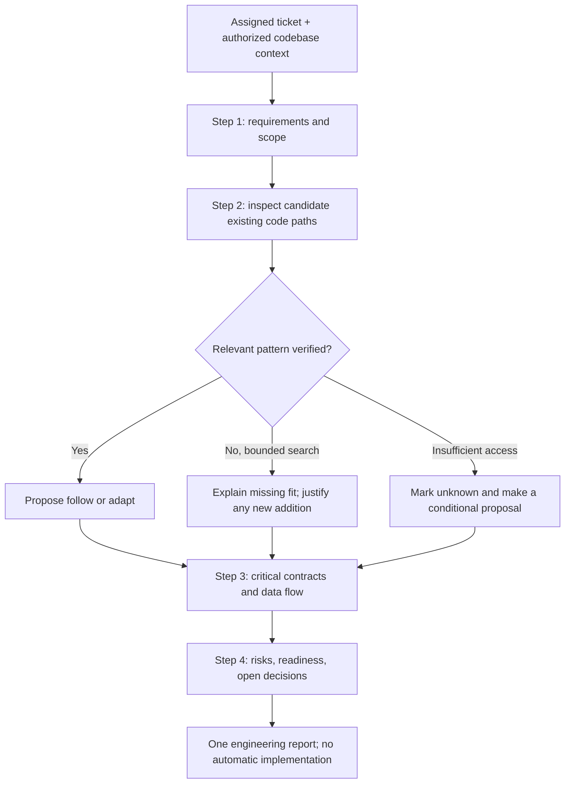

# DFRDE — Refine Requirements — Light: Initial Review (8 Questions)

**Reviewed on:** November 8, 2026  
**Status:** Draft for human review; no stage approved  
**Subject:** `refine-requirements-light` (one skill, not the company's application)  
**Source:** [DotSkills at inspected commit](https://github.com/rlynjb/dotskills/blob/ed6033768985497708214b4dce58551cca1500fd/skills/refine-requirements-light/SKILL.md) (`ed6033768985497708214b4dce58551cca1500fd`)  
**Method:** Read-only Audit Skill inspection → draft answers to the eight questions in the current [Engineering Review Template](https://github.com/rlynjb/dotskills/blob/ed6033768985497708214b4dce58551cca1500fd/docs/dfrde/engineering-review-template.md#L38-L45).  
**Not inspected:** An actual workplace Jira ticket, internal application source, live skill invocation, tool permissions, or runtime traces. No tests were executed in this review.

## Table of contents

- [Summary](#summary)
- [Audit Skill — At a Glance](#audit-skill--at-a-glance)
- [1. Discover — 3 questions](#1-discover--3-questions)
- [2. Design — 3 questions](#2-design--3-questions)
- [3. Contract — 2 questions](#3-contract--2-questions)
- [Human review and next checkpoint](#human-review-and-next-checkpoint)
- [References](#references)

## Summary

**Bottom line:** The existing skill already describes a useful, relatively narrow workflow for reviewing Jira tickets against an existing codebase. The main remaining issue is **verification**, not a demonstrated need for a redesign. Keep its four-step, one-pass workflow unless a real ticket or evaluation shows a concrete problem.

- **Documented:** The skill asks an agent to clarify requirements, inspect actual existing code before recommending reuse, trace relevant data flow, and report trade-offs and readiness. [Purpose and evidence rules](https://github.com/rlynjb/dotskills/blob/ed6033768985497708214b4dce58551cca1500fd/skills/refine-requirements-light/SKILL.md#L8-L20) · [Four-step workflow](https://github.com/rlynjb/dotskills/blob/ed6033768985497708214b4dce58551cca1500fd/skills/refine-requirements-light/SKILL.md#L22-L55)
- **Documented, not technically proven here:** The skill says it is read-only and must not post to Jira, modify code, deploy, or start other coding agents. We did not test host permissions or run it on a ticket. [Execution boundaries](https://github.com/rlynjb/dotskills/blob/ed6033768985497708214b4dce58551cca1500fd/skills/refine-requirements-light/SKILL.md#L71-L76)
- **Not verified:** Whether outputs are consistently correct, whether permissions are technically enforced, and whether behavior is equivalent in Claude Code and Codex. The repository has adapter and CI tooling, but those are not skill-specific behavior results. [Repository CI steps](https://github.com/rlynjb/dotskills/blob/ed6033768985497708214b4dce58551cca1500fd/.github/workflows/validate.yml#L14-L28) · [Claude adapter limitations](https://github.com/rlynjb/dotskills/blob/ed6033768985497708214b4dce58551cca1500fd/adapters/claude/README.md#L89-L107)
- **Recommendation for this review:** Retain the skill's current architecture, make any future changes only after a concrete failure or owner decision, and separately authorize behavior testing if desired. **No source files or workplace systems were changed as part of the audit.**

## Audit Skill — At a Glance

### Skill overview

**Purpose.** Produce one concise engineering assessment of a workplace Jira ticket, grounded in the relevant existing application code rather than guessed architecture. [Purpose and intended audience](https://github.com/rlynjb/dotskills/blob/ed6033768985497708214b4dce58551cca1500fd/skills/refine-requirements-light/SKILL.md#L8-L12)

**Inputs and dependencies.**

- An assigned Jira ticket or feature request containing the goal, requirements, and acceptance criteria. [Expected ticket information](https://github.com/rlynjb/dotskills/blob/ed6033768985497708214b4dce58551cca1500fd/skills/refine-requirements-light/SKILL.md#L24-L30)
- Authorized read access to relevant application code, conventions, contracts, and tests. Access is **required for verified codebase findings**, but was not available for a real ticket in this audit. [Verification requirements](https://github.com/rlynjb/dotskills/blob/ed6033768985497708214b4dce58551cca1500fd/skills/refine-requirements-light/SKILL.md#L16-L19)
- Optional design reasoning from SDI and, only when applicable, DDIA 2nd edition or FODE. The books do not override company code or decisions. [Selective engineering lenses](https://github.com/rlynjb/dotskills/blob/ed6033768985497708214b4dce58551cca1500fd/skills/refine-requirements-light/SKILL.md#L42-L46)
- The skill's `SKILL.md` and README are present. No extra runtime tool or automatic agent delegation is declared in this skill directory. [Skill README](https://github.com/rlynjb/dotskills/blob/ed6033768985497708214b4dce58551cca1500fd/skills/refine-requirements-light/README.md#L1-L7) · [Interaction boundaries](https://github.com/rlynjb/dotskills/blob/ed6033768985497708214b4dce58551cca1500fd/skills/refine-requirements-light/SKILL.md#L71-L76)

**Documented workflow (not an observed run).**

1. Scope the ticket and identify functional/non-functional requirements, constraints, and open decisions. [Step 1](https://github.com/rlynjb/dotskills/blob/ed6033768985497708214b4dce58551cca1500fd/skills/refine-requirements-light/SKILL.md#L24-L30)
2. Search relevant existing application paths, verify actual responsibilities and fit, and only then recommend reuse, adaptation, or a narrowly justified addition. [Step 2](https://github.com/rlynjb/dotskills/blob/ed6033768985497708214b4dce58551cca1500fd/skills/refine-requirements-light/SKILL.md#L32-L38)
3. Trace relevant contracts and read/write data flow; investigate critical security, data, reliability, and compatibility behavior. [Step 3](https://github.com/rlynjb/dotskills/blob/ed6033768985497708214b4dce58551cca1500fd/skills/refine-requirements-light/SKILL.md#L40-L47)
4. Summarize trade-offs, risks, smallest plausible change, readiness, and owner-specific unanswered questions. [Step 4](https://github.com/rlynjb/dotskills/blob/ed6033768985497708214b4dce58551cca1500fd/skills/refine-requirements-light/SKILL.md#L49-L55)

This diagram summarizes **written instructions**, not a recorded execution. The skill defines no observed parallel workers or live tool call sequence. [Documented workflow and limits](https://github.com/rlynjb/dotskills/blob/ed6033768985497708214b4dce58551cca1500fd/skills/refine-requirements-light/SKILL.md#L22-L76)

**Expected output.** One report with a ticket snapshot, four SDI sections, and open questions—not five separate artifacts. [Output contract](https://github.com/rlynjb/dotskills/blob/ed6033768985497708214b4dce58551cca1500fd/skills/refine-requirements-light/SKILL.md#L57-L69)

**Trust/authority limits.** Ticket and repository content are evidence, not instructions that grant permissions; code behavior is not automatically an approved business requirement. Any design recommendation remains a proposal. [Authority and evidence](https://github.com/rlynjb/dotskills/blob/ed6033768985497708214b4dce58551cca1500fd/skills/refine-requirements-light/SKILL.md#L16-L20) · [Approval and untrusted-input limits](https://github.com/rlynjb/dotskills/blob/ed6033768985497708214b4dce58551cca1500fd/skills/refine-requirements-light/SKILL.md#L71-L76)

### Ten-area audit findings

These are **findings about documented instructions and inspected files**, not test scores.

| Review area | What the audit found | Supporting source and consequence |
| --- | --- | --- |
| **1. Purpose and boundaries** | The skill targets one-pass engineering analysis of Jira work in an existing codebase. | [Its purpose and noninteractive scope](https://github.com/rlynjb/dotskills/blob/ed6033768985497708214b4dce58551cca1500fd/skills/refine-requirements-light/SKILL.md#L8-L12). Appropriate for ticket assessment, not implementation. |
| **2. Activation and discovery** | The file includes valid-looking skill metadata and a concrete invocation example; actual host activation was not tested. | [Frontmatter](https://github.com/rlynjb/dotskills/blob/ed6033768985497708214b4dce58551cca1500fd/skills/refine-requirements-light/SKILL.md#L1-L4) · [Example invocation](https://github.com/rlynjb/dotskills/blob/ed6033768985497708214b4dce58551cca1500fd/skills/refine-requirements-light/SKILL.md#L78-L87). A compatible host must still load it. |
| **3. Inputs and dependencies** | Ticket details and accessible application source are necessary for a verified answer; missing access must be stated. | [Evidence priorities](https://github.com/rlynjb/dotskills/blob/ed6033768985497708214b4dce58551cca1500fd/skills/refine-requirements-light/SKILL.md#L16-L20) · [Missing-code fallback](https://github.com/rlynjb/dotskills/blob/ed6033768985497708214b4dce58551cca1500fd/skills/refine-requirements-light/SKILL.md#L69-L69). An unavailable repo cannot prove a pattern is absent. |
| **4. Workflow and decisions** | Four sequential SDI steps are documented; no separate dynamic workers or actual parallel execution were observed. | [Step-by-step process](https://github.com/rlynjb/dotskills/blob/ed6033768985497708214b4dce58551cca1500fd/skills/refine-requirements-light/SKILL.md#L22-L55). Whether agents follow the sequence in practice is untested. |
| **5. Output contract** | The expected ticket snapshot, four sections, and open decisions are defined; no machine-readable schema or downstream parser was identified. | [Report requirements](https://github.com/rlynjb/dotskills/blob/ed6033768985497708214b4dce58551cca1500fd/skills/refine-requirements-light/SKILL.md#L57-L69). Treat output as a human-reviewed report unless an integration requires more. |
| **6. Context and trust** | The instructions distinguish stakeholder intent, code evidence, assumptions, and untrusted tool text. | [Evidence labels](https://github.com/rlynjb/dotskills/blob/ed6033768985497708214b4dce58551cca1500fd/skills/refine-requirements-light/SKILL.md#L16-L20) · [Trust boundary](https://github.com/rlynjb/dotskills/blob/ed6033768985497708214b4dce58551cca1500fd/skills/refine-requirements-light/SKILL.md#L73-L76). Prompt-injection resistance was not exercised. |
| **7. Permissions and effects** | The document forbids writes, Jira posting, deployment, and coding-agent execution in assessment mode. | [Read-only policy](https://github.com/rlynjb/dotskills/blob/ed6033768985497708214b4dce58551cca1500fd/skills/refine-requirements-light/SKILL.md#L71-L76). **Host/tool enforcement was not tested**; written limits are not a sandbox. |
| **8. Failure and stopping** | Missing evidence, unknown patterns, conditional proposals, and blocked readiness have documented fallback language. | [Missing evidence handling](https://github.com/rlynjb/dotskills/blob/ed6033768985497708214b4dce58551cca1500fd/skills/refine-requirements-light/SKILL.md#L17-L20) · [Readiness handling](https://github.com/rlynjb/dotskills/blob/ed6033768985497708214b4dce58551cca1500fd/skills/refine-requirements-light/SKILL.md#L49-L55). Timeouts, partial tool errors, and retries are not specified in detail. |
| **9. Evaluation and observability** | The repository defines validation/adapter CI and evaluation guidance, but no test results specific to this skill were inspected. | [CI workflow](https://github.com/rlynjb/dotskills/blob/ed6033768985497708214b4dce58551cca1500fd/.github/workflows/validate.yml#L14-L28) · [Evaluation guidance](https://github.com/rlynjb/dotskills/blob/ed6033768985497708214b4dce58551cca1500fd/evals/README.md#L1-L20). We did **not** run tests or prove answer quality. |
| **10. Lifecycle and portability** | Claude Code and OpenAI/Codex packaging adapters are documented, but this skill's behavior across hosts has not been compared. | [Claude adapter](https://github.com/rlynjb/dotskills/blob/ed6033768985497708214b4dce58551cca1500fd/adapters/claude/README.md#L1-L12) · [OpenAI adapter](https://github.com/rlynjb/dotskills/blob/ed6033768985497708214b4dce58551cca1500fd/adapters/openai/README.md#L1-L17). Adapters do not establish permission parity or model consistency. |

### Agent Skills format check

- The required `SKILL.md` exists with Markdown instructions. [Skill entry point](https://github.com/rlynjb/dotskills/blob/ed6033768985497708214b4dce58551cca1500fd/skills/refine-requirements-light/SKILL.md#L1-L12)
- YAML frontmatter contains `name: refine-requirements-light` and a nonempty `description`; the name matches the directory. These properties satisfy the **visible structural fields** of the [Agent Skills format specification](https://agentskills.io/specification). [Frontmatter](https://github.com/rlynjb/dotskills/blob/ed6033768985497708214b4dce58551cca1500fd/skills/refine-requirements-light/SKILL.md#L1-L4)
- The README is an optional explanatory file, not a second operational contract. [README boundaries](https://github.com/rlynjb/dotskills/blob/ed6033768985497708214b4dce58551cca1500fd/skills/refine-requirements-light/README.md#L66-L73)
- **Not run:** The official `skills-ref validate` command and any live host loading test. Static inspection is not a formal conformance certificate.

### Cross-platform checks

| Capability | Claude Code | OpenAI/Codex |
| --- | --- | --- |
| **Packaging pathway** | Repository adapter documents project-local copying and plugin packaging. [Installation options](https://github.com/rlynjb/dotskills/blob/ed6033768985497708214b4dce58551cca1500fd/adapters/claude/README.md#L14-L42) | Repository adapter documents a local `.agents/skills/` install and plugin packaging. [Installation options](https://github.com/rlynjb/dotskills/blob/ed6033768985497708214b4dce58551cca1500fd/adapters/openai/README.md#L6-L17) |
| **This skill activates in a live host** | Not verified for this skill. | Not verified for this skill. |
| **Access to a real Jira ticket and workplace code** | Not verified; depends on the user's approved environment. | Not verified; depends on the user's approved environment. |
| **Read-only restrictions enforced by host/tools** | Not verified; the skill's text alone cannot enforce them. | Not verified; the skill's text alone cannot enforce them. |
| **Equivalent report quality and error handling** | No comparable real runs inspected. | No comparable real runs inspected. |

The adapter docs describe **packaging possibilities**, not a guarantee that this skill has been installed or executed in either environment. [Claude validation caveat](https://github.com/rlynjb/dotskills/blob/ed6033768985497708214b4dce58551cca1500fd/adapters/claude/README.md#L89-L107) · [OpenAI adapter scope](https://github.com/rlynjb/dotskills/blob/ed6033768985497708214b4dce58551cca1500fd/adapters/openai/README.md#L111-L143)

### Key gaps to discuss

- **Observed behavior:** A representative real or synthetic ticket assessment has not been run in this review, so report quality, accurate citations, and appropriate uncertainty are not proven. [Expected report](https://github.com/rlynjb/dotskills/blob/ed6033768985497708214b4dce58551cca1500fd/skills/refine-requirements-light/SKILL.md#L57-L69)
- **Security enforcement:** The instructions say not to write, but actual Jira/GitHub tool scopes and approval controls were not inspected. [Documented restrictions](https://github.com/rlynjb/dotskills/blob/ed6033768985497708214b4dce58551cca1500fd/skills/refine-requirements-light/SKILL.md#L71-L76)
- **Evidence completeness:** No particular workplace codebase or Jira ticket was provided for this review, so no specific feature, subsystem, or API can be asserted as existing. [Verification-first requirement](https://github.com/rlynjb/dotskills/blob/ed6033768985497708214b4dce58551cca1500fd/skills/refine-requirements-light/SKILL.md#L16-L20)
- **Skill-specific regression coverage:** No `skills/refine-requirements-light/evals/` directory was found in the inspected default-branch directory listing. This is a limited source finding, **not** proof that no tests exist anywhere. [Available repository CI](https://github.com/rlynjb/dotskills/blob/ed6033768985497708214b4dce58551cca1500fd/.github/workflows/validate.yml#L14-L28).

---

## 1. Discover — 3 questions

**Review status:** Source-backed draft; business purpose and acceptance still need a responsible person's confirmation. The question wording comes from the [canonical template](https://github.com/rlynjb/dotskills/blob/ed6033768985497708214b4dce58551cca1500fd/docs/dfrde/engineering-review-template.md#L190-L196).

### S1-Q01 — What problem are we solving, and who is affected?

**Draft answer.** Engineers reviewing Jira tickets need to understand which existing application behavior is affected **before** choosing an implementation. The skill aims to reduce unsupported architecture assumptions and unnecessary new components by inspecting relevant code and supplying a single actionable overview. Intended users are developers or coding-agent operators working on existing applications; this audience is inferred from the purpose and example rather than independently confirmed by product stakeholders. [Stated purpose](https://github.com/rlynjb/dotskills/blob/ed6033768985497708214b4dce58551cca1500fd/skills/refine-requirements-light/SKILL.md#L8-L12) · [README audience and result](https://github.com/rlynjb/dotskills/blob/ed6033768985497708214b4dce58551cca1500fd/skills/refine-requirements-light/README.md#L1-L7)

**Needs confirmation:** Is the main goal faster ticket comprehension, safer implementation decisions, more reliable estimates, or a combination? No owner-approved success measure was supplied.

### S1-Q02 — What are the requirements, constraints, and success criteria?

**Documented requirements.** The report must extract ticket requirements and acceptance criteria; inspect relevant code and verify reuse candidates before recommending changes; trace important read/write contracts; and finish with risks, readiness, and owner-specific blockers. It should remain one-pass, concise, noninteractive, and read-only. [Four steps](https://github.com/rlynjb/dotskills/blob/ed6033768985497708214b4dce58551cca1500fd/skills/refine-requirements-light/SKILL.md#L24-L55) · [Output and safety boundaries](https://github.com/rlynjb/dotskills/blob/ed6033768985497708214b4dce58551cca1500fd/skills/refine-requirements-light/SKILL.md#L57-L76)

**Candidate success criteria — proposals, not approved requirements:** A reviewer can trace each major code claim to a real source; no new architecture is asserted without verifying a fit or explaining uncertainty; the output names relevant trade-offs and blockers; and no unauthorized side effects occur. Measurable thresholds and evaluators require human agreement; no run established that these conditions hold.

**Constraints:** Real workplace access and team conventions take priority over book examples. Ticket content and code must stay in approved environments. [Source authority](https://github.com/rlynjb/dotskills/blob/ed6033768985497708214b4dce58551cca1500fd/skills/refine-requirements-light/SKILL.md#L16-L20) · [Information boundaries](https://github.com/rlynjb/dotskills/blob/ed6033768985497708214b4dce58551cca1500fd/skills/refine-requirements-light/SKILL.md#L73-L76)

### S1-Q03 — What already exists that we can reuse?

**Documented existing pieces:** The `refine-requirements-light` instruction file and README already contain a four-step review workflow, evidence labels, reusable-pattern decisions, and a one-report output contract. DotSkills also documents Claude Code and OpenAI/Codex packaging adapters and repository validation scripts. [Existing design and output](https://github.com/rlynjb/dotskills/blob/ed6033768985497708214b4dce58551cca1500fd/skills/refine-requirements-light/SKILL.md#L22-L69) · [Claude packaging](https://github.com/rlynjb/dotskills/blob/ed6033768985497708214b4dce58551cca1500fd/adapters/claude/README.md#L14-L42) · [Codex packaging](https://github.com/rlynjb/dotskills/blob/ed6033768985497708214b4dce58551cca1500fd/adapters/openai/README.md#L6-L17) · [CI definitions](https://github.com/rlynjb/dotskills/blob/ed6033768985497708214b4dce58551cca1500fd/.github/workflows/validate.yml#L14-L28)

**What cannot be claimed:** This audit did not inspect a workplace application; it cannot identify a reusable Jira-specific subsystem or approved company architecture. The existing skill is a candidate to **keep and evaluate**, not proof of correct runtime behavior.

**Stage 1 checkpoint:** Confirm the intended users, key success measure, and which approved example ticket/environment can be used for later evaluation.

---

## 2. Design — 3 questions

**Review status:** The following are **conditional recommendations**, not approved architecture choices. The question wording comes from the [canonical template](https://github.com/rlynjb/dotskills/blob/ed6033768985497708214b4dce58551cca1500fd/docs/dfrde/engineering-review-template.md#L262-L268).

### S2-Q01 — What are the possible solutions?

**Option A — Keep the existing workflow.** Use the current four-step, codebase-first skill without new architecture. This is the lowest-change option and already matches its declared purpose. [Existing workflow](https://github.com/rlynjb/dotskills/blob/ed6033768985497708214b4dce58551cca1500fd/skills/refine-requirements-light/SKILL.md#L22-L55)

**Option B — Make a small targeted improvement after observing a problem.** For example, clarify an under-specified failure response or source-link requirement *only if* a review example exposes a genuine gap. This would revise instructions, not create another tool or workflow. [Existing evidence rules](https://github.com/rlynjb/dotskills/blob/ed6033768985497708214b4dce58551cca1500fd/skills/refine-requirements-light/SKILL.md#L16-L20) · [Missing-info and safety rules](https://github.com/rlynjb/dotskills/blob/ed6033768985497708214b4dce58551cca1500fd/skills/refine-requirements-light/SKILL.md#L69-L76)

**Option C — Build a stronger runtime guard or integration if explicitly required.** If a real deployment requires enforced read-only permissions or structured machine-consumable output, those are host/tool or consumer requirements to design separately. The current skill's written policy alone cannot provide that enforcement. [Documented contract and limits](https://github.com/rlynjb/dotskills/blob/ed6033768985497708214b4dce58551cca1500fd/skills/refine-requirements-light/SKILL.md#L57-L76)

### S2-Q02 — What are the trade-offs, and which approach is recommended?

**Recommendation for review: Option A, conditionally.** It is simplest, avoids duplicated documentation and new infrastructure, and preserves verified intended behavior. Its limitation is that a written workflow may still be ignored or applied inconsistently by the model; no behavioral result was inspected. [Intent and constraints](https://github.com/rlynjb/dotskills/blob/ed6033768985497708214b4dce58551cca1500fd/skills/refine-requirements-light/SKILL.md#L8-L20) · [Adapter's behavioral-test caveat](https://github.com/rlynjb/dotskills/blob/ed6033768985497708214b4dce58551cca1500fd/adapters/claude/README.md#L89-L107)

**Option B** may improve clarity at low cost, but adds instruction maintenance and should follow a specific failure rather than guesswork. **Option C** offers enforceable or machine-readable behavior only if built and tested in the relevant host; it has higher cost and ownership implications.

**Decision to make:** Keep the status quo for now unless the team can name a reproducible problem or a mandatory runtime requirement. No option has been approved.

### S2-Q03 — What are the main risks, including security and reliability?

- **Wrong codebase assumption:** The agent could misidentify or invent a reusable pattern if it cannot inspect relevant paths. The skill explicitly requires marking inaccessible areas unknown. [Verify-before-recommend rule](https://github.com/rlynjb/dotskills/blob/ed6033768985497708214b4dce58551cca1500fd/skills/refine-requirements-light/SKILL.md#L16-L20)
- **Unenforced permissions:** The instruction says not to write to code/Jira, but only actual host and tool controls can prohibit writes. Technical enforcement was not inspected. [Execution policy](https://github.com/rlynjb/dotskills/blob/ed6033768985497708214b4dce58551cca1500fd/skills/refine-requirements-light/SKILL.md#L71-L76)
- **Misleading evidence:** Code behavior is not the same as accepted product intent, and a proposed design is not approval. The skill documents this distinction; no real report was checked for compliance. [Evidence authority](https://github.com/rlynjb/dotskills/blob/ed6033768985497708214b4dce58551cca1500fd/skills/refine-requirements-light/SKILL.md#L18-L20) · [No auto-approval](https://github.com/rlynjb/dotskills/blob/ed6033768985497708214b4dce58551cca1500fd/skills/refine-requirements-light/SKILL.md#L73-L76)
- **Unverified portability and regressions:** Repository adapters exist, but there is no inspected per-skill behavioral comparison across hosts. [Claude validation limits](https://github.com/rlynjb/dotskills/blob/ed6033768985497708214b4dce58551cca1500fd/adapters/claude/README.md#L89-L107) · [OpenAI adapter limits](https://github.com/rlynjb/dotskills/blob/ed6033768985497708214b4dce58551cca1500fd/adapters/openai/README.md#L111-L143)
- **Incomplete failure handling:** Unknowns and blocked readiness are covered; tool timeouts, retries, and partial source access may need more explicit guidance if actual use reveals a problem. [Current missing-evidence fallback](https://github.com/rlynjb/dotskills/blob/ed6033768985497708214b4dce58551cca1500fd/skills/refine-requirements-light/SKILL.md#L17-L20) · [Readiness states](https://github.com/rlynjb/dotskills/blob/ed6033768985497708214b4dce58551cca1500fd/skills/refine-requirements-light/SKILL.md#L49-L55)

**Stage 2 checkpoint:** An accountable engineer confirms whether to retain the current workflow or authorize a narrowly scoped improvement.

---

## 3. Contract — 2 questions

**Review status:** Existing promises below are **written instructions**, not observed or technically enforced guarantees. The question wording comes from the [canonical template](https://github.com/rlynjb/dotskills/blob/ed6033768985497708214b4dce58551cca1500fd/docs/dfrde/engineering-review-template.md#L314-L320).

### S3-Q01 — What must the solution guarantee, and how will we verify those guarantees?

**Documented input/output contract.** Given an assigned Jira ticket and authorized, sufficiently accessible application context, the skill should return **one** report: ticket snapshot; requirements/scope; verified pattern assessment and conditional high-level design; relevant code/data-flow deep dive; risks/readiness; and open decisions. [Output contract](https://github.com/rlynjb/dotskills/blob/ed6033768985497708214b4dce58551cca1500fd/skills/refine-requirements-light/SKILL.md#L57-L69)

**Documented invariants (rules intended to remain true):**

- **Evidence before recommendation:** Do not claim an existing subsystem or pattern without checking it. Where access is missing, say what is unknown. [Evidence-before-reuse rule](https://github.com/rlynjb/dotskills/blob/ed6033768985497708214b4dce58551cca1500fd/skills/refine-requirements-light/SKILL.md#L16-L20)
- **Facts and decisions stay separate:** Cite inspected source paths, distinguish current behavior from design proposals, and leave business approval to a person. [Fact/proposal rule](https://github.com/rlynjb/dotskills/blob/ed6033768985497708214b4dce58551cca1500fd/skills/refine-requirements-light/SKILL.md#L18-L20) · [No auto-approval](https://github.com/rlynjb/dotskills/blob/ed6033768985497708214b4dce58551cca1500fd/skills/refine-requirements-light/SKILL.md#L73-L76)
- **No automatic changes:** Do not edit code, create Jira comments, migrate databases, deploy, or start coding agents merely to produce this review. [Assessment boundary](https://github.com/rlynjb/dotskills/blob/ed6033768985497708214b4dce58551cca1500fd/skills/refine-requirements-light/SKILL.md#L71-L76)
- **One-pass output:** Do not turn a routine ticket assessment into an interactive interview or extra approval step. [Noninteractive rule](https://github.com/rlynjb/dotskills/blob/ed6033768985497708214b4dce58551cca1500fd/skills/refine-requirements-light/SKILL.md#L8-L12) · [Execution limits](https://github.com/rlynjb/dotskills/blob/ed6033768985497708214b4dce58551cca1500fd/skills/refine-requirements-light/SKILL.md#L71-L75)

**How to verify — not yet executed:** Later, with explicit authorization, run one representative test ticket in a permitted nonproduction environment, check the report against the actual ticket/code, and separately inspect host/tool permission controls. This is a **high-level verification direction**, not an evaluation case, a test run, or evidence of passing behavior.

### S3-Q02 — Who owns responsibilities, decisions, and approvals?

**Documented:** The skill drafts engineering analysis; it explicitly does **not** approve its recommendation or change workplace systems. [Division of authority](https://github.com/rlynjb/dotskills/blob/ed6033768985497708214b4dce58551cca1500fd/skills/refine-requirements-light/SKILL.md#L71-L76)

**Proposed ownership to confirm:**

- **Product owner / ticket author:** Confirms the user problem, acceptance criteria, and priorities.
- **Responsible engineer / technical reviewer:** Confirms code findings, trade-offs, chosen design, and implementation scope.
- **Repository/skill maintainer:** Owns intentional revisions to the canonical `SKILL.md` and review of any behavioral regression evidence.
- **Host / security administrator:** Confirms and enforces actual tool access and permissions; policy text alone is insufficient.

No named approver, signed contract, runtime owner, or deployment date was evidenced in the inspected files. **All Stage 3 approvals remain open.**

---

## Human review and next checkpoint

**Stage 1 — Discover:** Review required. Confirm the real problem, audience, and acceptance measure; the skill's current instructions are documented but business intent has not been independently approved.

**Stage 2 — Design:** Review required. Option A (keep the existing flow) is recommended for discussion, **not selected**.

**Stage 3 — Contract:** Review required. Confirm owners, boundaries, and what later authorized verification will cover.

**Stage 4 — Implement:** Not started; no changes authorized.  
**Stage 5 — Evaluate:** Not started; no tests run.  
**Stage 6 — Release:** Not started; no production deployment or approval.

**Suggested next checkpoint:** Have the responsible engineer review these eight answers against one real, appropriately accessible Jira ticket and confirm whether any specific behavior needs to change. Do **not** add another skill, review question bank, or automatic workflow step.

**Decision log:** No human engineering decisions or approvals are recorded in this initial draft.  
**Document handling:** This public review contains only public DotSkills source observations and hypothetical owner roles; no internal Jira ticket or proprietary code was copied.

## References

- [Refine Requirements — Light: canonical skill instructions](https://github.com/rlynjb/dotskills/blob/ed6033768985497708214b4dce58551cca1500fd/skills/refine-requirements-light/SKILL.md#L1-L76).
- [Refine Requirements — Light: README](https://github.com/rlynjb/dotskills/blob/ed6033768985497708214b4dce58551cca1500fd/skills/refine-requirements-light/README.md#L1-L73).
- [DFRDE review template: questions and ownership](https://github.com/rlynjb/dotskills/blob/ed6033768985497708214b4dce58551cca1500fd/docs/dfrde/engineering-review-template.md#L38-L45); [Discover questions](https://github.com/rlynjb/dotskills/blob/ed6033768985497708214b4dce58551cca1500fd/docs/dfrde/engineering-review-template.md#L190-L196); [Design questions](https://github.com/rlynjb/dotskills/blob/ed6033768985497708214b4dce58551cca1500fd/docs/dfrde/engineering-review-template.md#L262-L268); [Contract questions](https://github.com/rlynjb/dotskills/blob/ed6033768985497708214b4dce58551cca1500fd/docs/dfrde/engineering-review-template.md#L314-L320).
- [DotSkills validation workflow](https://github.com/rlynjb/dotskills/blob/ed6033768985497708214b4dce58551cca1500fd/.github/workflows/validate.yml#L1-L28) and [evaluation guidance](https://github.com/rlynjb/dotskills/blob/ed6033768985497708214b4dce58551cca1500fd/evals/README.md#L1-L52).
- [Claude Code adapter README](https://github.com/rlynjb/dotskills/blob/ed6033768985497708214b4dce58551cca1500fd/adapters/claude/README.md#L1-L107) and [OpenAI/Codex adapter README](https://github.com/rlynjb/dotskills/blob/ed6033768985497708214b4dce58551cca1500fd/adapters/openai/README.md#L1-L143).
- [Agent Skills format specification](https://agentskills.io/specification) — structural requirements for the SKILL.md format. **No formal ISO, IEEE, or Agent Skills compliance certification is claimed.**
