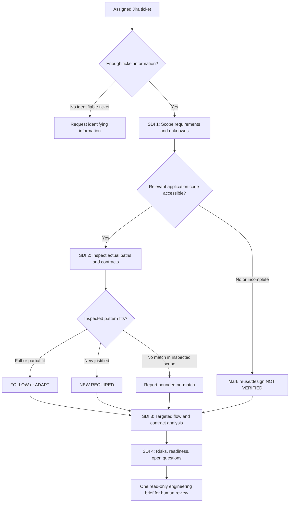

# DFRDE — Initial Engineering Review: Refine Requirements — Light

**Fresh audit-assisted prefill | November 8, 2026 | Human review required**

This is a newly generated review of the **current public skill documentation** using the updated [Audit Skill](https://github.com/rlynjb/dotskills/blob/5a758852a6dca17e97fe7fb424652bced94d00a6/skills/audit-skill/SKILL.md) and [DFRDE Engineering Review Template](https://github.com/rlynjb/dotskills/blob/5a758852a6dca17e97fe7fb424652bced94d00a6/docs/dfrde/engineering-review-template.md). It replaces the previous initial-review content; findings below are based on the inspected sources, not on the previous report.

- **Target:** [Refine Requirements — Light](https://github.com/rlynjb/dotskills/blob/5a758852a6dca17e97fe7fb424652bced94d00a6/skills/refine-requirements-light/SKILL.md); supporting [README](https://github.com/rlynjb/dotskills/blob/5a758852a6dca17e97fe7fb424652bced94d00a6/skills/refine-requirements-light/README.md)
- **Inspected source revision:** [`5a758852a6dca17e97fe7fb424652bced94d00a6`](https://github.com/rlynjb/dotskills/commit/5a758852a6dca17e97fe7fb424652bced94d00a6) (links below are pinned to this revision).
- **Scope:** Public skill instructions, README, [Claude adapter](https://github.com/rlynjb/dotskills/blob/5a758852a6dca17e97fe7fb424652bced94d00a6/adapters/claude/README.md), [Codex/OpenAI adapter](https://github.com/rlynjb/dotskills/blob/5a758852a6dca17e97fe7fb424652bced94d00a6/adapters/openai/README.md), and [repository CI configuration](https://github.com/rlynjb/dotskills/blob/5a758852a6dca17e97fe7fb424652bced94d00a6/.github/workflows/validate.yml); published [Agent Skills specification](https://agentskills.io/specification).
- **Not inspected or run:** Workplace Jira tickets, private application code, actual Claude/Codex execution, Jira integrations, host permissions, or Light-specific behavioral results.
- **Review gates:** Stage 1 **REVIEW REQUIRED**; Stage 2 **CONDITIONAL / PROPOSED**; Stage 3 **CONDITIONAL / NOT APPROVED**. Stages 4–6 **NOT STARTED**.
- **Owner:** UNASSIGNED. **Next step:** Confirm the skill's actual user/problem and whether any change is needed.

The words **documented**, **not verified**, and **proposed** are not interchangeable. A rule written in a skill does not prove that a running agent follows it or that technical permissions enforce it. Source links are included **beside findings**; there is no evidence-key table.

## Table of contents

- [Audit Skill — At a Glance](#audit-skill--at-a-glance)
- [1. Discover](#1-discover--current-state-and-problem)
- [2. Design](#2-design--conditional-options)
- [3. Contract](#3-contract--candidate-guarantees)
- [Team discussion](#team-discussion--remaining-decisions)
- [Decision log](#decision-log)
- [Next checkpoint](#next-checkpoint)

## Audit Skill — At a Glance

This is a **read-only inspection of what the skill says it should do**. It is not a test, a certification, or an approval to implement changes.

### Skill overview

- **Purpose:** Give a developer a one-pass engineering assessment of a Jira ticket against **verified existing code**, before implementation. [skill instructions](https://github.com/rlynjb/dotskills/blob/5a758852a6dca17e97fe7fb424652bced94d00a6/skills/refine-requirements-light/SKILL.md#L8-L12)
- **Inputs:** Ticket and acceptance criteria, applicable team standards, and authorized access to relevant code, contracts, or tests. If code cannot be inspected, the assessment must say so. [skill instructions](https://github.com/rlynjb/dotskills/blob/5a758852a6dca17e97fe7fb424652bced94d00a6/skills/refine-requirements-light/SKILL.md#L14-L31)
- **Workflow:** Four SDI steps—scope requirements, inspect existing patterns, examine critical data/contract paths, and summarize risks/readiness. [skill instructions](https://github.com/rlynjb/dotskills/blob/5a758852a6dca17e97fe7fb424652bced94d00a6/skills/refine-requirements-light/SKILL.md#L23-L55)
- **Outputs:** Ticket Snapshot, five prescribed report sections, evidence-backed reuse decisions, open questions, and `READY FOR REVIEW` / `CONDITIONAL` / `BLOCKED` readiness labels. [skill instructions](https://github.com/rlynjb/dotskills/blob/5a758852a6dca17e97fe7fb424652bced94d00a6/skills/refine-requirements-light/SKILL.md#L49-L69)
- **Boundaries:** The skill instructs the agent not to edit code, post to Jira, deploy, launch coding agents, or auto-approve its proposals. **Host enforcement has not been inspected.** [skill instructions](https://github.com/rlynjb/dotskills/blob/5a758852a6dca17e97fe7fb424652bced94d00a6/skills/refine-requirements-light/SKILL.md#L71-L76)
- **Cross-skill comparison:** NOT APPLICABLE; this audit has one target. The [README](https://github.com/rlynjb/dotskills/blob/5a758852a6dca17e97fe7fb424652bced94d00a6/skills/refine-requirements-light/README.md#L1-L7) describes the interactive full Refine Requirements skill as a separate companion, not an automatically invoked worker.

### Documented workflow (not an observed run)

Based on the [workflow and boundaries](https://github.com/rlynjb/dotskills/blob/5a758852a6dca17e97fe7fb424652bced94d00a6/skills/refine-requirements-light/SKILL.md#L22-L76). The flowchart depicts **written instructions**, not execution traces, worker activity, or actual Jira access.

### Ten-dimension review dashboard

**About this dashboard:** The Audit Skill checks ten areas: purpose, activation, inputs, workflow, outputs, context and trust, permissions, failure handling, evaluation evidence, and portability. It provides a quick view of **what is documented, what is missing, and what still needs verification**. These are **not ten DFRDE stages** or a score out of ten.

It is a **project-specific engineering rubric** that consolidates software engineering, AI reliability, security and trust, and lifecycle concerns. The underlying ideas also occur in frameworks such as NIST AI RMF, OWASP guidance, and the Agent Skills specification; **this exact dashboard is not an official standard or compliance certification**.

**How to read statuses:** **Documented (not tested)** means written instructions were inspected; **Needs verification** means actual behavior or protection was not checked; **Partial gap** means the writing does not cover every relevant case; **Evidence gap** means no supporting observed results were available within the inspected scope. Missing evidence is **not proof of failure**.

| Area | Finding | Meaning and direct source |
| --- | --- | --- |
| **Q-01 Purpose & boundaries** | **Documented (not tested)** | Job and no-write boundaries are explained. [skill instructions](https://github.com/rlynjb/dotskills/blob/5a758852a6dca17e97fe7fb424652bced94d00a6/skills/refine-requirements-light/SKILL.md#L8-L12); [skill instructions](https://github.com/rlynjb/dotskills/blob/5a758852a6dca17e97fe7fb424652bced94d00a6/skills/refine-requirements-light/SKILL.md#L71-L76). |
| **Q-02 Activation & discovery** | **Documented; activation not tested** | Name, description, and an invocation example exist; host selection has not been observed. [skill instructions](https://github.com/rlynjb/dotskills/blob/5a758852a6dca17e97fe7fb424652bced94d00a6/skills/refine-requirements-light/SKILL.md#L1-L4); [skill instructions](https://github.com/rlynjb/dotskills/blob/5a758852a6dca17e97fe7fb424652bced94d00a6/skills/refine-requirements-light/SKILL.md#L78-L87). |
| **Q-03 Inputs & dependencies** | **Documented; access not verified** | Ticket/code/standards requirements are described; real Jira, code, and credential access is unknown. [skill instructions](https://github.com/rlynjb/dotskills/blob/5a758852a6dca17e97fe7fb424652bced94d00a6/skills/refine-requirements-light/SKILL.md#L14-L31). |
| **Q-04 Workflow & decisions** | **Documented (not tested)** | Four ordered SDI steps and reuse decisions are specified; no executed Light run was inspected. [skill instructions](https://github.com/rlynjb/dotskills/blob/5a758852a6dca17e97fe7fb424652bced94d00a6/skills/refine-requirements-light/SKILL.md#L23-L55). |
| **Q-05 Contracts & outputs** | **Documented; machine use not verified** | Required headings and readiness labels are specified; no downstream parser or enforced output schema was checked. [skill instructions](https://github.com/rlynjb/dotskills/blob/5a758852a6dca17e97fe7fb424652bced94d00a6/skills/refine-requirements-light/SKILL.md#L49-L69). |
| **Q-06 Context & trust** | **Documented; behavior not tested** | Instructions require source citations, uncertainty labels, and treating ticket text as untrusted data. [skill instructions](https://github.com/rlynjb/dotskills/blob/5a758852a6dca17e97fe7fb424652bced94d00a6/skills/refine-requirements-light/SKILL.md#L14-L22); [skill instructions](https://github.com/rlynjb/dotskills/blob/5a758852a6dca17e97fe7fb424652bced94d00a6/skills/refine-requirements-light/SKILL.md#L71-L76). |
| **Q-07 Permissions & effects** | **Needs verification: technical restrictions** | “Read-only” is a written rule; actual host/tool write permissions were not inspected. [skill instructions](https://github.com/rlynjb/dotskills/blob/5a758852a6dca17e97fe7fb424652bced94d00a6/skills/refine-requirements-light/SKILL.md#L71-L76). |
| **Q-08 Failure & stopping** | **Partial gap: tool failures** | Missing code and unknown patterns are covered, but explicit timeout/retry/stale-source recovery is not apparent in the inspected instructions. [skill instructions](https://github.com/rlynjb/dotskills/blob/5a758852a6dca17e97fe7fb424652bced94d00a6/skills/refine-requirements-light/SKILL.md#L16-L20); [skill instructions](https://github.com/rlynjb/dotskills/blob/5a758852a6dca17e97fe7fb424652bced94d00a6/skills/refine-requirements-light/SKILL.md#L23-L76). |
| **Q-09 Evals & observability** | **Evidence gap: no Light-specific run evidence inspected** | The [CI configuration](https://github.com/rlynjb/dotskills/blob/5a758852a6dca17e97fe7fb424652bced94d00a6/.github/workflows/validate.yml#L17-L28) describes repository validators and other tests; no Light-specific execution results or traces were supplied in the [inspected skill files](https://github.com/rlynjb/dotskills/blob/5a758852a6dca17e97fe7fb424652bced94d00a6/skills/refine-requirements-light/README.md). |
| **Q-10 Lifecycle & portability** | **Needs verification: runtime equivalence** | [Claude setup](https://github.com/rlynjb/dotskills/blob/5a758852a6dca17e97fe7fb424652bced94d00a6/adapters/claude/README.md#L1-L34) and [Codex/OpenAI setup](https://github.com/rlynjb/dotskills/blob/5a758852a6dca17e97fe7fb424652bced94d00a6/adapters/openai/README.md#L1-L21) are documented; behavior across hosts has not been compared. |

**Interpretation:** The instructions provide a coherent intended workflow. This does **not** establish runtime correctness, enforced permissions, or production readiness.

### Agent Skills specification — structure only

Checked against the published [Agent Skills specification](https://agentskills.io/specification). This is a **file-format review**, not a behavioral test.

| Check | Result | Direct source or limit |
| --- | --- | --- |
| Required `SKILL.md` with YAML frontmatter | **Found in source** | [Skill entry point](https://github.com/rlynjb/dotskills/blob/5a758852a6dca17e97fe7fb424652bced94d00a6/skills/refine-requirements-light/SKILL.md#L1-L6). |
| Required `name` and `description`; folder/name match | **Found in source** | [Frontmatter](https://github.com/rlynjb/dotskills/blob/5a758852a6dca17e97fe7fb424652bced94d00a6/skills/refine-requirements-light/SKILL.md#L1-L4); folder is `refine-requirements-light`. |
| Markdown instructions after frontmatter | **Found in source** | [Skill body](https://github.com/rlynjb/dotskills/blob/5a758852a6dca17e97fe7fb424652bced94d00a6/skills/refine-requirements-light/SKILL.md#L6-L76). |
| `scripts/`, `references/`, `assets/` | **Optional under specification** | These are not mandatory for this skill; no optional-directory requirement is claimed. |
| Reference format-validator execution | **NOT RUN** | Inspection only; no `skills-ref validate` invocation or result. |

### Cross-platform compatibility

| Question | Claude Code | Codex / OpenAI |
| --- | --- | --- |
| Is a host adapter documented? | **Yes** — [setup instructions](https://github.com/rlynjb/dotskills/blob/5a758852a6dca17e97fe7fb424652bced94d00a6/adapters/claude/README.md#L1-L34) | **Yes** — [setup instructions](https://github.com/rlynjb/dotskills/blob/5a758852a6dca17e97fe7fb424652bced94d00a6/adapters/openai/README.md#L1-L21) |
| Was this specific skill activated in a host? | **NOT VERIFIED** | **NOT VERIFIED** |
| Was Jira/code access and context loading observed? | **NOT VERIFIED** | **NOT VERIFIED** |
| Were read-only technical permissions checked? | **NOT VERIFIED** | **NOT VERIFIED** |
| Is identical output/failure behavior proven? | **NOT VERIFIED** | **NOT VERIFIED** |

Documentation of installation is **not** evidence that this particular skill was loaded or behaved equivalently.

### Key gaps and open questions

- **Actual usage:** Which team members use Light, on what Jira tickets, and with what code access? The [intended context](https://github.com/rlynjb/dotskills/blob/5a758852a6dca17e97fe7fb424652bced94d00a6/skills/refine-requirements-light/SKILL.md#L8-L12) is documented, but no workplace run was inspected.
- **Permission enforcement:** The [no-write instruction](https://github.com/rlynjb/dotskills/blob/5a758852a6dca17e97fe7fb424652bced94d00a6/skills/refine-requirements-light/SKILL.md#L71-L76) exists; do the selected host and its tools actually prevent unauthorized writes?
- **Failure handling:** The skill handles [missing code and incomplete evidence](https://github.com/rlynjb/dotskills/blob/5a758852a6dca17e97fe7fb424652bced94d00a6/skills/refine-requirements-light/SKILL.md#L16-L20), but should specific tool errors/timeouts be made explicit?
- **Necessary platforms:** Are both [Claude](https://github.com/rlynjb/dotskills/blob/5a758852a6dca17e97fe7fb424652bced94d00a6/adapters/claude/README.md) and [Codex/OpenAI](https://github.com/rlynjb/dotskills/blob/5a758852a6dca17e97fe7fb424652bced94d00a6/adapters/openai/README.md) required, or only one? Neither was exercised in this review.

These are **unknowns or possible documentation improvements**, not confirmed defects. No evaluation cases are proposed or run in this audit.

---

## 1. Discover — current state and problem

**Stage:** REVIEW REQUIRED. **SDI lens:** Understand the problem and scope.

**Proposed problem statement — HUMAN CONFIRMATION REQUIRED:** Developers reviewing existing-application Jira work need a short, source-grounded assessment that separates confirmed requirements, verified code reuse, proposed changes, and unknowns before implementation. Light is written for that task, but actual user pain, adoption, and success criteria have not been established in this audit. [skill instructions](https://github.com/rlynjb/dotskills/blob/5a758852a6dca17e97fe7fb424652bced94d00a6/skills/refine-requirements-light/SKILL.md#L8-L20)

### Stage 1 questions — audit-prefilled

| ID | Question | Draft answer / unknown with source | Evidence state | Question status / next action |
| --- | --- | --- | --- | --- |
| **S1-Q01** | Who needs help and what outcome? | Intended user is a developer/coding agent needing a code-grounded ticket review. The actual business problem and desired improvement are unconfirmed. [skill instructions](https://github.com/rlynjb/dotskills/blob/5a758852a6dca17e97fe7fb424652bced94d00a6/skills/refine-requirements-light/SKILL.md#L8-L12) | DOCUMENTED intent; outcome PROPOSED | **NEEDS CONFIRMATION** — skill owner/users |
| **S1-Q02** | What exists and what was inspected? | A single-pass `SKILL.md` and [README](https://github.com/rlynjb/dotskills/blob/5a758852a6dca17e97fe7fb424652bced94d00a6/skills/refine-requirements-light/README.md#L1-L15); four SDI steps, reuse labels, output rules, and host setup guides. No application runtime inspected. [skill instructions](https://github.com/rlynjb/dotskills/blob/5a758852a6dca17e97fe7fb424652bced94d00a6/skills/refine-requirements-light/SKILL.md#L14-L76) | DOCUMENTED | **ANSWERED BY EVIDENCE** — source only |
| **S1-Q03** | What triggers it and who participates? | Intended trigger is an assigned Jira ticket; developer or host invokes skill; human reviews the brief. Exact host and owner not identified. [skill instructions](https://github.com/rlynjb/dotskills/blob/5a758852a6dca17e97fe7fb424652bced94d00a6/skills/refine-requirements-light/SKILL.md#L8-L12); [skill instructions](https://github.com/rlynjb/dotskills/blob/5a758852a6dca17e97fe7fb424652bced94d00a6/skills/refine-requirements-light/SKILL.md#L78-L87) | DOCUMENTED; host UNVERIFIED | **NEEDS CONFIRMATION** — identify host/user |
| **S1-Q04** | Inputs, outputs, dependencies? | Ticket/acceptance criteria, company standards, relevant code. Output is Ticket Snapshot + four SDI sections + open questions/readiness. [skill instructions](https://github.com/rlynjb/dotskills/blob/5a758852a6dca17e97fe7fb424652bced94d00a6/skills/refine-requirements-light/SKILL.md#L14-L31); [skill instructions](https://github.com/rlynjb/dotskills/blob/5a758852a6dca17e97fe7fb424652bced94d00a6/skills/refine-requirements-light/SKILL.md#L49-L69) | DOCUMENTED; actual access UNVERIFIED | **ANSWERED BY EVIDENCE** — intended interface |
| **S1-Q05** | Decisions, handoffs, boundaries? | Inspect code before reuse judgment (`FOLLOW` / `ADAPT` / `NEW REQUIRED` / scoped no-match / `NOT VERIFIED`); a report goes to a human, not a downstream automated consumer established here. [skill instructions](https://github.com/rlynjb/dotskills/blob/5a758852a6dca17e97fe7fb424652bced94d00a6/skills/refine-requirements-light/SKILL.md#L16-L20); [skill instructions](https://github.com/rlynjb/dotskills/blob/5a758852a6dca17e97fe7fb424652bced94d00a6/skills/refine-requirements-light/SKILL.md#L49-L76) | DOCUMENTED; consumer UNVERIFIED | **ANSWERED BY EVIDENCE** — documented decisions |
| **S1-Q06** | Safeguards, checks, observed failures? | Rules for source provenance, uncertainty and no external effects are written. [CI](https://github.com/rlynjb/dotskills/blob/5a758852a6dca17e97fe7fb424652bced94d00a6/.github/workflows/validate.yml#L17-L28) contains repo-level checks; Light-specific behavioral traces were not reviewed. [skill instructions](https://github.com/rlynjb/dotskills/blob/5a758852a6dca17e97fe7fb424652bced94d00a6/skills/refine-requirements-light/SKILL.md#L14-L20); [skill instructions](https://github.com/rlynjb/dotskills/blob/5a758852a6dca17e97fe7fb424652bced94d00a6/skills/refine-requirements-light/SKILL.md#L71-L76) | DOCUMENTED safeguards; OBSERVED RESULT unavailable | **NOT VERIFIED** — obtain existing results if any |
| **S1-Q07** | Trust, permission, runtime limits? | Ticket/source text is untrusted; skill is read-only by instruction. Effective host permissions and platform parity are unknown. [skill instructions](https://github.com/rlynjb/dotskills/blob/5a758852a6dca17e97fe7fb424652bced94d00a6/skills/refine-requirements-light/SKILL.md#L71-L76) | DOCUMENTED; enforcement UNVERIFIED | **NOT VERIFIED** — host owner to confirm |
| **S1-Q08** | Agreed FR/NFR, non-goals and measures? | The skill defines how to extract ticket FR/NFRs and avoid speculative design; no team-approved success metric or release requirement was supplied. [skill instructions](https://github.com/rlynjb/dotskills/blob/5a758852a6dca17e97fe7fb424652bced94d00a6/skills/refine-requirements-light/SKILL.md#L23-L31) | DOCUMENTED behavior; targets UNVERIFIED | **NEEDS CONFIRMATION** — agree what “good” means |
| **S1-Q09** | Can we use what already exists? | The smallest plausible path is to retain Light's present one-pass workflow unless a real need for changes is identified. [skill instructions](https://github.com/rlynjb/dotskills/blob/5a758852a6dca17e97fe7fb424652bced94d00a6/skills/refine-requirements-light/SKILL.md#L12-L20) | INFERRED / PROPOSED | **OPEN DECISION** — confirm actual gap |
| **S1-Q10** | What important evidence is missing? | Intended users/owner, representative ticket and code access, host/tool restrictions, actual outputs, and supported runtime targets. See [skill limits](https://github.com/rlynjb/dotskills/blob/5a758852a6dca17e97fe7fb424652bced94d00a6/skills/refine-requirements-light/SKILL.md#L71-L76) and [adapter setup](https://github.com/rlynjb/dotskills/blob/5a758852a6dca17e97fe7fb424652bced94d00a6/adapters/claude/README.md). | NOT VERIFIED | **NOT VERIFIED** — assign source owners |

**Current-state summary:** The only confirmed current state is the **written skill contract and repository setup documentation**. No production flow, Jira ticket, real-code integration, or execution trace was examined.

**Known constraints:** One noninteractive pass, existing-code verification before reuse, conditional results when access is missing, no code/Jira modifications, no automatic approval, and no copying proprietary data into public artifacts. [skill instructions](https://github.com/rlynjb/dotskills/blob/5a758852a6dca17e97fe7fb424652bced94d00a6/skills/refine-requirements-light/SKILL.md#L12-L20); [skill instructions](https://github.com/rlynjb/dotskills/blob/5a758852a6dca17e97fe7fb424652bced94d00a6/skills/refine-requirements-light/SKILL.md#L71-L76)

**Success criteria (proposed, not approved):** The resulting brief accurately identifies inspected sources, distinguishes known facts from assumptions, uses the required sections/readiness labels, and never implies authorization it lacks. No numerical targets or acceptance thresholds are agreed.

**Stage 1 deliverable:** Source-backed inventory and draft problem statement **PREPARED**; owner/success confirmation **OPEN**. **HUMAN REVIEW REQUIRED — Discover.**

---

## 2. Design — conditional options

**Stage:** CONDITIONAL / PROPOSED. Stage 1 scope and success criteria remain unconfirmed; **no design choice is approved**. The as-is workflow appears above.

### Stage 2 questions — audit-prefilled

| ID | Question | Draft answer / option with source | Evidence state | Question status / next action |
| --- | --- | --- | --- | --- |
| **S2-Q01** | Which approaches make sense? | **A:** Keep Light unchanged until a confirmed problem exists. **B:** Clarify only evidence/failure instructions if a specific gap matters. **C:** Consider machine-readable handoff only for a confirmed consumer. [skill instructions](https://github.com/rlynjb/dotskills/blob/5a758852a6dca17e97fe7fb424652bced94d00a6/skills/refine-requirements-light/SKILL.md#L14-L20); [skill instructions](https://github.com/rlynjb/dotskills/blob/5a758852a6dca17e97fe7fb424652bced94d00a6/skills/refine-requirements-light/SKILL.md#L49-L69) | PROPOSED options | **OPEN DECISION** — owner validates problem |
| **S2-Q02** | What existing design should be preserved? | Four SDI stages, inspect-before-reuse, concise brief, conditional `NOT VERIFIED` states, and no automatic approvals. [skill instructions](https://github.com/rlynjb/dotskills/blob/5a758852a6dca17e97fe7fb424652bced94d00a6/skills/refine-requirements-light/SKILL.md#L14-L76) | DOCUMENTED | **ANSWERED BY EVIDENCE** — preserve unless justified |
| **S2-Q03** | Who coordinates and decides? | Skill writes a report; human reviewer owns consequential design/implementation choices. No active subagent delegation is part of Light's documented contract. [skill instructions](https://github.com/rlynjb/dotskills/blob/5a758852a6dca17e97fe7fb424652bced94d00a6/skills/refine-requirements-light/SKILL.md#L49-L76) | DOCUMENTED; real host UNVERIFIED | **NEEDS CONFIRMATION** — identify reviewer/consumer |
| **S2-Q04** | What trade-offs matter? | A keeps complexity low but may leave real issues unaddressed; B adds instruction complexity; C adds schema/consumer coupling. Performance and runtime cost were not measured. [skill instructions](https://github.com/rlynjb/dotskills/blob/5a758852a6dca17e97fe7fb424652bced94d00a6/skills/refine-requirements-light/SKILL.md#L49-L69) | INFERRED / PROPOSED | **NEEDS CONFIRMATION** — choose based on actual need |
| **S2-Q05** | Which design has been approved? | None identified or authorized in inspected sources. The instruction explicitly separates recommendations from approved decisions. [skill instructions](https://github.com/rlynjb/dotskills/blob/5a758852a6dca17e97fe7fb424652bced94d00a6/skills/refine-requirements-light/SKILL.md#L71-L76) | NOT VERIFIED | **OPEN DECISION** — accountable reviewer |

### Options — NOT APPROVED

| Option | Scope | Main trade-off |
| --- | --- | --- |
| **A. Keep the skill as written** | No skill or format changes; first confirm actual usage/needs. | Least complexity; cannot claim effectiveness without observed behavior. |
| **B. Small clarification only if needed** | Explain a proven ambiguity or missing failure rule without changing the four-step workflow. | Easier to reason about; added text may not solve an operational issue. |
| **C. Structured handoff only for a real consumer** | Define a limited interface if an actual downstream program requires it. | Supports automation; adds schema, compatibility, versioning and ownership responsibilities. |

**Design outcome:** No new architecture or integration is established. Preserve the source-defined workflow while the use case is confirmed. **HUMAN REVIEW REQUIRED — Design.**

---

## 3. Contract — candidate guarantees

**Stage:** CONDITIONAL / NOT APPROVED. These are **draft expectations for discussion**, not enforced policies, an approved schema, or evaluation cases.

### Stage 3 questions — audit-prefilled

| ID | Question | Current evidence / candidate answer | Evidence state | Question status / next action |
| --- | --- | --- | --- | --- |
| **S3-Q01** | Who produces, consumes and owns it? | Light produces a human-readable brief; a developer/reviewer consumes it. Maintainer and any machine consumer not confirmed. [skill instructions](https://github.com/rlynjb/dotskills/blob/5a758852a6dca17e97fe7fb424652bced94d00a6/skills/refine-requirements-light/SKILL.md#L8-L12); [skill instructions](https://github.com/rlynjb/dotskills/blob/5a758852a6dca17e97fe7fb424652bced94d00a6/skills/refine-requirements-light/SKILL.md#L49-L69) | DOCUMENTED; ownership UNVERIFIED | **NEEDS CONFIRMATION** — name owner |
| **S3-Q02** | What does the output promise? | Ticket Snapshot, ordered four SDI sections, open questions, evidence labels, reuse decisions and readiness labels are described. Whether all appear consistently is untested. [skill instructions](https://github.com/rlynjb/dotskills/blob/5a758852a6dca17e97fe7fb424652bced94d00a6/skills/refine-requirements-light/SKILL.md#L16-L20); [skill instructions](https://github.com/rlynjb/dotskills/blob/5a758852a6dca17e97fe7fb424652bced94d00a6/skills/refine-requirements-light/SKILL.md#L49-L69) | DOCUMENTED, not tested | **ANSWERED BY EVIDENCE** — written format |
| **S3-Q03** | Who can act or write? | The instructions forbid code edits, Jira posts, migrations, deployment and coding agents; actual tool/host safeguards unknown. [skill instructions](https://github.com/rlynjb/dotskills/blob/5a758852a6dca17e97fe7fb424652bced94d00a6/skills/refine-requirements-light/SKILL.md#L71-L76) | DOCUMENTED; enforcement UNVERIFIED | **NOT VERIFIED** — check host permissions |
| **S3-Q04** | How are missing data and failures handled? | Missing code yields provisional/`NOT VERIFIED` findings; no-match is bounded; detailed timeout/retry/recovery behavior is not specified in inspected instructions. [skill instructions](https://github.com/rlynjb/dotskills/blob/5a758852a6dca17e97fe7fb424652bced94d00a6/skills/refine-requirements-light/SKILL.md#L16-L20); [skill instructions](https://github.com/rlynjb/dotskills/blob/5a758852a6dca17e97fe7fb424652bced94d00a6/skills/refine-requirements-light/SKILL.md#L49-L76) | DOCUMENTED partial coverage | **OPEN DECISION** — decide if clarification is needed |
| **S3-Q05** | What would meeting the contract mean? | High-level expectation: source-grounded output, explicit uncertainty, prescribed structure, and no unauthorized effects. No Light-specific observed results supplied; detailed evaluation cases belong to later evaluation work. [skill instructions](https://github.com/rlynjb/dotskills/blob/5a758852a6dca17e97fe7fb424652bced94d00a6/skills/refine-requirements-light/SKILL.md#L49-L76) | PROPOSED criteria; tests NOT RUN | **OPEN DECISION** — agree criteria |
| **S3-Q06** | Where does the contract live? | Existing report instructions are in [`SKILL.md`](https://github.com/rlynjb/dotskills/blob/5a758852a6dca17e97fe7fb424652bced94d00a6/skills/refine-requirements-light/SKILL.md#L49-L76) with explanatory [README](https://github.com/rlynjb/dotskills/blob/5a758852a6dca17e97fe7fb424652bced94d00a6/skills/refine-requirements-light/README.md#L9-L15). A separate machine schema is not justified yet. | DOCUMENTED current location | **NEEDS CONFIRMATION** — confirm owner/version policy |

### Existing written contract — no new interface assumed

| Boundary | Documented expectation | Source and assurance |
| --- | --- | --- |
| **Ticket → Light** | Scope FR/NFRs, actors, acceptance criteria, unknowns. | [skill instructions](https://github.com/rlynjb/dotskills/blob/5a758852a6dca17e97fe7fb424652bced94d00a6/skills/refine-requirements-light/SKILL.md#L23-L31); **documented** |
| **Application code → recommendation** | Inspect actual paths/contracts before claiming reuse; missing access remains unverified. | [skill instructions](https://github.com/rlynjb/dotskills/blob/5a758852a6dca17e97fe7fb424652bced94d00a6/skills/refine-requirements-light/SKILL.md#L16-L20); [skill instructions](https://github.com/rlynjb/dotskills/blob/5a758852a6dca17e97fe7fb424652bced94d00a6/skills/refine-requirements-light/SKILL.md#L32-L39); **documented** |
| **Light → human reviewer** | Ticket Snapshot, four sections, readiness and open questions. | [skill instructions](https://github.com/rlynjb/dotskills/blob/5a758852a6dca17e97fe7fb424652bced94d00a6/skills/refine-requirements-light/SKILL.md#L49-L69); **documented** |
| **Tool/action boundary** | No code/Jira mutation, deployment, or agent launch during assessment. | [skill instructions](https://github.com/rlynjb/dotskills/blob/5a758852a6dca17e97fe7fb424652bced94d00a6/skills/refine-requirements-light/SKILL.md#L71-L76); **instruction only, enforcement unknown** |

**Candidate minimum invariants — PROPOSED, pending human agreement:** (1) Never call a pattern verified without inspected source evidence. (2) When code access is missing, use `NOT VERIFIED` rather than inventing a path. (3) `READY FOR REVIEW` must not be interpreted as approval to implement. These follow the [documented intent](https://github.com/rlynjb/dotskills/blob/5a758852a6dca17e97fe7fb424652bced94d00a6/skills/refine-requirements-light/SKILL.md#L16-L76), not observed compliance.

**Option dependencies:** **A** retains this human-readable output. **B** may clarify ambiguous instruction or failure wording if justified. **C** would need a separately approved consumer, schema, versioning and technical authorization boundaries; none are assumed to exist.

**Stage 3 deliverable:** Current written contract and candidate expectations **PREPARED**; owners, enforcement and approvals **OPEN**. **HUMAN REVIEW REQUIRED — Contract.**

---

## Team discussion — remaining decisions

| Priority | Question | Suggested owner |
| --- | --- | --- |
| **P1** | Who uses Light now, and what real problem would changing it solve? | Skill owner / developers |
| **P1** | Which host and code/Jira access are expected, and are write restrictions technically enforced? | Host/tool owner |
| **P1** | What counts as an acceptable engineering brief, and who approves changes? | Reviewer / maintainer |
| **P2** | Must Claude and Codex behave equivalently, or is one deployment sufficient? | Platform owner |
| **P2** | Is any machine-readable downstream consumer actually needed? | Workflow owner |

No question here asks teammates to restate facts already established by the linked source documentation.

## Decision log

| ID | Pending decision | Status / owner |
| --- | --- | --- |
| **D-01** | Confirm user problem, scope, success criteria | **OPEN / UNASSIGNED** |
| **D-02** | Keep-as-is vs minimal clarification vs consumer interface | **OPEN / UNASSIGNED** |
| **D-03** | Confirm runtime support and effective write restrictions | **OPEN / UNASSIGNED** |
| **D-04** | Assign human reviewer and contract maintainer | **OPEN / UNASSIGNED** |

## Next checkpoint

**Recommended next action:** Have the skill owner confirm who uses Light, the specific problem to solve, and whether the current concise brief already suffices. Collect approved environment/source information only as needed; no target skill was executed here.

**Prepared:** Fresh static Audit Skill review, documented workflow, ten-dimension dashboard, format check, compatibility limits, **10 Stage 1 answers**, **5 Stage 2 answers**, **6 Stage 3 answers**, conditional options, written contracts and decision questions.

**Not prepared or authorized:** Behavioral evaluation cases, runtime observations, permission enforcement results, implementation changes, approved design/contract, or release.

**Review gates:** **HUMAN REVIEW REQUIRED — Discover; HUMAN REVIEW REQUIRED — Design; HUMAN REVIEW REQUIRED — Contract.**
