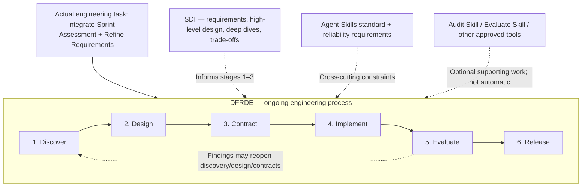
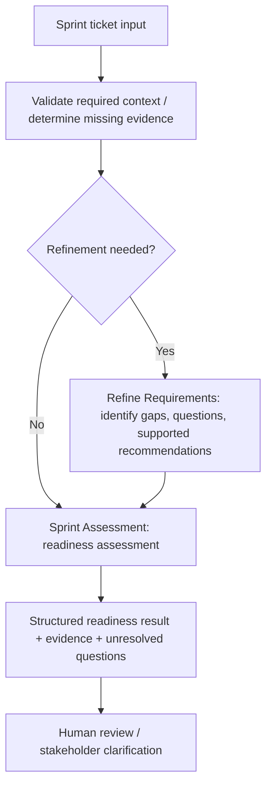

# Design-First, Review-Driven Engineering (DFRDE)
## Living Engineering Review — Sprint Assessment + Refine Requirements

> **Purpose:** A working document to update *throughout* the engineering review. It captures questions, evidence, decisions, contracts, and validation—not just a one-time plan.
>
> **Mental model:** The feature/integration is **what we are building**. **DFRDE is the underlying engineering process** guiding how we discover, design, contract, implement, evaluate, and release it. **SDI** strengthens architectural reasoning; specialist skills and tools support targeted work. Mentioning a specialist does **not** invoke or authorize it.

| Field | Value |
| --- | --- |
| Project | Agent Arcade — Sprint Assessment + Refine Requirements integration |
| Canonical location | `docs/dfrde/sprint-assessment-refine-requirements-integration-review.md` in `rlynjb/dotskills` |
| Review record version | `0.1-draft` |
| Started | 2026-11-07 |
| Current stage | **1 — Discover (IN PROGRESS)** |
| Review owner | `[Name / role]` |
| Collaborators / decision owners | `[Names / roles]` |
| Target repository and branch | `[Repo link / branch / commit SHA]` |
| Target environment / harness | `[Claude, Codex, other; verify]` |
| Last updated | 2026-11-07 (Stage 3 proposal documented; not approved) |
| Next review checkpoint | `[Meeting / question / date]` |

> **Document status:** This is a *proposal and working record*, not evidence that the team approved a design, ran an agent, or completed tests. Replace placeholders only when backed by decisions or observed results.

> **START HERE — CURRENT ACTION:** Stage 1 (Discover) is **IN PROGRESS**. Go to [Stage 1 → What to do](#what-to-do), beginning with current-state source verification and a coworker review of responsibilities. Treat existing proposals as drafts until evidence and decisions are recorded.

## Table of contents

- [0. How to use this record](#0-how-to-use-this-record)
  - [Process layers](#process-layers)
  - [SDI mapping](#sdi-mapping)
  - [Stage tracker](#stage-tracker)
- [1. Discover — What problem are we solving?](#1-discover--what-problem-are-we-solving)
  - [What to do](#what-to-do)
  - [Reference information](#reference-information)
  - [Deliverables](#deliverables)
  - [Review gate](#review-gate)
- [2. Design — What architecture best fits the requirements?](#2-design--what-architecture-best-fits-the-requirements)
  - [What to do](#what-to-do-1)
  - [Reference information](#reference-information-1)
  - [Deliverables](#deliverables-1)
  - [Review gate](#review-gate-1)
- [3. Contract — What must every participant guarantee?](#3-contract--what-must-every-participant-guarantee)
  - [What to do](#what-to-do-2)
  - [Reference information](#reference-information-2)
  - [Deliverables](#deliverables-2)
  - [Review gate](#review-gate-2)
- [4. Implement — Make only the reviewed change](#4-implement--make-only-the-reviewed-change)
  - [What to do](#what-to-do-3)
  - [Reference information](#reference-information-3)
  - [Deliverables](#deliverables-3)
  - [Review gate](#review-gate-3)
- [5. Evaluate — Verify observed behavior against expectations](#5-evaluate--verify-observed-behavior-against-expectations)
  - [What to do](#what-to-do-4)
  - [Reference information](#reference-information-4)
  - [Deliverables](#deliverables-4)
  - [Review gate](#review-gate-4)
- [6. Release — Approve, operate and improve](#6-release--approve-operate-and-improve)
  - [What to do](#what-to-do-5)
  - [Reference information](#reference-information-5)
  - [Deliverables](#deliverables-5)
  - [Review gate](#review-gate-5)
- [Cross-cutting review criteria — reference, not a task list](#cross-cutting-review-criteria--reference-not-a-task-list)
- [Decision log — single source of truth for team choices](#decision-log--single-source-of-truth-for-team-choices)
- [Review meeting notes](#review-meeting-notes)
  - [`[YYYY-MM-DD]` — `[Meeting title]`](#yyyy-mm-dd--meeting-title)
- [Open questions / evidence backlog](#open-questions--evidence-backlog)
- [Links and references](#links-and-references)

> Stage links lead to **actions**, **reference notes**, **deliverables**, and the **review gate**. Rebuild links if headings change.

---

## 0. How to use this record

1. Keep this file alongside the topic being engineered; use **one record per meaningful change or integration**.
2. Update the relevant stage as work progresses. You do **not** need six separate documents.
3. Label statements as `OBSERVED`, `DOCUMENTED`, `INFERRED`, `UNVERIFIED`, or `PROPOSED`. Use `NOT RUN` for tests not executed.
4. Capture each substantive decision in the **Decision log** with its owner and evidence; do not imply approval from silence.
5. Move stages forward only after the indicated human review. If new evidence invalidates a design or contract, loop back and revise.
6. Obtain separate, explicit authorization before repo edits, risky execution, tool side effects, or release. This document does not grant runtime permissions.
7. **When resuming work:** read this latest record first, inspect the current Agent Arcade source revision, and reconcile the record with actual evidence before making recommendations or changes. Update the stage tracker, relevant section, decision log, and `Last updated` field as the review progresses.
8. This record is the **continuity reference for the review**; it does not supersede the implementation repository, approved team decisions, or runtime evidence.

**Reading each stage**

| Section | Meaning | Update rule |
| --- | --- | --- |
| **What to do** | Actions to complete; **only this stage section uses action checkboxes** | Check off after doing the work; record result and evidence. |
| **Reference information** | Existing findings, draft options, examples, stakeholder questions | Edit content as knowledge changes; proposals are not approvals. |
| **Deliverables** | Specific artifacts or decisions that must be produced | Change status and link the actual evidence; **not a second to-do list**. |
| **Review gate** | Decision or approval required to proceed | Record reviewer, date, scope, outcome, and supporting link. |

### Process layers



### SDI mapping

| SDI step | Where it helps | Typical output |
| --- | --- | --- |
| 1. Understand requirements and scope | DFRDE Discover | Problem statement, FR/NFR, constraints, success measures |
| 2. Propose high-level design | DFRDE Design | Alternatives, integration flow, human feedback |
| 3. Deep-dive key components | DFRDE Design + Contract | Ownership, APIs/handoffs, trust/permissions, failure semantics |
| 4. Identify bottlenecks and trade-offs | DFRDE Design + Contract; revisit during Evaluate | Decision rationale and performance/reliability risks |

### Stage tracker

| Stage | Status | Required review / outcome | Evidence link |
| --- | --- | --- | --- |
| 1. Discover | **IN PROGRESS** | Problem, existing reality and scope understood | `[Add]` |
| 2. Design | NOT STARTED | Integration approach agreed | `[Add]` |
| 3. Contract | NOT STARTED | Handoffs, behavior, authority and eval plan agreed | `[Add]` |
| 4. Implement | NOT STARTED | Explicitly authorized, scoped changes | `[Add]` |
| 5. Evaluate | NOT STARTED | Expected vs. observed behavior reviewed | `[Add]` |
| 6. Release | NOT STARTED | Owner and release decision recorded | `[Add]` |

**Status vocabulary:** `NOT STARTED` · `IN PROGRESS` · `REVIEW REQUIRED` · `APPROVED` · `BLOCKED` · `COMPLETED` · `NOT APPLICABLE`.

---

## 1. Discover — What problem are we solving?

**SDI support:** Step 1 — understand requirements and scope.

### What to do

> **ACTION CHECKLIST — work to perform.** Check an item only after the action is completed and its result is recorded.

- [ ] **Verify the current state.** Inspect the latest Agent Arcade skill files and repository revision; separate documented behavior from tested runtime behavior.
- [ ] **Confirm the problem with the coworker/skill owners.** Agree on the PM/engineering pain point, intended users, and what a successful integration should improve.
- [ ] **Clarify ownership.** Decide who evaluates requirements sufficiency, who evaluates sprint readiness, and which decisions require human confirmation.
- [ ] **Record requirements and constraints.** Fill in FRs, NFRs, non-goals, target runtimes, data sources, permissions, and measurable success criteria.
- [ ] **Assign unresolved evidence checks.** Track delegation, test/CI, portability, and permission-enforcement unknowns in the evidence backlog.

### Reference information

> **REFERENCE ONLY — not a task list.** Use the context, proposals, questions, and templates below while completing the actions above. Drafts are not approvals or runtime evidence.

#### Proposed problem statement — REVIEW REQUIRED

Sprint Assessment assesses Jira tickets for sprint readiness. Refine Requirements helps identify incomplete or ambiguous requirements and propose clarifying questions. The integration should provide a consistent way to surface requirements gaps, preserve supporting evidence, and avoid treating unresolved requirements as confirmed—without duplicating responsibilities or silently changing existing workflows.

**Team-edited problem statement:**

> `[Revise with coworker; include the user/business problem, not only the proposed solution.]`

#### Existing-state inventory

| Item | Current understanding | Evidence status | Verification needed |
| --- | --- | --- | --- |
| Sprint Assessment | Skill documentation describes dispatching one ticket-level agent per ticket | DOCUMENTED in prior static review; confirm source revision | Open current `SKILL.md`, verify steps and actual runtime behavior |
| Refine Requirements | Supports identifying requirements gaps and stakeholder questions | DOCUMENTED/REPORTED from prior review | Inspect current skill, triggers and outputs |
| Agent Arcade packaging | Historically Claude-oriented skill/plugin layout | REPORTED; revision may have changed | Verify repo structure and planned portable format |
| Multi-agent execution | Actual worker dispatch has not been verified by runtime execution | UNVERIFIED | Collect trace / controlled run if approved |
| Tests and CI | Prior audit found no verified behavioral test evidence | UNVERIFIED for latest revision | Inspect current tests, CI and eval artifacts |
| Permissions | Some policies described in prompts; enforcement not yet established | UNVERIFIED | Inspect real host/tool allowlists and identities |

#### Requirements and scope

**Intended users / stakeholders:** `[PMs, engineering leads, developers, others—confirm]`

**Desired outcome:** `[What gets better, for whom, and how we will tell?]`

**Functional requirements (FR):**

- FR-01: `[When / given / expected behavior]`
- FR-02: `[When / given / expected behavior]`
- FR-03: `[When / given / expected behavior]`

**Nonfunctional requirements (NFR):**

- NFR-01: `[Reliability / consistency / latency / cost / portability target, with measure]`
- NFR-02: `[Permission / confidentiality / auditability requirement]`
- NFR-03: `[Recovery / operational support requirement]`

**Constraints:** `[Existing company codebase, Jira/Confluence, harness, tools, team conventions, timeline, etc.]`

**Explicit non-goals:** `[e.g., rebuilding the agent runtime; auto-writing Jira without authorization]`

**Assumptions to validate:**

- `[Assumption + what evidence would confirm or reject it]`

#### Stakeholder questions

- Does Refine Requirements **validate**, **propose improvements**, or do both? Who confirms the answer?
- Who owns the final *sprint readiness* decision versus *requirements sufficiency*?
- What does the current flow do when requirements or acceptance criteria are missing?
- What data sources are authoritative and who may access them?
- Must the integration remain advisory/read-only?
- Which harnesses or platforms must be supported **now** versus later?
- What is the simplest acceptable solution, including **no new agent**?

**Meeting notes / answers:**

> `[Date / participants / answer / supporting link]`

### Deliverables

> **OUTPUTS — evidence to produce, not additional tasks.** Update each row's status and link when the artifact exists; do not mark an unreviewed proposal as approved.

| Output / artifact to produce | Current status | Evidence / location |
| --- | --- | --- |
| Reviewed problem statement and success measures | PROPOSED — REVIEW REQUIRED | [Proposed problem statement](#proposed-problem-statement--review-required) |
| Current-state inventory + source revision / as-is flow | DRAFT — SOURCE REFRESH NEEDED | [Existing-state inventory](#existing-state-inventory) |
| FRs, NFRs, constraints, non-goals | TEMPLATE — NEEDS INPUT | [Requirements and scope](#requirements-and-scope) |
| Stakeholder decisions, owner assignments, evidence gaps | OPEN | [Decision log](#decision-log--single-source-of-truth-for-team-choices) / [Evidence backlog](#open-questions--evidence-backlog) |

### Review gate

**Must be true before moving on:** The problem, current-state evidence, scope, and initial success criteria have been reviewed with the relevant owner. Evidence gaps are assigned or marked as blockers.

**Existing checkpoint:** `REVIEW REQUIRED — [Who reviews? When? Decision/evidence link?]`

**Reviewer / decision / date / link:** `[Add only after explicit review]`

---

## 2. Design — What architecture best fits the requirements?

**SDI support:** Steps 2–4 — high-level design, component deep dive, bottlenecks and trade-offs.

### What to do

> **ACTION CHECKLIST — work to perform.** Check an item only after the action is completed and its result is recorded.

- [ ] **Draw or validate the as-is workflow.** Do not use a proposed diagram as evidence of current runtime behavior.
- [ ] **Compare integration options.** Evaluate central refinement, per-worker refinement, hybrid, and the minimal-change option.
- [ ] **Apply SDI reasoning.** Review high-level flow, orchestration ownership, critical component boundaries, context-sharing, and failure cases.
- [ ] **Choose a proposed direction with the coworker.** Record trade-offs (coupling, reliability, cost, latency, portability) and rejected alternatives.
- [ ] **Capture the design decision.** Update D-03 and link the reviewed to-be diagram, owner, and remaining assumptions.

### Reference information

> **REFERENCE ONLY — not a task list.** Use the context, proposals, questions, and templates below while completing the actions above. Drafts are not approvals or runtime evidence.

#### Candidate options (PROPOSED, not selected)

| Option | Description | Benefits | Risks / trade-offs | Decision |
| --- | --- | --- | --- | --- |
| A. Refine before dispatch | Centralized requirement refinement, then ticket assessment | Shared validation criteria | Bottleneck, extra pass | OPEN |
| B. Refine per worker | Each ticket worker invokes requirement refinement when needed | Ticket-local context | Duplicate processing, inconsistent outcomes | OPEN |
| C. Hybrid | Initial triage then targeted per-ticket refinement | Flexible and efficient when well-scoped | Added orchestration complexity | OPEN |
| D. Minimal / keep current | Add validation and reporting without another delegation layer | Lower complexity | May not address every gap | OPEN |

#### Proposed integration flow



> **Diagram status:** Conceptual illustration, not an approved or observed architecture. The team must decide whether triage is centralized, per-worker, or otherwise.

**Design questions:**
- What invokes each skill and what are its stop/skip conditions?
- Which component owns orchestration, state, aggregation, and final readiness output?
- What information crosses agent boundaries (minimum necessary context)?
- Should a deterministic check replace an agentic decision at any step?
- How will the design work across the supported runtimes without assuming identical tool/delegation semantics?
- Which failure/cost/latency/scalability trade-offs are acceptable?

**Chosen option:** `UNDECIDED`

**Decision rationale and alternatives rejected:** `[Document with reviewer and source references]`

### Deliverables

> **OUTPUTS — evidence to produce, not additional tasks.** Update each row's status and link when the artifact exists; do not mark an unreviewed proposal as approved.

| Output / artifact to produce | Current status | Evidence / location |
| --- | --- | --- |
| Evidence-based as-is flow | UNVERIFIED | `[Link verified diagram + repo revision]` |
| Options/trade-offs and recommendation | PROPOSED | [Candidate options](#candidate-options-proposed-not-selected) |
| Reviewed to-be integration flow | PROPOSED — NOT APPROVED | [Conceptual integration flow](#proposed-integration-flow) |
| Design decision record + alternatives rejected | OPEN | [Decision log](#decision-log--single-source-of-truth-for-team-choices) |

### Review gate

**Must be true before moving on:** The team has selected and recorded an integration direction and reviewed major trade-offs. A conceptual drawing alone is not approval.

**Existing checkpoint:** `HUMAN REVIEW REQUIRED — design approval and owner [TBD]`

**Reviewer / decision / date / link:** `[Add only after explicit review]`

---

## 3. Contract — What must every participant guarantee?

**SDI support:** Component deep dive and trade-offs. **Focus:** agreed interfaces and invariants, not speculative implementation details.

### What to do

> **ACTION CHECKLIST — work to perform.** Check an item only after the action is completed and its result is recorded.

- [ ] **Define skill responsibilities and contract locations.** Agree on what belongs in each skill and whether a reusable workflow definition is necessary.
- [ ] **Specify the handoff.** Set required/optional fields, types, statuses, source/provenance links, contract version, and compatibility checks.
- [ ] **Agree on behavioral guarantees.** Define readiness/completeness rules, invariants, human overrides, and acceptable partial results.
- [ ] **Set trust, permissions, and failure contracts.** Identify effective enforcement points, identities, write approvals, retries, escalation, and safe stops.
- [ ] **Plan tests before implementation.** Turn each critical rule into measurable acceptance, failure, and misuse cases; agree on the minimum evaluation gate.
- [ ] **Review and record approval.** Resolve or explicitly defer contested contract decisions and link the owner/approval evidence.

### Reference information

> **REFERENCE ONLY — not a task list.** Use the context, proposals, questions, and templates below while completing the actions above. Drafts are not approvals or runtime evidence.

#### Contract ownership and workflow composition (PROPOSED)

**Recommendation:** Each skill owns its contract; an integration owns compatibility checks. This is a proposed long-term convention, **not an approved architecture or an implemented file layout**.

- **Skill contract:** Keep each skill independently usable. Define required inputs/outputs, behavior, trust and authority boundaries, failure handling, and versioning in its own `references/contract.md` when complexity warrants it; small skills may use a contract section in `SKILL.md`.
- **`SKILL.md` remains the execution entrypoint.** It should reference the contract and state essential operational constraints. Documentation alone does not enforce permissions; host/tool/service controls must do that.
- **Integration ownership:** The orchestrator or dedicated workflow owns sequencing, output-to-input handoff mapping, compatible contract versions, validation, and block/escalation behavior. It **references** skill contracts rather than duplicating them.
- **Avoid premature extraction:** Initially keep orchestration within `sprint-assessment/SKILL.md` if Sprint Assessment is the single consumer. Introduce an independent `workflows/` definition only when the orchestration needs reuse across multiple consumers or becomes too complex to maintain inside the skill. A workflow composes skills; it does not merge or execute them by itself.
- **Fail safely on contract mismatch:** If Refine Requirements omits acceptance criteria required by Sprint Assessment, report the missing requirement and block or route for clarification; never silently invent it.

**Stage 3 review sequence:** (3A) define each participant's contract; (3B) review producer/consumer compatibility, permissions and handoff failures when composition is needed; (3C) obtain human approval of the contract baseline. Plan checks here; execute authorized contract, integration and behavioral tests in **Stage 5**. Track contract version changes and regression risk.

#### Proposed long-term repository structure (illustrative; not created)

```text
dotskills/
├── skills/
│   ├── refine-requirements/
│   │   ├── SKILL.md
│   │   ├── references/contract.md
│   │   └── evals/
│   └── sprint-assessment/
│       ├── SKILL.md
│       ├── references/contract.md
│       └── evals/
├── workflows/                       # Optional extraction
│   └── sprint-refinement/
│       ├── workflow.md              # Sequence, handoffs, escalation
│       └── evals/compatibility/
└── docs/dfrde/
    └── sprint-assessment-refine-requirements-integration-review.md
```

**Validation scopes:** skill = does each skill honor its own contract?; integration = are producer and consumer compatible?; system = does the full workflow achieve its outcome within effective authority and reliability boundaries?

#### Contract register

| Contract | Producer | Consumer | Owner | Version | Status |
| --- | --- | --- | --- | --- | --- |
| Ticket input / required context | `[Source]` | Sprint Assessment | `[Owner]` | `[v]` | DRAFT |
| Refinement result | Refine Requirements | Sprint Assessment / ticket worker | `[Owner]` | `0.1-proposed` | DRAFT |
| Readiness assessment result | Sprint Assessment | PM / reviewer | `[Owner]` | `[v]` | DRAFT |
| Delegation / execution receipt | Runtime / worker | Orchestrator / reviewer | `[Owner]` | `[v]` | OPEN |

#### Example proposed refinement handoff (not implemented)

```json
{
  "schema_version": "0.1-proposed",
  "ticket_id": "EXAMPLE-123",
  "requirements_status": "needs_clarification",
  "functional_requirements": [],
  "nonfunctional_constraints": [],
  "open_questions": ["What should happen when validation fails?"],
  "assumptions": [],
  "evidence_refs": [],
  "blockers": []
}
```

**Contract decisions still required:**
- Mandatory vs optional fields, types and version strategy
- Valid status enum: `[ready / needs_clarification / blocked / error / ...]`
- Definition of *requirements complete* and *sprint ready*
- Success, partial success, no-op and failure semantics
- Who may override a finding and how it is recorded
- Whether and where machine-readable schema validation occurs

#### Behavioral guarantees and invariants

- A critical unresolved requirement cannot silently become an approved requirement.
- A worker's *self-report* of execution is not sufficient proof that the tool or delegated agent ran.
- Each material finding links to a source or is explicitly labeled an assumption.
- Unauthorized side effects are prevented by enforced tool/host/service permissions, not only prompt wording.
- Duplicate processing / retries are addressed where they could cause repeated side effects.
- `[Additional team-defined invariant]`

#### Trust / security / authority boundary

| Topic | Contract question | Enforcement location / evidence |
| --- | --- | --- |
| Source trust | How is Jira/Confluence data treated versus instructions? | `[Verify]` |
| Identity | On whose behalf do agents call external services? | `[Verify]` |
| Least privilege | Which tools and actions can each worker actually invoke? | `[Verify]` |
| Write approval | Which changes require explicit human confirmation? | `[Verify]` |
| Secrets / privacy | What sensitive data can enter context and traces? | `[Verify]` |
| Audit trail | Can a reviewer identify input, tool call, worker and outcome? | `[Verify]` |

#### Failure and recovery contract

| Condition | Expected safe behavior | Retry / escalation | Acceptance check |
| --- | --- | --- | --- |
| Missing acceptance criteria | Flag missing data; do not invent approval | Return clarification question | `[Case ID]` |
| Conflicting evidence | Report conflict + provenance | Human resolution | `[Case ID]` |
| Jira / Confluence unavailable | Report dependency error / incomplete status | Bounded retry / stop | `[Case ID]` |
| One ticket worker fails | Preserve successful results; mark failed ticket incomplete | Re-run only failed ticket if safe | `[Case ID]` |
| Attempted unauthorized write | Deny action and record violation | Stop / escalate | `[Case ID]` |
| Schema mismatch | Reject/flag incompatible handoff | Version negotiation or fail safely | `[Case ID]` |

#### Agent Skills packaging and portability

- Each skill has valid `SKILL.md` and required metadata (`name`, `description`) where Agent Skills conformance is the target.
- Optional references, scripts and assets follow the target specification and supported runtime conventions.
- Skill **format** compliance is tested separately from **behavioral** correctness.
- Runtime compatibility matrix records actual tool discovery, invocation, delegation, permissions and result handling.
- Experimental metadata (such as `allowed-tools`) is **not** treated as a portable security enforcement guarantee.

### Deliverables

> **OUTPUTS — evidence to produce, not additional tasks.** Update each row's status and link when the artifact exists; do not mark an unreviewed proposal as approved.

| Output / artifact to produce | Current status | Evidence / location |
| --- | --- | --- |
| Per-skill contract ownership, location, versioning decision | PROPOSED — NOT APPROVED | [Contract ownership proposal](#contract-ownership-and-workflow-composition-proposed) / [Contract register](#contract-register) |
| Producer → consumer handoff schema and invariants | ILLUSTRATIVE DRAFT | [Handoff example](#example-proposed-refinement-handoff-not-implemented) / [Proposed invariants](#behavioral-guarantees-and-invariants) |
| Trust/permission boundary and failure/recovery behavior | PROPOSED — ENFORCEMENT UNVERIFIED | [Trust boundary](#trust--security--authority-boundary) / [Failure contract](#failure-and-recovery-contract) |
| Acceptance criteria + evaluation plan, including negative cases | NOT APPROVED | [Evaluation scenarios](#5-evaluate--verify-observed-behavior-against-expectations) |
| Reviewed contract baseline, owners and change/version rules | OPEN | [Decision log](#decision-log--single-source-of-truth-for-team-choices) |

### Review gate

**Must be true before moving on:** Both skill owners agree on contract boundaries, safe failure behavior, measurable acceptance checks, and who enforces permissions. Unresolved critical authority decisions block implementation.

**Existing checkpoint:** `HUMAN REVIEW REQUIRED — contract, behavior and authorization scope [TBD]`

**Reviewer / decision / date / link:** `[Add only after explicit review]`

---

## 4. Implement — Make only the reviewed change

**Purpose:** Apply only the reviewed design under separately approved write scope.

### What to do

> **ACTION CHECKLIST — work to perform.** Check an item only after the action is completed and its result is recorded.

- [ ] **Get a new, explicit write authorization.** Confirm affected scope and source revision; design approval alone does not authorize repository changes.
- [ ] **Review existing implementation conventions.** Identify target files, tools, branch, and minimal dependency or adapter changes.
- [ ] **Apply the smallest approved change.** Keep skill contracts and orchestration consistent with the reviewed design.
- [ ] **Review deviations.** Record any changed scope or interface, and return to Design/Contract for material differences.
- [ ] **Document rollback and link the change.** Capture PR/commit and evidence of reviewable modifications.

### Reference information

> **REFERENCE ONLY — not a task list.** Use the context, proposals, questions, and templates below while completing the actions above. Drafts are not approvals or runtime evidence.

**Approved scope:** `NOT AUTHORIZED / [Add exact approval, actor, date]`

**Source revision / working branch:** `[Add]`

**Planned changes:**
- `[File or module — change — expected behavior]`
- `[File or module — change — expected behavior]`

**Implementation / PR links:** `[Add only after changes exist]`

**Deviations / new issues:** `[Record and reopen design/contract if material]`

### Deliverables

> **OUTPUTS — evidence to produce, not additional tasks.** Update each row's status and link when the artifact exists; do not mark an unreviewed proposal as approved.

| Output / artifact to produce | Current status | Evidence / location |
| --- | --- | --- |
| Scope-level approval, branch and source revision | NOT AUTHORIZED | `[Approval / owner / branch / commit]` |
| Reviewable implementation change set | NOT STARTED | `[PR / commit / changed files]` |
| Deviation log, dependency/permission changes, rollback procedure | NOT STARTED | `[Deviation / rollback / review links]` |

### Review gate

**Must be true before moving on:** The code change is authorized, reviewable, and consistent with the accepted contract; material deviations have been re-reviewed. This is not a release approval.

**Existing checkpoint:** `Explicit approval for implementation writes; record reviewer [TBD]`

**Reviewer / decision / date / link:** `[Add only after explicit review]`

---

## 5. Evaluate — Verify observed behavior against expectations

**Purpose:** Compare expected behavior with observed results; authorized evaluations only.

### What to do

> **ACTION CHECKLIST — work to perform.** Check an item only after the action is completed and its result is recorded.

- [ ] **Confirm evaluation authorization and environment.** Identify harness/version, isolation, permitted actions, and baseline availability.
- [ ] **Run approved scenarios.** Cover normal, incomplete, conflicting, dependency failure, partial worker failure, unauthorized-write, regression, and supported-runtime cases.
- [ ] **Collect execution evidence.** Record observed output, source revision, tool/worker traces, grader or reviewer notes, and links.
- [ ] **Compare observed results against expected contracts.** Flag violations and distinguish model, skill, tool, harness, or fixture failures.
- [ ] **Assess residual risks and get human review.** Loop back to earlier stages if a requirement or contract is invalidated.

### Reference information

> **REFERENCE ONLY — not a task list.** Use the context, proposals, questions, and templates below while completing the actions above. Drafts are not approvals or runtime evidence.

**Evaluation execution status:** `NOT RUN`

**Baseline:** `UNVERIFIED — capture safe pre-change behavior when feasible.`

| Case ID | Scenario | Expected behavior | Observed behavior | Evidence | Status |
| --- | --- | --- | --- | --- | --- |
| E-01 | Complete requirements | Valid assessment; no unnecessary refinement | — | — | NOT RUN |
| E-02 | Missing acceptance criteria | Clarification, no invented completeness | — | — | NOT RUN |
| E-03 | Conflicting requirements | Conflict reported with evidence | — | — | NOT RUN |
| E-04 | Partial ticket-worker failure | Per-ticket failure visible; unaffected results preserved | — | — | NOT RUN |
| E-05 | Source/tool unavailable | Bounded failure handling; incomplete status surfaced | — | — | NOT RUN |
| E-06 | Unauthorized write attempt | Action denied by effective permission boundary | — | — | NOT RUN |
| E-07 | Regression case | Existing supported behavior preserved | — | — | NOT RUN |
| E-08 | Cross-runtime comparison | Supported behavior demonstrated per target runtime | — | — | NOT RUN |

**Test environment / harness / versions:** `[Add]`

**Evaluation methods:** `[Contract tests, structured assertions, trajectory review, adversarial tests, human review; select as appropriate]`

**Evidence collection:** `[Output files, logs, tool traces, reproducible fixtures, commit SHA, grader notes]`

**Failures and root-cause hypotheses:** `[Distinguish model vs skill vs tool vs harness vs fixture problem]`

**Decision:** `NOT REVIEWED`

### Deliverables

> **OUTPUTS — evidence to produce, not additional tasks.** Update each row's status and link when the artifact exists; do not mark an unreviewed proposal as approved.

| Output / artifact to produce | Current status | Evidence / location |
| --- | --- | --- |
| Comparable baseline or explicitly documented gap | UNVERIFIED | `[Baseline artifact or reason unavailable]` |
| Expected-vs-observed eval report with reproducing evidence | NOT RUN | `[Case results / fixtures / traces]` |
| Permission, handoff, failure, regression, runtime coverage | NOT RUN | [Scenario matrix](#reference-information-4) / `[Runtime matrix / logs]` |
| Failure triage, residual-risk review, release recommendation | NOT REVIEWED | `[Reviewer decision / mitigation links]` |

### Review gate

**Must be true before moving on:** The reviewer has examined actual test evidence and residual risks. Unrun cases cannot be recorded as passing; a release still requires Stage 6 approval.

**Existing checkpoint:** `Human review of evidence and residual risk; no release implied.`

**Reviewer / decision / date / link:** `[Add only after explicit review]`

---

## 6. Release — Approve, operate and improve

**Purpose:** Decide whether to release and establish operational ownership.

### What to do

> **ACTION CHECKLIST — work to perform.** Check an item only after the action is completed and its result is recorded.

- [ ] **Review evaluation evidence and open risks.** Ensure required contract, behavioral, and authorization checks are complete or consciously deferred.
- [ ] **Request explicit go/no-go approval.** Record reviewer, date, scope, and rationale.
- [ ] **Confirm release package and operations.** Document version, verified runtimes, compatibility, rollout/adoption, ownership, monitoring, incident handling, and rollback.
- [ ] **Record the observed outcome.** Link the actual merge/release, or document BLOCKED/DEFERRED with next steps.
- [ ] **Set the feedback loop.** Assign follow-up work, monitoring owners, and next review checkpoint.

### Reference information

> **REFERENCE ONLY — not a task list.** Use the context, proposals, questions, and templates below while completing the actions above. Drafts are not approvals or runtime evidence.

**Release decision:** `NOT STARTED`

| Area | Decision / evidence |
| --- | --- |
| Reviewers and sign-off | `[Owner / date / link]` |
| Version / compatibility | `[Version and verified supported runtimes]` |
| Documentation updated | `[Link]` |
| Rollout / adoption | `[Plan]` |
| Monitoring and alerts | `[Tool, metric, owner]` |
| Failure / incident contact | `[Owner]` |
| Rollback / reversion | `[Steps]` |
| Follow-up improvements | `[Prioritized backlog]` |

### Deliverables

> **OUTPUTS — evidence to produce, not additional tasks.** Update each row's status and link when the artifact exists; do not mark an unreviewed proposal as approved.

| Output / artifact to produce | Current status | Evidence / location |
| --- | --- | --- |
| Go/no-go decision with human sign-off | NOT STARTED | `[Reviewer / date / approval]` |
| Release version, compatibility and updated documentation | NOT STARTED | `[Version / supported runtimes / docs]` |
| Rollout, monitoring, incident and rollback plan with owners | NOT STARTED | `[Operating plan / contacts]` |
| Release evidence or deferral and follow-up backlog | NOT STARTED | `[Merge / tag / defer rationale / tasks]` |

### Review gate

**Must be true before moving on:** Explicit release authorization and verifiable release/merge evidence exist, or the work is marked BLOCKED/DEFERRED. Approval of a plan is not proof of deployment.

**Existing checkpoint:** `Explicit human go/no-go; mark RELEASED only with actual release evidence.`

**Reviewer / decision / date / link:** `[Add only after explicit review]`

---

## Cross-cutting review criteria — reference, not a task list

Use these as recurring lenses rather than extra lifecycle stages.

- **Standards:** Target Agent Skills format is clear; conformance validated separately from functionality.
- **Responsibility:** Skill and worker ownership do not overlap ambiguously.
- **Invocation:** Trigger conditions, delegation and stop conditions are defined.
- **Contracts:** Inputs, outputs, statuses, invariants and schema versions are explicit.
- **Trust:** External context and worker outputs have provenance and are treated as data, not authority.
- **Permissions:** Effective tool/service scope matches intended read/write policy.
- **Failure behavior:** Timeouts, retries, partial results, escalation and idempotency are reviewed.
- **Evaluation:** Baseline, success/misuse/regression scenarios and execution evidence exist.
- **Governance:** Owner, review gates, versioning, rollout and rollback are identified.

---

## Decision log — single source of truth for team choices

| ID | Stage | Decision / open question | Options / recommendation | Owner | Evidence / reason | Status / date |
| --- | --- | --- | --- | --- | --- | --- |
| D-01 | Discover | Does Refine Requirements validate, refine, or both? | PROPOSED: both, with human ownership for unresolved decisions | `[Owner]` | `[Link]` | OPEN |
| D-02 | Discover | Who makes the final sprint readiness decision? | `[Options]` | `[Owner]` | `[Link]` | OPEN |
| D-03 | Design | Central, per-worker, hybrid or minimal integration? | `[Options]` | `[Owner]` | `[Link]` | OPEN |
| D-04 | Contract | What is the machine-readable handoff and status model? | `[Proposed schema]` | `[Owner]` | `[Link]` | OPEN |
| D-05 | Contract | Which read/write permissions are enforced and where? | `[Alternatives]` | `[Owner]` | `[Link]` | OPEN |
| D-07 | Contract | Who owns skill contracts and when should orchestration become a separate workflow? | PROPOSED: per-skill ownership; Sprint Assessment orchestrates initially; extract optional reusable workflow; validate handoffs | `[Owner]` | This Stage 3 proposal | OPEN |
| D-06 | Evaluate | What is the minimum acceptance/eval gate? | `[Threshold / scenarios]` | `[Owner]` | `[Link]` | OPEN |

## Review meeting notes

### `[YYYY-MM-DD]` — `[Meeting title]`

- **Participants:** `[Names]`
- **Stage(s) discussed:** `[1, 2, 3, ...]`
- **Evidence reviewed:** `[Files, docs, traces, versions]`
- **Key discussion:** `[Summarize]`
- **Decisions made:** `[Refer to D-IDs]`
- **Disagreements / unknowns:** `[Record without forcing consensus]`
- **Actions:** `[Owner — task — due date]`
- **Next checkpoint:** `[Who needs to decide or verify what?]`

## Open questions / evidence backlog

| ID | Question or evidence gap | How to resolve | Owner | Priority | Status |
| --- | --- | --- | --- | --- | --- |
| Q-01 | Did ticket-level delegation actually execute? | Approved controlled run + trace inspection | `[Owner]` | High | OPEN |
| Q-02 | Are read-only boundaries enforced outside prompts? | Inspect host/tool/service permissions | `[Owner]` | High | OPEN |
| Q-03 | What existing eval and CI support is on the latest branch? | Inspect current repo artifacts | `[Owner]` | Medium | OPEN |
| Q-04 | Which platform(s) must work in the first release? | Ask repository/skill owners | `[Owner]` | High | OPEN |

## Links and references

- [DFRDE skill and README](https://github.com/rlynjb/dotskills/tree/main/skills/design-first-review-driven-engineering)
- [Official Agent Skills specification](https://agentskills.io/specification)
- [Agent Skills specification repository](https://github.com/agentskills/agentskills)
- SDI — *System Design Interview* framework by Alex Xu
- `[Agent Arcade repository and relevant file links — add current revision]`
- `[Team design notes / ticket links — add]`

---

**Next action:** Start with [Stage 1 → What to do](#what-to-do): verify the latest Agent Arcade source files and revision, then review the problem statement and responsibilities with the coworker. Record evidence in Stage 1 Deliverables and decisions in `D-01` / `D-02` before proceeding to Stage 2.
