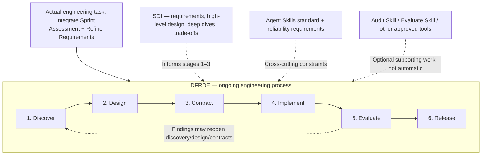
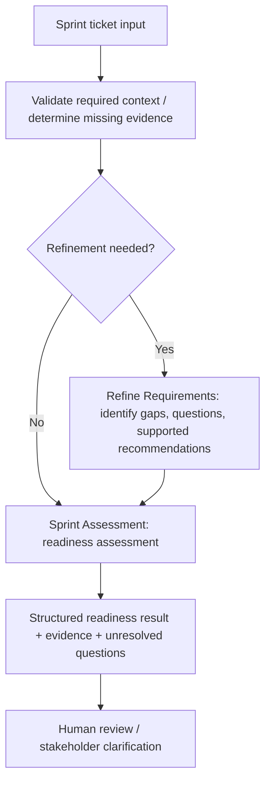

# Design-First, Review-Driven Engineering (DFRDE)
## Living Engineering Review — Sprint Assessment + Refine Requirements

> **Purpose:** A working document to update *throughout* the engineering review. It captures questions, evidence, decisions, contracts, and validation—not just a one-time plan.
>
> **Mental model:** The feature/integration is **what we are building**. **DFRDE is the underlying engineering process** guiding how we discover, design, contract, implement, evaluate, and release it. **SDI** strengthens architectural reasoning; specialist skills and tools support targeted work. Mentioning a specialist does **not** invoke or authorize it.

| Field | Value |
| --- | --- |
| Project | Agent Arcade — Sprint Assessment + Refine Requirements integration |
| Canonical location | `docs/dfrde/sprint-assessment-refine-requirements-integration-review.md` in `rlynjb/dotskills` |
| Review record version | `0.2-draft` (guide reorganization, no new team approvals) |
| Started | 2026-11-07 |
| Current stage | **1 — Discover (IN PROGRESS)** |
| Review owner | `[Name / role]` |
| Collaborators / decision owners | `[Names / roles]` |
| Target repository and branch | `[Repo link / branch / commit SHA]` |
| Target environment / harness | `[Claude, Codex, other; verify]` |
| Last updated | 2026-11-08 (beginner learning guide and standards reference added; architecture/contracts not approved) |
| Next review checkpoint | `[Meeting / question / date]` |

> **Document status:** This is a *proposal and working record*, not evidence that the team approved a design, ran an agent, or completed tests. Replace placeholders only when backed by decisions or observed results.

> **START HERE — CURRENT ACTION:** Stage 1 (Discover) is **IN PROGRESS**. Go to [Stage 1 → What to do](#what-to-do), beginning with current-state source verification and a coworker review of responsibilities. Treat existing proposals as drafts until evidence and decisions are recorded.

## Table of contents

- [0. How to use this record](#0-how-to-use-this-record)
  - [Beginner quick start — before, during and after a team review](#beginner-quick-start--before-during-and-after-a-team-review)
  - [Terminology — read this once](#terminology--read-this-once)
  - [Process layers](#process-layers)
  - [SDI mapping](#sdi-mapping)
  - [Stage tracker](#stage-tracker)
- [1. Discover — What problem are we solving?](#1-discover--what-problem-are-we-solving)
  - [What to do](#what-to-do)
  - [Guided walkthrough — how to complete the actions](#guided-walkthrough--how-to-complete-the-actions)
  - [Questions for your teammate](#questions-for-your-teammate)
  - [Deliverables](#deliverables)
  - [Review gate](#review-gate)
- [2. Design — What architecture best fits the requirements?](#2-design--what-architecture-best-fits-the-requirements)
  - [What to do](#what-to-do-1)
  - [Guided walkthrough — how to complete the actions](#guided-walkthrough--how-to-complete-the-actions-1)
  - [Questions for your teammate](#questions-for-your-teammate-1)
  - [Deliverables](#deliverables-1)
  - [Review gate](#review-gate-1)
- [3. Contract — What must every participant guarantee?](#3-contract--what-must-every-participant-guarantee)
  - [What to do](#what-to-do-2)
  - [Guided walkthrough — how to complete the actions](#guided-walkthrough--how-to-complete-the-actions-2)
  - [Questions for your teammate](#questions-for-your-teammate-2)
  - [Deliverables](#deliverables-2)
  - [Review gate](#review-gate-2)
- [4. Implement — Make only the reviewed change](#4-implement--make-only-the-reviewed-change)
  - [What to do](#what-to-do-3)
  - [Guided walkthrough — how to complete the actions](#guided-walkthrough--how-to-complete-the-actions-3)
  - [Questions for your teammate](#questions-for-your-teammate-3)
  - [Deliverables](#deliverables-3)
  - [Review gate](#review-gate-3)
- [5. Evaluate — Verify observed behavior against expectations](#5-evaluate--verify-observed-behavior-against-expectations)
  - [What to do](#what-to-do-4)
  - [Guided walkthrough — how to complete the actions](#guided-walkthrough--how-to-complete-the-actions-4)
  - [Questions for your teammate](#questions-for-your-teammate-4)
  - [Deliverables](#deliverables-4)
  - [Review gate](#review-gate-4)
- [6. Release — Approve, operate and improve](#6-release--approve-operate-and-improve)
  - [What to do](#what-to-do-5)
  - [Guided walkthrough — how to complete the actions](#guided-walkthrough--how-to-complete-the-actions-5)
  - [Questions for your teammate](#questions-for-your-teammate-5)
  - [Deliverables](#deliverables-5)
  - [Review gate](#review-gate-5)
- [Standards and Team Discussion Guide — reference library](#standards-and-team-discussion-guide--reference-library)
  - [What the Agent Skills standard does—and does not do](#what-the-agent-skills-standard-doesand-does-not-do)
  - [Skill vs worker vs workflow — decide before adding new files](#skill-vs-worker-vs-workflow--decide-before-adding-new-files)
  - [Five behavioral checks — from the Agent Skills conference discussion](#five-behavioral-checks--from-the-agent-skills-conference-discussion)
  - [Eight areas to discuss with the team](#eight-areas-to-discuss-with-the-team)
  - [Nine things a well-engineered skill should make reviewable](#nine-things-a-well-engineered-skill-should-make-reviewable)
  - [Practical compatibility matrix — fill with evidence, not assumptions](#practical-compatibility-matrix--fill-with-evidence-not-assumptions)
  - [Conference sessions to revisit by stage](#conference-sessions-to-revisit-by-stage)
- [Cross-cutting review criteria — reference, not a task list](#cross-cutting-review-criteria--reference-not-a-task-list)
- [Decision log — single source of truth for team choices](#decision-log--single-source-of-truth-for-team-choices)
- [Review meeting notes](#review-meeting-notes)
- [Open questions / evidence backlog](#open-questions--evidence-backlog)
- [Links and references](#links-and-references)

> Start with [Beginner quick start](#beginner-quick-start--before-during-and-after-a-team-review), then open the current stage's **What to do**, **Guided walkthrough**, **Questions for your teammate**, **Deliverables**, and **Review gate**. The standards and conference material lives in a separate reference library.

---

## 0. How to use this record

1. Keep this file alongside the topic being engineered; use **one record per meaningful change or integration**.
2. Update the relevant stage as work progresses. You do **not** need six separate documents.
3. Label statements as `OBSERVED`, `DOCUMENTED`, `INFERRED`, `UNVERIFIED`, or `PROPOSED`. Use `NOT RUN` for tests not executed.
4. Capture each substantive decision in the **Decision log** with its owner and evidence; do not imply approval from silence.
5. Move stages forward only after the indicated human review. If new evidence invalidates a design or contract, loop back and revise.
6. Obtain separate, explicit authorization before repo edits, risky execution, tool side effects, or release. This document does not grant runtime permissions.
7. **When resuming work:** read this latest record first, inspect the current Agent Arcade source revision, and reconcile the record with actual evidence before making recommendations or changes. Update the stage tracker, relevant section, decision log, and `Last updated` field as the review progresses.
8. This record is the **continuity reference for the review**; it does not supersede the implementation repository, approved team decisions, or runtime evidence.

**Reading each stage**

| Section | Meaning | Update rule |
| --- | --- | --- |
| **What to do** | Actions to complete; **only this stage section uses action checkboxes** | Check off after doing the work; record result and evidence. |
| **Reference information** | Existing findings, draft options, examples, stakeholder questions | Edit content as knowledge changes; proposals are not approvals. |
| **Deliverables** | Specific artifacts or decisions that must be produced | Change status and link the actual evidence; **not a second to-do list**. |
| **Review gate** | Decision or approval required to proceed | Record reviewer, date, scope, outcome, and supporting link. |

### Beginner quick start — before, during and after a team review

**Use this as a working conversation guide, not an exam or a six-stage meeting agenda.** A stage can take more than one meeting; some actions happen alone before talking to your teammate.

| When | Your job | Example |
| --- | --- | --- |
| **Before the meeting** | Read **Learn** and the **Guided walkthrough** for your current stage. Inspect any available approved source evidence. Bring one real scenario and 2–3 priority questions. | Verify what the current Sprint Assessment skill **documents** about ticket dispatch; don't claim a runtime trace exists. |
| **During the meeting** | Open **Questions for your teammate**, compare alternatives, and ask who owns the decision. Agree on requirements or explicitly leave an OPEN item. | “Should incomplete requirements become questions or a blocked readiness result?” |
| **After the meeting** | Write the answer with date/owner in **Decision log**, update any evidence links in **Deliverables**, and only advance at the **Review gate**. | Record D-01 and D-02 as OPEN or APPROVED with a meeting reference. |

**Evidence vocabulary:** `OBSERVED` = actually inspected/executed with source or trace; `DOCUMENTED` = file says so; `INFERRED` = reasoned from partial evidence; `UNVERIFIED` = not yet checked; `PROPOSED` = suggested future behavior; `NOT RUN` = test not executed. A completed checklist item is not proof of a runtime test.

**A practical first 30-minute conversation** (not a requirement to approve all three stages):

| Minutes | Focus | Your question |
| --- | --- | --- |
| 0–5 | Current behavior and problem (Discover) | What gap are we actually solving? |
| 5–15 | Options and responsibilities (Design) | Where should validation/refinement live? |
| 15–25 | Preview of handoff, permissions and failures (Contract) | What must each skill guarantee and who enforces access? |
| 25–30 | Open decisions, owner and next evidence | What do we agree on, and what stays OPEN? |

**Four decisions to carry through the process:** refinement placement (**D-03**), readiness/handoff contract (**D-04**), enforceable tool permissions (**D-05**), and the minimum evaluation gate (**D-06**). Don't make any of these on behalf of your teammate.

**Confidentiality:** This review lives in a personal GitHub repository; don't paste proprietary Jira descriptions, internal code, credentials, private security findings or sensitive logs into a public document. Use approved redacted examples and access-controlled source links.

### Terminology — read this once

| Term | Plain-English meaning |
| --- | --- |
| **DFRDE** | The underlying engineering method: discover → design → contract → implement → evaluate → release, with human review. |
| **SDI** | A way to reason about requirements and architecture within DFRDE, especially Stages 1–3. |
| **Skill** | Reusable instructions/resources for a task; a `SKILL.md` alone isn't a running background process. |
| **Agent / ticket worker** | A runtime-executed worker that may reason and call tools. A per-ticket worker may be different from a reusable declared agent file. |
| **Workflow / orchestrator** | Sequence, delegation, aggregation and error handling between participants. A workflow description alone doesn't execute anything. |
| **Harness / runtime** | The system that loads skills, runs agents, provides tools, manages context and enforces actual permissions. |
| **Contract / invariant** | Agreed inputs/outputs and behavior / a rule that must hold even on error paths. |
| **Evaluation / receipt** | Test of expected vs observed behavior / trace or record of what actually ran. |

### Process layers



### SDI mapping

| SDI step | Where it helps | Typical output |
| --- | --- | --- |
| 1. Understand requirements and scope | DFRDE Discover | Problem statement, FR/NFR, constraints, success measures |
| 2. Propose high-level design | DFRDE Design | Alternatives, integration flow, human feedback |
| 3. Deep-dive key components | DFRDE Design + Contract | Ownership, APIs/handoffs, trust/permissions, failure semantics |
| 4. Identify bottlenecks and trade-offs | DFRDE Design + Contract; revisit during Evaluate | Decision rationale and performance/reliability risks |

#### Using SDI during DFRDE

Use SDI as a **reasoning aid within DFRDE**, not a separate required lifecycle:

- **Stage 1 — Discover (SDI Step 1):** Clarify the problem, functional/nonfunctional requirements, scope and constraints. For existing systems, verify the current architecture before making design assumptions.
- **Stage 2 — Design (SDI Steps 2–4; primary SDI stage):** Sketch the high-level integration, deep-dive into critical components, compare alternatives and trade-offs, then ask the team to choose a direction. For this integration, decide who orchestrates the skills and whether a separate workflow is justified.
- **Stage 3 — Contract (informed by SDI Steps 3–4):** Translate the reviewed design into concrete inputs, outputs, ownership, permissions, failure behavior and measurable acceptance criteria. Reopen Stage 2 if contract details expose an architectural problem.
- **Stages 4–6 — Implement, Evaluate, Release:** Follow DFRDE's implementation, evidence and approval gates. Revisit SDI reasoning only if new evidence challenges the design.

**Keep it proportional:** A small change may need only a brief architecture check; use the full SDI walkthrough for meaningful architecture or integration decisions. **SDI shapes the design; DFRDE carries it through implementation, verification and release.**

### Stage tracker

| Stage | Status | Required review / outcome | Evidence link |
| --- | --- | --- | --- |
| 1. Discover | **IN PROGRESS** | Problem, existing reality and scope understood | `[Add]` |
| 2. Design | NOT STARTED | Integration approach agreed | `[Add]` |
| 3. Contract | NOT STARTED | Handoffs, behavior, authority and eval plan agreed | `[Add]` |
| 4. Implement | NOT STARTED | Explicitly authorized, scoped changes | `[Add]` |
| 5. Evaluate | NOT STARTED | Expected vs. observed behavior reviewed | `[Add]` |
| 6. Release | NOT STARTED | Owner and release decision recorded | `[Add]` |

**Status vocabulary:** `NOT STARTED` · `IN PROGRESS` · `REVIEW REQUIRED` · `APPROVED` · `BLOCKED` · `COMPLETED` · `NOT APPLICABLE`.

---

## 1. Discover — What problem are we solving?

**SDI support:** Step 1 — understand requirements and scope.

**Learn — why this stage exists:** Discovery means understanding the *problem and current behavior* before designing a fix. Reading a skill instruction tells us what is documented, not whether the runtime executed it. **Example:** a ticket lacks acceptance criteria; first find out what Sprint Assessment currently does, and what the team wants to happen.

**Watch out for:** mistaking our proposed integration for an approved requirement, or treating an agent's self-description as observed behavior.

### What to do

> **ACTION CHECKLIST — work to perform.** Check an item only after the action is completed and its result is recorded.

- [ ] **Step 1 — Verify the current state.** Inspect the latest Agent Arcade skill files and repository revision; separate documented behavior from tested runtime behavior.
- [ ] **Step 2 — Confirm the problem with the coworker/skill owners.** Agree on the PM/engineering pain point, intended users, and what a successful integration should improve.
- [ ] **Step 3 — Clarify ownership.** Decide who evaluates requirements sufficiency, who evaluates sprint readiness, and which decisions require human confirmation.
- [ ] **Step 4 — Record requirements and constraints.** Fill in FRs, NFRs, non-goals, target runtimes, data sources, permissions, and measurable success criteria.
- [ ] **Step 5 — Assign unresolved evidence checks.** Track delegation, test/CI, portability, and permission-enforcement unknowns in the evidence backlog.

### Guided walkthrough — how to complete the actions

The checkboxes above are the actual tasks; use this explanation to learn how to perform them. Record evidence rather than checking boxes because an answer sounds plausible.

| Step | How to do it | Where to record it |
| --- | --- | --- |
| **1** | Open the current repo revision; inspect Sprint Assessment and Refine Requirements `SKILL.md`, references, agent definitions, and tool/manifest configuration. Trace input → processing → worker delegation → output. Quote paths and mark untested paths UNVERIFIED. | Current-state inventory, Q-01/Q-03 |
| **2** | Ask for one real ticket that was hard to assess. Describe the PM/engineering pain point and how a better outcome would be recognized before suggesting a solution. | Team-edited problem statement |
| **3** | Use a responsibility table: requirement gaps/questions vs readiness, sizing, aggregation and human decisions. Identify ambiguous or overlapping ownership. | D-01, D-02 |
| **4** | Write 2–3 FR scenarios with Given/When/Then and measurable NFRs for safety, evidence, portability and performance where applicable. Include non-goals. | Requirements and scope |
| **5** | For each unknown, note evidence needed, who can verify it, and whether it blocks the next stage; do not run unapproved side-effectful tests. | Evidence backlog |

### Questions for your teammate

> **Suggested opening:** “Before deciding how these skills call each other, could we agree on the problem, the current behavior, and which team member owns each decision?”

| # | Ask this | Record the answer in |
| --- | --- | --- |
| 1 | What concrete problem are PMs/developers experiencing during sprint assessment? | Real ticket example; desired outcome and success measure |
| 2 | Does Refine Requirements validate, propose changes, or both? Who decides unresolved requirements? | D-01, decision owner |
| 3 | Who makes the final sprint readiness call? | D-02 and clear responsibility boundaries |
| 4 | Which Jira/Confluence data can we trust as evidence, and are actions read-only? | Data sources and actual permission constraints |
| 5 | Which runtimes matter now, and are we adopting the Agent Skills format as the baseline? | Target compatibility and standardization decision |
| 6 | Could the problem be solved with a simple deterministic check instead of another agent? | Simplest acceptable option / non-goals |

**Discussion results:** `[Meeting date / attendees / decisions (D-IDs) / evidence / outstanding questions / owner]`

### Reference information

> **REFERENCE ONLY — not a task list.** Use the context, proposals, questions, and templates below while completing the actions above. Drafts are not approvals or runtime evidence.

#### Proposed problem statement — REVIEW REQUIRED

Sprint Assessment assesses Jira tickets for sprint readiness. Refine Requirements helps identify incomplete or ambiguous requirements and propose clarifying questions. The integration should provide a consistent way to surface requirements gaps, preserve supporting evidence, and avoid treating unresolved requirements as confirmed—without duplicating responsibilities or silently changing existing workflows.

**Team-edited problem statement:**

> `[Revise with coworker; include the user/business problem, not only the proposed solution.]`

#### Existing-state inventory

| Item | Current understanding | Evidence status | Verification needed |
| --- | --- | --- | --- |
| Sprint Assessment | Skill documentation describes dispatching one ticket-level agent per ticket | DOCUMENTED in prior static review; confirm source revision | Open current `SKILL.md`, verify steps and actual runtime behavior |
| Refine Requirements | Supports identifying requirements gaps and stakeholder questions | DOCUMENTED/REPORTED from prior review | Inspect current skill, triggers and outputs |
| Agent Arcade packaging | Historically Claude-oriented skill/plugin layout | REPORTED; revision may have changed | Verify repo structure and planned portable format |
| Multi-agent execution | Actual worker dispatch has not been verified by runtime execution | UNVERIFIED | Collect trace / controlled run if approved |
| Tests and CI | Prior audit found no verified behavioral test evidence | UNVERIFIED for latest revision | Inspect current tests, CI and eval artifacts |
| Permissions | Some policies described in prompts; enforcement not yet established | UNVERIFIED | Inspect real host/tool allowlists and identities |

#### Requirements and scope

**Intended users / stakeholders:** `[PMs, engineering leads, developers, others—confirm]`

**Desired outcome:** `[What gets better, for whom, and how we will tell?]`

**Functional requirements (FR):**

- FR-01: `[When / given / expected behavior]`
- FR-02: `[When / given / expected behavior]`
- FR-03: `[When / given / expected behavior]`

**Nonfunctional requirements (NFR):**

- NFR-01: `[Reliability / consistency / latency / cost / portability target, with measure]`
- NFR-02: `[Permission / confidentiality / auditability requirement]`
- NFR-03: `[Recovery / operational support requirement]`

**Constraints:** `[Existing company codebase, Jira/Confluence, harness, tools, team conventions, timeline, etc.]`

**Explicit non-goals:** `[e.g., rebuilding the agent runtime; auto-writing Jira without authorization]`

**Assumptions to validate:**

- `[Assumption + what evidence would confirm or reject it]`

### Deliverables

> **OUTPUTS — evidence to produce, not additional tasks.** Update each row's status and link when the artifact exists; do not mark an unreviewed proposal as approved.

| Output / artifact to produce | Current status | Evidence / location |
| --- | --- | --- |
| Reviewed problem statement and success measures | PROPOSED — REVIEW REQUIRED | [Proposed problem statement](#proposed-problem-statement--review-required) |
| Current-state inventory + source revision / as-is flow | DRAFT — SOURCE REFRESH NEEDED | [Existing-state inventory](#existing-state-inventory) |
| FRs, NFRs, constraints, non-goals | TEMPLATE — NEEDS INPUT | [Requirements and scope](#requirements-and-scope) |
| Stakeholder decisions, owner assignments, evidence gaps | OPEN | [Decision log](#decision-log--single-source-of-truth-for-team-choices) / [Evidence backlog](#open-questions--evidence-backlog) |

### Review gate

**Must be true before moving on:** The problem, current-state evidence, scope, and initial success criteria have been reviewed with the relevant owner. Evidence gaps are assigned or marked as blockers.

**Existing checkpoint:** `REVIEW REQUIRED — [Who reviews? When? Decision/evidence link?]`

**Reviewer / decision / date / link:** `[Add only after explicit review]`

---

## 2. Design — What architecture best fits the requirements?

**SDI support:** Steps 2–4 — high-level design, component deep dive, bottlenecks and trade-offs.

**Learn — why this stage exists:** Design is about comparing realistic ways to meet the Stage 1 requirements. Use **SDI Step 2** for a high-level architecture and buy-in, then **Steps 3–4** to deep-dive critical components, risks and trade-offs. **Example:** refining once before ticket dispatch is different from refining within each worker.

**Watch out for:** introducing new agent/workflow files simply because extra layers look more architecturally sophisticated.

### What to do

> **ACTION CHECKLIST — work to perform.** Check an item only after the action is completed and its result is recorded.

- [ ] **Step 1 — Draw or validate the as-is workflow.** Do not use a proposed diagram as evidence of current runtime behavior.
- [ ] **Step 2 — Compare integration options.** Evaluate central refinement, per-worker refinement, hybrid, and the minimal-change option.
- [ ] **Step 3 — Apply SDI reasoning.** Review high-level flow, orchestration ownership, critical component boundaries, context-sharing, and failure cases.
- [ ] **Step 4 — Review the modular architecture.** Discuss independent skill ownership, who orchestrates today, and whether a separate workflow is actually justified.
- [ ] **Step 5 — Choose a proposed direction with the coworker.** Record trade-offs (coupling, reliability, cost, latency, portability) and rejected alternatives.
- [ ] **Step 6 — Capture the design decision.** Update D-03 and link the reviewed to-be diagram, owner, and remaining assumptions.

### Guided walkthrough — how to complete the actions

The checkboxes above are the actual tasks; use this explanation to learn how to perform them. Record evidence rather than checking boxes because an answer sounds plausible.

| Step | How to do it | Where to record it |
| --- | --- | --- |
| **1** | Use Stage 1's verified source paths to draw an **as-is** flow. Separate declared plugin agents from ad hoc per-ticket workers; runtime execution remains UNVERIFIED without traces. | Verified as-is diagram |
| **2** | Compare central, per-worker, hybrid and minimal/no-new-agent designs against consistency, duplicated work, latency/cost, failure isolation and complexity. | Candidate options table |
| **3** | Draw a **to-be** diagram with entrypoint, source data, trigger, skill invocation, worker boundaries, handoff, aggregator, result and human review. Label as PROPOSED. | Proposed integration flow |
| **4** | Distinguish the **skill** (task instructions), **agent/worker** (runtime executor), **workflow** (sequencing), and **harness** (actual tool/permission execution). Decide where orchestration currently belongs. | D-03 and D-07 |
| **5** | Walk through missing requirements, failed worker, duplicate retry, stale/conflicting context, cross-platform tool mismatch and unauthorized actions. Record trade-offs and mitigations. | Design trade-offs and Stage 3 inputs |
| **6** | Show your teammate the simplest adequate design and an alternative. Record approval, rejection or OPEN with reviewer and rationale—do not infer buy-in. | Design decision and review gate |

### Questions for your teammate

> **Suggested opening:** “Here are the integration options and the current skill boundaries. Which approach gives us the clearest ownership with the least unnecessary complexity?”

| # | Ask this | Record the answer in |
| --- | --- | --- |
| 1 | Where should refinement run: before batch dispatch, within each worker, only as needed, or not at all? | D-03 and rationale |
| 2 | Who owns orchestration, aggregation, state and final readiness output? | Owner for each component and state |
| 3 | Must each skill work independently? What would justify extracting a `workflows/` definition? | D-07 and extraction criteria |
| 4 | Which checks can be deterministic instead of agent decisions? | Simplification opportunities |
| 5 | What minimum context crosses agent boundaries, and what trace proves dispatch? | Handoff and execution evidence needs |
| 6 | How do we handle runtime-specific tools, permissions and delegation without pretending portability? | Compatibility and adapter strategy |

**Discussion results:** `[Meeting date / attendees / decisions (D-IDs) / evidence / outstanding questions / owner]`

### Reference information

> **REFERENCE ONLY — not a task list.** Use the context, proposals, questions, and templates below while completing the actions above. Drafts are not approvals or runtime evidence.

#### Candidate options (PROPOSED, not selected)

| Option | Description | Benefits | Risks / trade-offs | Decision |
| --- | --- | --- | --- | --- |
| A. Refine before dispatch | Centralized requirement refinement, then ticket assessment | Shared validation criteria | Bottleneck, extra pass | OPEN |
| B. Refine per worker | Each ticket worker invokes requirement refinement when needed | Ticket-local context | Duplicate processing, inconsistent outcomes | OPEN |
| C. Hybrid | Initial triage then targeted per-ticket refinement | Flexible and efficient when well-scoped | Added orchestration complexity | OPEN |
| D. Minimal / keep current | Add validation and reporting without another delegation layer | Lower complexity | May not address every gap | OPEN |

#### Proposed integration flow



> **Diagram status:** Conceptual illustration, not an approved or observed architecture. The team must decide whether triage is centralized, per-worker, or otherwise.

#### Proposed modular architecture (PROPOSED)

**Design direction for team review, not an approved decision:** Keep Refine Requirements and Sprint Assessment independently reusable, with each skill owning its capability and contract. For now, prefer Sprint Assessment as the integration's orchestration owner; extract a separate workflow only if coordination becomes independently reusable or too complex for the skill.

- **Skill:** Owns its behavior and interface. A short contract may live in `SKILL.md`; complex contracts may be kept in `references/contract.md` and referenced by `SKILL.md`.
- **Orchestration:** Owns sequencing, handoffs, and escalation between skills. A separate `workflows/` directory is **optional**, not a prerequisite; composition does not merge skills, and a workflow document alone does not execute anything.
- **Trade-offs:** Skill independence supports extension and reuse, but adds interface maintenance, compatibility checks, and the risk of duplicate orchestration. Avoid introducing directories or abstraction layers without a concrete need.


#### Proposed long-term repository structure (illustrative; not created)

For an easy-to-follow example of **where `SKILL.md`, skill contracts, optional workflow definitions and evals belong**, see [Skill vs worker vs workflow — decide before adding new files](#skill-vs-worker-vs-workflow--decide-before-adding-new-files).

**Important:** Agent Arcade's actual repository structure and platform-specific agents/adapters still require source verification. The diagrams are **PROPOSED**, not new files, and the living DFRDE review belongs separately in `dotskills/docs/dfrde/`. Stage 4 should only edit paths selected in a reviewed design.

**Chosen option:** `UNDECIDED`

**Decision rationale and alternatives rejected:** `[Document with reviewer and source references]`

### Deliverables

> **OUTPUTS — evidence to produce, not additional tasks.** Update each row's status and link when the artifact exists; do not mark an unreviewed proposal as approved.

| Output / artifact to produce | Current status | Evidence / location |
| --- | --- | --- |
| Evidence-based as-is flow | UNVERIFIED | `[Link verified diagram + repo revision]` |
| Options/trade-offs and recommendation | PROPOSED | [Candidate options](#candidate-options-proposed-not-selected) |
| Reviewed to-be integration flow | PROPOSED — NOT APPROVED | [Conceptual integration flow](#proposed-integration-flow) |
| Modular architecture and workflow-extraction decision | PROPOSED — NOT APPROVED | [Architecture proposal](#proposed-modular-architecture-proposed) / [Reference layout](#proposed-long-term-repository-structure-illustrative-not-created) |
| Design decision record + alternatives rejected | OPEN | [Decision log](#decision-log--single-source-of-truth-for-team-choices) |

### Review gate

**Must be true before moving on:** The team has selected and recorded the integration direction, orchestration owner, and whether a separate workflow is justified. A conceptual drawing alone is not approval.

**Existing checkpoint:** `HUMAN REVIEW REQUIRED — design approval and owner [TBD]`

**Reviewer / decision / date / link:** `[Add only after explicit review]`

---

## 3. Contract — What must every participant guarantee?

**SDI support:** Steps 3–4 — Component deep dive and trade-offs. **Focus:** Translate the reviewed architecture into explicit contracts, interfaces, behavioral guarantees, permissions, and invariants.

**Distinction:** Stage 2 uses SDI Steps 3–4 to reason about architecture; Stage 3 uses those findings to formalize agreements between components.

**Learn — why this stage exists:** A contract defines what each participant **receives, returns, guarantees and does when it cannot fulfill its work**. It is different from implementation detail. A written 'read-only' rule is a promise, not enforced authorization. **Example:** a `needs_clarification` result must not be silently converted into an approved `ready` result.

**Watch out for:** agreeing only on a JSON shape while ignoring status meanings, failure cases, provenance and who may approve overrides.

### What to do

> **ACTION CHECKLIST — work to perform.** Check an item only after the action is completed and its result is recorded.

- [ ] **Step 1 — Define participant guarantees.** Using the Stage 2 architecture decision, agree on each skill's contract location, owner, version, and behavioral commitments.
- [ ] **Step 2 — Specify the handoff.** Set required/optional fields, types, statuses, source/provenance links, contract version, and compatibility checks.
- [ ] **Step 3 — Agree on behavioral guarantees.** Define readiness/completeness rules, invariants, human overrides, and acceptable partial results.
- [ ] **Step 4 — Set trust, permissions, and failure contracts.** Identify effective enforcement points, identities, write approvals, retries, escalation, and safe stops.
- [ ] **Step 5 — Plan tests before implementation.** Turn each critical rule into measurable acceptance, failure, and misuse cases; agree on the minimum evaluation gate.
- [ ] **Step 6 — Review and record approval.** Resolve or explicitly defer contested contract decisions and link the owner/approval evidence.

### Guided walkthrough — how to complete the actions

The checkboxes above are the actual tasks; use this explanation to learn how to perform them. Record evidence rather than checking boxes because an answer sounds plausible.

| Step | How to do it | Where to record it |
| --- | --- | --- |
| **1** | List ticket input, refinement result, readiness result and delegation receipt. For each, name producer, consumer, owner, version and where the contract is documented. | Contract register |
| **2** | Take a complete and an incomplete Jira example. For every handoff field define type, required/optional status, valid values, evidence link and version compatibility. | Refinement handoff, D-04 |
| **3** | Agree on definitions of requirements complete vs sprint ready and rules that must always hold (invariants); specify who may override and how. | Behavioral guarantees |
| **4** | Map untrusted sources, service/user identity, access scopes, approval requirements and actual host/tool/service enforcement; label missing evidence UNVERIFIED. | Trust/permissions table, D-05 |
| **5** | Define safe behavior for missing fields, incompatible schemas, tool failure, timeout, retries, duplicates, one worker failing, and partial results. | Failure/recovery table |
| **6** | Turn each critical guarantee into expected results and negative cases now. Separate format conformance from actual behavior, integration compatibility and end-to-end success. | E-01–E-08, D-06 and evaluation plan |

### Questions for your teammate

> **Suggested opening:** “Can we walk one ticket through the handoff field by field and agree on behavior for missing data, permissions and failures before implementing it?”

| # | Ask this | Record the answer in |
| --- | --- | --- |
| 1 | What must Sprint Assessment provide to Refine Requirements, and exactly what comes back? | Required fields, types, statuses, D-04 |
| 2 | How do we distinguish complete requirements, sprint readiness, blocked, needs clarification and error? | Status definitions and invariants |
| 3 | Who owns each skill contract and when is a separate workflow contract needed? | Contract location, D-07 compatibility |
| 4 | Who actually authenticates to Jira/Confluence, and what technically blocks unauthorized writes? | Identity, least privilege, D-05 |
| 5 | What happens if a ticket worker fails, a tool times out, or results conflict? | Partial completion, retry, escalation |
| 6 | How do we prove worker execution and source validity instead of trusting a summary? | Trace/receipt and provenance requirements |
| 7 | What are the minimum passing and failing test cases before implementation is accepted? | D-06, evaluation plan and owner |

**Discussion results:** `[Meeting date / attendees / decisions (D-IDs) / evidence / outstanding questions / owner]`

### Reference information

> **REFERENCE ONLY — not a task list.** Use the context, proposals, questions, and templates below while completing the actions above. Drafts are not approvals or runtime evidence.

#### Contract guarantees and compatibility (PROPOSED)

Apply the architecture selected in Stage 2; this stage defines **what each participant guarantees**, not where orchestration should live.

- **Skill-owned guarantees:** Record required inputs/outputs, behavioral invariants, trust/authority boundaries, failure behavior, owners, and contract version in the agreed per-skill location. `SKILL.md` remains the execution entrypoint and must surface critical operational constraints.
- **Integration compatibility:** Specify producer → consumer field mapping, required/optional values, accepted versions, provenance, and handling of missing or incompatible data. Do not duplicate either skill's contract in the orchestration layer.
- **Safe failures:** If acceptance criteria are missing or outputs are incompatible, flag or block the handoff and request clarification; do not invent approval or silently mark requirements complete.
- **Enforcement and verification:** Host/tool/service controls enforce permissions; contract prose does not. Define structural, behavioral, negative-path, and regression checks now; run authorized evaluations in Stage 5.

**Validation scopes:** skill = honors its contract; integration = compatible handoffs; system = reliable end-to-end behavior within effective authority boundaries.

**Stage 3 review gate:** Obtain human agreement on interfaces, ownership, permissions, failure semantics, versions, and acceptance checks before implementation. Reopen Stage 2 if contract details reveal an architectural flaw.

#### Contract register

| Contract | Producer | Consumer | Owner | Version | Status |
| --- | --- | --- | --- | --- | --- |
| Ticket input / required context | `[Source]` | Sprint Assessment | `[Owner]` | `[v]` | DRAFT |
| Refinement result | Refine Requirements | Sprint Assessment / ticket worker | `[Owner]` | `0.1-proposed` | DRAFT |
| Readiness assessment result | Sprint Assessment | PM / reviewer | `[Owner]` | `[v]` | DRAFT |
| Delegation / execution receipt | Runtime / worker | Orchestrator / reviewer | `[Owner]` | `[v]` | OPEN |

#### Example proposed refinement handoff (not implemented)

```json
{
  "schema_version": "0.1-proposed",
  "ticket_id": "EXAMPLE-123",
  "requirements_status": "needs_clarification",
  "functional_requirements": [],
  "nonfunctional_constraints": [],
  "open_questions": ["What should happen when validation fails?"],
  "assumptions": [],
  "evidence_refs": [],
  "blockers": []
}
```

**Contract decisions still required:**
- Mandatory vs optional fields, types and version strategy
- Valid status enum: `[ready / needs_clarification / blocked / error / ...]`
- Definition of *requirements complete* and *sprint ready*
- Success, partial success, no-op and failure semantics
- Who may override a finding and how it is recorded
- Whether and where machine-readable schema validation occurs

#### Behavioral guarantees and invariants

- A critical unresolved requirement cannot silently become an approved requirement.
- A worker's *self-report* of execution is not sufficient proof that the tool or delegated agent ran.
- Each material finding links to a source or is explicitly labeled an assumption.
- Unauthorized side effects are prevented by enforced tool/host/service permissions, not only prompt wording.
- Duplicate processing / retries are addressed where they could cause repeated side effects.
- `[Additional team-defined invariant]`

#### Trust / security / authority boundary

| Topic | Contract question | Enforcement location / evidence |
| --- | --- | --- |
| Source trust | How is Jira/Confluence data treated versus instructions? | `[Verify]` |
| Identity | On whose behalf do agents call external services? | `[Verify]` |
| Least privilege | Which tools and actions can each worker actually invoke? | `[Verify]` |
| Write approval | Which changes require explicit human confirmation? | `[Verify]` |
| Secrets / privacy | What sensitive data can enter context and traces? | `[Verify]` |
| Audit trail | Can a reviewer identify input, tool call, worker and outcome? | `[Verify]` |

#### Failure and recovery contract

| Condition | Expected safe behavior | Retry / escalation | Acceptance check |
| --- | --- | --- | --- |
| Missing acceptance criteria | Flag missing data; do not invent approval | Return clarification question | `[Case ID]` |
| Conflicting evidence | Report conflict + provenance | Human resolution | `[Case ID]` |
| Jira / Confluence unavailable | Report dependency error / incomplete status | Bounded retry / stop | `[Case ID]` |
| One ticket worker fails | Preserve successful results; mark failed ticket incomplete | Re-run only failed ticket if safe | `[Case ID]` |
| Attempted unauthorized write | Deny action and record violation | Stop / escalate | `[Case ID]` |
| Schema mismatch | Reject/flag incompatible handoff | Version negotiation or fail safely | `[Case ID]` |

#### Agent Skills packaging and portability

- Each skill has valid `SKILL.md` and required metadata (`name`, `description`) where Agent Skills conformance is the target.
- Optional references, scripts and assets follow the target specification and supported runtime conventions.
- Skill **format** compliance is tested separately from **behavioral** correctness.
- Runtime compatibility matrix records actual tool discovery, invocation, delegation, permissions and result handling.
- Experimental metadata (such as `allowed-tools`) is **not** treated as a portable security enforcement guarantee.

### Deliverables

> **OUTPUTS — evidence to produce, not additional tasks.** Update each row's status and link when the artifact exists; do not mark an unreviewed proposal as approved.

| Output / artifact to produce | Current status | Evidence / location |
| --- | --- | --- |
| Per-skill contract guarantees, location, and versioning agreement | PROPOSED — NOT APPROVED | [Proposed guarantees](#contract-guarantees-and-compatibility-proposed) / [Contract register](#contract-register) |
| Producer → consumer handoff schema and invariants | ILLUSTRATIVE DRAFT | [Handoff example](#example-proposed-refinement-handoff-not-implemented) / [Proposed invariants](#behavioral-guarantees-and-invariants) |
| Trust/permission boundary and failure/recovery behavior | PROPOSED — ENFORCEMENT UNVERIFIED | [Trust boundary](#trust--security--authority-boundary) / [Failure contract](#failure-and-recovery-contract) |
| Acceptance criteria + evaluation plan, including negative cases | NOT APPROVED | [Evaluation scenarios](#5-evaluate--verify-observed-behavior-against-expectations) |
| Reviewed contract baseline, owners and change/version rules | OPEN | [Decision log](#decision-log--single-source-of-truth-for-team-choices) |

### Review gate

**Must be true before moving on:** Both skill owners agree on contract boundaries, safe failure behavior, measurable acceptance checks, and who enforces permissions. Unresolved critical authority decisions block implementation.

**Existing checkpoint:** `HUMAN REVIEW REQUIRED — contract, behavior and authorization scope [TBD]`

**Reviewer / decision / date / link:** `[Add only after explicit review]`

---

## 4. Implement — Make only the reviewed change

**Purpose:** Apply only the reviewed design under separately approved write scope.

**Learn — why this stage exists:** Implementation changes only what the team has reviewed. A design decision does not authorize repository writes, tool calls, or production operations. **Example:** If the approved contract only adds a structured refinement result, don't introduce a new agent runtime unless a separate design review justifies it.

### What to do

> **ACTION CHECKLIST — work to perform.** Check an item only after the action is completed and its result is recorded.

- [ ] **Step 1 — Get a new, explicit write authorization.** Confirm affected scope and source revision; design approval alone does not authorize repository changes.
- [ ] **Step 2 — Review existing implementation conventions.** Identify target files, tools, branch, and minimal dependency or adapter changes.
- [ ] **Step 3 — Apply the smallest approved change.** Keep skill contracts and orchestration consistent with the reviewed design.
- [ ] **Step 4 — Review deviations.** Record any changed scope or interface, and return to Design/Contract for material differences.
- [ ] **Step 5 — Document rollback and link the change.** Capture PR/commit and evidence of reviewable modifications.

### Guided walkthrough — how to complete the actions

Use the checklist above for task status. These explanations show what evidence to look for and where to record it; they are not a second set of tasks.

| Step | How to do it | Where to record it |
| --- | --- | --- |
| **1** | Confirm the approved architecture and contract; ask for **explicit** write scope, branch and tool permissions before modifying source. | Approval and source revision |
| **2** | Inspect the existing skill entrypoint, worker/harness code, manifest, references, tests and naming conventions. Identify the smallest coherent set of files to edit. | Planned changes |
| **3** | Implement the reviewed handoff, validation, and safe defaults. Keep the old path working where backward compatibility is required; don't silently add privileges. | PR/commit evidence |
| **4** | If source inspection exposes a new architectural or contract issue, record the deviation and return to Stage 2/3 for review. | Deviation log |
| **5** | Prepare and document a safe rollback path; link the diff and request review by someone accountable for the feature. | Rollback and change review |

### Questions for your teammate

> **Suggested opening:** “Now that the design is reviewed, can we agree on the smallest permitted change and on what must stay backward compatible?”

| # | Ask this | Record the answer in |
| --- | --- | --- |
| 1 | Which files, branch, and tools are we allowed to change? Who approves those writes? | Explicit scope and authorization |
| 2 | Can we reuse the existing skill entrypoints and runtime adapters? | Smallest approved change |
| 3 | Which existing workflows or integrations must not break? | Regression expectations |
| 4 | What would trigger design/contract re-review? | Deviation criteria |

**Discussion results:** `[Meeting date / attendees / decisions / evidence / outstanding questions / owner]`

### Reference information

> **REFERENCE ONLY — not a task list.** Use the context, proposals, questions, and templates below while completing the actions above. Drafts are not approvals or runtime evidence.

**Approved scope:** `NOT AUTHORIZED / [Add exact approval, actor, date]`

**Source revision / working branch:** `[Add]`

**Planned changes:**
- `[File or module — change — expected behavior]`
- `[File or module — change — expected behavior]`

**Implementation / PR links:** `[Add only after changes exist]`

**Deviations / new issues:** `[Record and reopen design/contract if material]`

### Deliverables

> **OUTPUTS — evidence to produce, not additional tasks.** Update each row's status and link when the artifact exists; do not mark an unreviewed proposal as approved.

| Output / artifact to produce | Current status | Evidence / location |
| --- | --- | --- |
| Scope-level approval, branch and source revision | NOT AUTHORIZED | `[Approval / owner / branch / commit]` |
| Reviewable implementation change set | NOT STARTED | `[PR / commit / changed files]` |
| Deviation log, dependency/permission changes, rollback procedure | NOT STARTED | `[Deviation / rollback / review links]` |

### Review gate

**Must be true before moving on:** The code change is authorized, reviewable, and consistent with the accepted contract; material deviations have been re-reviewed. This is not a release approval.

**Existing checkpoint:** `Explicit approval for implementation writes; record reviewer [TBD]`

**Reviewer / decision / date / link:** `[Add only after explicit review]`

---

## 5. Evaluate — Verify observed behavior against expectations

**Purpose:** Compare expected behavior with observed results; authorized evaluations only.

**Learn — why this stage exists:** Evaluation compares an expected outcome with actual observed behavior. A valid `SKILL.md` or a plausible parent-agent summary does **not** prove correct execution. **Example:** for missing acceptance criteria, verify that the workflow returns clarification (with provenance), never fabricates readiness, and records whether any worker actually ran.

**Watch out for:** hiding a permission failure inside an average score or reporting NOT RUN scenarios as passing.

### What to do

> **ACTION CHECKLIST — work to perform.** Check an item only after the action is completed and its result is recorded.

- [ ] **Step 1 — Confirm evaluation authorization and environment.** Identify harness/version, isolation, permitted actions, and baseline availability.
- [ ] **Step 2 — Run approved scenarios.** Cover normal, incomplete, conflicting, dependency failure, partial worker failure, unauthorized-write, regression, and supported-runtime cases.
- [ ] **Step 3 — Collect execution evidence.** Record observed output, source revision, tool/worker traces, grader or reviewer notes, and links.
- [ ] **Step 4 — Compare observed results against expected contracts.** Flag violations and distinguish model, skill, tool, harness, or fixture failures.
- [ ] **Step 5 — Assess residual risks and get human review.** Loop back to earlier stages if a requirement or contract is invalidated.

### Guided walkthrough — how to complete the actions

Use the checklist above for task status. These explanations show what evidence to look for and where to record it; they are not a second set of tasks.

| Step | How to do it | Where to record it |
| --- | --- | --- |
| **1** | Record safe pre-change baseline when available, chosen runtime/model versions, source revision, test fixtures and authorized execution environment. | Baseline and environment |
| **2** | Run normal and incomplete-ticket end-to-end cases; check field/status guarantees in the handoff separately. | E-01/E-02 and contract checks |
| **3** | Run safe/isolated negative scenarios: conflicting context, unavailable tools, partial worker failure, schema mismatch and unauthorized-write denial. | E-03–E-06 |
| **4** | Check regressions and any claimed target runtime: discovery, activation, delegation, tool authority, results, receipts. Format conformance is a separate check. | E-07/E-08 and compatibility matrix |
| **5** | Collect output/traces; distinguish model, skill, harness, tool and fixture failures. Review results and unresolved risks with the decision owner. | Observed findings and review |

### Questions for your teammate

> **Suggested opening:** “Let's choose real ticket scenarios and agree on what counts as success, how we'll observe it, and what failures block release.”

| # | Ask this | Record the answer in |
| --- | --- | --- |
| 1 | What are the 2–3 most representative real tickets to start with? | Fixtures and expected outcomes |
| 2 | Which safety/failure scenarios are release blockers rather than average-score inputs? | Minimum acceptance gate |
| 3 | Can we prove workers were dispatched and identify what each did? | Execution receipt/trace requirements |
| 4 | How will we tell a model failure from a harness, tool, skill or fixture issue? | Diagnostic approach |
| 5 | Which runtime compatibility claims are supported by actual results? | Verified matrix and limitations |

**Discussion results:** `[Meeting date / attendees / decisions / evidence / outstanding questions / owner]`

### Reference information

> **REFERENCE ONLY — not a task list.** Use the context, proposals, questions, and templates below while completing the actions above. Drafts are not approvals or runtime evidence.

**Evaluation execution status:** `NOT RUN`

**Baseline:** `UNVERIFIED — capture safe pre-change behavior when feasible.`

| Case ID | Scenario | Expected behavior | Observed behavior | Evidence | Status |
| --- | --- | --- | --- | --- | --- |
| E-01 | Complete requirements | Valid assessment; no unnecessary refinement | — | — | NOT RUN |
| E-02 | Missing acceptance criteria | Clarification, no invented completeness | — | — | NOT RUN |
| E-03 | Conflicting requirements | Conflict reported with evidence | — | — | NOT RUN |
| E-04 | Partial ticket-worker failure | Per-ticket failure visible; unaffected results preserved | — | — | NOT RUN |
| E-05 | Source/tool unavailable | Bounded failure handling; incomplete status surfaced | — | — | NOT RUN |
| E-06 | Unauthorized write attempt | Action denied by effective permission boundary | — | — | NOT RUN |
| E-07 | Regression case | Existing supported behavior preserved | — | — | NOT RUN |
| E-08 | Cross-runtime comparison | Supported behavior demonstrated per target runtime | — | — | NOT RUN |

**Test environment / harness / versions:** `[Add]`

**Evaluation methods:** `[Contract tests, structured assertions, trajectory review, adversarial tests, human review; select as appropriate]`

**Evidence collection:** `[Output files, logs, tool traces, reproducible fixtures, commit SHA, grader notes]`

**Failures and root-cause hypotheses:** `[Distinguish model vs skill vs tool vs harness vs fixture problem]`

**Decision:** `NOT REVIEWED`

### Deliverables

> **OUTPUTS — evidence to produce, not additional tasks.** Update each row's status and link when the artifact exists; do not mark an unreviewed proposal as approved.

| Output / artifact to produce | Current status | Evidence / location |
| --- | --- | --- |
| Comparable baseline or explicitly documented gap | UNVERIFIED | `[Baseline artifact or reason unavailable]` |
| Expected-vs-observed eval report with reproducing evidence | NOT RUN | `[Case results / fixtures / traces]` |
| Permission, handoff, failure, regression, runtime coverage | NOT RUN | [Scenario matrix](#reference-information-4) / `[Runtime matrix / logs]` |
| Failure triage, residual-risk review, release recommendation | NOT REVIEWED | `[Reviewer decision / mitigation links]` |

### Review gate

**Must be true before moving on:** The reviewer has examined actual test evidence and residual risks. Unrun cases cannot be recorded as passing; a release still requires Stage 6 approval.

**Existing checkpoint:** `Human review of evidence and residual risk; no release implied.`

**Reviewer / decision / date / link:** `[Add only after explicit review]`

---

## 6. Release — Approve, operate and improve

**Purpose:** Decide whether to release and establish operational ownership.

**Learn — why this stage exists:** Release is a human decision to make a change available and support it over time. Passing tests does not automatically authorize rollout. **Example:** if the skill works in Claude but Codex has not been tested, claim support only for the tested runtime and record the portability gap.

### What to do

> **ACTION CHECKLIST — work to perform.** Check an item only after the action is completed and its result is recorded.

- [ ] **Step 1 — Review evaluation evidence and open risks.** Ensure required contract, behavioral, and authorization checks are complete or consciously deferred.
- [ ] **Step 2 — Request explicit go/no-go approval.** Record reviewer, date, scope, and rationale.
- [ ] **Step 3 — Confirm release package and operations.** Document version, verified runtimes, compatibility, rollout/adoption, ownership, monitoring, incident handling, and rollback.
- [ ] **Step 4 — Record the observed outcome.** Link the actual merge/release, or document BLOCKED/DEFERRED with next steps.
- [ ] **Step 5 — Set the feedback loop.** Assign follow-up work, monitoring owners, and next review checkpoint.

### Guided walkthrough — how to complete the actions

Use the checklist above for task status. These explanations show what evidence to look for and where to record it; they are not a second set of tasks.

| Step | How to do it | Where to record it |
| --- | --- | --- |
| **1** | Compare the actual implementation, approved contracts, eval results, and known limitations; list blocking versus accepted risks. | Readiness summary |
| **2** | Ask the accountable owner for an explicit go/no-go decision. Record scope, date, approval and remaining conditions. | Release decision |
| **3** | Assign maintainer/support owner; document version, verified runtimes, deployment/adoption steps, monitoring, recovery and rollback. | Operating plan |
| **4** | Publish or merge only with release authorization, then link real deployment/merge/tag evidence; otherwise label DEFERRED/BLOCKED. | Observed release outcome |
| **5** | Define follow-up monitoring, user feedback, eval regression additions and a trigger for the next design/contract review. | Maintenance backlog |

### Questions for your teammate

> **Suggested opening:** “Given the observed evidence and unresolved risks, who is comfortable approving the release and supporting it afterward?”

| # | Ask this | Record the answer in |
| --- | --- | --- |
| 1 | Who owns this skill integration after the initial developer finishes? | Maintainer and escalation contact |
| 2 | Which versions and runtimes are officially supported? | Release scope and compatibility note |
| 3 | What metrics and traces reveal failures in normal use? | Observability signals and owner |
| 4 | How will we roll back a faulty skill or contract version? | Incident and rollback procedure |
| 5 | Which future edits require another review and regression evaluation? | Governance/change policy |

**Discussion results:** `[Meeting date / attendees / decisions / evidence / outstanding questions / owner]`

### Reference information

> **REFERENCE ONLY — not a task list.** Use the context, proposals, questions, and templates below while completing the actions above. Drafts are not approvals or runtime evidence.

**Release decision:** `NOT STARTED`

| Area | Decision / evidence |
| --- | --- |
| Reviewers and sign-off | `[Owner / date / link]` |
| Version / compatibility | `[Version and verified supported runtimes]` |
| Documentation updated | `[Link]` |
| Rollout / adoption | `[Plan]` |
| Monitoring and alerts | `[Tool, metric, owner]` |
| Failure / incident contact | `[Owner]` |
| Rollback / reversion | `[Steps]` |
| Follow-up improvements | `[Prioritized backlog]` |

### Deliverables

> **OUTPUTS — evidence to produce, not additional tasks.** Update each row's status and link when the artifact exists; do not mark an unreviewed proposal as approved.

| Output / artifact to produce | Current status | Evidence / location |
| --- | --- | --- |
| Go/no-go decision with human sign-off | NOT STARTED | `[Reviewer / date / approval]` |
| Release version, compatibility and updated documentation | NOT STARTED | `[Version / supported runtimes / docs]` |
| Rollout, monitoring, incident and rollback plan with owners | NOT STARTED | `[Operating plan / contacts]` |
| Release evidence or deferral and follow-up backlog | NOT STARTED | `[Merge / tag / defer rationale / tasks]` |

### Review gate

**Must be true before moving on:** Explicit release authorization and verifiable release/merge evidence exist, or the work is marked BLOCKED/DEFERRED. Approval of a plan is not proof of deployment.

**Existing checkpoint:** `Explicit human go/no-go; mark RELEASED only with actual release evidence.`

**Reviewer / decision / date / link:** `[Add only after explicit review]`

---

## Standards and Team Discussion Guide — reference library

> **How to use this section:** Read it when a Stage 1–6 task references standards, skill structure, authority or evaluation. These are **reference lenses**, not another lifecycle or mandatory set of tasks. They incorporate the earlier *Agent Arcade: Standards and Team Discussion Guide*.

### What the Agent Skills standard does—and does not do

The Linux Foundation announced on **October 22, 2026** that Anthropic contributed Agent Skills to the Agentic AI Foundation (AAIF). The published open specification describes **how a skill is packaged and discovered**, not a universal architecture for business-specific orchestration, contracts, security enforcement or production approval.

- **Required format:** a skill directory with `SKILL.md` containing YAML frontmatter with `name` and `description`, followed by Markdown instructions.
- **Optional supporting material:** `references/` for deeper documentation, `scripts/` for executable helpers, `assets/` for templates/resources, plus optional frontmatter such as `license`, `compatibility` and `metadata`.
- **Progressive disclosure:** discovery reads names/descriptions; activation loads `SKILL.md`; supporting references load when needed. Keep the entrypoint focused and move long material into references.
- **Validation:** `skills-ref validate ./path-to-skill` checks structural conformance (where the reference utility is installed). It **does not** prove tool permission enforcement, correct delegation or task success.
- **Important caution:** `allowed-tools` is **experimental** in the specification, with varying runtime support. A tool list in Markdown is not a universal security boundary.

Sources: [Official Agent Skills specification](https://agentskills.io/specification) · [Reference repository](https://github.com/agentskills/agentskills) · [Linux Foundation AAIF announcement (October 22, 2026)](https://www.linuxfoundation.org/press/agentic-ai-foundation-announces-four-new-projects-agent-skills-open-responses-openenv-and-opensandbox).

**Two separate review layers**

| Layer | What it checks | Example evidence |
| --- | --- | --- |
| **Standards compliance** | File layout, required metadata, supported references and discoverability | `SKILL.md` inspection, format validator output |
| **Operational reliability** | Clear responsibility, real tool permissions, contracts, failure recovery, worker traces, behavioral evals, governance | Reviewed contract, actual permission policy, execution receipts, observed eval report |

### Skill vs worker vs workflow — decide before adding new files

```text
Agent Arcade target structure — ILLUSTRATIVE, NOT INSPECTED/APPROVED
agent-arcade/
└── skills/
    ├── sprint-assessment/
    │   ├── SKILL.md                    # purpose, triggers, procedure, stop conditions
    │   ├── references/
    │   │   ├── contract.md             # optional: detailed I/O + rules
    │   │   └── rubric.md               # optional: readiness criteria
    │   └── evals/                      # team-defined tests; not required by spec
    └── refine-requirements/
        ├── SKILL.md
        ├── references/
        │   ├── contract.md             # optional: refinement output contract
        │   └── question-bank.md        # optional: stakeholder question patterns
        └── evals/

workflows/                             # OPTIONAL, only if independently needed
└── sprint-refinement/
    └── workflow.md                     # sequencing, mapping, escalation

Platform-specific adapters / agents      # location and shape depend on actual runtime
```

The structure above is a **teaching example**, not the verified workplace repository and not a request to create those files. The living review remains in `dotskills/docs/dfrde/`. Verify Agent Arcade's current layout with its owner before naming any required new paths.

**When deciding the skill structure, ask:**

| Question | Recommended default to challenge with evidence |
| --- | --- |
| Does the skill have one clear responsibility and trigger? | Keep each skill independently meaningful; avoid ambiguous overlap. |
| Does `SKILL.md` tell the agent when to stop or ask for clarification? | State activation, stop/no-op, and failure behavior explicitly. |
| Where should detailed contracts live? | Put concise essential guarantees in `SKILL.md`; use optional `references/contract.md` when detailed enough to justify it. |
| Where should orchestration live? | Prefer an existing coordinator when there is one consumer; extract a shared workflow only for proven reuse or complexity. |
| Does each ticket need a new agent? | Compare task complexity and isolation needs against a deterministic check or simple function. |
| Is portability proven? | Test skill discovery, invocation, tools, delegated workers, output parsing and effective permissions per runtime; don't infer from file format. |

### Five behavioral checks — from the Agent Skills conference discussion

| Check | What to ask | First DFRDE stage |
| --- | --- | --- |
| **Discover** | Can the agent locate the appropriate skill for this request? | 1 / 5 |
| **Activate** | Does it invoke the skill at the right time—and skip it when unnecessary? | 2 / 5 |
| **Execute** | Does the procedure produce the expected ticket result? | 3 / 5 |
| **Authorize** | Does the actual runtime/service constrain permitted actions, including delegated workers? | 3 / 5 |
| **Verify** | Can we inspect outputs and execution evidence rather than trusting self-report? | 3 / 5 |

These are **team behavioral-review heuristics**, not additional mandatory frontmatter fields under the Agent Skills specification.

### Eight areas to discuss with the team

| Topic from the earlier discussion guide | Most useful stage | Decision or evidence to capture |
| --- | --- | --- |
| Standards adoption | 1 / 3 | Portable skill format baseline and target runtimes |
| Skill responsibilities | 1 / 3 | Refine Requirements vs Sprint Assessment ownership |
| Invocation and orchestration | 2 / 3 | Central, per-worker, hybrid or minimal flow; stop conditions |
| Handoff contracts | 3 | Inputs/outputs, statuses, schema version, invariants |
| Trust, identity and permissions | 3 / 5 | Source provenance, effective access and write enforcement |
| Failure and recovery | 3 / 5 | Partial success, retries, idempotency, safe stops |
| Evaluation and observability | 3 / 5 / 6 | Baseline, user-journey evals, worker traces and thresholds |
| Governance and release | 4 / 6 | Maintainer, reviews, change control, release/rollback |

### Nine things a well-engineered skill should make reviewable

| Quality requirement | Concrete question |
| --- | --- |
| **Purpose and boundaries** | When should the skill run, and when should it *not* run? |
| **Dependencies** | Which tools, environment, runtime and identities are required? |
| **Procedure** | What are its ordered steps, branches, worker handoffs and stop conditions? |
| **Contracts** | What are required inputs/outputs, versions, statuses and invariants? |
| **Trust model** | What sources are authoritative, and how are claims verified/cited? |
| **Permissions** | What actions are allowed, prohibited, approved, and enforced by real controls? |
| **Failure behavior** | What happens on timeout, missing data, bad versions, retries and partial success? |
| **Evaluation evidence** | Which realistic success, negative, misuse, and regression tests actually ran? |
| **Lifecycle** | Who owns the skill, reviews changes, versions it, monitors it and rolls it back? |

### Practical compatibility matrix — fill with evidence, not assumptions

| Capability | Runtime A `[name/version]` | Runtime B `[name/version]` | Evidence |
| --- | --- | --- | --- |
| Discover `SKILL.md` | NOT TESTED | NOT TESTED | `[Link]` |
| Activate/skip correctly | NOT TESTED | NOT TESTED | `[Link]` |
| Tool/API calls mapped correctly | NOT TESTED | NOT TESTED | `[Link]` |
| Per-ticket worker dispatch and receipt | NOT TESTED | NOT TESTED | `[Link]` |
| Tool permission enforcement | NOT TESTED | NOT TESTED | `[Link]` |
| Output contract and errors | NOT TESTED | NOT TESTED | `[Link]` |

A fully formatted skill may still fail any of these runtime tests.

### Conference sessions to revisit by stage

These are the presentation links collected in the earlier AgentCon/MCPCon guide; use them as **optional learning references**, not as proof that Agent Arcade has implemented their recommendations.

| Stage | Session / presentation | What to learn or discuss |
| --- | --- | --- |
| 1 / 3 | [Lizzie Siegle — Gotta Catch ’Em All: Agent Skills](https://drive.google.com/file/d/1dmm3d5Y3o5lbmaRuEUkIJDXUI95QrCfx/view) | Discovery, activation, permission and verification; when a skill should stop |
| 1 / 2 | [Takeshwari Kamal — Should This Be an AI Agent?](https://drive.google.com/file/d/1qURpZHbKHcuS2NrvlO901ZN2p2WBu_7B/view) | Compare agentic work with deterministic alternatives |
| 2 / 3 | [Martin Bliss — Don't Share the Database, Share the Contracts](https://drive.google.com/file/d/1E4J2rfYLoN-H9wnK_K3f6bGshiwmDUmo/view) | Isolated contexts and explicit interface contracts |
| 2 / 3 | [Anishma Mavuram — When Agents Spawn Agents](https://drive.google.com/file/d/1_jXpA_vFEBAAPYeklZmliAs9jNWZTyWx/view) | Bounded delegation, child-agent permissions |
| 2 / 5 | [Chris Knuteson — Stop Writing Agents, Declare Them](https://drive.google.com/file/d/1f9v2ZupSLbcik_AkKJgtfVu9mmVZ5jjI/view) | Execution receipts versus self-reported execution |
| 3 | [Shub Argha — Trustworthy Context Is Untrusted by Default](https://drive.google.com/file/d/19aoCF7WZ2GfVi7vb5ISZHIPKkQOtjjz1/view) | Provenance, untrusted Jira/Confluence content, source authority |
| 3 | [Masato Kozuka — Stop Running Agents as Service Accounts](https://drive.google.com/file/d/1pFtRiB7w-_B4G10fbOwEZvq5PcAqf80Z/view) | User-scoped identity and auditability |
| 3 / 5 | [Vikas Luthra — Prove What Your Agent Did](https://drive.google.com/file/d/1ZiZn1h8IuQDEjBVibU8gzortXJABLidk/view) | Traceable tool calls and results |
| 4 / 6 | [Michael Larson — Shipping Agent Skills Safely](https://drive.google.com/file/d/1eU_vKOAiG-8nZzbYNWaTBZE-TvFxw6j3/view) | Skill versioning, eval gates, review and safe release |
| 5 | [Kurtis Van Gent and Haoyu Wang — Building an Agentic Eval Pipeline](https://drive.google.com/file/d/1us0-hWJPMvH7dw2ZGoCvbRRUtJBFSyBf/view) | Test complete user journeys, not only tool invocations |
| 5 | [Han Xu — Why Your Agent Is Failing](https://drive.google.com/file/d/10e0bWIwOfzSptB8UHQ1M_Vf5X0n54B55/view) | Distinguish model, tool, harness and evaluation failures |
| 1 / 6 | [Jonathan Hefner — How Open Standards Become Real](https://drive.google.com/file/d/15VBUiiEWlrpmM07kHLrXAMCHCoI0wufy/view) | Distinguish specification from an implementation's support |
| 2 / 3 | [Karthik Karunanithi — The MCP Cold-Start Problem](https://drive.google.com/file/d/1AT1V9r0LR0E8LeXN6A7AOqfNcgwoYjX4/view) | Progressive tool discovery, context and exposure trade-offs |

## Cross-cutting review criteria — reference, not a task list

Use these as recurring lenses rather than extra lifecycle stages.

- **Standards:** Target Agent Skills format is clear; conformance validated separately from functionality.
- **Responsibility:** Skill and worker ownership do not overlap ambiguously.
- **Invocation:** Trigger conditions, delegation and stop conditions are defined.
- **Contracts:** Inputs, outputs, statuses, invariants and schema versions are explicit.
- **Trust:** External context and worker outputs have provenance and are treated as data, not authority.
- **Permissions:** Effective tool/service scope matches intended read/write policy.
- **Failure behavior:** Timeouts, retries, partial results, escalation and idempotency are reviewed.
- **Evaluation:** Baseline, success/misuse/regression scenarios and execution evidence exist.
- **Governance:** Owner, review gates, versioning, rollout and rollback are identified.

---

## Decision log — single source of truth for team choices

| ID | Stage | Decision / open question | Options / recommendation | Owner | Evidence / reason | Status / date |
| --- | --- | --- | --- | --- | --- | --- |
| D-01 | Discover | Does Refine Requirements validate, refine, or both? | PROPOSED: both, with human ownership for unresolved decisions | `[Owner]` | `[Link]` | OPEN |
| D-02 | Discover | Who makes the final sprint readiness decision? | `[Options]` | `[Owner]` | `[Link]` | OPEN |
| D-03 | Design | Central, per-worker, hybrid or minimal integration? | `[Options]` | `[Owner]` | `[Link]` | OPEN |
| D-04 | Contract | What is the machine-readable handoff and status model? | `[Proposed schema]` | `[Owner]` | `[Link]` | OPEN |
| D-05 | Contract | Which read/write permissions are enforced and where? | `[Alternatives]` | `[Owner]` | `[Link]` | OPEN |
| D-07 | Design | Should skill contracts remain individually owned and when should orchestration be extracted? | PROPOSED: per-skill ownership; Sprint Assessment orchestrates initially; extract only if reusable or needed | `[Owner]` | [Stage 2 architecture](#proposed-modular-architecture-proposed) | OPEN |
| D-06 | Evaluate | What is the minimum acceptance/eval gate? | `[Threshold / scenarios]` | `[Owner]` | `[Link]` | OPEN |

## Review meeting notes

### `[YYYY-MM-DD]` — `[Meeting title]`

- **Participants:** `[Names]`
- **Stage(s) discussed:** `[1, 2, 3, ...]`
- **Evidence reviewed:** `[Files, docs, traces, versions]`
- **Key discussion:** `[Summarize]`
- **Decisions made:** `[Refer to D-IDs]`
- **Disagreements / unknowns:** `[Record without forcing consensus]`
- **Actions:** `[Owner — task — due date]`
- **Next checkpoint:** `[Who needs to decide or verify what?]`

## Open questions / evidence backlog

| ID | Question or evidence gap | How to resolve | Owner | Priority | Status |
| --- | --- | --- | --- | --- | --- |
| Q-01 | Did ticket-level delegation actually execute? | Approved controlled run + trace inspection | `[Owner]` | High | OPEN |
| Q-02 | Are read-only boundaries enforced outside prompts? | Inspect host/tool/service permissions | `[Owner]` | High | OPEN |
| Q-03 | What existing eval and CI support is on the latest branch? | Inspect current repo artifacts | `[Owner]` | Medium | OPEN |
| Q-04 | Which platform(s) must work in the first release? | Ask repository/skill owners | `[Owner]` | High | OPEN |

## Links and references

- [DFRDE skill and README](https://github.com/rlynjb/dotskills/tree/main/skills/apply-dfrde)
- [Official Agent Skills specification](https://agentskills.io/specification)
- [Agent Skills specification repository](https://github.com/agentskills/agentskills)
- SDI — *System Design Interview* framework by Alex Xu
- `[Agent Arcade repository and relevant file links — add current revision]`
- `[Team design notes / ticket links — add]`

---

**Next action:** Start with [Stage 1 → What to do](#what-to-do): verify the latest Agent Arcade source files and revision, then review the problem statement and responsibilities with the coworker. Record evidence in Stage 1 Deliverables and decisions in `D-01` / `D-02` before proceeding to Stage 2.
