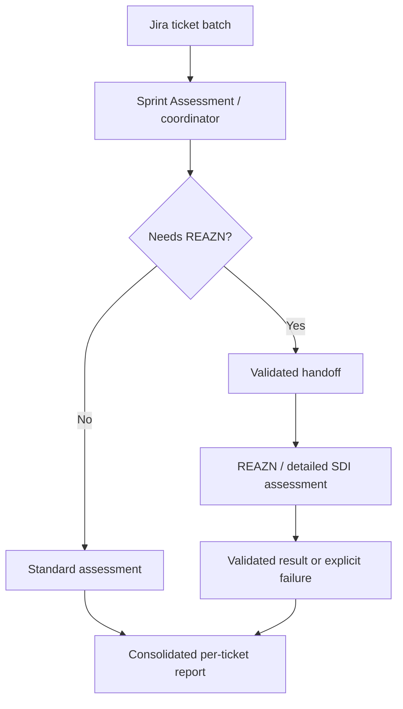

# Engineering Contracts 101

**A practical tutorial, explained senior-developer to junior-developer**

> **Core idea:** A contract is an agreement between interacting components about **what they expect, what they provide, and what must remain true**. It describes *what must happen*; the implementation decides *how*; tests and runtime evidence tell us whether the agreement is actually met.

**Audience:** Developers learning API, component, distributed-system, and AI-skill contracts.  
**Running example:** Sprint Assessment consumes Jira tickets and may invoke REAZN (formerly Refine Requirements Light) for deeper requirements/design analysis. The integration is **illustrative, not a confirmed implementation**.  
**Learning approach:** Use the four System Design Interview (SDI) steps you already know; examine contracts in **Step 3 — Design Deep Dive**.

## Table of Contents

- [Quick reference](#quick-reference)
1. [What is an engineering contract?](#1-what-is-an-engineering-contract)
2. [Are contracts universal? Are these official categories?](#2-are-contracts-universal-are-these-official-categories)
3. [Preconditions, postconditions, invariants, and guarantees](#3-preconditions-postconditions-invariants-and-guarantees)
4. [Common contract areas beyond input and output](#4-common-contract-areas-beyond-input-and-output)
5. [Who owns the contract? Consumer, provider, and orchestrator](#5-who-owns-the-contract-consumer-provider-and-orchestrator)
6. [Worked example: Jira ticket to REAZN assessment](#6-worked-example-jira-ticket-to-reazn-assessment)
7. [What if REAZN cannot find or inspect a repository?](#7-what-if-reazn-cannot-find-or-inspect-a-repository)
8. [What if one or two tickets fail in a batch?](#8-what-if-one-or-two-tickets-fail-in-a-batch)
9. [What observability should the contract support?](#9-what-observability-should-the-contract-support)
10. [How do two engineers agree on a contract?](#10-how-do-two-engineers-agree-on-a-contract)
11. [How do we verify contracts, especially for AI skills?](#11-how-do-we-verify-contracts-especially-for-ai-skills)
12. [Where contracts fit in the four SDI steps](#12-where-contracts-fit-in-the-four-sdi-steps)
13. [Your questions, answered in one place](#13-your-questions-answered-in-one-place)
14. [Reading path using your existing books](#14-reading-path-using-your-existing-books)
15. [Reusable contract-review checklist](#15-reusable-contract-review-checklist)

---

## Quick reference

| Term | Plain-English meaning |
| --- | --- |
| **Contract** | The agreed expectations between interacting components |
| **Precondition** | What the caller must provide or ensure before an operation |
| **Postcondition** | What the provider promises after an operation, under the stated conditions |
| **Invariant** | A rule that must remain true within a defined scope |
| **Guarantee** | A broader promise, whose conditions and limits must be specified |
| **Fault isolation** | Containing a failure so independent work can continue |
| **Observability** | The ability to determine what happened using traces, logs, metrics, and evidence |
| **Consumer** | The component relying on a capability or result |
| **Provider** | The component supplying that capability or result |
| **Orchestrator** | The component coordinating work, status, and handoffs |

**Memory aid:** *Before → After → Always → On failure.*

These four prompts are a **teaching checklist**, not the official four-part definition of Design by Contract.

---

## 1. What is an engineering contract?

**Junior:** “Is a contract just the input and output?”

**Senior:** “Input and output are a start. A useful contract also makes the meanings, error cases, and important promises clear.”

Imagine a frontend calling a backend:

```http
GET /customers/123
```

The frontend needs to know what to send, what a successful response means, and what happens if customer 123 does not exist. The backend can change its internal storage without forcing the frontend to understand or copy that implementation.

**The important boundary:** The consumer should depend on the provider's **agreed behavior**, not its internal implementation details.

For a two-skill workflow:

- **Sprint Assessment** could be the consumer of a deeper assessment.
- **REAZN** could be the provider of that assessment.
- Both need to agree on the request, result, semantics, and failure behavior.
- A separate host or orchestrator may be required to enforce routing, validation, permissions, and retries.

> **Engineering takeaway:** Contract = expected behavior at a boundary. Implementation = internal method for meeting that expectation.

---

## 2. Are contracts universal? Are these official categories?

**Yes, explicit contracts are a broadly used engineering practice.** They appear in APIs, library functions, components, services, databases, and workflows.

**No, there isn't one universal eight-category contract standard.** The areas in this tutorial organize common concerns; they are not a formal checklist mandated by an industry body.

Two useful distinctions:

1. **Formal Design by Contract** commonly uses **preconditions, postconditions, and invariants**.
2. **Broader engineering agreements** can cover interface, behavior, failure handling, security, performance, observability, data integrity, and compatibility.

Different teams may call these *API contracts*, *service contracts*, *operational expectations*, *SLAs/SLOs*, *schemas*, or *acceptance criteria*. Terms and enforcement mechanisms depend on the system.

**Don't start by inventing categories.** Start by asking: *What expectations must both sides agree on for this interaction to be safe and useful?*

---

## 3. Preconditions, postconditions, invariants, and guarantees

These are the foundations to learn before memorizing any larger checklist.

| Concept | Question | Example for Sprint Assessment × REAZN |
| --- | --- | --- |
| **Precondition** | What must be true **before** this call? | The request identifies a ticket and the intended assessment; the caller provides required fields. |
| **Postcondition** | What must be true **after** the operation completes under agreed conditions? | REAZN returns a result associated with the requested ticket, indicating whether its assessment completed. |
| **Invariant** | What must stay true throughout a defined scope? | Findings must never be attributed to the wrong Jira ticket; inaccessible evidence must not be presented as verified. |
| **Guarantee** | What does the component promise, and under which conditions? | An individual ticket's assessment failure will not automatically terminate other independent tickets in the batch. |

**Precision matters:** A postcondition must state the outcome for a **successful call or each documented failure outcome**, rather than promising successful analysis even if the repository is inaccessible.

**A guarantee is not a fourth formal Design by Contract primitive.** It is a broad engineering word for a promise. A good guarantee states its scope and limits.

### Examples: weak versus testable statements

**Weak:** “The skill is reliable.”

**Better:** “If an individual ticket assessment fails, the batch continues for independently processable tickets and records a terminal status for the failed ticket.”

**Weak:** “REAZN checks the repository.”

**Better:** “REAZN must not mark repository-dependent claims as verified unless appropriate source evidence was actually inspected.”

**Weak:** “The batch completed.”

**Better:** “For every ticket accepted into the batch, the final report includes its ticket ID and a terminal processing status.”

---

## 4. Common contract areas beyond input and output

These are practical areas to consider **when relevant**, not eight documents you must always create.

| Area | What you agree on | Concrete example |
| --- | --- | --- |
| **Interface** | Request/response fields, types, statuses, errors | Ticket ID and acceptance criteria in; structured REAZN result out |
| **Behavioral** | Business rules and expected actions | Do not invent missing requirements or claim unverified source behavior |
| **Reliability** | What happens under failures, timeouts, retries, and partial success | A failed ticket does not cancel other independent ticket assessments |
| **Observability** | What evidence makes execution diagnosable | Ticket ID, run ID, tool outcome, error category, and source revision |
| **Security** | Which actions and data access are authorized | Read only approved repositories; never assume tool availability grants permission |
| **Performance** | Useful limits for latency, throughput, cost, or concurrency | An agreed processing budget for a 20-ticket batch |
| **Consistency & data integrity** | Correct associations, idempotency, and valid state | No duplicated or mismatched results after retries |
| **Compatibility & versioning** | How one side changes without unexpectedly breaking the other | A REAZN output change does not silently break Sprint Assessment's parser |

### So where does fault isolation fit?

**Fault isolation is a reliability principle**, not usually a separate contract category.

A reliability **contract** might explicitly promise: “A failure in ticket A does not prevent the processing of ticket B when their work is independent.”

Likewise, **observability** is a system capability. You turn it into a specific agreement by saying *which events, identifiers, errors, or measurements must be recorded*.

### Other cross-cutting concerns

- **Ownership:** Who makes the dispatch decision, owns the final report, and responds to failure?
- **Authority:** Which tool or host actually permits an action?
- **Verification:** Which tests or evidence demonstrate that a promise is met?

These don't need their own contract category in every system. They must, however, be clear where they affect the interaction.

---

## 5. Who owns the contract? Consumer, provider, and orchestrator

A useful division of responsibility:



*Proposed workflow only; actual ownership and dispatch rules need team confirmation.*

| Responsibility | Example owner to discuss |
| --- | --- |
| Decide whether deeper analysis is required | Sprint Assessment or an external orchestrator |
| Perform the four-step SDI analysis | REAZN |
| Validate request and response structure | Integration code or agent harness, when available |
| Enforce repository permissions | Host, tool layer, or external authorization system |
| Keep one accountable result per accepted ticket | Batch coordinator |
| Record trustworthy execution traces | Runtime/observability infrastructure |

**Senior developer's advice:** Separate *who is responsible* from *who has the technical ability to enforce the rule*. A `SKILL.md` instruction saying “read-only” does not, by itself, remove write permissions from a tool.

---

## 6. Worked example: Jira ticket to REAZN assessment

**Your question, paraphrased:** “If REAZN receives a Jira ticket, reads its description and acceptance criteria, and looks for relevant repositories, what should the input and output contract be?”

### Step A — Agree on the consumer's actual need

First establish what Sprint Assessment needs. Does it want REAZN's full SDI report, or only a small, structured summary that can be combined with other ticket results?

Do **not** pick the schema before answering that question.

### Step B — Draft a minimal request

```typescript
// Illustrative integration schema — NOT REAZN's current API.
type ReaznRequest = {
  ticketId: string;
  description: string;
  acceptanceCriteria: string[];
  objective: string;
  sourceRevision?: string;
};
```

The team decides which fields must be present, which may be absent, and how source access is provided. A Jira ticket alone does **not** guarantee that relevant repository context exists or can be retrieved.

### Step C — Draft a result with separate meanings

```typescript
// Illustrative schema — no claim that the current skills emit this.
type ReaznResult = {
  ticketId: string;
  processingStatus: "completed" | "incomplete" | "failed";
  findings: Array<{
    summary: string;
    evidence: string[];
    verification: "verified" | "unverified";
  }>;
  failureCategory?: string;
  diagnosticRunId?: string;
};
```

Important distinction:

- **Processing status:** Did the operation run and produce the agreed result?
- **Assessment findings:** Are the Jira requirements complete, ambiguous, contradictory, or risky?
- **Verification status:** Was a specific finding supported by actual inspected evidence?

**A successfully processed ticket may still have poor requirements. A failed processing run doesn't mean the Jira ticket is bad.**

### Step D — State the contract in plain English

> Given a valid assessment request, REAZN returns the original ticket ID, its findings, and an explicit processing state. It must not label uninspected repository behavior as verified. Sprint Assessment handles each returned state according to agreed rules.

This is **proposed behavior**. It becomes an agreed contract only after the team accepts it.

---

## 7. What if REAZN cannot find or inspect a repository?

**Your question, paraphrased:** “If no relevant repository is found, should REAZN return ‘no repo found’ or ‘more Jira information needed’?”

**Senior:** “Not until we know what actually happened. *Couldn't inspect* is an observation; *no repository exists* is a stronger conclusion.”

| What we actually know | Possible diagnostic category | What we should **not** assume |
| --- | --- | --- |
| Ticket does not identify the affected system | `INSUFFICIENT_TICKET_CONTEXT` | That repository access is broken |
| Search completed, but no relevant repository was identified | `REPOSITORY_NOT_IDENTIFIED` | That no relevant repository exists anywhere |
| Tool explicitly returned permission denied | `REPOSITORY_ACCESS_DENIED` | That the Jira requirements are incomplete |
| Repository lookup failed or tool did not execute | `REPOSITORY_RETRIEVAL_FAILED` | That the cause was permissions or the LLM |

*These labels are examples, not current REAZN status codes.*

### Observed failure versus root cause

Separate:

1. **Observation:** Repository evidence wasn't retrieved.
2. **Potential causes:** Missing permissions, unavailable tool, incorrect lookup, wrong repository, insufficient context, or other runtime failure.
3. **Contract behavior:** Report what was observed, identify what is unverified, and preserve enough information for investigation.

**The key open design question:** Should REAZN continue with a **requirements-only assessment** when repository evidence is inaccessible, or return an **incomplete/failed assessment**? Either can be reasonable. The consumer and provider must agree on the behavior and how the limitation is represented.

**Non-negotiable example invariant:** Never invent repository evidence or silently describe a repository as verified when it was not inspected.

---

## 8. What if one or two tickets fail in a batch?

**Your decision, paraphrased:** “If one or two of ten Jira tickets fail, isolate those failures, process the rest, and include every ticket's status in the final report.”

That's a useful **fault-isolation requirement**.

### Example batch result

| Ticket | Processing status | Assessment result or diagnostic |
| --- | --- | --- |
| `PROJ-001` | Completed | Requirements are sufficiently clear |
| `PROJ-002` | Completed | Acceptance criteria contain a gap |
| `PROJ-003` | Incomplete | Repository retrieval failed |
| `PROJ-004`–`PROJ-009` | Completed | Individual findings available |
| `PROJ-010` | Incomplete | Required source evidence unavailable |

**Summary:** 10 accepted tickets; 8 completed; 2 incomplete; 0 unaccounted for. These are hypothetical numbers.

### Two different guarantees

**Ticket-level guarantee:** Failure of one independent assessment must not automatically terminate the other assessments.

**Batch-level guarantee:** Every accepted ticket must have an attributable final state by the time the batch report is finalized.

The batch may report **partial success**, but it must not silently omit failed tickets.

### What if the Jira API fails before tickets are retrieved?

That's a **shared-dependency failure**, not just an individual REAZN error.

If the system never obtained the ticket IDs, it may be impossible to report individual statuses. A batch-level failure could be appropriate. If the system already accepted and persisted the IDs, it may still be able to account for each one.

**Lesson:** A guarantee needs boundaries. Fault isolation is possible only when the remaining work is sufficiently independent and the coordinator retains the information needed to continue.

---

## 9. What observability should the contract support?

**Your question, paraphrased:** “What if the LLM or the retrieval system had an issue? How would we trace and debug it?”

A final response saying “repository lookup failed” is useful, but may be insufficient.

Useful runtime evidence might include:

- **Correlation:** Jira ticket ID, batch ID, individual assessment/run ID
- **Execution:** Skill and model/harness versions, relevant source revision
- **Tool activity:** Which lookup was attempted, whether a tool actually ran, and its success/error outcome
- **Failure detail:** Error category, retry count, timing, and a diagnostic reference
- **Evidence state:** Which claims were verified against inspected sources versus left unverified

Keep sensitive source content and credentials out of shared logs; capture only necessary, authorized diagnostics.

**Important:** A skill's text claiming “I searched the repository” is **not equivalent to a trustworthy execution trace** demonstrating a tool call.

The goal is to answer: **Which step failed, for which ticket, under which execution, and with what observed evidence?**

---

## 10. How do two engineers agree on a contract?

Imagine you maintain REAZN and your coworker maintains Sprint Assessment.

A practical sequence is:

1. **Discover the existing interaction.** Does Sprint Assessment already invoke skills? What inputs/outputs and result conventions exist?
2. **Start with the consumer's need.** What does Sprint Assessment actually need from REAZN to do its job?
3. **Agree on the minimum interface.** Required inputs, returned fields, and the meaning of each state.
4. **Agree on behavioral and failure promises.** What does success mean? What is allowed to be incomplete? What must never happen?
5. **Assign enforcement and ownership.** Which rules live in skill instructions, and which must be validated by runtime code, schemas, or permissions?
6. **Write tests before relying on the integration.** Use representative tickets, negative cases, and failures.
7. **Evolve intentionally.** Version significant changes, check compatibility, and communicate consumer-impacting changes.

**Good opening question for the meeting:**

> “Before defining a new contract, can we review how Sprint Assessment currently invokes or consumes other skills, and confirm what it actually needs from REAZN?”

Don't mistake a detailed proposed contract for an approved one.

---

## 11. How do we verify contracts, especially for AI skills?

**Three different questions require three kinds of evidence:**

| Verification | Question | Example test |
| --- | --- | --- |
| **Schema / deterministic checks** | Does the result have the correct structure? | Ticket ID and status are present; unknown status is rejected |
| **Integration / failure tests** | Do components coordinate correctly? | Two failed tickets do not erase the other eight results |
| **Behavioral AI evals** | Are the findings and decisions actually useful and evidence-based? | REAZN flags CSV-versus-PDF conflict without inventing repository facts |

### CSV versus PDF: a small contract/eval example

- **Source Jira ticket:** Export assessment results as **CSV**.
- **Generated assessment:** Describes download as **PDF**.
- **Expected evaluation:** Detect the discrepancy instead of treating both descriptions as equivalent.
- **Possible routing question:** Does Sprint Assessment catch the mismatch itself, or dispatch REAZN for deeper analysis?
- **Contract question:** How is that discrepancy represented in the result that Sprint Assessment consumes?

### Important for agent skills

A `SKILL.md` file can **document** the intended behavior. A harness or runtime may **enforce** permissions, tool access, validation, and structured output. An evaluation provides **evidence** of observed behavior in a particular setup.

Do not claim that a documented rule is technically enforced, or that a saved test case has passed unless there is actual run evidence.

A useful progression is:

**Documented expectation → executable check → observed result → regression protection.**

---

## 12. Where contracts fit in the four SDI steps

Keep your existing SDI mental model. You do **not** need a sixth engineering framework.

| SDI step | Contract-related reasoning |
| --- | --- |
| **1. Requirements & scope** | What problem are we solving? What is already known versus assumed? What guarantees do stakeholders actually need? |
| **2. Existing patterns & high-level design** | Which components interact, and what existing interfaces or team conventions should be reused? |
| **3. Design Deep Dive** | Define request/response semantics, preconditions, postconditions, invariants, authority boundaries, and failure behavior. |
| **4. Risks & trade-offs** | Evaluate latency, complexity, cost, missed dispatch, cascading failures, and how proposed guarantees will be verified. |

**Engineering habit:** Stay in Step 1 until you can explain the observable problem. Then examine existing patterns before designing a new contract.

---

## 13. Your questions, answered in one place

These questions are paraphrased from the learning conversation so they're easy to revisit.

**Q: Is an engineering contract just input and output?**  
**A:** No. The interface includes inputs and outputs, but a useful agreement may also define behavior, error semantics, invariants, and operational expectations.

**Q: Are reliability, observability, security, performance, and compatibility all different “contracts”?**  
**A:** They are common engineering concerns that may become explicit contractual obligations. There is no single mandatory industry taxonomy that packages all of them as separate contract types.

**Q: What's the difference between precondition, postcondition, invariant, and guarantee?**  
**A:** Before a call; after an operation under agreed conditions; a rule that must remain true; and a broader promise whose scope must be specified. The first three are the classic Design by Contract terms.

**Q: Is fault isolation another contract type?**  
**A:** Usually not. It's a reliability principle that can be expressed as a precise, testable promise.

**Q: If REAZN cannot access a repository, should it output “no repo found”?**  
**A:** Only if that wording matches what was actually established. Distinguish missing context, no repository identified, explicit access denial, and tool/retrieval failures.

**Q: Is repository access failure automatically a permissions issue?**  
**A:** No. A permission error is one possible cause. Check tool results and traces before diagnosing the cause.

**Q: Should two failures stop a 10-ticket Sprint Assessment batch?**  
**A:** Your proposed requirement is **no** for independent per-ticket failures: report partial success and keep an attributable status for every accepted ticket. Confirm that guarantee with the project owner.

**Q: What if Jira itself is down before the batch can identify tickets?**  
**A:** That's a different, potentially batch-level failure. The system can only report individual ticket states for work it can identify and track.

**Q: How is an AI-skill contract different from a normal API contract?**  
**A:** A skill document instructs an LLM; it doesn't alone guarantee compliance. Runtime validation, tool permission enforcement, and behavioral evals are needed for stronger assurance.

**Q: How should two developers begin designing a contract?**  
**A:** Review the existing pattern, ask what the consumer needs, agree on expected behavior and failure cases, and then make those expectations testable.

**Q: Do I need to memorize all these contract categories?**  
**A:** No. Start with **Before → After → Always → On failure** and expand only into the relevant concerns for the component or system being designed.

---

## 14. Reading path using your existing books

Stick to your **five foundational engineering books**; no new purchase is necessary. Use the relevant topic or chapter in your edition rather than forcing a separate course on contracts.

| Book | Look for these topics | Connect it to |
| --- | --- | --- |
| **A Philosophy of Software Design** — John Ousterhout | Modules, deep interfaces, information hiding, abstraction | Why the provider shouldn't expose unnecessary internals |
| **System Design Interview, Vol. 1 & 2** — Alex Xu | Interface design, capacity, trade-offs, component deep dives | Where contracts appear in SDI Step 3 |
| **Designing Data-Intensive Applications, 2nd ed.** — Martin Kleppmann and Chris Riccomini | Nonfunctional requirements, evolution/compatibility, transactions, distributed failure | Reliability, data integrity, and versioning |
| **Fundamentals of Data Engineering** — Joe Reis and Matt Housley | Data contracts/quality concerns, pipeline interfaces, observability | Trustworthy inputs, transformations, and downstream consumers |
| **Algorithmic Thinking, 2nd ed.** — Daniel Zingaro | Correctness reasoning, constraints, algorithmic complexity | Preconditions, invariants, and performance guarantees |

**Suggested sequence for this topic:** *A Philosophy of Software Design* → relevant SDI design deep dives → DDIA on failures and evolution → FODE on data pipelines → Algorithmic Thinking on correctness and invariants.

**Supplemental, not a sixth foundational book:** *AI Agents in Action, 2nd Edition* for agent orchestration, evaluation, and runtime behavior when you're specifically testing REAZN or Sprint Assessment.

---

## 15. Reusable contract-review checklist

Use this when two skills, components, or services need to work together.

### A. First establish the problem

- [ ] What existing interaction did we verify?
- [ ] What does the consumer actually need?
- [ ] Which behavior is required, and which behavior is merely proposed?

### B. Define the agreement

- [ ] What inputs are required and optional?
- [ ] What output states and fields have clear meanings?
- [ ] What preconditions, postconditions, and invariants matter?
- [ ] Who makes the dispatch decision, owns results, and handles failures?
- [ ] What happens if required evidence or a dependency is unavailable?

### C. Check enforcement and evidence

- [ ] Which rules are documented versus runtime-enforced?
- [ ] What diagnostic evidence is available when something fails?
- [ ] Which deterministic checks, integration tests, and behavioral evals verify the agreement?
- [ ] How will compatibility be maintained when either side changes?

### A final senior-engineer reminder

> **A contract describes what must happen. An implementation determines how it happens. Verification shows what actually happened.**

Before using any proposed contract in production, confirm it with the responsible engineers and test it in the intended runtime.

---

## Related DotSkills documents

- [Sprint Assessment × REAZN — Engineering Design Meeting Agenda](sprint-assessment-reazn-engineering-design-meeting-agenda.md)
- [REAZN README](../skills/reazn/README.md)
- [Audit Skill README](../skills/audit-skill/README.md)
- [Evaluate Skill README](../skills/evaluate-skill/README.md)
- [DotSkills architecture](architecture.md)
