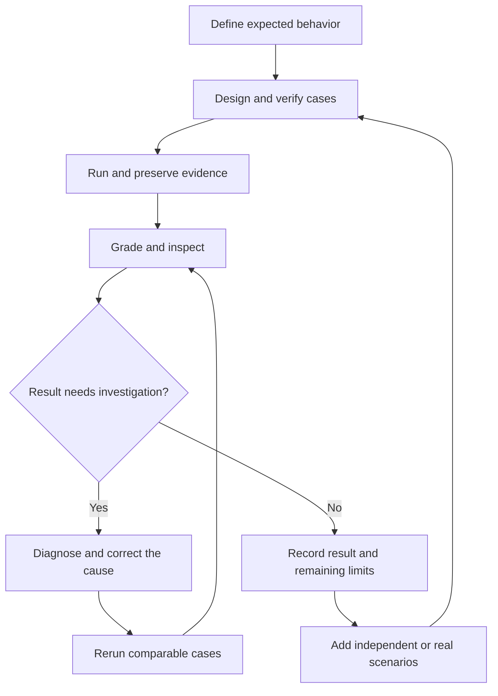

# Eval-Driven Skill Development

A repeatable workflow for building and improving agent skills through clear expectations, representative eval cases, evidence-based grading, and regression checks.

Use this workflow for any DotSkills skill: code review, requirements refinement, investigation, learning, rehearsal, or decision support. DDIA code review is a worked example below, not a restriction on the workflow.

## Table of contents

- [What you are evaluating](#what-you-are-evaluating)
- [The ongoing cycle](#the-ongoing-cycle)
- [1. Understand the skill and choose one capability](#1-understand-the-skill-and-choose-one-capability)
- [2. Define the cases and the answer key](#2-define-the-cases-and-the-answer-key)
- [3. Run the evals](#3-run-the-evals)
  - [Before each run](#before-each-run)
  - [During each run](#during-each-run)
  - [After each run](#after-each-run)
- [4. Grade meaning and inspect the evidence](#4-grade-meaning-and-inspect-the-evidence)
- [5. Diagnose before changing the skill](#5-diagnose-before-changing-the-skill)
- [6. Compare, check regressions, and expand coverage](#6-compare-check-regressions-and-expand-coverage)
- [Worked progression: DDIA review](#worked-progression-ddia-review)
- [Reusable case outline](#reusable-case-outline)
- [How much subject knowledge do you need?](#how-much-subject-knowledge-do-you-need)
- [Where the pieces belong](#where-the-pieces-belong)

## What you are evaluating

An eval observes an agent performing a task with a particular skill, model, harness, context, and tool setup. Its results describe that combination under the tested conditions. They do not establish that the instruction file alone caused the outcome.

| Item | Purpose |
| --- | --- |
| Skill | Reusable instructions and references that guide the agent. |
| Eval case | A particular task, its inputs, and evaluator-only expectations and grading criteria. |
| Eval suite | A collection of cases covering different situations. |
| Run | One attempt at one case under a recorded configuration. |
| Grader or rubric | Checks the completed output and available action evidence against the case criteria. |
| Baseline | A recorded starting result used for later comparisons, including failures and unknowns. |

For code review, an application unit test checks what the application does. A reviewer eval checks whether the agent correctly assesses that behavior. Buggy application code can fail its unit test while the reviewer passes by correctly finding the defect.

You can give the agent the full relevant skill while a case checks one narrow capability. There is no requirement to test each instruction sentence in isolation.

## The ongoing cycle



Keep every run record, including unsuccessful attempts. A completed cycle can end with an unresolved limitation; it does not need to manufacture a passing result.

## 1. Understand the skill and choose one capability

Start with a small, observable objective. Write down the intended task, required context, scope, and what the agent should do when evidence is missing.

| Skill | Example capability to evaluate |
| --- | --- |
| DDIA code review | Distinguish a partial-update defect from a protected operation or an unresolved storage guarantee. |
| Requirements refinement | Inspect an existing implementation pattern before proposing requirements, and distinguish established facts from stakeholder questions. |
| Repository investigation | Trace a behavior through relevant callers and dependencies without inventing unseen implementation details. |
| Decision support | Identify missing decision evidence and apply the specified workflow without inventing inputs or unauthorized effects. |

Define success as behavior you can inspect. For example, “explain which mutation survives a failed operation and which requirement it violates” is more useful than “give a thorough review.”

Decide whether you are testing a reference directly, the whole skill package, skill selection, or an end-to-end workflow. A direct reference test does not also test whether the harness selects and loads the right skill.

## 2. Define the cases and the answer key

Each case includes what the agent receives and what the evaluator checks. Keep those parts separate when executing the case, even if they are stored in one authoring file.

| Part | What to include | Who receives it during a run? |
| --- | --- | --- |
| Identity and capability | Stable case ID and the behavior being measured. | Eval coordinator. Avoid revealing the diagnosis through names. |
| Input | Neutral task, realistic requirements, files, context, and allowed tools. | Agent under evaluation. |
| Expected behavior | Correct conclusion, essential explanation, or appropriate handling of uncertainty. | Evaluator. |
| Grading | Required behavior, unacceptable claims or actions, and evidence needed for each check. | Evaluator. |
| Answer-key evidence | Requirement, reproduction, authoritative source, or expert review establishing the expectation. | Evaluator. |

For a review capability, begin with contrasting cases: a defect exists, the relevant protection exists, and evidence is insufficient. For other skills, use the equivalent normal, boundary, and missing-context situations. Add cases as you discover distinct failure modes; useful coverage matters more than case count.

Verify the expected answer before relying on it. Small executable examples help establish code behavior; complex repository changes may also require requirements, integration evidence, or expert review. An LLM can draft a case, but its confidence is not proof that the answer key is correct.

Keep task wording neutral. “Review this transfer against its requirements” gives an assignment. “Find the debit that survives a rejected transfer” reveals the diagnosis.

## 3. Run the evals

To explore coverage, keep one skill version fixed and run it across different cases. To compare a skill change, hold each case and its rubric fixed and run both skill versions under comparable conditions. If you correct a case or rubric, version the correction and reassess both sides before claiming improvement.

### Before each run

- [ ] Identify the exact skill/reference version and case version or hashes.
- [ ] Record the model, harness, settings, tools, permissions, and time or token budget where available.
- [ ] Confirm the fixture and expected behavior agree; distinguish intentional missing context from a setup mistake.
- [ ] Prepare only the agent-facing inputs. Exclude answer keys, private verification scripts, other variants, and earlier outputs.
- [ ] Start a fresh session without the eval-authoring conversation or previous answers.
- [ ] Configure workspace access restrictions where supported. A working directory alone is not an access-control boundary.

### During each run

- [ ] Provide the task and selected guidance through the intended harness workflow.
- [ ] Avoid hints or mid-run corrections. If intervention is needed, record it as a different or invalid attempt under the protocol.
- [ ] Preserve the original response and available read/search/tool/command trace.
- [ ] Record errors, timeouts, unavailable tools, and changes to the fixture or other state.

### After each run

- [ ] Check whether the intended guidance was supplied or loaded, using the available evidence.
- [ ] Check for answer-key access or other contamination before grading.
- [ ] Record output and trace locations, trace limitations, run status, and validity.
- [ ] Grade the output separately from the loading diagnostics. Loading a guide is not itself a quality improvement.

**How this works today:** DotSkills has a [manual code-review eval package](../evals/code-review/context-validation/README.md), preparation and fixture-verification helpers, and recorded results. It does not yet have a general automated model-evaluation runner. A capable coding-agent harness can execute the documented helper commands and coordinate authorized steps, but you must still launch the evaluated agent, capture its result, and grade it. A script that prepares files or verifies a fixture does not perform all those steps automatically.

The existing preparation helper selects a historical skill snapshot for one case at a time. Its `before` and `after` labels identify those snapshots; neither selects the current skill. Recorded attempts, including direct-DDIA runs, live in each case’s `results/` folder.

## 4. Grade meaning and inspect the evidence

Define the grading criteria before the run. A numeric score is optional: start with **Pass / Fail / Unknown** for each criterion and a short evidence note. Define how those checks combine if you need an overall case result; do not hide a critical failure inside an average.

For a review, check whether the conclusion is correct, its explanation connects concrete behavior to the requirement, and source or execution claims are supported. Grade essential meaning, allowing different wording. “Consider transactions” does not establish that the reviewer found a particular partial-update defect.

Use deterministic checks for observable facts such as changed file hashes or recorded command results. Use a precise rubric for semantic judgments. A cited path existing does not prove it supports a claim, and a plausible final answer does not prove a tool was used. If using an LLM judge, calibrate its decisions against human review, especially disagreements and borderline cases.

Keep these outcomes distinct:

| Situation | Treatment |
| --- | --- |
| A completed, valid response contradicts an established requirement. | Fail the relevant quality check. |
| The case deliberately omits decisive evidence, and the agent identifies that limit accurately. | This can pass the uncertainty criterion. |
| The trace does not establish whether the agent inspected a file or ran a command. | Mark that process check Unknown. |
| The agent accessed the answer key. | Mark the run Invalid; repeat without contamination. |
| No completed response exists, or execution stopped. | Record Not Run, Error, or Incomplete as appropriate; do not invent a quality grade. |

Execution reliability may be a separate measured objective. Record those failures even when there is no completed response to grade.

## 5. Diagnose before changing the skill

A failed check is evidence to investigate, not an automatic instruction to rewrite the prompt.

| Possible cause | Next action |
| --- | --- |
| Incorrect or ambiguous expected answer | Recheck requirements and evidence; correct and version the case or rubric. |
| Required context accidentally absent | Repair the setup, or explicitly make missing-context behavior the objective. |
| Skill not loaded, tool unavailable, or execution interrupted | Repair or document the harness/setup issue. |
| Judge interprets the rubric incorrectly | Clarify the rubric and audit previous judgments affected by the change. |
| Skill guidance leads to the wrong decision | Make a targeted instruction change addressing the general reasoning weakness. |
| Results vary across attempts | Repeat under the same conditions and retain all attempts; do not select only favorable outputs. |

Improve the reusable procedure, not a memorized answer. For example, require checking relevant callers and storage guarantees before reporting an atomicity defect, rather than teaching the exact names and balances in one fixture.

Follow [source ownership](sources.md) when editing imported references: preserve locked snapshots, put adapted guidance in a separate file, or deliberately update upstream content and its lock through the documented process.

## 6. Compare, check regressions, and expand coverage

Rerun the existing suite after a change, including cases that previously passed. For a large suite, record which subset ran and why, then complete the intended regression coverage before making a suite-wide claim. Also test independent cases that did not drive the edit.

| Before | After | Supported conclusion |
| --- | --- | --- |
| Fail | Pass | Improvement on that case under the tested conditions. |
| Pass | Fail | Regression to investigate. |
| Pass | Pass | No improvement demonstrated by that pass/fail criterion. |
| Fail | Fail | The measured problem remains. |
| Unknown or invalid | Any result | Resolve the evidence or validity issue before making that comparison. |

Repeat cases to examine consistency. One attempt is one observation, not a reliability estimate. Preserve skill and case versions, the rubric, raw outputs, available traces, scores, and limitations so another run can be compared fairly.

Grow from controlled diagnostic examples toward representative real tasks. Separate teaching examples inside the skill from independent evaluation cases; repeatedly tuning on the same examples can exaggerate apparent progress. A few passes do not establish broad skill quality or portability across harnesses.

## Worked progression: DDIA review

This is an illustrative development cycle, not a report of newly executed evals.

1. **Observe a mistake:** the reviewer reports a partial-update defect because it sees two writes.
2. **Establish the facts:** inspect the caller and storage contract. Both writes participate in one transaction whose rollback guarantee covers the specified failure path. The transaction's name alone is insufficient evidence.
3. **Capture the case:** supply that code, contract, and neutral review task; keep the expected recognition of protection with the evaluator.
4. **Record the unchanged skill's behavior:** run the case in a fresh session. If the false alarm recurs, preserve the output and grade it against the evidence.
5. **Improve the general instruction:** require checking caller-level boundaries and the relevant storage guarantees before alleging a partial update.
6. **Check all three situations:** rerun the protected case, a case where a debit really survives rejection, and a case where the storage guarantee is unavailable.

| Case input | Expected reviewer behavior |
| --- | --- |
| Source debit remains after destination validation fails. | Explain the surviving mutation and the unchanged-on-failure requirement it violates. |
| A verified transaction rolls back both writes on the specified failure. | Recognize that protection and avoid the original false alarm within the supplied scope. |
| Relevant storage implementation and guarantees are unavailable. | Explain what cannot be established and identify the evidence needed. |

The goal is better judgment across these situations. Fewer findings by itself is not evidence of improvement.

## Reusable case outline

For a ready-to-copy folder structure, use the
[case template](../templates/case/README.md). Start with the case goal, fill
in `input/`, establish `expected.md`, define `grading.md`, then retain actual
attempts in `results/`. The reviewer receives only `input/` and the selected
skill guidance. This template applies to code, data, documents, or combinations.


This is an authoring outline, not an executable schema or a new runner format. Use Markdown, YAML, JSON, or your runner's supported format. The existing manual package distributes these responsibilities across fixtures, a task, a grader, and a scorecard.

```yaml
id: case-001
capability: "The observable behavior this case tests"
input:
  task: "A neutral, realistic assignment"
  requirements:
    - "The applicable requirement or constraint"
  context: "Files, data, evidence, and any intentional limits"
  allowed_actions: "Tools and state changes permitted for this task"
expected:
  outcome: "The conclusion, action, artifact, or uncertainty handling expected"
  essential_reasoning:
    - "A necessary connection between evidence and the expected outcome"
grading:
  must:
    - "An observable requirement for success"
  must_not:
    - "An unsupported claim or unacceptable action"
  unknown_when:
    - "Evidence needed to judge a criterion is unavailable"
  invalid_when:
    - "The evaluated agent accessed the answer key"
answer_key_evidence:
  - "The requirement, reproduction, source, or expert review supporting the key"
```

The agent receives `input` and the intended skill guidance. The coordinator retains the rest for evaluation. Record actual run metadata and results separately so expectations are not overwritten by what the agent happened to produce.

## How much subject knowledge do you need?

You do not need to be an expert before starting. You do need to understand the intended task and have a reliable way to establish whether results are correct. Start with one concept you can verify, then expand your understanding and cases together.

Check three things: the accuracy and provenance of collected material, whether its instructions apply those ideas appropriately, and whether your evaluation can distinguish a correct result from an unsupported one. Books, talks, documentation, and external prompts can be inputs to a skill; reputation or model confidence alone does not validate their application. Preserve attribution and applicable licenses, and inspect imported prompts for irrelevant instructions or behavioral redirection.

## Where the pieces belong

| Location | Responsibility |
| --- | --- |
| This guide in `docs/` | Shared development and evaluation workflow across skills. |
| `skills/<name>/` | Agent-facing instructions and references. |
| `evals/<skill>/<capability>/` | Case inputs, evaluator criteria, run guidance, and recorded results following the package's conventions. |
| `adapters/` | How a harness consumes a skill. |
| `scripts/` | Shared repository utilities; the current validator checks structure and source integrity. |

Keep evaluator material out of installed agent-facing packages. Use [authoring](authoring.md) for skill structure, [evaluations](../evals/README.md) for available cases and the roadmap, and [contributing](../CONTRIBUTING.md) for repository checks.
