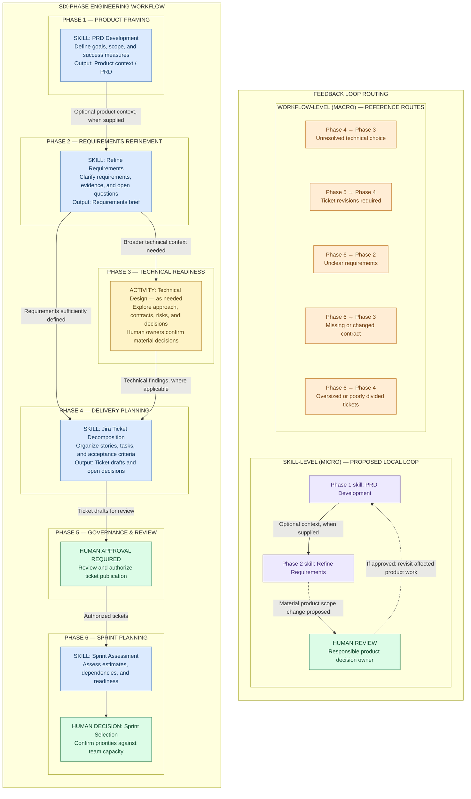
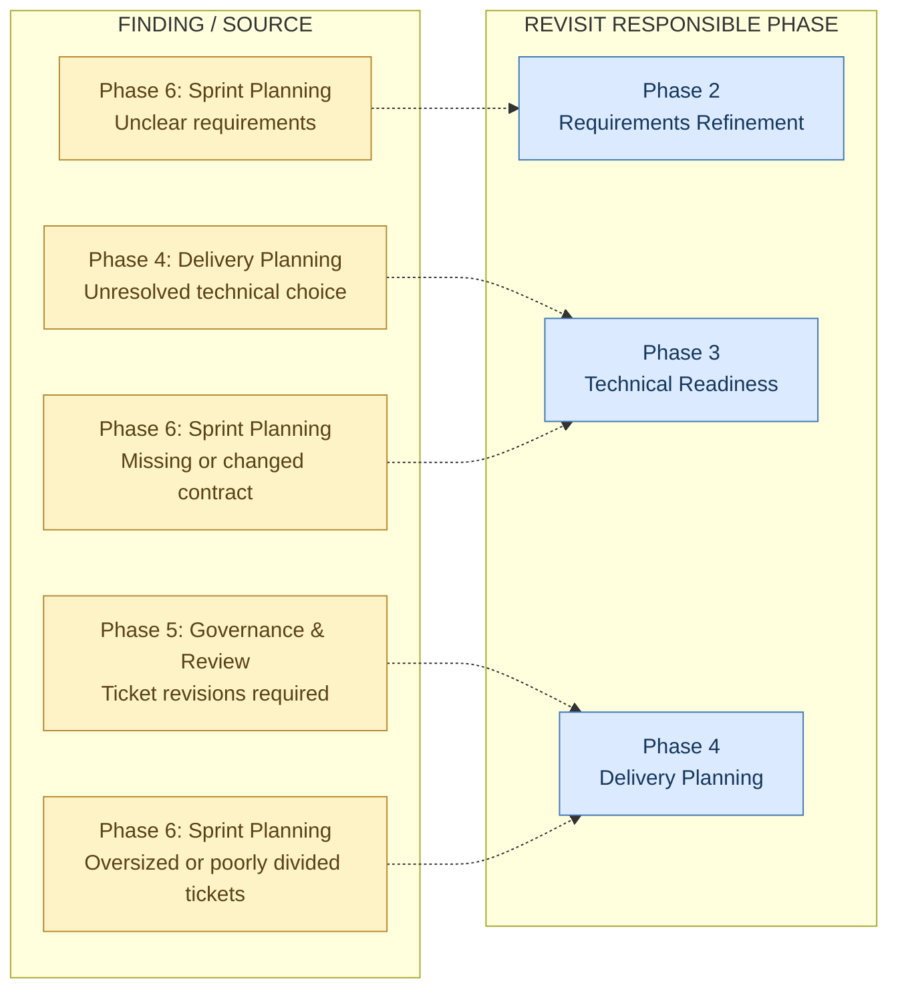

# Product-to-Sprint: Reference Engineering Workflow

## Purpose

This diagram describes how four Agent Arcade skills may support work from product framing through sprint selection. The six phases represent **responsibilities and handoffs**, not a mandatory step-by-step execution script. Teams may tailor the sequence to a ticket's scope and available evidence, while keeping ownership, decision records, and human authorization clear.

## Engineering workflow — six phases with multilevel feedback

The original six phases and human checkpoints are preserved. The feedback-routing panel distinguishes **workflow-level (macro)** return paths from a **skill-level (micro)** example. Macro routes identify where an issue belongs; local integration contracts specify how participating skills handle it. Both levels coexist without implying automatic dispatch.



**Legend:** Blue = agent skill; yellow = collaborative activity; green = human approval or decision; orange = workflow-level (macro) feedback routing; purple = skill-level (micro) feedback participants. Solid arrows = common or optional forward handoffs as labeled; dashed arrows = conditional feedback, not automatic invocation. The branch around Technical Design remains a requirements-only shortcut. The macro panel maps the existing reference routes using phase numbers; the micro panel is a **proposed illustrative local loop**, not an approved integration or observed execution.

**Standalone behavior:** The optional product-context handoff does not require Refine Requirements to wait for a PRD when its normal starting inputs are available. A material proposed change to product scope goes to the responsible human owner. If approved, revisit only the affected product work and use revised context when needed; otherwise follow the applicable stop, defer, or continuation rule. Genuine prerequisites remain mandatory.

## Workflow-level (macro) feedback — detailed routing map



**Legend:** Yellow = a finding that may require rework; blue = a phase that may own its resolution; dashed arrows = suggested feedback routes, not automatic dispatch rules. These are the same five macro paths in the combined architecture above, retained here for detailed review.

## How macro and micro feedback work together

**Macro feedback — where should the issue be resolved?** A workflow-level finding routes back to the responsible phase. For example, unclear requirements discovered during Sprint Assessment return from Phase 6 to Phase 2.

**Micro feedback — how should the participating skills handle the issue?** A local integration contract governs the exchange, trigger, required versus optional context, ownership, failure/stop behavior, and human approval boundary. For example, Refine Requirements may propose a product-scope change for human review and a possible return to PRD Development.

```text
[Sprint Assessment - Phase 6]
       |
       | Unclear requirements (MACRO)
       v
[Refine Requirements - Phase 2]
       |
       | Material product scope change? (MICRO)
       v
[Responsible human review]
       |
       | If approved
       v
[PRD Development - Phase 1]
       |
       | Revised context, when needed
       v
[Refine Requirements]
       |
       v
[Revisit affected downstream work]
```

This is an illustrative proposed scenario, not a required sequence. If the issue can be resolved within Phase 2, the local return is unnecessary. If a revision is declined or deferred, follow the applicable approved continuation or stop rule. Revisit only affected work and re-obtain approvals where changes invalidate them.

The two feedback levels describe scope and responsibility, not merely the number of phases crossed. A workflow-level route may connect two skills directly; a local contract may define the mechanics supporting that route. Not every skill pair needs a feedback loop, and a local loop must not override the broader workflow's governance.

## Why this is a reference workflow, not a rigid script

Different Jira tickets need different levels of refinement and technical design. Requiring every decision and feedback condition to be encoded in the diagram would create unnecessary coupling and imply that the team has agreed to exhaustive routing rules. Instead, the diagram establishes stable **responsibilities, expected handoffs, and human authorization boundaries**, leaving each phase free to adapt its methods, evidence gathering, and depth of analysis.

## Design decisions

- **Six phases, four skills.** Phases describe responsibilities; not every phase needs a standalone skill.
- **Technical Design is conditional.** Requirements can move directly to ticket decomposition when deeper design is not needed.
- **Feedback is normal and multilevel.** Preserve the five workflow-level reference routes. Define local feedback agreements only when evidence or intended design warrants them, keeping independently useful skills loosely coupled. The shown routes are examples, not a complete decision tree.
- **Selective re-entry.** Resolve issues within the smallest appropriate ownership boundary, then revisit affected downstream artifacts and approvals; do not rerun the entire workflow by default.
- **Human control stays explicit.** Ticket publication requires authorization, and sprint selection is a team decision. Material technical decisions are confirmed with their owners as appropriate.
- **Contracts remain important.** Each skill should identify its responsibility, the information it needs, and the findings or artifacts it provides. The detailed execution rules belong in the skill instructions and associated contracts, not in this high-level diagram. Stage 1 establishes macro routing; Stage 2 investigates current responsibilities and feedback evidence; Stage 3 defines justified local handoffs and guarantees using [Skill Integration Contracts](../skills/skill-integration-contracts/SKILL.md); Stage 4 implements explicitly approved agreements; Stage 5 evaluates standalone, integration, and end-to-end feedback behavior.

**Implementation note:** This is a proposed reference presentation based on the existing Agent Arcade product-to-sprint diagram. It does not establish that every handoff or feedback route has already been implemented or evaluated in Codex. Changes to published tickets should pass through the applicable review and authorization process again.

## Short team presentation description

> This is a reference workflow, not a fixed execution script. We use six phases to clarify who owns each type of work, four existing agent skills to support the process, and explicit human checkpoints for publishing and sprint selection. Teams can skip unnecessary technical design and revisit earlier phases when new information appears. We distinguish broader workflow-level feedback (where to return) from local skill-level feedback (how to handle the return), preserving human authority and revisiting only affected work. The goal is flexibility within clear responsibilities and boundaries.
