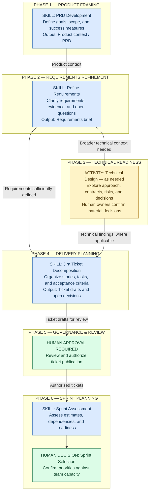
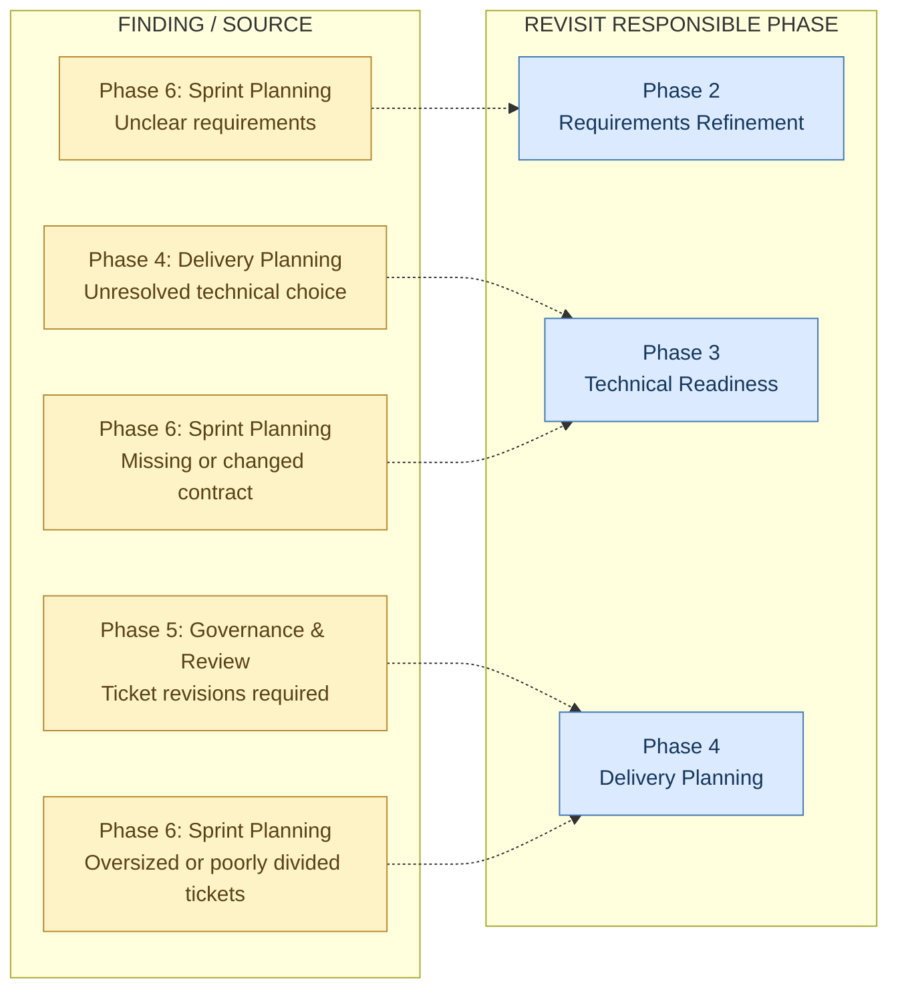

# Product-to-Sprint: Reference Engineering Workflow

## Purpose

This diagram describes how four Agent Arcade skills may support work from product framing through sprint selection. The six phases represent **responsibilities and handoffs**, not a mandatory step-by-step execution script. Teams may tailor the sequence to a ticket's scope and available evidence, while keeping ownership, decision records, and human authorization clear.

## Engineering workflow — six phases

**Legend:** Blue = agent skill; yellow = collaborative activity; green = human approval or decision; solid arrows = common handoffs; the branch around Technical Design = requirements-only shortcut when appropriate.

## Common feedback paths — illustrative, not exhaustive

**Legend:** Yellow = a finding that may require rework; blue = a phase that may own its resolution; dashed arrows = suggested feedback routes, not automatic dispatch rules.

## Why this is a reference workflow, not a rigid script

Different Jira tickets need different levels of refinement and technical design. Requiring every decision and feedback condition to be encoded in the diagram would create unnecessary coupling and imply that the team has agreed to exhaustive routing rules. Instead, the diagram establishes stable **responsibilities, expected handoffs, and human authorization boundaries**, leaving each phase free to adapt its methods, evidence gathering, and depth of analysis.

## Design decisions

- **Six phases, four skills.** Phases describe responsibilities; not every phase needs a standalone skill.
- **Technical Design is conditional.** Requirements can move directly to ticket decomposition when deeper design is not needed.
- **Feedback is normal.** Work can revisit the phase best placed to resolve a gap. The shown routes are examples, not a complete decision tree.
- **Human control stays explicit.** Ticket publication requires authorization, and sprint selection is a team decision. Material technical decisions are confirmed with their owners as appropriate.
- **Contracts remain important.** Each skill should identify its responsibility, the information it needs, and the findings or artifacts it provides. The detailed execution rules belong in the skill instructions and associated contracts, not in this high-level diagram.

**Implementation note:** This is a proposed reference presentation based on the existing Agent Arcade product-to-sprint diagram. It does not establish that every handoff or feedback route has already been implemented or evaluated in Codex. Changes to published tickets should pass through the applicable review and authorization process again.

## Short team presentation description

> This is a reference workflow, not a fixed execution script. We use six phases to clarify who owns each type of work, four existing agent skills to support the process, and explicit human checkpoints for publishing and sprint selection. Teams can skip unnecessary technical design and revisit earlier phases when new information appears. The goal is flexibility within clear responsibilities and boundaries.
