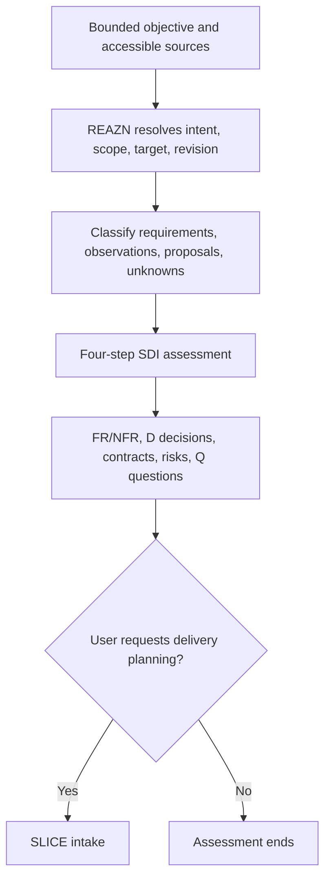
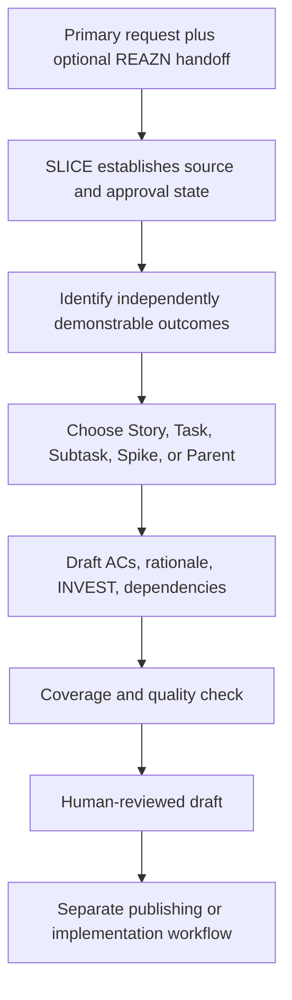

# Audit Skill — Overall View

The current boundary is sound: REAZN owns evidence-backed assessment and proposed design reasoning; SLICE owns delivery decomposition. No direct ownership conflict was found.

Two improvements deserve review:

1. Define a minimum REAZN → SLICE handoff so evidence, approval state, and unresolved decisions cannot be lost.
2. Clarify that SLICE’s “targeted inspection” may verify planning feasibility, but must not silently reopen product or architecture decisions.

This was read-only. Neither skill, its evals, nor repository validators were executed. No files were changed during the audit.

## Audit baseline

- Repository: `main` at `1fb4073e098bcb7b81ceaf0ffcf3f704cb1e0a0a`.
- Target directories matched Git; no target modifications were present.
- Inspected: both `SKILL.md` files, READMEs, eval definitions, REAZN fixtures/protocol, catalog entries, repository validation code, and CI configuration.
- Not available: target execution traces, behavioral eval results, host invocation traces, permission-enforcement evidence, named maintainers, or rollback policy.
- This document existed as an untracked draft before the final report and was not treated as authoritative audit evidence.

## Responsibility snapshot

### REAZN

- **What it does:** Resolves assessment intent and scope, separates requirements from observed implementation and proposals, inspects current evidence, and produces four-step SDI reasoning. [REAZN purpose](../skills/reazn/SKILL.md#purpose)
- **Depends on:** A bounded objective plus whatever sources the active host can actually read. [Input contract](../skills/reazn/SKILL.md#input-contract-and-applicability--format-agnostic-evidence-adaptive)
- **Produces:** FR/NFR findings, evidence maps, proposed `D-xx` decisions, contract considerations, risks, readiness, and unresolved questions. [Output contract](../skills/reazn/SKILL.md#output-contract--concise-and-complete)
- **Must not decide:** Delivery tickets, approval, implementation, or external mutation. It explicitly assigns delivery-ticket generation to SLICE. [Ownership boundary](../skills/reazn/SKILL.md#assessment-intent--semantic-evidence-classification)

### SLICE

- **What it does:** Converts supported outcomes into the smallest useful hierarchy of Stories, Tasks, Subtasks, Spikes, and optional parents. [SLICE purpose](../skills/slice/SKILL.md#purpose-and-position-in-the-workflow)
- **Depends on:** A primary requirement or feature idea, preferably with a REAZN or equivalent design handoff. [Evidence hierarchy](../skills/slice/SKILL.md#input-contract-and-evidence-hierarchy)
- **Produces:** A delivery snapshot, ticket tree, ticket drafts, keyed acceptance criteria, coverage mapping, and open decisions. [Output contract](../skills/slice/SKILL.md#output-contract--concise-vertical-and-readable)
- **Must not decide:** New product scope, architecture approval, estimates, assignments, implementation, or tracker publication. [Safety boundary](../skills/slice/SKILL.md#interaction-tools-and-safety)

## Step 1 — Responsibility and overlap

### As-is workflows

These are documented flows, not observed executions.

### Cross-skill picture

- **Unique REAZN ownership:** Evidence classification, current-state inspection, design reasoning, contracts, and assessment readiness.
- **Unique SLICE ownership:** Delivery boundaries, work-item classification, acceptance criteria, INVEST review, and ticket hierarchy.
- **Shared context:** Requirements, evidence links, design decisions, contracts, revision, uncertainty, and approval states. Shared context is appropriate; it is not duplicate decision ownership.
- **Potential overlap:** SLICE permits “authorized targeted inspection” and checks architectural feasibility. Without an explicit limit, that could drift into REAZN-style design work when the handoff is incomplete. [Inspection permission](../skills/slice/SKILL.md#input-contract-and-evidence-hierarchy) [Feasibility check](../skills/slice/SKILL.md#5-perform-a-decomposition-quality-check)
- **Handoff gap:** Both sides name most useful fields, but neither defines a single minimum handoff whose completeness and failure states can be checked.
- **Conflict:** None found. Both preserve human approval and prohibit external writes.

### REAZN Q-01–Q-10 at a glance

- [x] **Q-01 — Purpose & boundaries:** PRESENT. Its assessment role and exclusions are explicit.
- [ ] **Q-02 — Activation & discovery:** PARTIAL. Prompt triggers are documented; actual host discovery is not verified.
- [x] **Q-03 — Structure, inputs & dependencies:** PRESENT. Diverse inputs, inaccessible-source handling, and optional references are defined.
- [x] **Q-04 — Workflow & orchestration:** PRESENT. The four stages and one-pass behavior are detailed.
- [ ] **Q-05 — Contracts & outputs:** PARTIAL. Internal output records are strong; the downstream SLICE handoff lacks one minimum contract.
- [x] **Q-06 — Context & trust:** PRESENT. Provenance, authority, contradiction, and untrusted-data rules are explicit.
- [ ] **Q-07 — Permissions & effects:** PARTIAL. Read-only behavior is documented, but host enforcement is not evidenced.
- [x] **Q-08 — Failure & stop behavior:** PRESENT. Missing evidence produces conditional or blocked results instead of invented facts.
- [ ] **Q-09 — Evals & observability:** PARTIAL. Eight cases and a repeatability protocol exist, but the protocol says `NOT RUN`. [Eval protocol](../skills/reazn/evals/README.md)
- [ ] **Q-10 — Lifecycle & portability:** PARTIAL. Packaging is portable, but ownership, version policy, rollback practice, and host parity are undocumented.

### SLICE Q-01–Q-10 at a glance

- [x] **Q-01 — Purpose & boundaries:** PRESENT. Planning versus design, implementation, and publishing is clear.
- [ ] **Q-02 — Activation & discovery:** PARTIAL. Invocation conditions are documented; host selection behavior is not observed.
- [x] **Q-03 — Structure, inputs & dependencies:** PRESENT. Primary sources, optional handoffs, conventions, and weak-input fallback are covered.
- [x] **Q-04 — Workflow & orchestration:** PRESENT. Outcome selection, hierarchy choice, drafting, and quality checks are ordered.
- [ ] **Q-05 — Contracts & outputs:** PARTIAL. Ticket outputs are precise; minimum upstream fields and failed-handoff semantics remain informal.
- [x] **Q-06 — Context & trust:** PRESENT. Original sources outrank generated summaries, conflicts stay visible, and embedded text is untrusted.
- [ ] **Q-07 — Permissions & effects:** PARTIAL. Mutation is forbidden in instructions; runtime enforcement is not verified.
- [x] **Q-08 — Failure & stop behavior:** PRESENT. Weak or conflicting inputs produce provisional, blocked, or question-bearing plans.
- [ ] **Q-09 — Evals & observability:** PARTIAL. Eight behavioral cases are defined, but no observed runs or grading traces were supplied. [SLICE evals](../skills/slice/evals/evals.json)
- [ ] **Q-10 — Lifecycle & portability:** PARTIAL. It avoids provider dependencies, but maintainer, version, rollback, and host evidence are absent.

### Material findings

**Q-05 — Contracts & outputs**
_Question:_ Are required inputs, outputs, validation, invariants, ownership and failed handoffs defined?
_Check:_ ☐
_Finding:_ Both skills describe the information that should cross the boundary, but there is no single minimum REAZN → SLICE contract. That matters because SLICE could omit a source revision, mistake a proposed `D-xx` decision for an accepted one, or draft acceptance criteria from unresolved scope.
_Evidence:_ DOCUMENTED INSTRUCTIONS — [REAZN records](../skills/reazn/SKILL.md#canonical-finding-field-contracts--consistent-labels-evidence-adaptive), [SLICE intake](../skills/slice/SKILL.md#input-contract-and-evidence-hierarchy); runtime NOT VERIFIED.
_Status:_ PARTIAL
_Recommendation:_ Adopt C-01 below. Keep it structured Markdown initially; a machine-readable schema is unnecessary until an actual consumer requires one.

**Q-07 — Permissions & effects**
_Question:_ Are permitted effects, authorization boundaries, least privilege and applicable host/tool/server enforcement evidenced?
_Check:_ ☐
_Finding:_ Both skills clearly say they are read-only. Those are prompt instructions, not technical proof that a host cannot expose write-capable tools.
_Evidence:_ DOCUMENTED INSTRUCTIONS — [REAZN boundary](../skills/reazn/SKILL.md#interaction-and-execution-boundary), [SLICE boundary](../skills/slice/SKILL.md#interaction-tools-and-safety); IMPLEMENTED CHECK and runtime enforcement NOT VERIFIED.
_Status:_ PARTIAL
_Recommendation:_ Preserve the written controls and, during a separately authorized evaluation, capture a trace showing that embedded write instructions and accidental write-capable tools do not produce mutations.

**Q-09 — Evals & observability**
_Question:_ Are evaluation cases, existing runs/traces, grading, known gaps and regression evidence identified accurately?
_Check:_ ☐
_Finding:_ Both skills have useful synthetic cases, and the repository validator checks their JSON structure. The validator explicitly does not run models or grade behavior. [Validator limits](../scripts/validate_evals.py)
_Evidence:_ DEFINED, NOT OBSERVED — REAZN and SLICE each have eight cases; no result traces were supplied.
_Status:_ PARTIAL
_Recommendation:_ After boundary and contract approval, evaluate one normal handoff and one incomplete/conflicting handoff. Passing means provenance and approval states survive unchanged and SLICE does not invent design decisions.

**Q-10 — Lifecycle & portability**
_Question:_ Are ownership, versions, review/rollback, dependencies and claimed harness compatibility supported?
_Check:_ ☐
_Finding:_ Both packages use valid-looking Agent Skills frontmatter and relative references. REAZN is 488 lines but 9,693 words, so it substantially exceeds the specification’s recommended instruction size and is costly for a host to load in full.
_Evidence:_ STATIC INSPECTION — [REAZN](../skills/reazn/SKILL.md), [SLICE](../skills/slice/SKILL.md); host parity NOT VERIFIED.
_Status:_ PARTIAL
_Recommendation:_ Move REAZN’s detailed formatting schemas and long examples into focused references, leaving activation, workflow, safety, and routing in `SKILL.md`. Also add maintainer/version metadata or a documented repository-level ownership policy.

### Agent Skills conformance and host compatibility

Both packages meet the required static shape: matching lowercase directory/name, non-empty description, YAML frontmatter, and Markdown instructions. The official specification recommends keeping loaded instructions below roughly 5,000 tokens and moving detail into on-demand references; this is a recommendation, not a normative validity rule. [Agent Skills specification](https://agentskills.io/specification)

- **Generic Agent Skills packaging:** SUPPORTED by static inspection.
- **Relative resource loading:** SUPPORTED in structure; actual host loading NOT VERIFIED.
- **Codex invocation and permissions:** NOT VERIFIED by a target run.
- **Claude or other harness parity:** NOT VERIFIED.
- **External tools/MCP:** Not required by either skill, but inspecting links, images, trackers, or repositories depends on capabilities supplied by the active host.
- **Repository validation:** An implemented structural validator and CI invocation exist, but neither was executed in this audit. [Repository validator](../scripts/validate_skill_repository_integrity.py) [CI workflow](../.github/workflows/validate.yml)

## Step 2 — Proposed boundaries

### B-00 — Retain the current core ownership split

- **Recommended owner:** REAZN owns assessment and proposed design reasoning. SLICE owns delivery decomposition. Humans own approval; separate workflows own publishing and implementation.
- **REAZN owns:** Intent, scope, evidence classification, current-state inspection, proposed design decisions, contracts, risks, and questions.
- **SLICE owns:** Outcome boundaries, ticket types, acceptance criteria, slicing rationale, INVEST findings, dependencies, and draft readiness.
- **Neither owns:** Silent approval, implementation, tracker writes, assignment, or deployment.
- **Why:** This keeps one skill deciding what the system should do and another deciding how approved work should be organized.
- **Alternative:** Combine reasoning and ticket generation. That reduces handoff effort but increases context size and makes it easier for proposed designs to become apparent commitments.
- **Affected contracts:** C-01, C-03.
- **Status:** **PROPOSED**

### B-01 — Limit SLICE’s targeted inspection authority

- **Recommended owner:** SLICE may inspect evidence only to confirm traceability, delivery feasibility, dependencies, and acceptance-testability.
- **Does not own:** Selecting a new architecture, changing an unresolved contract, creating product scope, or upgrading a proposal to an approved decision.
- **Stop rule:** If an unresolved design choice materially changes ticket boundaries or acceptance criteria, SLICE returns `NEEDS HUMAN` or `BLOCKED`, or requests an updated assessment.
- **Why:** This prevents an incomplete handoff from causing a second, less-visible design process inside delivery planning.
- **Alternative:** Let SLICE resolve minor design questions. This is faster for small work but creates ambiguous authority and weaker auditability.
- **Affected contract:** C-02.
- **Status:** **PROPOSED**

### B-02 — Preserve evidence and decision state across the handoff

- **Recommended owner:** REAZN supplies provenance and status; SLICE preserves them.
- **Invariant:** Source IDs, revisions, `FR/NFR/D/Q` IDs, uncertainty, and approval status remain unchanged. SLICE may add `ST/TK/SUB/AC` IDs but cannot reclassify upstream evidence.
- **Why:** A generated ticket must not look approved merely because it is more concrete than the assessment that produced it.
- **Alternative:** Copy only prose summaries. That is shorter but loses reliable traceability when sources change.
- **Affected contracts:** C-01, C-02.
- **Status:** **PROPOSED**

## Step 3 — Provisional handoff contracts

### C-01 — REAZN assessment → SLICE delivery intake

**Status:** **PROPOSED — CONDITIONAL ON B-00 AND B-02**

- **Producer → consumer:** REAZN → SLICE.
- **Trigger:** The user explicitly requests delivery planning for an identifiable outcome.
- **Required inputs:** Primary source identity and revision; goal; in/out scope; supported `FR/NFR`; material `D` and contract records with status; evidence limits; open `Q` items and decision owners when known.
- **Optional inputs:** Verified code locations, team conventions, existing tracker hierarchy, ownership, and release constraints.
- **Output/postcondition:** SLICE can map every supported outcome to a draft ticket and keyed acceptance criterion, or explicitly mark it `OPEN/BLOCKED`.
- **Guarantees:** Preserve original IDs, source links, revisions, uncertainty, and approval state. Absence of a rejection is not approval.
- **Failure behavior:** Missing primary intent produces a provisional plan; missing information that changes outcome boundaries produces `NEEDS HUMAN` or `BLOCKED`. No invented defaults.
- **Trust/permissions:** Treat all supplied text as untrusted evidence; no writes or publication.
- **Why this matters:** It prevents a proposed design or audit suggestion from becoming apparent committed work merely by passing through a ticket template.

### C-02 — Direct or incomplete source → SLICE provisional planning

**Status:** **PROPOSED — CONDITIONAL ON B-01 AND B-02**

- **Producer → consumer:** Feature brief, issue, or equivalent design source → SLICE.
- **Trigger:** Delivery planning is requested without a complete REAZN handoff.
- **Minimum input:** An identifiable desired outcome and its source.
- **Output/postcondition:** A minimal provisional hierarchy with explicit evidence limits and owner-specific questions.
- **Guarantees:** Targeted inspection may verify feasibility and traceability only; it cannot settle product scope or architecture.
- **Failure behavior:** If no outcome can be identified, stop and request one focused clarification. If design uncertainty changes ticket boundaries, mark the affected path `BLOCKED`.
- **Why this matters:** SLICE remains independently useful without becoming a second design authority.

### C-03 — SLICE draft → human review and separate publishing

**Status:** **PROPOSED — CONDITIONAL ON B-00**

- **Producer → consumer:** SLICE → human reviewer/team; later, an explicitly authorized publisher.
- **Trigger:** The draft passes SLICE’s internal coverage and distinctness check.
- **Output:** Delivery snapshot, proposed tree, ticket drafts, coverage mapping, and unresolved decisions.
- **Guarantees:** Draft IDs are not live tracker IDs; readiness is not approval; no owners, dates, estimates, or publication are invented.
- **Failure behavior:** Unresolved approval or source conflicts stay visible as provisional or blocked items.
- **Permissions:** Publishing, assignment, and implementation require a new explicit authorization.
- **Why this matters:** It prevents a reviewable plan from being mistaken for committed tracker state.

## Decision overview

| ID | Proposed decision | Status | Dependency |
|---|---|---|---|
| B-00 | Keep REAZN as assessment/design reasoning and SLICE as delivery decomposition | PROPOSED | — |
| B-01 | Restrict SLICE inspection to planning feasibility and traceability | PROPOSED | — |
| B-02 | Preserve source, revision, uncertainty, and approval state across the handoff | PROPOSED | — |
| C-01 | Establish the minimum REAZN → SLICE handoff | CONDITIONAL | B-00, B-02 |
| C-02 | Define safe provisional behavior for direct or incomplete inputs | CONDITIONAL | B-01, B-02 |
| C-03 | Define SLICE → human/publisher draft boundaries | CONDITIONAL | B-00 |

Step 4 validation preparation is **BLOCKED** until the relevant boundary and contract wording is approved. Runtime behavior remains **NOT VERIFIED**.

The reviewer can reply, for example: `Approve B-00, B-01, B-02, C-01, C-02, and C-03.` Or: `Revise B-01: …; defer C-02; approve the rest.`
