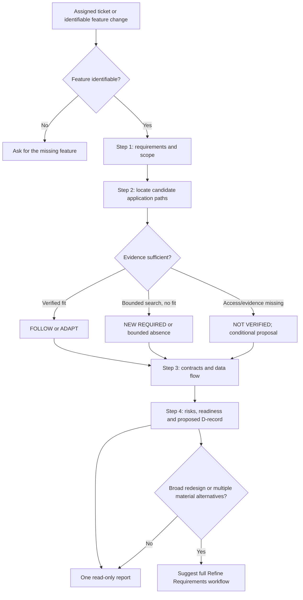

# Audit Skill — At a Glance

## Inspection boundary

Target: `refine-requirements-light`

Revision: `main` at `2dd3417407f83390fdbda0fa687b0cbae6127d2b`

Inspected:

- [SKILL.md](../skills/refine-requirements-light/SKILL.md#L1)
- [README.md](../skills/refine-requirements-light/README.md#L1)
- [Catalog entry](../catalog.json#L101)
- [Claude Code adapter](../adapters/claude/README.md#L15)
- [OpenAI/Codex adapter](../adapters/openai/README.md#L16)
- [Repository architecture](architecture.md#L17)
- [Validation and runtime-safety boundaries](skill-repository-integrity-and-runtime-safety.md#L24)
- [CI workflow](../.github/workflows/validate.yml#L17)
- Downstream contracts in [plan-ticket-delivery](../skills/plan-ticket-delivery/SKILL.md#L8) and [review-implementation](../skills/review-implementation/SKILL.md#L8)
- The historical [November 8 DFRDE review](dfrde/refine-requirements-light-dfrde-review-2026-11-08.md#L1)

Not executed: the target skill, adapters, validators, tests, Jira integrations, or behavioral evaluations. No files were changed during the assessment.

The historical DFRDE review is pinned to `dc80e68…`; seven material target commits followed it on November 11. Its behavioral conclusions are therefore historical rather than current evidence.

## Skill snapshot

Purpose: Produce one concise, read-only engineering assessment of a Jira ticket or feature change against verified existing application code. [Source](../skills/refine-requirements-light/SKILL.md#L8)

Trigger: An assigned Jira ticket or identifiable feature change with relevant application evidence. The metadata and body do not fully resolve whether non-Jira feature briefs are first-class inputs. [Source](../skills/refine-requirements-light/SKILL.md#L1)

Inputs:

- Ticket intent, actors, requirements, acceptance criteria, and constraints.
- Accessible application code, callers, tests, contracts, configuration, ADRs, and team conventions.
- Repository revision and evidence limitations.

Dependencies:

- A compatible Agent Skills host.
- Authorized ticket and repository readers supplied by that host.
- No fixed Jira client, MCP server, shell, or delegation mechanism is required by the written contract.

Workflow:

1. Establish requirements and scope.
2. Locate and verify existing code patterns.
3. Classify reuse as FOLLOW, ADAPT, NEW REQUIRED, bounded absence, or not verified.
4. Inspect critical contracts and data paths.
5. Report trade-offs, risks, readiness, proposed decisions, and unresolved questions. [Source](../skills/refine-requirements-light/SKILL.md#L99)

Output: One report containing a Ticket Snapshot, SDI Steps 1–4, and open decisions—not separate artifacts. It preserves `FR-xx`, `NFR-xx`, `D-xx`, contract considerations, and implementation-deviation watchpoints. [Source](../skills/refine-requirements-light/SKILL.md#L192)

Effects: Written instructions prohibit code, Jira, branch, commit, migration, deployment, and agent-launch effects. Enforcement belongs to the consuming host. [Source](../skills/refine-requirements-light/SKILL.md#L206)

Stop behavior: If evidence is incomplete, produce a conditional report; ask only when the feature itself cannot be identified. Broad redesign or unresolved product decisions are handed to the full collaborative skill. [Source](../skills/refine-requirements-light/SKILL.md#L204)

Relationship review: Not applicable—one target skill was audited.

## Documented as-is workflow



This diagram abstracts written instructions; it is not an observed execution trace.

## Ten-dimension dashboard

| Area | Finding and consequence |
|---|---|
| Q-01 Purpose & boundaries | The purpose, one-pass behavior, read-only boundary, and separation from the interactive sibling are explicit. Target users are implied rather than directly named, and runtime compliance was not observed. [Purpose](../skills/refine-requirements-light/SKILL.md#L8) |
| Q-02 Activation & discovery | Valid frontmatter and a catalog entry exist, while actual host selection and incorrect-trigger behavior have not been exercised. [Metadata](../skills/refine-requirements-light/SKILL.md#L1) [Catalog](../catalog.json#L101) |
| Q-03 Structure, inputs & dependencies | Ticket and code evidence requirements are described, but concrete reader/tool availability, versions, and credentials are deliberately left to the host. [Priorities](../skills/refine-requirements-light/SKILL.md#L14) |
| Q-04 Workflow & orchestration | All four SDI stages, evidence decisions, and escalation boundaries are documented. The skill requires no workers, and model adherence to its extensive formatting and reasoning rules has not been observed. [Workflow](../skills/refine-requirements-light/SKILL.md#L99) |
| Q-05 Contracts & outputs | The report structure and stable requirement/decision identifiers are unusually explicit, and downstream skills consume those identifiers. No current representative output demonstrates completeness or usability. [Output](../skills/refine-requirements-light/SKILL.md#L192) [Downstream plan contract](../skills/plan-ticket-delivery/SKILL.md#L35) |
| Q-06 Context & trust | The skill distinguishes requirements, observed code, proposals, assumptions, and untrusted retrieved content. Citation and contradiction behavior remain written safeguards rather than observed results. [Evidence rules](../skills/refine-requirements-light/SKILL.md#L16) [Trust boundary](../skills/refine-requirements-light/SKILL.md#L211) |
| Q-07 Permissions & effects | Read-only behavior and prohibited effects are clear, while actual least-privilege enforcement is owned by the host and was not checked. [Skill boundary](../skills/refine-requirements-light/SKILL.md#L206) [Repository ownership boundary](architecture.md#L17) |
| Q-08 Failure & stop behavior | Missing evidence produces conditional findings instead of invented facts, and an entirely absent feature prompts clarification. Timeout, partial retrieval, contradictory-source, and repeated tool-failure behavior are not specifically defined. [Conditional behavior](../skills/refine-requirements-light/SKILL.md#L16) |
| Q-09 Evals & observability | Repository CI structurally validates skills and adapters, but the target has no local evals, scripts, traces, or behavioral grader. The historical review predates the current instruction set. [CI](../.github/workflows/validate.yml#L17) [Validation limits](skill-repository-integrity-and-runtime-safety.md#L76) |
| Q-10 Lifecycle & portability | Canonical-source and adapter workflows are documented. Maintainer ownership, target versioning, rollback criteria, supported host versions, and current cross-host behavioral parity are not established. [OpenAI source rule](../adapters/openai/README.md#L117) |

## Agent Skills format assessment

The current [Agent Skills specification](https://agentskills.io/specification) requires a `SKILL.md` with YAML frontmatter, a conforming `name`, and a nonempty `description`; it recommends keeping the main skill below 500 lines and loading supporting resources progressively.

| Check | Static finding |
|---|---|
| Required `SKILL.md` | Present |
| Required YAML frontmatter | Present |
| Name syntax and directory match | `refine-requirements-light` conforms |
| Description | Present, within the published length limit, and describes purpose and activation |
| Markdown body | Present |
| Size recommendation | 222 lines, below the published 500-line recommendation |
| Optional resources | README present; absence of scripts, references, and assets is permitted |
| Relative references | The sibling skill is referenced by a relative path |
| Official `skills-ref validate` | Not run under the audit’s no-test boundary |

This is static conformance, not runtime certification.

## Cross-runtime compatibility

The target itself does not declare supported runtimes. The repository offers general Claude and OpenAI distribution routes, while its architecture also mentions ChatGPT Work. Those repository routes do not prove target-specific execution.

| Capability | Claude Code | Codex/OpenAI | ChatGPT Work |
|---|---|---|---|
| Format and packaging | **ADAPTER REQUIRED** — documented general adapter; target packaging not run | **ADAPTER REQUIRED** — documented general adapter; target packaging not run | **NOT VERIFIED** |
| Discovery and invocation | **NOT VERIFIED** | **NOT VERIFIED** | **NOT VERIFIED** |
| Instruction loading and isolation | **NOT VERIFIED** | **NOT VERIFIED** | **NOT VERIFIED** |
| Ticket/code tools and credentials | **NOT VERIFIED** | **NOT VERIFIED** | **NOT VERIFIED** |
| Delegation and aggregation | **NOT VERIFIED** — no delegation is required by the target contract | **NOT VERIFIED** — no delegation is required by the target contract | **NOT VERIFIED** |
| Permission enforcement | **NOT VERIFIED** | **NOT VERIFIED** | **NOT VERIFIED** |
| Output/failure parity | **NOT VERIFIED** | **NOT VERIFIED** | **NOT VERIFIED** |
| Behavioral verification and lifecycle | **NOT VERIFIED** | **NOT VERIFIED** | **NOT VERIFIED** |

## Key gaps and verification limits

The written design is coherent and substantially stronger than the version reviewed on November 8. Its principal weakness is now evidence, not missing instruction detail:

- No behavioral evidence covers the current 222-line skill after the November 11 formatting, diagram, and decision-traceability changes.
- The README still summarizes the older, simpler output and omits the current D-ID/contract/watchpoint contract. Compare [README output](../skills/refine-requirements-light/README.md#L3) with [current decision traceability](../skills/refine-requirements-light/SKILL.md#L76).
- Jira-only versus generic feature-input activation is not fully settled.
- Prompt-level read-only rules are not permission enforcement.
- Failure behavior for partial reads, timeouts, and contradictory sources is less precise than the happy-path workflow.
- The historical DFRDE review’s unassigned owner and keep-as-is recommendation have not been refreshed against the current source. [Historical status](dfrde/refine-requirements-light-dfrde-review-2026-11-08.md#L7)

No evaluation cases were generated or run during the audit.

# Refine Requirements Light — Self-Assessment

## Ticket Snapshot

Goal: Assess the current `refine-requirements-light` skill itself and identify the smallest evidence-backed refinement direction.

Actor: Skill maintainer and agents using the skill.

Revision: `main` at `2dd3417407f83390fdbda0fa687b0cbae6127d2b`.

Paths examined: Target skill and README, full interactive sibling, downstream planning/review consumers, adapters, repository safety documentation, CI, catalog, and historical DFRDE review.

Evidence limitation: This is a meta-use outside the skill’s normal application-ticket scenario. No explicit desired behavioral change, representative ticket/codebase run, or current target-specific evaluation was supplied.

Recommendation: Keep the four-step one-pass architecture; prioritize current behavioral evidence and small contract/documentation clarifications before expanding the instructions again.

## Step 1 — Requirements & scope

### Functional Requirements (FRs)

**FR-01 — Produce one complete assessment**

Requirement: Deliver all four SDI steps in one response without an interview or approval checkpoint.

Status: CONFIRMED current contract.

Source: [Purpose and one-pass rule](../skills/refine-requirements-light/SKILL.md#L10)

**FR-02 — Verify before recommending**

Requirement: Inspect real code, callers, contracts, tests, and conventions before claiming pattern fit or recommending reuse.

Status: CONFIRMED current contract.

Source: [Evidence priorities](../skills/refine-requirements-light/SKILL.md#L14)

**FR-03 — Preserve traceability**

Requirement: Maintain stable FR/NFR/D identifiers, contract implications, source evidence, approval state, and realistic implementation watchpoints.

Status: CONFIRMED current contract.

Source: [Decision traceability](../skills/refine-requirements-light/SKILL.md#L76)

**FR-04 — Degrade safely when evidence is incomplete**

Requirement: Produce bounded, conditional findings rather than inventing code paths, patterns, guarantees, or approvals.

Status: CONFIRMED current contract.

Source: [Conditional behavior](../skills/refine-requirements-light/SKILL.md#L16)

**FR-05 — Support downstream planning and review**

Requirement: Produce a handoff usable by delivery planning and post-implementation review without automatically invoking either workflow.

Status: OBSERVED repository integration.

Source: [Planning input contract](../skills/plan-ticket-delivery/SKILL.md#L35) and [review input contract](../skills/review-implementation/SKILL.md#L14)

### Non-Functional Requirements (NFRs)

**NFR-01 — Read-only safety**

Quality: No source, ticket, branch, deployment, or external-system mutation.

Linked FR: FR-01 through FR-05.

Status: CONFIRMED written requirement; enforcement is host-dependent.

Source: [Execution boundary](../skills/refine-requirements-light/SKILL.md#L206)

**NFR-02 — Readability**

Quality: Concise, vertically labeled output that remains usable at narrow terminal widths.

Linked FR: FR-01 and FR-03.

Status: CONFIRMED current requirement; behavioral compliance not tested.

Source: [Output-format invariant](../skills/refine-requirements-light/SKILL.md#L22)

**NFR-03 — Evidence integrity**

Quality: Separate confirmed requirements, observations, proposals, assumptions, and unknowns; never invent history, guarantees, metrics, or approvals.

Linked FR: FR-02 through FR-04.

Status: CONFIRMED current requirement.

Source: [Authority and evidence rule](../skills/refine-requirements-light/SKILL.md#L18)

**NFR-04 — Portability**

Quality: Remain useful without assuming a particular Jira client, MCP endpoint, model, shell, or delegation API.

Linked FR: FR-01 and FR-04.

Status: PROPOSED compatibility requirement inferred from repository architecture; runtime parity is not verified.

Source: [Repository ownership model](architecture.md#L17)

Scope: Preserve the existing one-pass assessment contract and identify refinement needs.

Out of scope: Editing the skill, creating evals, approving a design, running the target, or changing adapters.

## Step 2 — Verify patterns & recommend high-level design

**Area: Current Light workflow**

Where it lives: [SKILL.md workflow](../skills/refine-requirements-light/SKILL.md#L99)

What it does today: Combines requirements, verified reuse analysis, targeted contract/data-flow inspection, risks, readiness, and proposed decision records.

Fit to ticket: Direct baseline for FR-01 through FR-04.

Verdict: ADAPT.

Why: The architecture is coherent; the missing confidence comes chiefly from behavioral evidence and small ambiguity/failure-contract gaps, not from a need for another workflow stage.

---

**Area: Interactive sibling boundary**

Where it lives: [refine-requirements](../skills/refine-requirements/SKILL.md#L8)

What it does today: Supports broader feature inputs, collaborative exploration, explicit D-ID approval, and overall design sign-off.

Fit to ticket: Establishes a verified escalation path for broad redesign and ambiguous decisions.

Verdict: FOLLOW.

Why: Light should retain its noninteractive identity instead of absorbing the sibling’s checkpoints and approval state machine.

---

**Area: Downstream handoff**

Where it lives: [plan-ticket-delivery](../skills/plan-ticket-delivery/SKILL.md#L35) and [review-implementation](../skills/review-implementation/SKILL.md#L14)

What it does today: Consumes FR/NFR/D IDs, contract considerations, risks, and implementation watchpoints.

Fit to ticket: Confirms that the new decision-traceability fields have real repository consumers.

Verdict: FOLLOW.

Why: Removing or renaming these fields would break a documented handoff; their behavioral usability still needs evidence.

---

**Area: Validation and release evidence**

Where it lives: [CI workflow](../.github/workflows/validate.yml#L17) and [safety documentation](skill-repository-integrity-and-runtime-safety.md#L45)

What it does today: Checks structure, catalog consistency, eval schemas, and adapters.

Fit to ticket: Covers packaging integrity but not FR-01 through FR-04 behavior.

Verdict: NEW REQUIRED.

Why: Current structural checks cannot show that the latest instruction set produces concise, complete, evidence-disciplined reports.

### Existing-pattern purpose and rationale

The Light/full-skill separation is sound: Light optimizes for one-pass assessment, while the sibling owns collaborative decisions and explicit approvals. Downstream skills already treat Light output as proposed evidence rather than authorization, which preserves human ownership.

The strict output and traceability additions are internally consistent, but they repeat similar rules across the format invariant, individual workflow steps, and final output contract. Whether that repetition improves adherence or merely consumes model attention is not established by current evidence.

### Observed current flow

```text
+--------------------------------+
| Ticket / feature request       |
| + accessible application code  |
+--------------------------------+
                 |
                 | inspect and classify evidence
                 v
+--------------------------------+
| Refine Requirements Light      |
| Steps 1–4 + output invariants  |
+--------------------------------+
                 |
                 | one proposed assessment
                 v
+--------------------------------+
| Developer / reviewer           |
+--------------------------------+
          | optional later use
          v
+--------------------------------+
| Plan Ticket Delivery or        |
| Review Implementation          |
+--------------------------------+
```

The target owns synthesis and traceability. The host owns access and permissions. Downstream skills consume the report but do not inherit approval.

### Proposed flow

```text
+--------------------------------+
| Ticket / feature request       |
| + accessible application code  |
+--------------------------------+
                 |
                 v
+--------------------------------+
| Refine Requirements Light      |
| existing Steps 1–4 retained    |
+--------------------------------+
          |
          +---- evidence available ----+
          |                            |
          |                            v
          |                 +-----------------------+
          |                 | Evidence-backed      |
          |                 | proposed assessment  |
          |                 +-----------------------+
          |
          +---- partial/failed access ---+
                                       |
                                       v
                           +-------------------------+
                           | Explicit bounded report |
                           | + failure/source status |
                           | [PROPOSED clarification]|
                           +-------------------------+
                                       |
                                       v
                           +-------------------------+
                           | Human/downstream review |
                           +-------------------------+

Separate lifecycle path:
current behavioral evaluation [PROPOSED]
        -> evidence-backed instruction changes
        -> adapter/package validation
```

### Design rationale

**D-01 — Retain the one-pass four-step core**

Decision: Keep the current Light/full-skill separation and existing downstream identifier contract.

Why: Current source and consumers align; no inspected evidence justifies a redesign.

Alternative: Merge Light into the collaborative sibling.

Trade-off: Merging would reduce duplicated concepts but remove the intentionally noninteractive workflow.

Status: PROPOSED.

**D-02 — Add evidence before more instruction growth**

Decision: Use a separately authorized target-specific behavioral evaluation before further expanding or substantially reorganizing the prompt.

Why: The latest formatting and traceability changes have no current target-specific execution evidence.

Alternative: Continue refining by static inspection alone.

Trade-off: Evaluation requires model/runtime resources, but directly addresses the largest evidence gap.

Status: CONDITIONAL.

**D-03 — Clarify activation and partial-access failure behavior**

Decision: Make a small future clarification covering Jira-only versus generic feature inputs, contradictory sources, partial reads, timeouts, and bounded retry/stop behavior.

Why: The full sibling explicitly accepts broad inputs, while Light’s metadata emphasizes assigned Jira tickets and its failure contract is less precise than its main workflow.

Alternative: Leave these behaviors to host judgment.

Trade-off: More text could worsen instruction density, so the change should consolidate rather than append repeated rules.

Status: CONDITIONAL.

## Step 3 — Deep dive & data flow

**Instruction/data flow**

Source: User ticket or feature brief plus authorized repository evidence.

Ingestion: The host selects and loads `SKILL.md`.

Transformation: The model extracts requirements, verifies relevant paths, classifies evidence, and proposes a design.

Output: One Markdown engineering report.

Consumers: Human developer/reviewer; optionally delivery planning or post-implementation review.

Persistence: None supplied by this skill.

Side effects: Forbidden by written instructions; actual enforcement belongs to the host.

**Current input contract**

Owner: User and source-system owners.

Guarantee: An identifiable ticket or feature change is expected.

Unknown: Whether arbitrary feature briefs are fully supported, despite “feature change” wording in the body.

Linked decision: D-03.

**Current output contract**

Owner: Refine Requirements Light.

Guarantee: Ticket Snapshot, Steps 1–4, open decisions, stable requirement/decision IDs, evidence labels, and no automatic approval.

Compatibility: Downstream consumers explicitly accept these fields.

Linked requirements: FR-01, FR-03, FR-05.

Linked decision: D-01.

**Permission contract**

Current guarantee: Prompt instructions prohibit mutations.

Actual enforcement: NOT VERIFIED; host/tool policy owns it.

Linked requirement: NFR-01.

**Failure contract**

Current guarantee: Missing evidence yields conditional or not-verified findings; an entirely absent feature may trigger one clarification.

Unknown: Partial retrieval, timeout, repeated tool failure, and contradictory-source resolution.

Linked requirements: FR-04, NFR-03.

Linked decision: D-03.

**Tests and checks**

Tests inspected: No target-local tests or eval definitions exist. Repository CI definitions are structural. The historical review predates current behavior.

Checks actually run: None. Only read-only source inspection was performed.

Future verification: A separate `evaluate-skill` request could assess current behavioral adherence, but this run did not create cases or invoke it.

Data-flow deep dive: Application data storage, transactions, and consistency are not applicable to this instruction-only target.

## Step 4 — Trade-offs, risks & readiness

**Preferred minimal change**

Recommendation: Retain the current structure. First obtain behavioral evidence; then make only evidence-supported clarifications to activation, failure behavior, README parity, or duplicated wording.

**Risk: Instruction density**

Classification: Plausible risk.

Consequence: Repeated formatting and traceability rules may compete with codebase reasoning or concision.

Evidence: Static repetition across [format rules](../skills/refine-requirements-light/SKILL.md#L22), [workflow](../skills/refine-requirements-light/SKILL.md#L99), and [output contract](../skills/refine-requirements-light/SKILL.md#L192).

**Risk: Unevaluated recent behavior**

Classification: Verification gap.

Consequence: The current skill may not consistently satisfy its new diagram, vertical-layout, decision-record, and concision requirements.

Evidence: Target-local package contains only `SKILL.md` and `README.md`; repository validation does not prove behavioral correctness.

**Risk: Documentation drift**

Classification: Confirmed documentation mismatch.

Consequence: README users do not see the newer D-ID, contract, and deviation-watchpoint expectations.

Evidence: [README summary](../skills/refine-requirements-light/README.md#L3) versus [current traceability contract](../skills/refine-requirements-light/SKILL.md#L76).

**Risk: Runtime portability assumptions**

Classification: Verification gap.

Consequence: General adapters may package the skill, but invocation, permissions, source access, and output parity remain host-specific.

Evidence: [Adapter limits](../adapters/claude/README.md#L85).

**Readiness**

Status: CONDITIONAL.

Reason: The current design is ready for maintainer review, but an implementation/change proposal should wait for the intended input scope and behavioral acceptance evidence to be chosen.

### Proposed Engineering Decision Record

**D-01 — Retain the one-pass four-step core**

Decision: Keep the current architecture and Light/full-workflow separation.

Why/evidence: The target, sibling, and downstream consumers have compatible ownership and handoff contracts.

Alternative: Merge or substantially rewrite the skill.

Contract impact: Preserve FR/NFR/D IDs and noninteractive behavior.

Linked requirements: FR-01, FR-03, FR-05, NFR-01.

Status: PROPOSED.

Revisit if: Behavioral evidence shows the current structure cannot produce concise or reliable reports.

**D-02 — Require behavioral evidence before further expansion**

Decision: Evaluate the current revision before adding more detailed instructions.

Why/evidence: Structural CI and the historical review do not cover the latest behavior.

Alternative: Static refinement only.

Contract impact: None until evaluation results justify a change.

Linked requirements: FR-01 through FR-04, NFR-02, NFR-03.

Status: CONDITIONAL.

Revisit if: Representative current execution evidence already exists elsewhere.

**D-03 — Consolidate scope and failure clarification**

Decision: If change is authorized, clarify supported feature inputs and bounded partial-access behavior in one compact location.

Why/evidence: Current activation language and failure rules leave host-dependent ambiguity.

Alternative: Preserve existing model discretion.

Contract impact: Input eligibility, stop conditions, and evidence-status reporting.

Linked requirements: FR-04, NFR-03, NFR-04.

Status: CONDITIONAL.

Revisit if: Maintainer intent is strictly Jira-only or behavioral evaluation shows the current language is sufficient.

Implementation-deviation watchpoints: Any future change that removes the one-pass contract, renames stable handoff IDs, introduces automatic writes or agents, or treats proposals as approved decisions should receive explicit review.

## Open decisions / questions for the ticket

**Q-01 — Skill owner**

Question: Is Light intentionally limited to assigned Jira tickets, or should its metadata explicitly support pasted stories, acceptance criteria, and generic feature briefs?

Blocks implementation: YES for activation-copy changes.

**Q-02 — Evaluation owner**

Question: What representative outputs define acceptable concision, evidence quality, diagram correctness, traceability, and missing-access behavior for the current revision?

Blocks implementation: YES for evidence-led prompt changes.

**Q-03 — Harness owners**

Question: Which Claude, Codex, or ChatGPT Work versions and permission configurations are actually supported?

Blocks implementation: NO for source-only maintenance; YES for portability claims.

**Q-04 — Maintainer**

Question: Should the November 8 DFRDE review be refreshed or explicitly marked superseded after the November 11 behavioral-contract changes?

Blocks implementation: NO.

No repository files, tickets, evaluations, or external systems were modified during the assessment.
