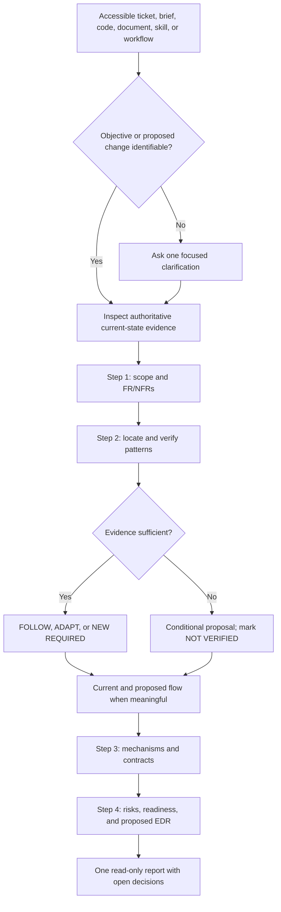

# Audit Skill — At a Glance

## Target and inspection boundary

Target: `refine-requirements-light` at repository HEAD `54b21c658e248888555c913714c8a4a1539554ff`; target’s latest change is `e52a59d` from November 13, 2026.

Inspected:

- [Operational SKILL.md](../skills/refine-requirements-light/SKILL.md)
- [Package README](../skills/refine-requirements-light/README.md)
- [Catalog registration](../catalog.json)
- [Linked full Refine Requirements skill](../skills/refine-requirements/SKILL.md)
- [Claude adapter documentation](../adapters/claude/README.md)
- [OpenAI/Codex adapter documentation](../adapters/openai/README.md)
- [Repository validator](../scripts/validate_skill_repository_integrity.py)
- [CI configuration](../.github/workflows/validate.yml)
- [Runtime-safety boundaries](skill-repository-integrity-and-runtime-safety.md)
- [Prior DFRDE review](dfrde/refine-requirements-light-dfrde-review-2026-11-08.md)
- Current [Agent Skills specification](https://agentskills.io/specification)

The target was not executed during the audit phase, and no tests, validators, live host permissions, external systems, or current CI results were exercised. The later self-assessment below applies its written method but is not an independent behavioral evaluation.

Cross-skill overlap: not applicable—there is one target skill.

## Skill snapshot

- Purpose: one-pass, read-only SDI assessment for identifiable changes across software, agent skills, documents, and operational workflows.
- Trigger: an accessible source with an identifiable objective or proposed change.
- Inputs:
  - Source request, ticket, brief, code, document, audit finding, or workflow.
  - Available current-state evidence.
  - Relevant constraints and acceptance evidence.
- Dependencies:
  - Host-provided access to the relevant sources and inspection tools.
  - Optional handoff to the full `refine-requirements` sibling.
- Workflow:
  1. Establish scope and FR/NFRs.
  2. Verify existing patterns and propose a high-level design.
  3. Examine critical mechanisms and contracts.
  4. Assess alternatives, risks, readiness, and proposed decisions.
- Agents/tools: none declared; coding-agent launch and external mutation are forbidden.
- Output: one vertically formatted report containing an input snapshot, four SDI steps, and open decisions.
- Side effects: none intended.
- Stop behavior: ask one clarification only if no objective can be identified; otherwise return a conditional report.
- Unknowns: host activation, permission enforcement, formatting adherence, cross-runtime behavior, and behavioral reliability remain unverified. [SKILL.md L10–28](../skills/refine-requirements-light/SKILL.md#L10-L28) [SKILL.md L200–219](../skills/refine-requirements-light/SKILL.md#L200-L219)

## Coverage dashboard

| Area | Evidence-backed finding | Consequence |
|---|---|---|
| Q-01 Purpose & boundaries | The operational contract clearly defines a broad, read-only assessment, but the README and catalog still describe a Jira/application-code workflow. [SKILL.md L10–20](../skills/refine-requirements-light/SKILL.md#L10-L20) [README L3–7](../skills/refine-requirements-light/README.md#L3-L7) [catalog L101–106](../catalog.json#L101-L106) | Users and discovery surfaces may infer different scopes. |
| Q-02 Activation & discovery | Valid frontmatter and catalog registration exist; live activation was not tested. | Static discovery is supported, but actual selection behavior is unknown. |
| Q-03 Structure, inputs & dependencies | Diverse inputs and partial-access handling are documented. Tool requirements and the availability of the linked full sibling are host-dependent. [SKILL.md L14–20](../skills/refine-requirements-light/SKILL.md#L14-L20) | The skill can degrade conditionally, but an optional handoff may be unavailable after single-skill installation. |
| Q-04 Workflow & orchestration | Four ordered SDI stages, evidence labels, and decision rules are detailed. No agent delegation is required. [SKILL.md L107–198](../skills/refine-requirements-light/SKILL.md#L107-L198) | The architecture is understandable, but adherence is model-directed and unobserved. |
| Q-05 Contracts & outputs | A detailed five-section output contract exists, including FR/NFR and D-ID traceability. [SKILL.md L200–212](../skills/refine-requirements-light/SKILL.md#L200-L212) | Downstream structure is predictable; “concise” has no measurable acceptance threshold. |
| Q-06 Context & trust | Instructions distinguish authority, observation, assumptions, proposals, and untrusted retrieved content. [SKILL.md L22–28](../skills/refine-requirements-light/SKILL.md#L22-L28) [SKILL.md L214–219](../skills/refine-requirements-light/SKILL.md#L214-L219) | Strong written provenance discipline exists, but it has not been behaviorally checked. |
| Q-07 Permissions & effects | Read-only and no-auto-approval restrictions are explicit. Repository policy correctly states that prompt text is not enforcement. [SKILL.md L214–219](../skills/refine-requirements-light/SKILL.md#L214-L219) [runtime safety L120–137](skill-repository-integrity-and-runtime-safety.md#L120-L137) | Actual safety depends on host/tool permissions. |
| Q-08 Failure & stop behavior | Missing evidence, conflicting sources, absent baselines, and an unidentified objective are addressed. Detailed timeout and partial multi-source failure handling is not specified. | Conditional reporting is supported; runtime/tool recovery remains host-dependent. |
| Q-09 Evals & observability | No target-local evals, scripts, or preserved runtime traces were found. Repository validation is structural and explicitly does not prove behavior. [validator L20–28](../scripts/validate_skill_repository_integrity.py#L20-L28) | Reliability and format adherence are not demonstrated for the current revision. |
| Q-10 Lifecycle & portability | Git history and two packaging adapters exist, but no maintainer, supported-version policy, rollback contract, or current-revision behavioral record is declared. The prior review covers an older, materially narrower version. | Review conclusions cannot safely be inherited from the November 8 review. |

## Agent Skills format check

| Specification area | Finding |
|---|---|
| Required directory and `SKILL.md` | Present. |
| YAML frontmatter | Present with required `name` and `description`. |
| Name constraints and directory match | `refine-requirements-light` satisfies the current normative rules. |
| Description | Non-empty, below the 1,024-character limit, and describes behavior and activation context. |
| Optional fields | `license`, `compatibility`, `metadata`, and `allowed-tools` are absent; this is permitted. |
| Markdown body | Present; the specification imposes no fixed body structure. |
| Progressive disclosure | The file is 237 lines, within the recommended 500-line ceiling. At 31 KB/4,108 words, its exact token count was not measured; extracting long examples and repeated formatting rules could improve context efficiency. |
| References | The sibling link resolves in this repository, but it points outside the package. Single-skill packaging does not guarantee the sibling is installed. |
| Static validation | The repository validator checks frontmatter, naming, catalog consistency, and `references/` links, but it does not check sibling `../` links. It was inspected, not run. [validator L77–106](../scripts/validate_skill_repository_integrity.py#L77-L106) |

## Cross-runtime compatibility

| Capability | Claude Code | Codex/OpenAI | Evidence limit |
|---|---|---|---|
| Format and packaging | ADAPTER REQUIRED | ADAPTER REQUIRED | Repository adapters copy/package canonical skill directories. |
| Discovery and invocation | NOT VERIFIED | NOT VERIFIED | No live host activation was observed. |
| Instructions and context | NOT VERIFIED | NOT VERIFIED | No context-limit or adherence trace was available. |
| Tools and integrations | NOT VERIFIED | NOT VERIFIED | Required inspection capabilities depend on the active host and input. |
| Delegation | NOT VERIFIED | NOT VERIFIED | The skill requires no delegation, but parity was not exercised. |
| Permission enforcement | NOT VERIFIED | NOT VERIFIED | Read-only behavior is prompt instruction, not a technical boundary. |
| Contracts and failures | NOT VERIFIED | NOT VERIFIED | No representative execution or failure trace was inspected. |
| Verification and lifecycle | NOT VERIFIED | NOT VERIFIED | General adapter tests exist; no current target-specific behavioral results were found. |

The Claude adapter explicitly notes that selection does not infer dependencies, which matters for the sibling-skill link. [Claude adapter L74–79](../adapters/claude/README.md#L74-L79)

## Documented as-is workflow



This abstracts written instructions only; it is not a recorded execution.

## Key gaps and verification limits

- README, catalog, and root documentation have not caught up with the input-agnostic operational contract.
- The optional full-skill handoff is not guaranteed in single-skill packages.
- No target-specific behavioral evaluation or cross-host execution evidence exists for the current revision.
- The current core file is instruction-dense, creating tension between “concise” output and numerous mandatory sections.
- Ownership, supported runtimes, acceptance thresholds, and release/rollback expectations are unassigned.
- Runtime permissions and read-only enforcement require host evidence; static instructions cannot prove them.

# Refine Requirements Light — Self-Assessment

## Input Snapshot

Input type: Agent-skill definition plus audit findings.

Objective: Preserve the skill’s one-pass, evidence-first SDI workflow while making its scope, packaging, context footprint, and assurance story internally consistent.

Inspected revision: `54b21c658e248888555c913714c8a4a1539554ff`.

Evidence limitation: Written sources and repository structure were inspected; no isolated behavioral run, validator, adapter build, or live host was exercised.

Recommendation: **ADAPT** the existing design—synchronize discovery documentation, make the sibling handoff explicitly optional, reduce duplicated core instructions, and pursue target-specific evaluation separately.

## Step 1 — Requirements & scope

### Functional Requirements

**FR-01 — Accept identifiable change inputs**
Requirement: Accept accessible tickets, briefs, code, documents, agent skills, workflows, and similar bounded sources when an objective can be identified.
Status: CONFIRMED in the operational contract.
Source: [SKILL.md L14–20](../skills/refine-requirements-light/SKILL.md#L14-L20)

**FR-02 — Produce one complete SDI assessment**
Requirement: Return all four SDI steps in one noninteractive report.
Status: CONFIRMED.
Acceptance: The report contains an input snapshot, Steps 1–4, and open decisions.
Source: [SKILL.md L107–212](../skills/refine-requirements-light/SKILL.md#L107-L212)

**FR-03 — Verify before recommending**
Requirement: Inspect relevant current-state evidence, distinguish evidence states, and keep unsupported recommendations conditional.
Status: CONFIRMED.
Source: [SKILL.md L22–28](../skills/refine-requirements-light/SKILL.md#L22-L28)

**FR-04 — Preserve decisions without approving them**
Requirement: Trace consequential recommendations through FR/NFR and D-IDs while keeping decisions proposed or conditional.
Status: CONFIRMED.
Source: [SKILL.md L84–92](../skills/refine-requirements-light/SKILL.md#L84-L92)

### Non-Functional Requirements

**NFR-01 — Read-only and trustworthy operation**
Quality: Avoid external mutation, fabricated evidence, unauthorized disclosure, and automatic approval.
Status: DOCUMENTED; enforcement NOT VERIFIED.
Linked FR: FR-01–FR-04.

**NFR-02 — Standalone portability**
Quality: A single-skill installation should remain usable even when the full sibling is absent.
Status: PROPOSED clarification.
Evidence: The current package links to the sibling while adapter selection does not guarantee dependency installation.

**NFR-03 — Consistent discovery scope**
Quality: Frontmatter, README, catalog, and root documentation should communicate the same activation boundary.
Status: PROPOSED.
Evidence: Operational instructions are input-agnostic; user-facing metadata remains Jira-centric.

**NFR-04 — Context efficiency**
Quality: Keep the activation-time instruction body proportionate while preserving mandatory behavior.
Status: PROPOSED.
Evidence: The core is 31 KB and repeats several format rules and illustrative structures.

**NFR-05 — Behavioral assurance**
Quality: Representative host behavior, evidence labeling, output structure, and safety-boundary adherence should have current evaluation evidence.
Status: NOT VERIFIED.

Scope: skill instructions, package documentation, packaging contract, and evidence lifecycle.

Out of scope: implementing changes, executing evals, modifying adapters, or approving a release.

## Step 2 — Verify patterns & recommend high-level design

**Area: Four-step operational contract**
Where it lives: [SKILL.md L107–212](../skills/refine-requirements-light/SKILL.md#L107-L212)
What exists today: A coherent scope → design → contract → readiness workflow with traceable IDs.
Fit to objective: Directly satisfies FR-02 through FR-04.
Verdict: FOLLOW.
Why: The core architecture is useful and does not need replacement.

---

**Area: Discovery documentation**
Where it lives: [README L3–7](../skills/refine-requirements-light/README.md#L3-L7), [catalog L101–106](../catalog.json#L101-L106), [root README L23–25](../README.md#L23-L25)
What exists today: Jira/application-code descriptions narrower than the operational contract.
Fit to objective: Conflicts with NFR-03.
Verdict: ADAPT.
Recommendation: **D-01** — make the operational scope canonical across all discovery surfaces.

---

**Area: Full-skill escalation**
Where it lives: [SKILL.md L12](../skills/refine-requirements-light/SKILL.md#L12), [SKILL.md L218](../skills/refine-requirements-light/SKILL.md#L218)
What exists today: Broad redesign is referred to the full sibling, but its installation is not guaranteed.
Fit to objective: Affects NFR-02.
Verdict: ADAPT.
Recommendation: **D-02** — define the sibling as an optional handoff; if unavailable, report the escalation need without assuming invocation.

---

**Area: Core instruction density**
Where it lives: [SKILL.md L30–105](../skills/refine-requirements-light/SKILL.md#L30-L105), [SKILL.md L117–179](../skills/refine-requirements-light/SKILL.md#L117-L179)
What exists today: Detailed formatting rules, examples, diagrams, and workflow obligations coexist in the activation-time file.
Fit to objective: Supports output consistency but creates tension with NFR-04.
Verdict: ADAPT.
Recommendation: **D-03** — retain mandatory invariants in `SKILL.md`; consider moving long illustrative examples and repeated presentation guidance into one package-local reference.

---

**Area: Evaluation infrastructure**
Where it lives: [CI workflow L17–30](../.github/workflows/validate.yml#L17-L30), [validator L20–28](../scripts/validate_skill_repository_integrity.py#L20-L28)
What exists today: Repository-wide structural checks and adapter tests, but no target-local behavioral suite.
Fit to objective: Infrastructure can be reused, but it does not satisfy NFR-05.
Verdict: ADAPT.
Recommendation: **D-04** — use the separate Evaluate Skill workflow to establish current target-specific evidence.

### Existing pattern purpose and rationale

The canonical `SKILL.md` appropriately owns runtime behavior. README and catalog entries serve different consumers—humans and package discovery—but should summarize that canonical contract rather than define a narrower alternative.

The adapters appropriately package canonical source without rewriting instructions. That separation avoids generated-source drift, but it means cross-skill dependencies must either be packaged explicitly or treated as optional.

Structural validation is correctly separated from behavioral evaluation. Keeping that boundary avoids claiming that valid Markdown or packaging proves model compliance.

### Documented current workflow

```text
+----------------------------------+
| Broad accessible input           |
| ticket / code / skill / workflow |
+----------------------------------+
                 |
                 | host activates skill
                 v
+----------------------------------+
| refine-requirements-light        |
| canonical SKILL.md               |
+----------------------------------+
                 |
                 | four SDI steps
                 v
+----------------------------------+
| One read-only assessment         |
| FR/NFR + D-IDs + readiness       |
+----------------------------------+

Discovery limitation:
README/catalog advertise a narrower Jira-oriented scope.

Packaging limitation:
The full sibling handoff may not be installed.
```

### Proposed flow

```text
+----------------------------------+
| Synchronized discovery surfaces |
| [PROPOSED D-01]                  |
+----------------------------------+
                 |
                 | activate canonical scope
                 v
+----------------------------------+
| Lean operational SKILL.md        |
| + local format reference         |
| [PROPOSED D-03]                  |
+----------------------------------+
                 |
                 | four SDI steps
                 v
+----------------------------------+
| One read-only assessment         |
+----------------------------------+
                 |
                 | broad redesign identified
                 v
+----------------------------------+
| Optional full-skill handoff      |
| or explicit unavailable notice   |
| [PROPOSED D-02]                  |
+----------------------------------+
```

Design rationale: preserve the proven written workflow and change only the inconsistent discovery, dependency, and instruction-packaging boundaries. Replacing the four-step design would add risk without addressing the observed gaps.

## Step 3 — Deep dive & data flow

**Mechanism: Evidence authority**
Current contract: Source authority, observed implementation, documentation, assumptions, and proposals are distinguished.
Proposed change: None. Preserve this mechanism unchanged.
Linked requirements: FR-03, NFR-01.

**Contract consideration: Canonical scope**
Current: `SKILL.md` accepts multiple domains; README/catalog describe Jira-oriented use.
Proposed: D-01 makes `SKILL.md` the canonical scope and synchronizes summaries.
Invariant: Summaries may be shorter but must not narrow or materially broaden activation.

**Contract consideration: Standalone installation**
Current: A sibling handoff is documented without a guaranteed packaging dependency.
Proposed: D-02 requires graceful operation when the sibling is absent.
Invariant: The Light assessment must still finish; it must not silently invoke or fabricate the full workflow.

**Contract consideration: Instruction/reference split**
Current: All rules and examples load together.
Proposed: D-03 may extract illustration-heavy material while retaining mandatory routing and output invariants in the core.
Unknown: Whether every supported host reliably loads required references.

**Contract consideration: Behavioral evidence**
Current: Structural validation exists; behavioral correctness is unverified.
Proposed: D-04 routes evaluation to a separately authorized workflow.
Invariant: Structural results must never be described as behavioral proof.

Data-flow deep dive: **NOT APPLICABLE**. The skill does not own an application data store or mutation path; source reads and tool access are host-specific.

Likely change touchpoints: `SKILL.md`, package README, catalog, root README, and—if separately authorized—one local reference and target evaluation package.

Checks actually run: none. Repository and adapter files were inspected only.

## Step 4 — Trade-offs, risks & readiness

**Preferred minimal change**
Decision: Synchronize discovery text and clarify standalone sibling behavior first. Treat instruction extraction and behavioral evaluation as follow-on work.
Why: This resolves verified contradictions without redesigning the core workflow.

**Alternative: Leave current sources unchanged**
Trade-off: Avoids maintenance work but preserves contradictory activation signals and an unreliable handoff assumption.

**Risk: Scope ambiguity**
Impact: Users may invoke the skill only for Jira work or receive broader behavior than the README promises.
Mitigation: D-01.

**Risk: Broken optional handoff**
Impact: A single-skill package may refer to a sibling that is not installed.
Mitigation: D-02.

**Risk: Instruction overload**
Impact: Repeated formatting requirements may compete with concision and domain adaptation.
Mitigation: D-03, conditional on reference-loading compatibility.

**Risk: Unsupported reliability claims**
Impact: The current revision may appear mature because it is structurally valid despite lacking behavioral evidence.
Mitigation: D-04 and explicit evidence-state labeling.

**Verification plan**
Status: NOT RUN.
Needed evidence: structural validation after any edits, single-skill packaging inspection for both adapters, and separately authorized representative behavioral evaluation across supported domains and runtimes.

**Readiness**
Status: **CONDITIONAL**.
Reason: The documentation corrections are reviewable now; portability and behavioral-release readiness need an owner and current evidence.

### Proposed Engineering Decision Record

**D-01 — Canonicalize activation scope**
Decision: Synchronize README, catalog, and root documentation with the input-agnostic `SKILL.md`.
Why/evidence: Current sources describe materially different scopes.
Alternative: Revert the operational contract to Jira-only behavior.
Contract impact: Discovery and activation wording.
Linked requirements: FR-01, NFR-03.
Status: PROPOSED.
Revisit if: The maintainer intends Jira/application-code use to remain the product boundary.

**D-02 — Preserve standalone operation**
Decision: Treat the full sibling as an optional escalation destination, not an assumed installed dependency.
Why/evidence: Adapter selection does not infer dependencies.
Alternative: Declare and package the sibling as a mandatory dependency.
Contract impact: Failure and handoff behavior.
Linked requirements: FR-02, NFR-02.
Status: PROPOSED.
Revisit if: Packaging gains explicit dependency resolution.

**D-03 — Reduce activation-time instruction density**
Decision: Consider extracting long examples and repeated formatting explanations into one local reference while retaining hard invariants in the core.
Why/evidence: The core is 31 KB and context-heavy.
Alternative: Keep all instructions inline for maximum loading certainty.
Contract impact: Reference-loading behavior.
Linked requirements: FR-02, NFR-04.
Status: CONDITIONAL.
Revisit if: Supported hosts do not reliably load required references.

**D-04 — Establish behavioral evidence separately**
Decision: Route target-specific evaluation through Evaluate Skill rather than treating repository validation as proof.
Why/evidence: No current target-local behavioral results were found.
Alternative: Continue with static review only.
Contract impact: Release confidence, not runtime behavior.
Linked requirements: NFR-05.
Status: CONDITIONAL — separate authorization required.

Implementation-deviation watchpoints: scope wording diverges again; the sibling becomes mandatory without packaging support; extracted rules are no longer loaded; structural validation is presented as behavioral proof.

## Open decisions / questions for the request

**Q-01 — Maintainer**
Open question: Is the November 13 input-agnostic scope the intended canonical product boundary?
Impact: Confirms D-01 rather than reverting the operational contract.

**Q-02 — Packaging owner**
Open question: Should `refine-requirements` be optional or automatically bundled with Light?
Impact: Determines the final form of D-02.

**Q-03 — Skill/evaluation owner**
Open question: Which runtimes and behavioral acceptance threshold define release readiness?
Impact: Required before NFR-05 can be verified.

No files other than this report were changed. No tests or validators were run as part of the assessment.
