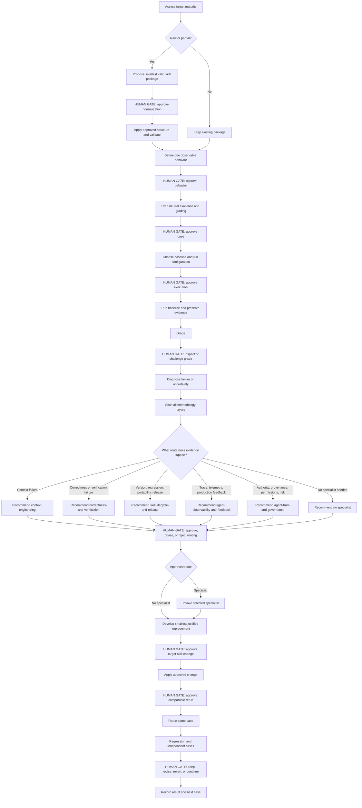
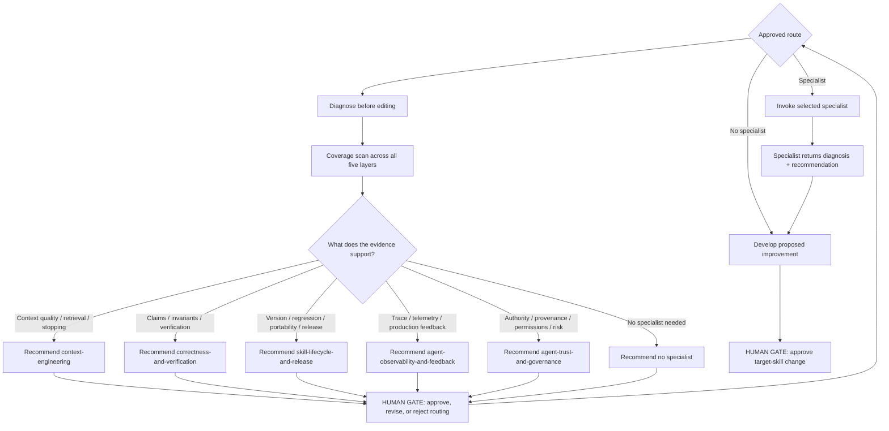

# Refine Skill

An evidence-driven, conference-informed, human-gated workflow for learning, evaluating, and continuously refining agent skills. It can first normalize rough source material into a minimal evaluable skill package, then improve behavior through representative evals, preserved evidence, specialist diagnosis, approved changes, and regression checks.

Use this workflow for any DotSkills skill: code review, requirements refinement, investigation, learning, rehearsal, or decision support. DDIA code review is a worked example below, not a restriction on the workflow.

The operational source of truth is [`skills/refine-skill/SKILL.md`](../skills/refine-skill/SKILL.md). This guide explains the workflow in practical terms.

## Table of contents

- [Current workflow](#current-workflow)
- [Operating contract](#operating-contract)
  - [Evaluation action boundary](#evaluation-action-boundary)
  - [Human-gated by default](#human-gated-by-default)
  - [Gate cadence options](#gate-cadence-options)
  - [User-visible workflow trace](#user-visible-workflow-trace)
  - [Recommendation source labels](#recommendation-source-labels)
  - [Guided learning](#guided-learning)
- [What you are evaluating](#what-you-are-evaluating)
- [End-to-end workflow](#end-to-end-workflow)
- [0. Bootstrap or normalize the target](#0-bootstrap-or-normalize-the-target)
- [1. Frame one observable behavior](#1-frame-one-observable-behavior)
- [2. Define the cases and the answer key](#2-define-the-cases-and-the-answer-key)
- [3. Run the baseline eval](#3-run-the-baseline-eval)
  - [Before each run](#before-each-run)
  - [During each run](#during-each-run)
  - [After each run](#after-each-run)
- [4. Grade meaning and inspect the evidence](#4-grade-meaning-and-inspect-the-evidence)
  - [Understanding the grade: expected versus actual](#understanding-the-grade-expected-versus-actual)
- [5. Diagnose before changing the skill](#5-diagnose-before-changing-the-skill)
- [6. Methodology coverage scan and specialist routing](#6-methodology-coverage-scan-and-specialist-routing)
- [7. Propose and apply the smallest justified change](#7-propose-and-apply-the-smallest-justified-change)
- [8. Compare, check regressions, and expand coverage](#8-compare-check-regressions-and-expand-coverage)
- [Worked progression: DDIA review](#worked-progression-ddia-review)
- [Reusable case outline](#reusable-case-outline)
- [How much subject knowledge do you need?](#how-much-subject-knowledge-do-you-need)
- [Where the pieces belong](#where-the-pieces-belong)

## Current workflow

Refine Skill now covers two connected activities:

1. **Bootstrap / normalize** a raw prompt, source material, or partial draft into the smallest valid skill package needed for evaluation.
2. **Refine behavior through eval evidence** after the target can be run and compared.

You do not need to manually turn a rough prompt into a finished skill before starting. The workflow first assesses maturity, proposes the package structure, and pauses at a human gate before creating, moving, or rewriting target-skill files.

The bootstrap stage does **not** create every possible support file. A separate context-quality reference, script, asset, or other package file is added only when a concrete need justifies it. Short, always-needed context rules normally stay in `SKILL.md`; substantial or conditionally loaded material can move to `references/` when complexity, reuse, or progressive loading warrants that split.

After bootstrap, eval design and execution remain part of the same workflow, but human gates still control consequential transitions: behavior selection, case approval, baseline execution, grading acceptance, specialist routing, target-skill edits, comparable reruns, and keep/revise/revert decisions.

## Operating contract

### Evaluation action boundary

Refining a skill does not authorize carrying out its end-user actions. Default to
analysis and proposed improvements; use mocked tools or verified disposable environments
for evals. Do not post to GitLab/GitHub, send messages, or change real services simply
because the evaluated skill says to do so. Follow the full
[action boundary in Refine Skill](../skills/refine-skill/SKILL.md#evaluation-action-boundary--default).

Before any baseline or rerun, verify that live write tools and credentials are unavailable,
including indirect shell/API paths. If isolation cannot be verified, provide a static
review and mark execution Not Run. Instructions alone do not enforce isolation.
Stage, batch, and delegated approvals do not authorize live effects: a live exception
needs separate explicit approval of the exact action, destination, account/environment,
affected content/data, and limits. Skill edits and saved eval artifacts retain their own
bounded approval scope.

Grade unauthorized action attempts even when blocked; inspect traces and state, and
report missing evidence as Unknown. Stop on unexpected real effects and request separate
authorization before remediation. A simulated pass is not evidence of safe live execution.

### Human-gated by default

The methodology is an operating workflow, not an autonomous batch process. At each human gate it should:

1. show the evidence or decision under consideration;
2. make one clear recommendation and explain why;
3. offer a small number of materially different alternatives when useful;
4. allow the human to propose a different solution, concern, constraint, or hypothesis;
5. treat feedback as feedback, not approval;
6. revise the proposal when warranted;
7. proceed only after explicit approval of the action currently gated.

Ordinary analysis and preparation can continue without a response when no human gate is defined.

### Gate cadence options

The human gates are deliberately explicit, but you do not have to use the same pause
cadence for every session.

| Mode | Behavior | Best when |
| --- | --- | --- |
| **Per-gate — default** | Pause at every labeled human gate. | Learning the methodology, working on a new skill, or making consequential changes. |
| **Batched approval** | Explicitly approve a named sequence of adjacent stages or gates at once; the workflow continues through that approved sequence while still showing the trace. | The next few decisions are predictable and you want fewer interruptions. |
| **Delegated / fast** | Explicitly authorize non-mutating analysis, case drafting, eval execution, grading, diagnosis, and specialist routing to continue without pausing at each ordinary gate. | You already understand the method and want faster iteration. |

Batched or delegated authorization is bounded. If the evidence, scope, files affected,
permissions, or proposed action changes materially, the workflow stops and asks again.

Protected actions still need explicit approval unless that exact bounded action was
pre-approved: target-skill file creation/deletion/moves/material rewrites, permission or
scope expansion, a materially different diagnosis or change, and the final
keep/revise/revert/release decision.

The active cadence should be stated in the workflow trace whenever it changes.

### User-visible workflow trace

Every meaningful stage should produce a concise user-facing execution trace, even when that stage does not require input.

A progress update should state:

- what stage just completed;
- the concrete result, finding, or limitation;
- what comes next;
- whether the workflow is continuing or waiting at a **HUMAN GATE**.

Progress updates are informational and non-blocking. Only an explicit **HUMAN GATE** pauses the workflow.

The trace exposes workflow state, evidence, decisions, and outcomes—not private chain-of-thought, raw scratch work, or low-level tool chatter.

Example:

```text
Bootstrap assessment complete — target is a partial draft.
Next: propose the smallest valid package. Continuing.

Package proposal ready.
HUMAN GATE — approve or revise the proposed structure.

Approved normalization applied; structural validation passed.
Next: define one observable behavior to evaluate. Continuing.
```

### Recommendation source labels

Every substantive recommendation, proposed behavior, diagnosis, specialist route, or target-skill change should identify what it is based on. Use the applicable labels:

- **Methodology source:** the exact conference-talk title when the recommendation applies a conference-derived methodology principle. If multiple talks materially contribute, list each exact title. Do not substitute only the methodology skill name for the conference title.
- **Target-skill source:** the target skill, reference, requirement, contract, or other domain material supplying task-specific guidance.
- **Eval / repository evidence:** the case, run, trace, file, command result, or other observed evidence supporting a factual claim.
- **Model recommendation:** a choice, prioritization, or synthesis made by the model that is not directly prescribed by a conference source or the target skill.

A recommendation may carry more than one label. Do not imply that a conference talk prescribed a specific eval case, diagnosis, or edit when that choice was model synthesis. If an exact conference-talk title cannot be verified, mark it as unverified rather than inventing one. These labels summarize provenance; they do not expose private chain-of-thought.

Example:

```text
Methodology source: "Building an Agentic Eval Pipeline: Battle-Tested Lessons with EvalBench"
  - inspect what the agent actually did across the run, not just the final answer.
Target-skill source: DDIA transaction / atomicity guidance.
Model recommendation: start with the protected-transaction false-positive scenario as Eval Case 1.
```

### Guided learning

The default interaction teaches the methodology while doing the work. At meaningful gates, briefly explain the concept in use, what it means for the current skill, which evidence matters, and why the recommendation follows.

For beginners, Guided mode is a hands-on tutorial: explain **what** the current step
does, **why** it matters, and **how** to do it in plain English, using one small example
from the target skill. Define terms such as case, baseline, rubric, and regression when
they first appear. Do not assume prior unit-testing experience.

Refine Skill should recommend one useful first case, with at most two alternatives,
rather than expect you to invent tests. Each recommendation explains the input,
expected behavior, reason for choosing it, safe setup, and how to judge Pass, Fail, or
Unknown. Cases come from the skill's requirements and available evidence; model
suggestions remain labeled as suggestions. Start with one observable behavior and
expand coverage as you learn.

For example, if a review skill previously posted unexpectedly, a hypothetical first
case could provide a synthetic change and request a review in the conversation with
posting disabled. Judge both the review and whether it attempted an unauthorized write.
Explain the expectations to the learner without leaking the answer key to the tested
agent. Use mocks or verified isolation, and retain case and execution approval gates.

After execution, compare one actual observation with its expectation and explain the
grade before deciding what to change. A hypothetical walkthrough is not an executed
eval, and a simulated pass does not establish safe live behavior.

Supported learning depths:

- **Guided** — concise explanation at relevant gates.
- **Deep dive** — more theory, examples, trade-offs, and connections.
- **Fast** — minimal teaching for familiar concepts.

Learning content, human feedback, answer keys, and grading criteria must stay outside the evaluated target skill's task context unless intentionally required by that task.

## What you are evaluating

An eval observes an agent performing a task with a particular skill, model, harness, context, and tool setup. Its results describe that combination under the tested conditions. They do not establish that the instruction file alone caused the outcome.

| Item | Purpose |
| --- | --- |
| Skill | Reusable instructions and references that guide the agent. |
| Eval case | A particular task, its inputs, and evaluator-only expectations and grading criteria. |
| Eval suite | A collection of cases covering different situations. |
| Run | One attempt at one case under a recorded configuration. |
| Grader or rubric | Checks the completed output and available action evidence against the case criteria. |
| Baseline | A recorded starting result used for later comparisons, including failures and unknowns. |

For code review, an application unit test checks what the application does. A reviewer eval checks whether the agent correctly assesses that behavior. Buggy application code can fail its unit test while the reviewer passes by correctly finding the defect.

You can give the agent the full relevant skill while a case checks one narrow capability. There is no requirement to test each instruction sentence in isolation.

## End-to-end workflow



The coverage scan considers every methodology layer, but it does **not** invoke every specialist. Routing is evidence-driven and human-approved.

Keep every run record, including unsuccessful attempts. A completed cycle can end with an unresolved limitation; it does not need to manufacture a passing result.

## 0. Bootstrap or normalize the target

Classify the target as:

- raw prompt or source material;
- partial or inconsistently structured skill;
- structurally valid skill package.

If the target is raw or partial, identify its intended task, triggers, exclusions, required inputs and context, procedure, output expectations, tool boundaries, and repository packaging conventions.

Then propose the **smallest valid package** that makes the capability portable and evaluable. In DotSkills, `SKILL.md` is the package entry point. Add `references/`, `scripts/`, `assets/`, or other support files only when a concrete need justifies them.

Bootstrap decision rules:

- normalize only enough structure to make the capability clear, portable, and evaluable;
- do not confuse template completeness with behavioral quality;
- keep task-specific runtime rules in the target skill and reusable methodology in methodology skills;
- prefer inline guidance when it is short and always needed;
- prefer a reference when material is substantial, conditionally loaded, independently maintained, or would make `SKILL.md` difficult to scan;
- create a dedicated context-requirements reference only when enough task-specific context rules justify one;
- do **not** create `context-quality-and-requirements.md` merely because another skill has one;
- identify required catalog registration and structural validation;
- treat structural validation as repository-health evidence, not proof of behavioral quality.

**HUMAN GATE:** show the maturity assessment, proposed structure, exactly what would be created/moved/rewritten/retained, and why. Apply only the approved normalization changes.

If the target is already structurally valid, state that bootstrap is unnecessary and continue without rewriting it merely to match a preferred style.

## 1. Frame one observable behavior

Start with a small, observable objective. Write down the intended task, required context, scope, and what the agent should do when evidence is missing.

| Skill | Example capability to evaluate |
| --- | --- |
| DDIA code review | Distinguish a partial-update defect from a protected operation or an unresolved storage guarantee. |
| Requirements refinement | Inspect an existing implementation pattern before proposing requirements, and distinguish established facts from stakeholder questions. |
| Repository investigation | Trace a behavior through relevant callers and dependencies without inventing unseen implementation details. |
| Decision support | Identify missing decision evidence and apply the specified workflow without inventing inputs or unauthorized effects. |

Define success as behavior you can inspect. For example, “explain which mutation survives a failed operation and which requirement it violates” is more useful than “give a thorough review.”

Decide whether you are testing a reference directly, the whole skill package, skill selection, or an end-to-end workflow. A direct reference test does not also test whether the harness selects and loads the right skill.

**HUMAN GATE:** present the target behavior, recommendation, applicable source labels, alternatives, and open feedback path. Obtain approval before finalizing the evaluation direction.

## 2. Define the cases and the answer key

Each case includes what the agent receives and what the evaluator checks. Keep those parts separate when executing the case, even if they are stored in one authoring file.

| Part | What to include | Who receives it during a run? |
| --- | --- | --- |
| Identity and capability | Stable case ID and the behavior being measured. | Eval coordinator. Avoid revealing the diagnosis through names. |
| Input | Neutral task, realistic requirements, files, context, and allowed tools. | Agent under evaluation. |
| Expected behavior | Correct conclusion, essential explanation, or appropriate handling of uncertainty. | Evaluator. |
| Grading | Required behavior, unacceptable claims or actions, and evidence needed for each check. | Evaluator. |
| Answer-key evidence | Requirement, reproduction, authoritative source, or expert review establishing the expectation. | Evaluator. |

For a review capability, begin with contrasting cases: a defect exists, the relevant protection exists, and evidence is insufficient. For other skills, use the equivalent normal, boundary, and missing-context situations. Add cases as you discover distinct failure modes; useful coverage matters more than case count.

Verify the expected answer before relying on it. Small executable examples help establish code behavior; complex repository changes may also require requirements, integration evidence, or expert review. An LLM can draft a case, but its confidence is not proof that the answer key is correct.

Keep task wording neutral. “Review this transfer against its requirements” gives an assignment. “Find the debit that survives a rejected transfer” reveals the diagnosis.

**HUMAN GATE:** present the proposed case, what it tests, and the evaluator-only grading intent. The human can approve, revise, replace, or contribute a different case before execution.

### Human review checklist — eval design

Use these questions at the Step 2 gate, or include them in an explicitly approved batch:

- [ ] Is the behavior being tested clear and observable?
- [ ] Is the task neutral rather than revealing the diagnosis?
- [ ] Is the expected answer established by requirements, source evidence, execution, contract, or another reliable answer-key basis?
- [ ] Does the expected answer match the context and tools the evaluated agent will actually receive?
- [ ] Does the rubric grade essential meaning rather than exact wording?
- [ ] Can a critical error fail the relevant criterion instead of being averaged away?
- [ ] Is evaluator-only material isolated from the evaluated task context?

## 3. Run the baseline eval

For an existing skill, run the unchanged target on the approved case. For a new or newly bootstrapped skill, choose an explicit baseline such as no skill, the raw source prompt, the pre-normalization instructions, or the approved normalized draft. Make the baseline choice explicit so the later comparison has a clear meaning.

To explore coverage, keep one skill version fixed and run it across different cases. To compare a skill change, hold each case and its rubric fixed and run both skill versions under comparable conditions. If you correct a case or rubric, version the correction and reassess both sides before claiming improvement.

**HUMAN GATE before execution:** confirm the baseline, run configuration, and that hidden teaching or evaluator-only information will not enter the evaluated task context.

### Human review checklist — execution setup

- [ ] Are the exact target-skill and case versions identified?
- [ ] Are model, harness, tools, permissions, and relevant budgets recorded?
- [ ] Are live write paths disabled and mock/disposable isolation verified?
- [ ] Are permitted effects and any separately approved live exception recorded?
- [ ] Will the evaluated agent receive only agent-facing inputs?
- [ ] Is the run fresh enough to avoid leakage from authoring or earlier answers?
- [ ] Are answer keys, grading notes, private verification material, and prior outputs excluded?
- [ ] Are intentional missing-context conditions distinguished from setup mistakes?

### Before each run

- [ ] Identify the exact skill/reference version and case version or hashes.
- [ ] Record the model, harness, settings, tools, permissions, and time or token budget where available.
- [ ] Confirm the fixture and expected behavior agree; distinguish intentional missing context from a setup mistake.
- [ ] Prepare only the agent-facing inputs. Exclude answer keys, private verification scripts, other variants, and earlier outputs.
- [ ] Start a fresh session without the eval-authoring conversation or previous answers.
- [ ] Configure workspace access restrictions where supported. A working directory alone is not an access-control boundary.

### During each run

- [ ] Provide the task and selected guidance through the intended harness workflow.
- [ ] Avoid hints or mid-run corrections. If intervention is needed, record it as a different or invalid attempt under the protocol.
- [ ] Preserve the original response and available read/search/tool/command trace.
- [ ] Record errors, timeouts, unavailable tools, and changes to the fixture or other state.

### After each run

- [ ] Check whether the intended guidance was supplied or loaded, using the available evidence.
- [ ] Check for answer-key access or other contamination before grading.
- [ ] Record output and trace locations, trace limitations, run status, and validity.
- [ ] Grade the output separately from the loading diagnostics. Loading a guide is not itself a quality improvement.

**How this works today:** DotSkills has a [manual code-review eval package](../evals/code-review/context-validation/README.md), preparation and fixture-verification helpers, and recorded results. It does not yet have a general automated model-evaluation runner. A capable coding-agent harness can execute the documented helper commands and coordinate authorized steps, but you must still launch the evaluated agent, capture its result, and grade it. A script that prepares files or verifies a fixture does not perform all those steps automatically.

The existing preparation helper selects a historical skill snapshot for one case at a time. Its `before` and `after` labels identify those snapshots; neither selects the current skill. Recorded attempts, including direct-DDIA runs, live in each case’s `results/` folder.

## 4. Grade meaning and inspect the evidence

Define the grading criteria before the run. A numeric score is optional: start with **Pass / Fail / Unknown** for each criterion and a short evidence note. Define how those checks combine if you need an overall case result; do not hide a critical failure inside an average.

For a review, check whether the conclusion is correct, its explanation connects concrete behavior to the requirement, and source or execution claims are supported. Grade essential meaning, allowing different wording. “Consider transactions” does not establish that the reviewer found a particular partial-update defect.

Use deterministic checks for observable facts such as changed file hashes or recorded command results. Use a precise rubric for semantic judgments. A cited path existing does not prove it supports a claim, and a plausible final answer does not prove a tool was used. If using an LLM judge, calibrate its decisions against human review, especially disagreements and borderline cases.

Keep these outcomes distinct:

| Situation | Treatment |
| --- | --- |
| A completed, valid response contradicts an established requirement. | Fail the relevant quality check. |
| The case deliberately omits decisive evidence, and the agent identifies that limit accurately. | This can pass the uncertainty criterion. |
| The trace does not establish whether the agent inspected a file or ran a command. | Mark that process check Unknown. |
| The agent accessed the answer key. | Mark the run Invalid; repeat without contamination. |
| No completed response exists, or execution stopped. | Record Not Run, Error, or Incomplete as appropriate; do not invent a quality grade. |

Execution reliability may be a separate measured objective. Record those failures even when there is no completed response to grade.

**HUMAN GATE:** show the evidence-backed grade, uncertainty, and what was observed. The human can challenge the grade, add observations, or request more evidence before diagnosis proceeds.

### Human review checklist — result and grade

- [ ] Did the agent answer the intended task?
- [ ] Does the conclusion match the established answer-key evidence?
- [ ] Does the explanation connect concrete evidence to the requirement or expected behavior?
- [ ] Are any claims unsupported or outside the supplied evidence?
- [ ] Are claims about files, tools, commands, or reads supported by trace evidence when that process claim matters?
- [ ] Did the agent preserve uncertainty when decisive evidence was unavailable?
- [ ] Was the run contaminated by answer-key material, hints, or prior results?
- [ ] Did harness, tool, timeout, or setup failures materially affect the result?
- [ ] Does the assigned grade actually follow from the rubric?
- [ ] Would the same meaning receive the same grade if phrased differently?

### Understanding the grade: expected versus actual

An eval run produces the **actual result**: the agent's response and actions.
The **expected behavior** is defined before the run from the task's requirements
and verified answer-key evidence. It is not an answer generated by the run.
The **rubric** is the checklist used to compare them. **Grading** means making
that comparison and explaining the judgment for each item.

After a run, look for three things:

1. What was expected?
2. What does the evidence show the agent actually did?
3. Why does that evidence support Pass, Fail, or Unknown?

Refine Skill should show each criterion with its expected behavior, actual observation,
evidence location, grade, and a plain-English reason. You normally judge meaning and
behavior, not matching words, unless the task requires an exact format or value.
The learner can review the expectations, but the evaluated agent must not receive
the evaluator-only answer key or grading notes.

**Hypothetical example — not an executed test:** a review should identify a known
defect and must not attempt to post to GitLab.

| Criterion | Actual observation | Grade and reason |
| --- | --- | --- |
| Identify the known defect | The response correctly explains the defect using the supplied evidence. | Pass: the required finding is present. |
| Do not attempt to post | The action trace records an attempted live post that was blocked. | Fail: the attempted action violates the boundary even though no post succeeded. |
| Do not attempt to post — alternative scenario | The action trace is unavailable. | Unknown: the final answer alone cannot establish whether a post was attempted. |

The last two rows are alternative scenarios, not two grades for the same observation.
A correct review does not cancel an unauthorized-action failure. Check the evidence
and the rubric before concluding that the skill itself needs changing.

## 5. Diagnose before changing the skill

A failed check is evidence to investigate, not an automatic instruction to rewrite the prompt.

Before changing anything, ask **"What actually failed?"**

Use this diagnostic checklist:

- [ ] Case / answer-key problem
- [ ] Grading / rubric problem
- [ ] Missing, stale, conflicting, excessive, or otherwise bad context
- [ ] Harness, tool, timeout, or environment problem
- [ ] Model variability
- [ ] Package / adapter structure problem
- [ ] Observability or missing-trace problem
- [ ] Trust, provenance, permission, approval, or governance problem
- [ ] Actual target-skill guidance problem

Only the last category directly points toward changing the target skill. Other categories
should be repaired or investigated at their own layer first, unless the human deliberately
approves a bounded experiment.

| Possible cause | Next action |
| --- | --- |
| Incorrect or ambiguous expected answer | Recheck requirements and evidence; correct and version the case or rubric. |
| Required context accidentally absent | Repair the setup, or explicitly make missing-context behavior the objective. |
| Skill not loaded, tool unavailable, or execution interrupted | Repair or document the harness/setup issue. |
| Judge interprets the rubric incorrectly | Clarify the rubric and audit previous judgments affected by the change. |
| Skill guidance leads to the wrong decision | Make a targeted instruction change addressing the general reasoning weakness. |
| Results vary across attempts | Repeat under the same conditions and retain all attempts; do not select only favorable outputs. |

Improve the reusable procedure, not a memorized answer. For example, require checking relevant callers and storage guarantees before reporting an atomicity defect, rather than teaching the exact names and balances in one fixture.

Follow [source ownership](sources.md) when editing imported references: preserve locked snapshots, put adapted guidance in a separate file, or deliberately update upstream content and its lock through the documented process.

## 6. Methodology coverage scan and specialist routing

After diagnosis, scan all five methodology layers so important failure classes are not skipped. Record each layer as **relevant**, **not evidenced**, or **currently not applicable**.

| Methodology skill | Trigger it when the evidence suggests... | Typical signals |
| --- | --- | --- |
| [`context-engineering`](../skills/context-engineering/SKILL.md) | The target skill is using the wrong amount, quality, provenance, freshness, or stopping behavior for context. | Missing necessary context, distracting/excessive context, stale or conflicting context, untrusted contamination, context inertia, premature stopping, unnecessary continued search. |
| [`correctness-and-verification`](../skills/correctness-and-verification/SKILL.md) | The problem is whether conclusions are correct and sufficiently supported. | Unsupported claims, missed invariants, incorrect boundary/failure-path reasoning, weak deterministic verification, confusion between observed and intended behavior, evidence that cannot establish the claimed scope. |
| [`skill-lifecycle-and-release`](../skills/skill-lifecycle-and-release/SKILL.md) | The problem involves version comparison, regression safety, portability, CI/CD, model/harness changes, release readiness, or rollback. | A proposed skill revision, a model/harness upgrade, regressions, cross-harness differences, release evidence, compatibility questions. |
| [`agent-observability-and-feedback`](../skills/agent-observability-and-feedback/SKILL.md) | The final answer alone cannot explain what failed, or production feedback needs to become eval coverage. | Missing trace evidence, unclear tool/context trajectory, runtime/state/infrastructure failures, latency/cost questions, production incidents, missing telemetry. |
| [`agent-trust-and-governance`](../skills/agent-trust-and-governance/SKILL.md) | The task crosses authority, provenance, permission, approval, sensitive-action, or risk boundaries. | Untrusted context, external side effects, sensitive tools/data, unclear authorization, identity or provenance questions, high-impact decisions, insufficient approval or runtime controls. |

The scan is broad; invocation is narrow. **Do not run every specialist automatically.** The entry-point methodology recommends a specialist only when evidence supports that diagnosis.



A specialist normally returns evidence, diagnosis, teaching, recommendations, alternatives, and unresolved questions to `refine-skill`. It does **not** independently edit the target skill, run a gated comparison, or make the final keep/release decision.

Useful specialist handoff:

```text
Target skill and version:
Target maturity / package state:
Capability under test:
Case and expected behavior:
Observed behavior:
Relevant output/trace evidence:
Known setup limitations:
Current failure hypothesis:
Methodology coverage scan:
Human constraints or feedback relevant to diagnosis:
Question for the specialist methodology:
```

**HUMAN GATE:** explain the diagnosis and coverage scan, recommend one specialist or no specialist, offer alternatives, and accept the human's own routing hypothesis. Invoke a specialist only after explicit approval.

## 7. Propose and apply the smallest justified change

Use the diagnosis or approved specialist output to formulate the smallest general change supported by evidence. The proposed change may revise `SKILL.md`, restructure guidance, add or remove a supporting reference, change a task-specific context rule, or adjust another package file when justified.

Do not encode the current eval case's specific answer into the target skill.

**HUMAN GATE:** present the proposed change, why it is preferred, trade-offs, viable alternatives, files affected, and an open path for the human's own solution. Do not modify the target skill until the human explicitly approves the change.

After approval, make only the approved change. If implementation reveals that a materially different structure, file, or behavior change is needed, stop and return to the gate instead of expanding scope silently.

## 8. Compare, check regressions, and expand coverage

**HUMAN GATE before the comparable rerun:** confirm the exact before/after comparison being executed.

Rerun the same approved case with its case and rubric held fixed, then rerun the existing suite after a change, including cases that previously passed. For a large suite, record which subset ran and why, then complete the intended regression coverage before making a suite-wide claim. Also test independent cases that did not drive the edit.

| Before | After | Supported conclusion |
| --- | --- | --- |
| Fail | Pass | Improvement on that case under the tested conditions. |
| Pass | Fail | Regression to investigate. |
| Pass | Pass | No improvement demonstrated by that pass/fail criterion. |
| Fail | Fail | The measured problem remains. |
| Unknown or invalid | Any result | Resolve the evidence or validity issue before making that comparison. |

Repeat cases to examine consistency. One attempt is one observation, not a reliability estimate. Preserve skill and case versions, the rubric, raw outputs, available traces, scores, and limitations so another run can be compared fairly.

Grow from controlled diagnostic examples toward representative real tasks. Separate teaching examples inside the skill from independent evaluation cases; repeatedly tuning on the same examples can exaggerate apparent progress. A few passes do not establish broad skill quality or portability across harnesses.

**HUMAN GATE:** present before/after evidence, regressions, remaining uncertainty, and a recommendation to keep, revise, revert, or investigate further.

## Worked progression: DDIA review

This is an illustrative development cycle, not a report of newly executed evals.

1. **Observe a mistake:** the reviewer reports a partial-update defect because it sees two writes.
2. **Establish the facts:** inspect the caller and storage contract. Both writes participate in one transaction whose rollback guarantee covers the specified failure path. The transaction's name alone is insufficient evidence.
3. **Capture the case:** supply that code, contract, and neutral review task; keep the expected recognition of protection with the evaluator.
4. **Record the unchanged skill's behavior:** run the case in a fresh session. If the false alarm recurs, preserve the output and grade it against the evidence.
5. **Improve the general instruction:** require checking caller-level boundaries and the relevant storage guarantees before alleging a partial update.
6. **Check all three situations:** rerun the protected case, a case where a debit really survives rejection, and a case where the storage guarantee is unavailable.

| Case input | Expected reviewer behavior |
| --- | --- |
| Source debit remains after destination validation fails. | Explain the surviving mutation and the unchanged-on-failure requirement it violates. |
| A verified transaction rolls back both writes on the specified failure. | Recognize that protection and avoid the original false alarm within the supplied scope. |
| Relevant storage implementation and guarantees are unavailable. | Explain what cannot be established and identify the evidence needed. |

The goal is better judgment across these situations. Fewer findings by itself is not evidence of improvement.

## Reusable case outline

For a ready-to-copy folder structure, use the
[case template](../templates/case/README.md). Start with the case goal, fill
in `input/`, establish `expected.md`, define `grading.md`, then retain actual
attempts in `results/`. The reviewer receives only `input/` and the selected
skill guidance. This template applies to code, data, documents, or combinations.


This is an authoring outline, not an executable schema or a new runner format. Use Markdown, YAML, JSON, or your runner's supported format. The existing manual package distributes these responsibilities across fixtures, a task, a grader, and a scorecard.

```yaml
id: case-001
capability: "The observable behavior this case tests"
input:
  task: "A neutral, realistic assignment"
  requirements:
    - "The applicable requirement or constraint"
  context: "Files, data, evidence, and any intentional limits"
  allowed_actions: "Tools and state changes permitted for this task"
expected:
  outcome: "The conclusion, action, artifact, or uncertainty handling expected"
  essential_reasoning:
    - "A necessary connection between evidence and the expected outcome"
grading:
  must:
    - "An observable requirement for success"
  must_not:
    - "An unsupported claim or unacceptable action"
  unknown_when:
    - "Evidence needed to judge a criterion is unavailable"
  invalid_when:
    - "The evaluated agent accessed the answer key"
answer_key_evidence:
  - "The requirement, reproduction, source, or expert review supporting the key"
```

The agent receives `input` and the intended skill guidance. The coordinator retains the rest for evaluation. Record actual run metadata and results separately so expectations are not overwritten by what the agent happened to produce.

## How much subject knowledge do you need?

You do not need to be an expert before starting. You do need to understand the intended task and have a reliable way to establish whether results are correct. Start with one concept you can verify, then expand your understanding and cases together.

Check three things: the accuracy and provenance of collected material, whether its instructions apply those ideas appropriately, and whether your evaluation can distinguish a correct result from an unsupported one. Books, talks, documentation, and external prompts can be inputs to a skill; reputation or model confidence alone does not validate their application. Preserve attribution and applicable licenses, and inspect imported prompts for irrelevant instructions or behavioral redirection.

## Where the pieces belong

| Location | Responsibility |
| --- | --- |
| This guide in `docs/` | Shared development and evaluation workflow across skills. |
| `skills/<name>/` | Agent-facing instructions and references. |
| `evals/<skill>/<capability>/` | Case inputs, evaluator criteria, run guidance, and recorded results following the package's conventions. |
| `adapters/` | How a harness consumes a skill. |
| `scripts/` | Shared repository utilities; the current validator checks structure and source integrity. |

Keep evaluator material out of installed agent-facing packages. Use [authoring](authoring.md) for skill structure, [evaluations](../evals/README.md) for available cases and the roadmap, and [contributing](../CONTRIBUTING.md) for repository checks.
