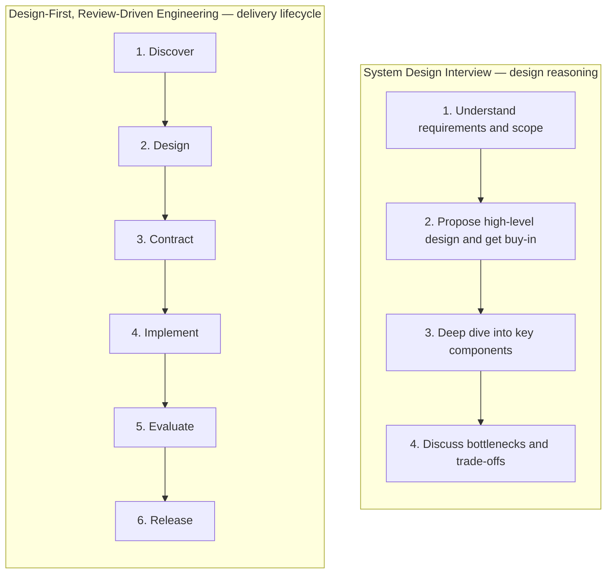
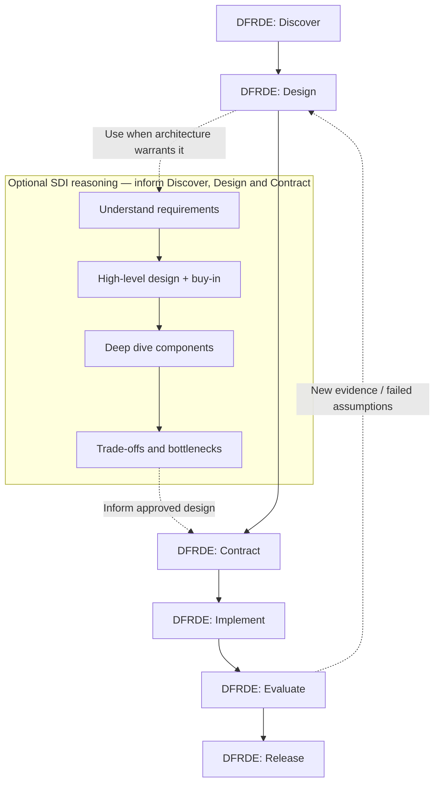
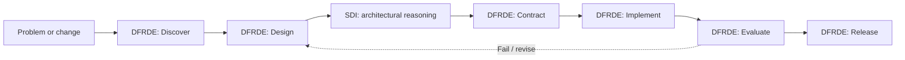

# Apply DFRDE — Design-First, Review-Driven Engineering

An **engineering methodology skill** for developing, changing and integrating *anything technical*: agent skills, MCP tools, agents, harnesses, applications, services, data systems and infrastructure.

**Core idea:** Discover → Design → Contract → Implement → Evaluate → Release, with human review at meaningful decision points. It is an adaptable engineering synthesis, **not** a formal AAIF standard or an automatic CI/deployment engine.

## When to use it

Use this as an overview-first **coordinator** whenever a task needs design deliberation, explicit contracts, measurable behavior or release readiness. It can start with existing systems or greenfield work. It can guide a small reversible change quickly or spend more effort on costly, security-sensitive, production work.

| Stage | Output |
| --- | --- |
| 1. Discover | Problem, evidence, existing architecture or greenfield assumptions, constraints |
| 2. Design | Options, trade-offs, proposed design and human decision |
| 3. Contract | Ownership, inputs/outputs, invariants, permissions, failure cases and test plan |
| 4. Implement | Approved small change, change evidence and deviations |
| 5. Evaluate | Expected vs observed outcomes, safety, regression evidence and limits |
| 6. Release | Human go/no-go, rollout/rollback, monitoring and ownership |

A failure can loop back to discovery, design or contracts. Determine acceptance criteria **before implementation**; establish a safe baseline **before changing** an existing system whenever feasible.

## Invocation examples

**A new MCP tool:**
```text
Use apply-dfrde to guide a new MCP tool.
Start with the engineering overview and Stage 1. Help me review
alternatives and the API/security contract before proposing code.
```

**An existing agent harness:**
```text
Use apply-dfrde on this agent harness refactor.
Inspect existing behavior and architecture before designing. Include
execution boundaries, tool permissions, failure recovery and regression
evidence. Pause at design/implementation gates.
```

**Two related agent skills:**
```text
Use apply-dfrde to guide an integration of
Sprint Assessment and Refine Requirements. Use the existing skill
auditing/evaluation capabilities only if available and separately
approved. Keep current-state evidence separate from proposed integration.
```

**A small application change:**
```text
Use apply-dfrde on this small feature.
Keep the process lightweight, reuse existing patterns, define acceptance
checks and ask me before writing changes.
```

## Audit-assisted Stages 1–3 — Discover, Design, Contract

For **existing agent skills**, use `audit-skill` to prefill the [reusable engineering review template](../../docs/dfrde/engineering-review-template.md) through the **first three stages**. It inspects available skills and prepares **Stage 1** source-backed questions `S1-Q01–S1-Q10`, **Stage 2** provisional design options and trade-offs `S2-Q01–S2-Q05`, and **Stage 3** conditional contract and evaluation proposals `S3-Q01–S3-Q06`. The result includes current-state diagrams, explicit evidence gaps and targeted team questions.

Distinguish **ANSWERED BY EVIDENCE** (with source), **NEEDS CONFIRMATION** (human intent), **OPEN DECISION** (design choices) and **NOT VERIFIED** (missing evidence or runtime tests). The Stage 1 problem statement remains **PROPOSED** until confirmed; Stage 2 options remain **PROPOSED** until design review; Stage 3 contracts remain **CONDITIONAL / NOT APPROVED** until architecture and owners are settled. A completed audit does not advance any gate, run a skill, or save a review file.

For a tool, application, agent harness or infrastructure change, use relevant domain-specific source inspection instead of assuming `audit-skill` is universal. The DFRDE template itself stays domain-agnostic.

## Composition and authority

This skill **coordinates engineering decisions**, not the implementation details of every domain. When auditing an actual agent skill, it may recommend [Audit Skill](../audit-skill/SKILL.md). For separately authorized skill behavior tests, it may recommend [Evaluate Skill](../evaluate-skill/SKILL.md). Mentioning a skill or an agent is **not an execution or tool permission**. For non-skill domains it should select appropriate tools/tests rather than assuming a skill-specific evaluator works everywhere.

Default behavior is planning and authorized read-only inspection. Before writes, risky tests, external actions or releases, a **fresh explicit approval** for the scope is required. Host/tool enforcement, not these instructions, determines what actions are technically allowed.

## Files

- [`SKILL.md`](SKILL.md) — entrypoint, review sequence, decision criteria, safety boundaries.
- [`references/lifecycle.md`](references/lifecycle.md) — detailed six-stage method and human gates.
- [`references/domain-adaptation.md`](references/domain-adaptation.md) — optional per-domain considerations.
- [`references/engineering-record.md`](references/engineering-record.md) — optional lightweight decision/evidence template.
- [`docs/dfrde/engineering-review-template.md`](../../docs/dfrde/engineering-review-template.md) — **canonical reusable full review template** with beginner-friendly actions, guided steps, questions, deliverables and review gates for all six stages.
- [`evals/evals.json`](evals/evals.json) — proposed scenario-based tests for this skill itself (**NOT RUN**).

**Current status:** documented methodology with static evaluation cases; not a verified behavioral orchestration engine. Do not infer portability or runtime execution from successful packaging.

---

## Relationship to the System Design Interview (SDI) framework

**SDI and Design-First, Review-Driven Engineering (DFRDE) are complementary, not competing methodologies.** The four-step System Design Interview approach from Alex Xu offers a structured way to reason through architectural decisions. DFRDE is a broader engineering lifecycle that carries those decisions into agreed contracts, implementation, evidence-based verification, and release.

| | System Design Interview (SDI) | Design-First, Review-Driven Engineering (DFRDE) |
| --- | --- | --- |
| **Primary question** | How should this system be designed, and why? | How do we discover, design, build, verify, and release it responsibly? |
| **Emphasis** | Requirements, high-level architecture, component depth, bottlenecks and trade-offs | Engineering decisions, interface and authority contracts, implementation, evaluation evidence and delivery |
| **Typical output** | Defensible architecture and trade-off analysis | Reviewed design and contracts, implemented change, test evidence and release decision |
| **Scope** | Primarily system-design reasoning | End-to-end, adaptable engineering lifecycle |
| **Relationship** | A design-thinking method you can use within DFRDE | The coordinating process that benefits from SDI when architectural complexity warrants it |

### Compare the two frameworks



The stages overlap, but they are not a perfect one-to-one mapping:

| SDI step | Where it contributes within DFRDE |
| --- | --- |
| **1. Understand requirements and scope** | **Discover:** clarify the problem, constraints, assumptions, and what exists |
| **2. Propose high-level design and get buy-in** | **Design:** present options, recommend an approach and obtain review |
| **3. Deep dive into components** | **Design + Contract:** analyze important components, responsibilities, interfaces and failure cases |
| **4. Discuss bottlenecks and trade-offs** | **Design + Contract**, revisited during **Evaluate** when evidence exposes a trade-off |

### Use SDI within DFRDE, not as another mandatory lifecycle

Use the SDI steps to strengthen **Discover, Design and Contract** when the engineering task involves meaningful architecture decisions. For a small, reversible change, a lightweight design discussion may be enough. For a new agent harness, distributed service or multi-agent workflow, a deeper SDI walkthrough may be warranted.



**Review occurs throughout:** clarify human ownership and get design agreement before committing to an approach; agree on contracts and authority before implementation; review observed test evidence before release. The lifecycle is iterative, **not a strict waterfall**.

### Example: Sprint Assessment + Refine Requirements

**SDI helps reason about the design:**

- What do the skills need to accomplish, and what current architecture is verified?
- Should refinement happen before batch dispatch or inside ticket-level workers?
- Which skill owns requirements completeness and which owns sprint readiness?
- What are the coupling, complexity, context-sharing and failure trade-offs?

**DFRDE then governs the engineering work:**

1. **Discover** existing skill contracts and tool/agent boundaries; identify undocumented behavior.
2. **Design** and review competing integration flows with the skill owners.
3. **Contract** the handoff fields, responsibilities, evidence requirements, permissions and failure states.
4. **Implement** only the authorized, scoped change.
5. **Evaluate** representative tickets and failures, comparing baseline versus integrated behavior and checking for regressions.
6. **Release** only with reviewed evidence, an owner, a rollback path, and an agreed operating plan.



### Memory aid

> **SDI = how to think through the design.**  
> **DFRDE = how to engineer the solution from discovery to release.**

Use **SDI to strengthen architectural reasoning** and **DFRDE to strengthen engineering discipline**. Both apply to skills, tools, agents, harnesses, applications and infrastructure. Neither requires unnecessary ceremony or substitutes for the domain's actual engineering standards, security controls, tests, or human approvals.

