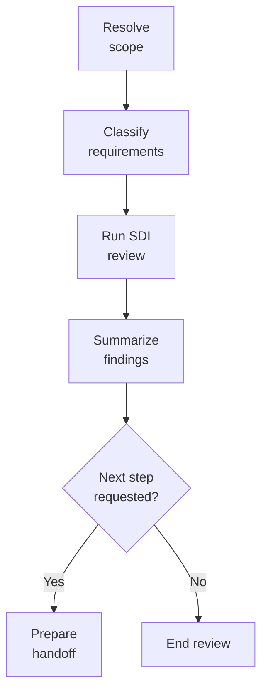

# Audit Skill

**Audit Skill is an engineering review taught at a junior-developer level.** Think of an experienced senior engineer examining a skill with you, pointing out what works, explaining risks in everyday language, and recommending the smallest sensible improvement.

It inspects skills as they exist, recommends responsibility boundaries, drafts the corresponding handoff contracts, and presents **all three parts in one initial overview**. You can then approve, revise, reject, or defer individual decisions. No automatic architectural decisions, edits, or test executions.

**Audience:** Junior developers who know basic software development but are still learning agent skills, system boundaries, contracts, failures, and evaluation. The skill should **teach throughout the entire review**, not only in its ten-question checklist.

## Table of contents

1. [Why this skill exists](#1-why-this-skill-exists)
2. [The overview-first four-step workflow](#2-the-overview-first-four-step-workflow)
3. [What the first report contains](#3-what-the-first-report-contains)
4. [Step 1 — Inspect responsibilities and overlap](#4-step-1--inspect-responsibilities-and-overlap)
5. [Step 2 — Propose boundaries](#5-step-2--propose-boundaries)
6. [Step 3 — Propose handoff contracts](#6-step-3--propose-handoff-contracts)
7. [Review and revise decisions together](#7-review-and-revise-decisions-together)
8. [Step 4 — Prepare validation](#8-step-4--prepare-validation)
9. [Q-01–Q-10 and evidence](#9-q-01q-10-and-evidence)
10. [Try it with your skills](#10-try-it-with-your-skills)
11. [Responsibilities and safety](#11-responsibilities-and-safety)

## 1. Why this skill exists

Imagine four skills in a development workflow. They may each look fine individually, but the **relationships** are unclear:

- Two skills both inspect acceptance criteria. Which one owns the final decision?
- A downstream skill needs a field the upstream skill never guarantees.
- A missing requirement quietly turns into an assumption.
- Everyone agrees with an architecture diagram but nobody has verified the workflow in Codex.

If you approve skill boundaries before seeing the handoff contracts, you might miss how those decisions change the flow. **The design deliberately shows Steps 1, 2, and 3 together**, before your first decision.

### How the senior-engineer mentoring style works

For **every important part** of the audit—not just the Q-01–Q-10 findings—expect four answers:

1. **What am I looking at?** A simple explanation of the behavior or design decision.
2. **Why should I care?** A specific consequence such as duplicated decisions, lost information, accidental permissions or confusing failures.
3. **What would a senior engineer recommend?** A concrete option, the reasoning behind it and any meaningful trade-off.
4. **What can I do next?** Approve, revise, reject, defer or verify with a separate authorized check.

Unfamiliar words should be explained in context, not used as substitutes for understanding. For example, a **skill boundary** is simply what that skill is responsible for and what it must not decide. A **handoff contract** describes what one skill promises to pass to another and what the receiver can safely expect.

The language should be straightforward and respectful, never oversimplify away security or reliability, and never turn a recommendation into an automatic change.

The key distinction is between **CURRENT DOCUMENTED**, **PROPOSED**, **HUMAN-APPROVED DESIGN**, **IMPLEMENTED CHECK**, and **OBSERVED RESULT**. Each means something different.

## 2. The overview-first four-step workflow

```text
  STEP 1 — Responsibility & overlap audit
  Inspect SKILL.md files, dependencies, Q-01–Q-10
                         |
  STEP 2 — Proposed boundaries
  Who owns each decision? What must each skill not do?
                         |
  STEP 3 — Proposed handoff contracts
  Inputs / outputs / guarantees / failures / dependencies
                         |
              ONE COMPLETE OVERVIEW
             Steps 1 + 2 + 3 together
                         |
                HUMAN REVIEW
   Approve / revise / reject / defer B-xx and C-xx
                         |
  STEP 4 — Validation preparation
  Expected behavior / sample scenario / evidence
                         |
             Separate authorized run
               (Codex / Evaluate Skill)
```

There is **one consolidated human review stage**, not two sequential approval stops. The human may take several turns to revise decisions. The skill should not advance an unresolved path as if approved.

**First response:** show the full analysis and both types of proposals. **Later responses:** address your chosen decisions, update dependencies, and prepare Step 4 when the relevant decisions are approved.

## 3. What the first report contains

The first report has a **repeatable structure**, not a collection of disconnected findings:

1. **Audit Skill — Overall View:** What was inspected, the main concern, and what remains unknown.
2. **Step 1 — Skill Responsibility & Overlap Assessment:** Examine **the same six considerations for each skill**: Inputs, Responsibilities, Outputs, Handoffs, Boundaries, Feedback. Then explain evidence-backed overlaps across skills.
3. **Step 1 — Supporting Quality Checks:** Q-01–Q-10 coverage, material findings, as-is Mermaid diagrams, Agent Skills compliance and portability evidence. These support the six considerations; they do not replace them.
4. **Step 2 — Proposed Skill Boundaries:** Decisions `B-01`, `B-02`, etc., with recommended owners, exclusions, reasons and alternatives.
5. **Step 3 — Skill Integration Contracts — PROPOSED:** Contracts `C-01`, `C-02`, etc., showing inputs/outputs, guarantees, failures and relevant feedback paths. Link each contract to its provisional boundary decisions.
6. **Consolidated Human Review:** One understandable list of decisions you may approve, revise, reject or defer.
7. **Step 4 — Validation Readiness (NOT EXECUTED):** A short preview of what needs approval or verification; the detailed validation plan follows applicable approvals. Audit Skill never runs live tests.

**The six considerations answer "What is true or unknown about the current skills?" The four steps answer "Where am I in the audit process?"** Keep the Q-01–Q-10 checklist as supporting technical coverage rather than a second framework to memorize.

All significant findings should explain **what exists, why it matters and what the next justified action is**, using actual source links. The whole report remains readable for a junior developer; long technical detail is expandable on request.

**Nothing in this first report is automatically approved or tested.**

## 4. Step 1 — Inspect responsibilities and overlap

Audit Skill examines authorized source files, starting with `SKILL.md` and material references, including resources, scripts, agents, schemas, and existing eval evidence.

### The six considerations — the same six every time

This is your **engineering investigation worksheet**. Treat each consideration like a small SDI Step 1 exercise: **Observe → Question assumptions → Validate before solving**. Do not start designing B-xx boundaries or C-xx contracts until the existing behavior and its evidence have been examined.

1. **Inputs — What does the skill need?** Requests, documents, other skill outputs, tools or context. Which are required, optional or assumed?
2. **Responsibilities — What does it own?** Its primary job and decisions. Another skill reading the same information does not automatically make ownership duplicated.
3. **Outputs — What does it produce?** Expected artifacts, statuses, evidence, open questions or proposed decisions.
4. **Handoffs — How is the result used next?** Who provides information, who receives it, and what must survive the transfer? For a standalone skill, focus on its input/output interface without inventing a downstream skill.
5. **Boundaries — What cannot happen automatically?** Human sign-off, prohibited actions, security permissions, stop conditions or decisions outside the skill's authority.
6. **Feedback — What happens when information needs reconsideration?** When a later step discovers a gap, conflict or changed requirement, is there a documented destination for that issue? What evidence returns, and does the workflow stop, continue or need a human? This is feedback **between stages**, not simply the human reviewing the Audit Skill report.

**Use the same three fields beneath every consideration:**

```markdown
**01 — Inputs**
_Observed:_ What the inspected files actually describe.
_Evidence:_ [Real source file and relevant lines] or NOT VERIFIED.
_Open question:_ An assumption to check, or None material identified.

**02 — Responsibilities**
_Observed:_ ...
_Evidence:_ ...
_Open question:_ ...

... repeat for 03 Outputs, 04 Handoffs,
05 Boundaries, 06 Feedback.
```

**What to do when information is missing:** If the inspected sources do not define a rule, say **NOT FOUND IN INSPECTED SOURCES**. If you cannot inspect enough evidence, say **NOT VERIFIED**. Neither statement proves that a running skill is broken. If an item genuinely does not apply, say why.

This is a **format for understanding**, not a demand to fill every row with a problem. Keep each field concise, then explain the most important gaps in more depth.

For **one skill**, Audit Skill assesses these six considerations, including its own input/output interface, without fabricating neighboring skills.

For **multiple skills**, it first assesses each independently, then compares:

- **Unique ownership:** one skill is clearly responsible for a job or decision.
- **Shared context:** two skills read the same information for different reasons; this is often normal.
- **Duplicated decision ownership:** two skills both claim to make the final decision; their answers could disagree.
- **Conflict:** their instructions or responsibilities contradict each other.
- **Unowned responsibility:** an important task or decision has no clear owner.
- **Handoff gap:** one skill expects information another does not promise to supply.
- **Feedback-routing gap:** a later skill knows something needs correction but has no documented route back to the skill or human responsible for deciding.

A senior engineer should explain the *consequence*, not just name the category. For example, two skills checking the same requirements is not necessarily wrong. But if both can independently declare them complete, the workflow could get conflicting answers. The report should explain how the actual inspected skills differ.

Do not confuse an as-is flow with a proposed future architecture. Every material conclusion should have a real file/line source link.

### Make Mermaid workflows easy to read

An **as-is workflow diagram** shows the steps a skill currently documents. It should be readable at a glance, including in a narrow Markdown window. **Do not cram whole sentences into small boxes or leave cut-off words.**

Use this approach:

- **Short, complete node titles:** aim for **2–4 words** per box, preserving the actual meaning.
- **Manual line breaks when needed:** use `<br/>` inside quoted Mermaid labels to split longer ideas across two short lines.
- **Do not shrink the font as the primary fix:** smaller text often makes the chart harder to read.
- **One diagram per skill:** split a long flow into a summary and a focused detail diagram when necessary.
- **Explain the nodes underneath:** give the full action or decision in plain English, with source links for actual audit claims. This also helps when a viewer clips the figure.
- **Keep branching and evidence accurate:** preserve decisions, stops, documented failure paths and `NOT VERIFIED` cases; do not make up a simpler workflow just to get a prettier chart.

**Illustrative Mermaid diagram (not a verified skill workflow):**



**Node explanations:**

- **Resolve scope:** Identify the request and which materials are relevant.
- **Classify requirements:** Distinguish the types of requirements being assessed.
- **Run SDI review:** Perform the documented system-design reasoning steps.
- **Summarize findings:** Produce the assessment and flag unanswered questions.
- **Next step requested?:** Check whether the user requested additional work.
- **Prepare handoff / End review:** Either explain the next stage or finish without automatically starting another skill.

These explanations carry the **complete meaning** even when the chart is rendered at a small width. For a real audit, use the inspected source and line links rather than copying the illustrative nodes.

## 5. Step 2 — Propose boundaries

A recommendation is expressed as a named `B-xx` decision. **B means boundary:** a choice about who owns a particular job or decision. The reviewer explains what exists, the recommended owner, what that skill should **not** own, alternatives and trade-offs.

Every proposed boundary should answer: **Which skill should decide? Which skill should only consume the result? Why is this division safer or simpler? What happens if we leave it unclear?**

### Example B-01 — Requirements clarity versus sprint readiness

*Hypothetical example, not a result of a fresh source audit.*

- **Observed concern:** Refine Requirements and Sprint Assessment may both inspect requirements.
- **Recommendation:** Refine Requirements owns detailed requirements clarification. Sprint Assessment consumes that conclusion for sprint readiness and reports missing requirements without silently rewriting them.
- **Why it matters:** When two skills can both rewrite requirements, a later skill may not know which version is authoritative. Keeping one clear owner reduces conflicting answers.
- **Alternative:** Both independently re-decide requirements clarity. That may give flexibility but could duplicate work and produce conflicting conclusions.
- **Affects contracts:** C-01.
- **Status:** PROPOSED.

The Audit Skill **does not pause here**. It proceeds to propose the affected contract so you can assess the boundary and its consequences together.

## 6. Step 3 — Propose handoff contracts

Each `C-xx` proposal describes the minimum useful agreement between **the producer (the skill sending information)** and **the consumer (the skill receiving it)**. **C means contract.** This is like agreeing on what a function accepts and returns, plus what happens when it cannot complete successfully.

- Who produces the result and who consumes it.
- When the handoff can happen.
- Required/optional inputs and expected outputs.
- Guarantees and invariants: source references, ticket identity, unresolved questions, and approval state, as appropriate.
- What happens on missing inputs, errors, conflicting information or partial failures.
- Trust, permission and compatibility boundaries.

### Example C-01 — Refine Requirements → Sprint Assessment

*Illustrative and conditional on proposed B-01.*

```text
Producer: Refine Requirements
Consumer: Sprint Assessment

Inputs:
  - Ticket identity
  - Assessed requirements and acceptance criteria
  - Evidence/source links
  - Unresolved questions and any human decisions

Expected consumer behavior:
  - Assess sprint readiness from the supplied evidence
  - Report BLOCKED or NEEDS HUMAN if required inputs are missing
  - Do not silently invent or change acceptance criteria

Must preserve:
  - Original identity, provenance, open questions, approvals

Depends on: B-01
Status: PROPOSED — CONDITIONAL ON B-01
```

**Why this contract matters:** Imagine the first skill identifies an unanswered question, but the second skill never receives that information. The second skill might mark a ticket ready even though the requirement is unresolved. Preserving that question—and stopping safely when important data is missing—reduces the risk.

This contract **appears in the first report**, even though B-01 is not approved yet. It is **not an implemented, enforced, or approved contract**.

## 7. Review and revise decisions together

After seeing the whole picture, you can give feedback naturally:

```text
Approve B-01 and C-01.
Revise B-02 so Sprint Assessment can report missing
requirements but cannot edit acceptance criteria.
Defer C-02.
```

The skill should:

1. Record **what you actually approved**, using the exact wording shown.
2. Mark B-02 **REVISED** and show your updated wording for confirmation.
3. Re-check any C-xx contracts affected by B-02, and explain *why* their fields or responsibilities might need to change.
4. Keep unrelated approvals, while explaining that deferred decisions leave affected contracts undecided.
5. Prepare validation only for paths whose relevant boundaries and contracts are approved.

**Plain-English decision meanings:** `APPROVE` = accept the proposed wording; `REVISE` = change it before accepting; `REJECT` = do not adopt that proposal; `DEFER` = decide later. You should not have to understand any special command syntax to review the recommendations.

**You may approve B-01 and C-01 together** if the wording is clear and consistent. The skill processes boundary approval first, then contract approval. If you revise B-01, C-01 must be checked against that revision rather than implicitly approved.

Available decisions: **APPROVE, REVISE, REJECT, DEFER**. A vague “looks good” is not automatic blanket approval of conflicting or unseen choices.

The decision ledger records IDs, wording, current source revision, dependencies and status. An approval in the conversation is **design approval**, not permission to edit GitHub files, run agents or claim the team approved it.

## 8. Step 4 — Prepare validation

After the relevant B and C items are approved, Audit Skill proposes a representative, sanitized scenario and an evidence-based checklist. Think of it as asking: **"If I give these skills this input, what result should I see, and what evidence would prove it?"**

For example: **Given** a task with a missing required field, **when** the approved workflow runs in a separately authorized environment, **then** the next skill should clearly say `NEEDS HUMAN` or `BLOCKED`, rather than inventing the value. A **trace** is the record of what really happened during that run.

- Did each skill make only the decisions it owns?
- Did the handoff preserve required inputs, sources, unanswered questions and approval states?
- Did missing data produce BLOCKED/NEEDS HUMAN rather than a guessed answer?
- Were errors and partial failures handled properly?
- Did runtime permissions and human approval requirements hold?
- Were relevant output formats and orchestration claims demonstrated by traces?

**In the initial report:** Step 4 appears as a short **Validation Readiness (NOT EXECUTED)** section. It names approval blockers, unknown test environment/data, and a few behaviors that may eventually need verification. That section is **not** a claim that test preparation is approved or complete.

**After the relevant boundaries and contracts are approved:** expand Step 4 into a specific, sanitized Given/When/Then scenario and evidence checklist.

**Audit Skill itself does not run tests.** A separately authorized Codex or [Evaluate Skill](../evaluate-skill/SKILL.md) workflow can execute tests when its tool permissions and environment safety controls permit it. Check the evaluation runner's actual current status rather than assuming live end-to-end tests work.

If genuine authorized trace evidence is supplied, Audit Skill may inspect it **read-only** and compare observed behavior to the approved contracts. READY TO TEST does **not** mean TESTED or PASSED.

## 9. Q-01–Q-10 and evidence

The existing ten engineering checks remain the foundation of the audit. They are **review criteria**, not ten separate approval prompts.

- **Q-01 — Purpose & boundaries:** purpose, users, prohibited actions.
- **Q-02 — Activation & discovery:** invocation, triggers and wrong-trigger behavior.
- **Q-03 — Structure, inputs & dependencies:** source resources, environment and missing files.
- **Q-04 — Workflow & orchestration:** stages, decisions, delegation and approvals.
- **Q-05 — Contracts & outputs:** inputs, outputs, validation, invariants and failed handoffs.
- **Q-06 — Context & trust:** source provenance, freshness, contradictions and untrusted inputs.
- **Q-07 — Permissions & effects:** allowed changes and host/tool enforcement.
- **Q-08 — Failure & stop behavior:** errors, retries, partial outcomes and escalation.
- **Q-09 — Evals & observability:** actual test definitions/results, traces and gaps.
- **Q-10 — Lifecycle & portability:** versioning, rollback, maintenance and supported harnesses.

For every accessible skill, Audit Skill checks all ten and gives a short coverage checklist. When you request a detailed finding (or a significant gap needs explanation), the standard six fields are **Question → Check → Finding → Evidence → Status → Recommendation**.

### Findings and recommendations should teach you something

The entire audit uses the mentoring style, but it is especially important here. A **finding** says what the source shows, identifies an actual gap or uncertainty, and explains the *consequence*. A **recommendation** gives one clear improvement or verification step, explains *why it helps*, and says how you could recognize a better outcome.

**Too vague (hypothetical):**

> *Finding:* Output contract incomplete.
>
> *Recommendation:* Improve failure handling.

**Better (hypothetical, not a real audit finding):**

> *Finding:* The skill describes the fields it returns, so the next skill knows what kind of result to expect. But the inspected instructions do not say what should happen when a required input is missing. That matters because the next skill may treat an incomplete result as valid.
>
> *Recommendation:* Identify which inputs are required and define an explicit `NEEDS HUMAN` or `BLOCKED` result when one is absent. This makes the missing information visible instead of forcing the next skill to guess. Check the behavior in a separately authorized evaluation.

Every **real** finding must cite the exact source and distinguish missing documentation from a proven runtime failure. If a criterion is sufficiently covered, the recommendation can be "No change justified" rather than inventing work.

The [Q-01–Q-10 learning guide](references/coverage-checklist-examples.md) contains a junior-friendly explanation of each question. You can also request `Expand Q-05 like a senior engineer explaining it to a junior developer.`

Evidence states:

- **DOCUMENTED INSTRUCTIONS** = source claims a behavior.
- **IMPLEMENTED CHECK** = inspected code/config contains a validator or guard.
- **OBSERVED RESULT** = genuine authorized run/trace evidence.
- **NOT VERIFIED** = source or runtime evidence is insufficient.

See [Q-01–Q-10 with examples](references/coverage-checklist-examples.md). A prompt saying “read-only” does not prove enforced permissions; eval definitions do not prove the tests were run.

## 10. Try it with your skills

**Four-skill overview:**

```text
Use audit-skill to inspect PRD Development,
Refine Requirements, Jira Ticket Decomposition,
and Sprint Assessment.

In the first response, give me one overview covering:
Step 1 — Skill Responsibility & Overlap Assessment:
for EACH skill, use six explicit headings in this order:
Inputs, Responsibilities, Outputs, Handoffs, Boundaries,
Feedback, with Observed / Evidence / Open question.
Then show cross-skill overlaps, gaps, Q-01–Q-10 checks,
and readable as-is diagrams.
Step 2 — all proposed B-xx ownership boundaries.
Step 3 — all proposed C-xx handoff contracts and
relevant feedback routes, linked to B-xx decisions.
Show one consolidated human review section and a short
Step 4 Validation Readiness (NOT EXECUTED) preview.

Use actual source links, not guessed evidence.
Explain findings, proposed boundaries and contracts at
a junior-developer level: what, why, recommendation and
next action. Act like a senior engineer coaching me.
Do not pause for approvals between Steps 1–3.

After presenting the entire picture, let me approve,
revise, reject or defer individual B-xx and C-xx items.
Then prepare Step 4 validation when relevant decisions
are approved. Do not run tests or edit files.
```

**Single-skill overview:**

```text
Use audit-skill on Refine Requirements.
Inspect the current skill and its material references.
Show the same six considerations (Inputs, Responsibilities,
Outputs, Handoffs, Boundaries, Feedback) with source
evidence and open questions, then propose any B-xx
boundary improvement and meaningful C-xx input/output
contract.
Show Steps 1–3 together, then ask for my review.
Explain terms, the reason for recommendations and next
steps as a senior engineer mentoring a junior developer.
Do not fabricate neighboring skills or execute anything.
```

**Follow-up review:**

```text
Approve B-01 and C-01 as written.
Revise B-02: Sprint Assessment can flag missing criteria,
but cannot rewrite them. Show dependent contracts.
Defer C-03.
```

A multi-skill teaching example is in [Sprint Assessment worked example](references/sprint-assessment-audit.md).

## 11. Responsibilities and safety

- **Audit Skill:** inspect existing skills, compare responsibilities, propose boundaries/contracts, record human design choices, prepare validation scenarios and inspect supplied evidence.
- **Evaluate Skill:** separately authorized behavioral evaluation, grading and diagnostics, under its own current safety and sandbox restrictions.
- **Human/team:** approve architecture and contracts, authorize actual source changes and live execution separately.

The four visible steps of this workflow are **not** four new SDI reasoning stages. Audit Skill may use SDI internally for scope, design, contracts, and trade-offs.

**Mental model:** A senior engineer helps you understand **what exists → why it matters → what they recommend → what you decide → how to verify it**. The workflow remains **inspect all skills → see boundaries and contracts together → approve/revise decisions → validate in a separate authorized run**.
