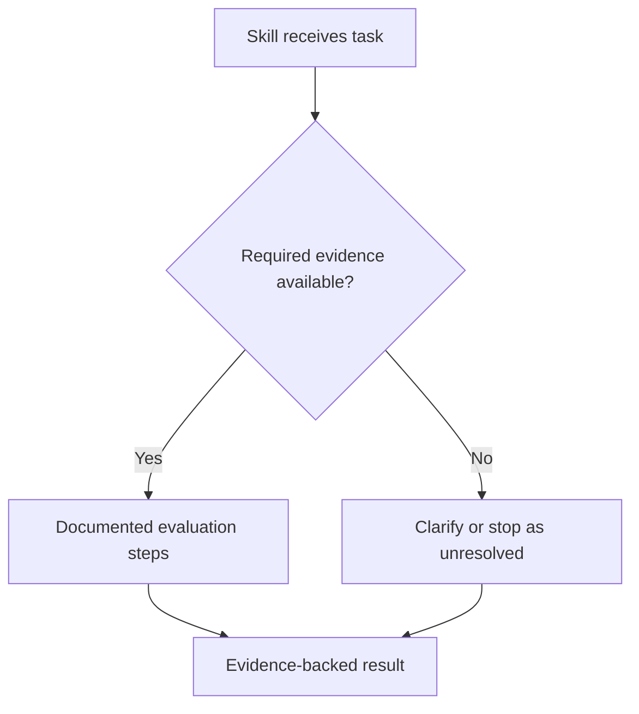

# Audit Skill

**`audit-skill` is one read-only, overview-first workflow for reviewing one or more agent skills.** It automatically adjusts its scope from independent single-skill analysis to multi-skill responsibility and handoff analysis. There is **no Explore/Audit/Compare mode selection**.

The first result is a compact, complete review of what each skill does, how it works, what evidence exists, what is unverified, and what the team should discuss. **Audit-only does not create a questionnaire or prefill DFRDE stages.** Only if you explicitly request a DFRDE review prefill does the audit supply source-backed draft answers to the **eight questions defined by the Engineering Review Template** (3 Discover, 3 Design, 2 Contract). It does not edit documents, choose architectures, or approve decisions. Choose any finding or topic afterward for a deeper explanation.

## Table of contents

- [How it works](#how-it-works)
- [What the first report contains](#what-the-first-report-contains)
- [DFRDE Stages 1–3 prefill](#dfrde-stages-13-prefill)
- [Quality and standards checks](#quality-and-standards-checks)
- [Cross-platform compatibility](#cross-platform-compatibility)
- [How to invoke](#how-to-invoke)
- [Evidence and safety rules](#evidence-and-safety-rules)
- [Relationship to other DotSkills skills](#relationship-to-other-dotskills-skills)

## How it works

```text
                 One or more target skills
                           |
             Read-only source inspection
                           |
              Audit Skill — At a Glance
              /                       \
       For every skill          Only with 2+ skills
       - Contract/profile       - Responsibility matrix
       - Standards review       - Shared/unique decisions
       - Current-state flow     - Conflicts/duplication
       - Quality & evidence     - Handoff/integration options
       - Runtime parity                |
              \                       /
               Evidence-backed findings + verification limits
                           |
                 Human selects topic/finding
                           |
               Cited, focused deep dive
                           |
              Human decides next workflow
```

1. **Find and inspect** each available skill, references, agents, manifests, tests and relevant history, with source revision and line evidence.
2. **Apply the same review criteria to every skill**, whether one or several were supplied.
3. **Add relationships automatically** only when there are two or more accessible skills. Otherwise mark inter-skill comparison NOT APPLICABLE.
4. **Report all criteria at a glance** with existing safeguards first, then evidence gaps, limitations and behavior that has **not** been verified. Do not generate evaluation test cases during the initial audit.
5. **Wait for a requested deep dive.** Never silently change the skill or run a behavioral evaluation.

If a named target cannot be accessed, label it NOT ASSESSED and avoid constructing a fictitious comparison.

## What the first report contains

The report begins **Audit Skill — At a Glance** (not a mode guide or a long question menu):

| Output | What it communicates |
| --- | --- |
| **Target/source boundary** | Which skills and revisions were inspected; what was inaccessible; no tests or target skill execution |
| **Skill profile(s)** | Purpose, activation, inputs, dependencies, steps/decisions, agents and tools, outputs, permissions, failures and handoffs |
| **Quality dashboard** | Q-01–Q-10 plain-English findings for each skill, with direct source links and key unknowns |
| **Agent Skills specification matrix** | Required format vs recommended/optional structure; normative claims tied to the published specification |
| **Mermaid current-state diagram(s)** | One flowchart per target, including decisions, delegation, stop conditions and unverified edges |
| **Relationship analysis (2+ only)** | Shared/unique responsibility matrix, conflicts, duplicate decisions, and proposed handoff/compose/merge alternatives |
| **Cross-runtime matrix** | Explicit host-by-capability compatibility evidence and adapter needs |
| **Evidence and gaps** | Existing safeguards first; important source-backed findings, limitations and unanswered questions |
| **DFRDE Stages 1–3 handoff (only when requested)** | Answers to the template's eight questions (3 Discover, 3 Design, 2 Contract), grounded in audit evidence; design and contract suggestions remain proposed and human review gates remain pending |

The main report remains concise. A selected `F-xx`, `Q-xx`, `S1-Qxx`, `S2-Qxx`, `S3-Qxx`, diagram, workflow stage or contract receives an evidence-backed deep dive without switching modes. Never present a hypothetical path as a tested run.

### Mermaid example (illustrative only)



A real diagram must come from the target files and label which edges are inferred or unverified. For two skills, keep **as-is** diagrams distinct from any **PROPOSED** integration diagram.

## DFRDE Stages 1–3 prefill

The Audit Skill performs a **read-only source review** and returns evidence-backed findings by default. **Only when you explicitly request a DFRDE Stages 1–3 prefill** does it use those findings to draft answers to the eight questions already defined in the engineering review template. There is no second question list in this skill. The meeting then focuses on confirmations and decisions that source evidence cannot resolve.

Use [the generic DFRDE engineering review template](../../docs/dfrde/engineering-review-template.md) as the destination for an approved copy. The [Stage 1 discovery handoff](references/dfrde-stage-1-handoff.md) defines how to prefill current-state facts, while the [Stage 2–3 design/contract handoff](references/dfrde-stages-2-3-handoff.md) defines conditional proposals and approval gates.

| Question status | What to do |
| --- | --- |
| **ANSWERED BY EVIDENCE** | Give the concise answer, inspected version and exact path:line; distinguish documented intent from observed behavior |
| **NEEDS CONFIRMATION** | Ask a stakeholder to confirm business purpose, user intent, ownership or proposed success metrics |
| **OPEN DECISION** | Carry architecture/ownership alternatives into Stage 2 rather than letting the agent choose |
| **NOT VERIFIED** | Identify missing source or runtime evidence and how to obtain it safely |

When a prefill is requested, Stage 1 answers summarize the problem, requirements, constraints and reusable existing patterns. Stage 2 answers outline possible solutions, trade-offs and risks. Stage 3 answers describe candidate guarantees, ways to verify them, and ownership/approval boundaries. Mark unsupported claims **NOT VERIFIED** and unperformed checks **NOT RUN**. **All three human review gates remain pending**; no approval, live execution, or file modification is implied.

### Audit-assisted invocation example

```text
Use audit-skill on the existing skill(s). Give the full At a Glance
review, then explicitly prefill only the eight DFRDE questions in the
Engineering Review Template (3 Discover, 3 Design, 2 Contract) from
source and version evidence. Keep the problem PROPOSED until confirmed,
architectural options conditional until reviewed, and contracts NOT
APPROVED until responsible owners agree. Don't invent questions, run
tests, choose a design, edit the record, or advance stages.
```

## Quality and standards checks

The [Agent Skills specification](https://agentskills.io/specification) is the standards baseline for `SKILL.md`, naming/frontmatter and supporting resources. Its actual requirements are distinct from the team-defined engineering quality expectations below.

| ID | Requirement | What a reviewer should find |
| --- | --- | --- |
| Q-01 | Purpose and boundaries | Intended job, who uses it, when it should not activate |
| Q-02 | Activation and discovery | Invocation, triggers, incorrect-trigger behavior |
| Q-03 | Structure, inputs and dependencies | Source files, context, tools/MCP, credentials and environment assumptions |
| Q-04 | Workflow and orchestration | Steps, decisions, dynamic vs named agents, delegation, approvals and result aggregation |
| Q-05 | Contracts and outputs | Explicit inputs, outputs, guarantees, invariants, ownership and failed handoffs |
| Q-06 | Context and trust | Provenance, freshness, conflicting or untrusted information and evidence |
| Q-07 | Permissions and side effects | Enforced authorization, least privilege, scoped writes and human approval |
| Q-08 | Failure and stop behavior | Unavailable tools, ambiguous inputs, partial batches, retries, stop conditions |
| Q-09 | Evals and observability | Existing tests, CI, scenarios, execution traces, expected and observed outcomes |
| Q-10 | Lifecycle and portability | Owners, versioning, review/rollback, compatible hosts, adapters and regressions |

For each applicable item, write a **plain-English sentence** describing what the audit found and what remains unverified, with direct links to the evidence. Avoid shorthand verdicts or a separate legend. A written instruction does not prove behavior was tested or enforced.

The separate **standards compliance matrix** distinguishes required specification elements, recommendations and experimental/host-specific behavior. It should not imply full standards conformance if the published specification was not consulted or a validator was not run.

## Cross-platform compatibility

An Agent Skills-compatible Markdown directory does **not** guarantee that a multi-agent workflow behaves the same in every harness. The review explicitly covers:

1. Skill packaging and installation.
2. Discovery, triggers and invocation.
3. Context loading and configuration inheritance.
4. Tools, shell names, MCP integrations and local paths.
5. Agent delegation, concurrency and worker result aggregation.
6. User identity, permission and approval enforcement.
7. Output schemas, error handling, timeouts and partial failures.
8. Eval evidence, adapter ownership and supported versions.

Use a runtime × capability matrix with **SUPPORTED (evidenced)**, **ADAPTER REQUIRED**, **NOT SUPPORTED (evidenced)** and **NOT VERIFIED**. When runtimes are unspecified, say so. Do not assume Claude Code and Codex have interchangeable tool names or delegation APIs.

## How to invoke

**One skill — no mode to select:**

```text
Use audit-skill on Sprint Assessment in this repository.
Start with a complete at-a-glance report including the skill contract,
Mermaid current-state flow, Agent Skills format check, ten quality
areas, cross-platform compatibility and evidence gaps.
Cite file/line evidence. Do not execute the skill or edit anything.
```

**Two skills — comparison happens automatically:**

```text
Use audit-skill on Sprint Assessment and Refine Requirements.
Inspect each independently, then include the ownership/overlap matrix,
conflicting decisions, missing handoffs and PROPOSED integration choices.
Include standards, quality, runtime-compatibility and evidence checks.
Read-only; no execution or edits. Pause for my review.
```

**Focused follow-up:**

```text
Deep dive F-02. Show the exact source evidence, implementation status,
risk, trade-offs and the smallest useful validation step.
```

The [Stage 1 handoff](references/dfrde-stage-1-handoff.md) and [Stage 2–3 handoff](references/dfrde-stages-2-3-handoff.md) define the reusable early DFRDE drafts. The optional [Sprint Assessment example](references/sprint-assessment-audit.md) provides task-specific prompts, not an alternative workflow.

## Evidence and safety rules

- **DOCUMENTED INSTRUCTIONS** = written guidance; **IMPLEMENTED CHECK** = code/config check found; **OBSERVED RESULT** = actual authorized trace; **NOT VERIFIED** = not established.
- Cite relevant file paths and lines; distinguish a referenced file from an actually loaded file.
- Report existing safeguards **before** gaps. Missing evidence must not become a fabricated failure or a passing test.
- The audit is **read-only** and never executes target agents, scripts, evals, live Jira/Confluence actions or repo mutations. Approved read-only file/repository sources may be inspected.
- Prompt text cannot enforce permissions. Only host/tool/server controls can enforce read-only authority.
- Preserve approved workplace data boundaries; do not paste confidential sources into a public repository.

## Relationship to other DotSkills skills

| Skill | Responsibility |
| --- | --- |
| **Audit Skill** (this skill) | Single read-only workflow for independent and multi-skill source audits, trust, diagrams and portability. Only on an explicit DFRDE prefill request, draft answers to the eight template-owned questions; no design approvals, execution or edits |
| [Evaluate Skill](../evaluate-skill/SKILL.md) | Separately authorized behavioral evaluation, diagnosis, human-approved changes and regression review; runtime safety gates still apply |
| [Integrate Skills](../integrate-skills/SKILL.md) | Draft collaboration/architecture walkthrough for connecting independently reviewed skills; not an implementation runner |
| [Learn Repo](../learn-repo/SKILL.md) | Guided learning of an entire codebase rather than skill-specific audit |

**Recommended path:** Audit as-is → discuss contracts/decisions with humans → separately authorize evaluation or implementation when warranted.

**Status:** This revision defines a single review procedure, not a proven new agent runtime or eval engine. Static documentation checks alone do not establish behavioral reliability.
