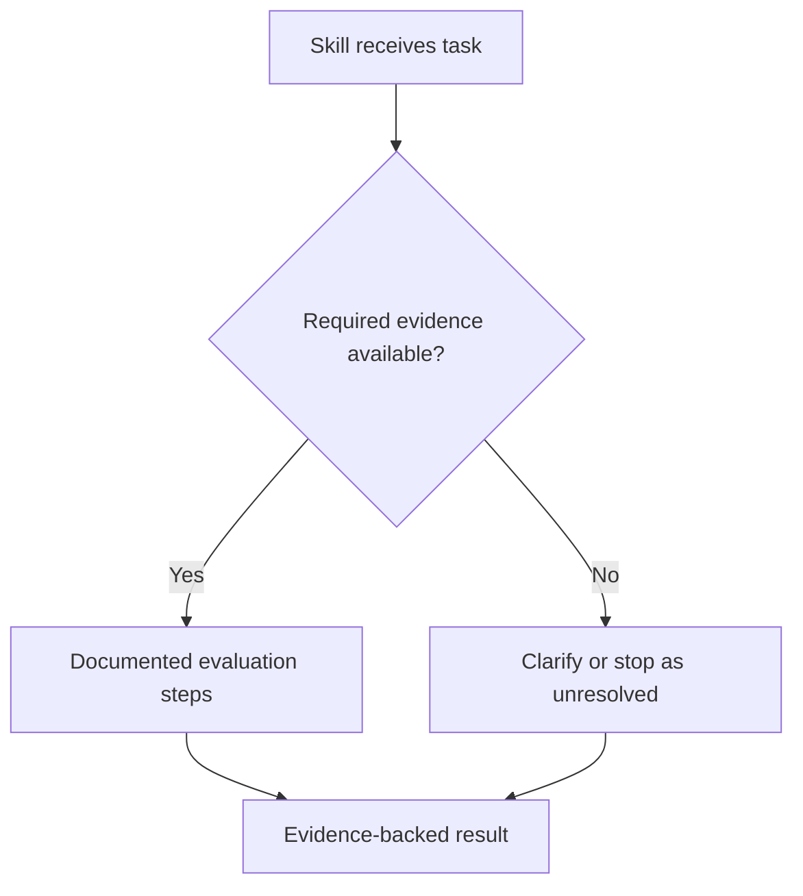

# Audit Skill

**`audit-skill` is one read-only, overview-first workflow for reviewing one or more agent skills.** It automatically adjusts its scope from independent single-skill analysis to multi-skill responsibility and handoff analysis. There is **no Explore/Audit/Compare mode selection**.

The first result is a complete, **one-pass** At a Glance checklist plus **Q-01–Q-10 individual findings**. Each checkbox indicates whether the criterion is sufficiently evidenced; each finding explains what exists, what's unverified and a recommendation when justified. The audit does not execute tools, change documents, select architectures or approve decisions. No user checkpoints between questions.

## Table of contents

- [How it works](#how-it-works)
- [One-pass checklist and findings](#one-pass-checklist-and-findings)
- [What the first report contains](#what-the-first-report-contains)
- [Quality and standards checks](#quality-and-standards-checks)
- [Cross-platform compatibility](#cross-platform-compatibility)
- [How to invoke](#how-to-invoke)
- [Evidence and safety rules](#evidence-and-safety-rules)
- [Relationship to other DotSkills skills](#relationship-to-other-dotskills-skills)

## How it works

```text
                 One or more target skills
                           |
             Read-only source inspection
                           |
              Audit Skill — At a Glance
                           |
                Q-01–Q-10 checklist
               checked / unchecked / N/A
                           |
             Ten source-backed findings
       Question / Check / Finding / Evidence
              Status / Recommendation
                           |
          Standards / as-is flow / portability
        + multi-skill comparison when relevant
                           |
              Gaps and verification limits
                           |
          Optional user-selected deep dive
```

1. **Find and inspect** each available skill, references, agents, manifests, tests and relevant history, with source revision and line evidence.
2. **Apply the same review criteria to every skill**, whether one or several were supplied.
3. **Add relationships automatically** only when there are two or more accessible skills. Otherwise mark inter-skill comparison NOT APPLICABLE.
4. **Report the At a Glance checklist, followed by all ten individual findings in a single response** with supported/unsupported checks, concrete evidence, and brief recommendations. No pauses or automatic evaluation-case generation.
5. **Wait for a requested deep dive.** Never silently change the skill or run a behavioral evaluation.

If a named target cannot be accessed, label it NOT ASSESSED and avoid constructing a fictitious comparison.

## One-pass checklist and findings

Audit Skill uses the **four SDI reasoning steps internally across the whole inspection**: understand the skill's job and scope; verify its workflow; examine relevant contracts, context, trust and failures; then assess gaps, trade-offs and readiness. **It does not assign an SDI step to each Q, print extra SDI stages or pause for Q-by-Q approval.**

The Q-01–Q-10 checklist uses:

- `- [x]` **PRESENT** — the criterion's relevant expectations are backed by inspected evidence. This is **presence**, not approval or a live test pass.
- `- [ ]` **PARTIAL / MISSING / NOT VERIFIED** — important coverage is incomplete, absent in the inspected scope or impossible to establish from available sources.
- **N/A** **NOT APPLICABLE** — the whole criterion genuinely does not apply, with an explanation.

A checkmark requires the **appropriate evidence level**. A documented output format may establish its contract, but a prompt saying "read-only" is not proof of enforced host permissions; a defined eval is not a run result.

Every criterion then has the same **six fields**: `Question`, `Check`, `Finding`, `Evidence`, `Status`, `Recommendation`. For example:

```markdown
**Q-05 — Contracts & outputs**  
_Question:_ Are required inputs, outputs, validation, invariants, ownership and failed handoffs defined?  
_Check:_ ☐  
_Finding:_ The output is documented, but missing-input handling was not described in the inspected scope.  
_Evidence:_ DOCUMENTED INSTRUCTIONS — [verified source reference]; execution NOT VERIFIED.  
_Status:_ PARTIAL  
_Recommendation:_ Define the missing-input response and verify the behavior separately.
```

This is an **illustrative** finding, not an observed audit. If a criterion is fully evidenced or not applicable, its recommendation can say `None justified`. If you later supply additional context, it stays **USER-PROVIDED — NOT VERIFIED** until supporting evidence is inspected. The initial audit remains read-only and fully one-pass.

## What the first report contains

The report begins **Audit Skill — At a Glance** (not a mode guide or a long question menu):

| Output | What it communicates |
| --- | --- |
| **Target/source boundary** | Which skills and revisions were inspected; what was inaccessible; no tests or target skill execution |
| **Skill profile(s)** | Purpose, activation, inputs, dependencies, steps/decisions, agents and tools, outputs, permissions, failures and handoffs |
| **Q-01–Q-10 checklist** | Ten ordered checked/unchecked/N/A items summarizing whether each criterion is evidenced, plus a short basis |
| **Individual findings** | A consistent Question → Check → Finding → Evidence → Status → Recommendation block for each criterion |
| **Agent Skills specification matrix** | Required format vs recommended/optional structure; normative claims tied to the published specification |
| **Mermaid current-state diagram(s)** | One flowchart per target, including decisions, delegation, stop conditions and unverified edges |
| **Relationship analysis (2+ only)** | Shared/unique responsibility matrix, conflicts, duplicate decisions, and proposed handoff/compose/merge alternatives |
| **Cross-runtime matrix** | Explicit host-by-capability compatibility evidence and adapter needs |
| **Evidence and gaps** | Existing safeguards first; important source-backed findings, limitations and unanswered questions |

The main report remains concise. A selected `F-xx`, quality dimension (`Q-01`–`Q-10`), diagram, workflow stage, or contract receives an evidence-backed deep dive without switching modes. Never present a hypothetical path as a tested run.

### Mermaid example (illustrative only)



A real diagram must come from the target files and label which edges are inferred or unverified. For two skills, keep **as-is** diagrams distinct from any **PROPOSED** integration diagram.

## Quality and standards checks

The [Agent Skills specification](https://agentskills.io/specification) is the standards baseline for `SKILL.md`, naming/frontmatter and supporting resources. Its actual requirements are distinct from the team-defined engineering quality expectations below.

| ID | Requirement | What a reviewer should find |
| --- | --- | --- |
| Q-01 | Purpose and boundaries | Intended job, who uses it, when it should not activate |
| Q-02 | Activation and discovery | Invocation, triggers, incorrect-trigger behavior |
| Q-03 | Structure, inputs and dependencies | Source files, context, tools/MCP, credentials and environment assumptions |
| Q-04 | Workflow and orchestration | Steps, decisions, dynamic vs named agents, delegation, approvals and result aggregation |
| Q-05 | Contracts and outputs | Explicit inputs, outputs, guarantees, invariants, ownership and failed handoffs |
| Q-06 | Context and trust | Provenance, freshness, conflicting or untrusted information and evidence |
| Q-07 | Permissions and side effects | Enforced authorization, least privilege, scoped writes and human approval |
| Q-08 | Failure and stop behavior | Unavailable tools, ambiguous inputs, partial batches, retries, stop conditions |
| Q-09 | Evals and observability | Existing tests, CI, scenarios, execution traces, expected and observed outcomes |
| Q-10 | Lifecycle and portability | Owners, versioning, review/rollback, compatible hosts, adapters and regressions |

For each criterion, answer its canonical question using actual source evidence. Follow the same compact **Question → Check → Finding → Evidence → Status → Recommendation** layout, without inventing missing content. The detailed questions are defined in [SKILL.md](SKILL.md). A written instruction does not prove runtime enforcement; an eval definition does not prove execution.

The separate **standards compliance matrix** distinguishes required specification elements, recommendations and experimental/host-specific behavior. It should not imply full standards conformance if the published specification was not consulted or a validator was not run.

## Cross-platform compatibility

An Agent Skills-compatible Markdown directory does **not** guarantee that a multi-agent workflow behaves the same in every harness. The review explicitly covers:

1. Skill packaging and installation.
2. Discovery, triggers and invocation.
3. Context loading and configuration inheritance.
4. Tools, shell names, MCP integrations and local paths.
5. Agent delegation, concurrency and worker result aggregation.
6. User identity, permission and approval enforcement.
7. Output schemas, error handling, timeouts and partial failures.
8. Eval evidence, adapter ownership and supported versions.

Use a runtime × capability matrix with **SUPPORTED (evidenced)**, **ADAPTER REQUIRED**, **NOT SUPPORTED (evidenced)** and **NOT VERIFIED**. When runtimes are unspecified, say so. Do not assume Claude Code and Codex have interchangeable tool names or delegation APIs.

## How to invoke

**One skill — no mode to select:**

```text
Use audit-skill on Sprint Assessment in this repository.
Start with Q-01–Q-10 checked/unchecked/N/A at a glance,
then give the six-field evidence-backed finding for each question.
Include Agent Skills compliance, as-is Mermaid flow, compatibility
and material gaps.
Cite file/line evidence. Do not execute the skill or edit anything.
```

**Two skills — comparison happens automatically:**

```text
Use audit-skill on Sprint Assessment and Refine Requirements.
Inspect each independently, then include the ownership/overlap matrix,
conflicting decisions, missing handoffs and PROPOSED integration choices.
Include standards, quality, runtime-compatibility and evidence checks.
Read-only; no execution or edits. Pause for my review.
```

**Focused follow-up:**

```text
Deep dive F-02. Show the exact source evidence, implementation status,
risk, trade-offs and the smallest useful validation step.
```

The optional [Sprint Assessment example](references/sprint-assessment-audit.md) demonstrates a two-skill audit. It is task-specific guidance, not another review process.

## Evidence and safety rules

- **DOCUMENTED INSTRUCTIONS** = written guidance; **IMPLEMENTED CHECK** = code/config check found; **OBSERVED RESULT** = actual authorized trace; **NOT VERIFIED** = not established.
- Cite relevant file paths and lines; distinguish a referenced file from an actually loaded file.
- Report existing safeguards **before** gaps. Missing evidence must not become a fabricated failure or a passing test.
- The audit is **read-only** and never executes target agents, scripts, evals, live Jira/Confluence actions or repo mutations. Approved read-only file/repository sources may be inspected.
- Prompt text cannot enforce permissions. Only host/tool/server controls can enforce read-only authority.
- Preserve approved workplace data boundaries; do not paste confidential sources into a public repository.

## Relationship to other DotSkills skills

| Skill | Responsibility |
| --- | --- |
| **Audit Skill** (this skill) | Read-only review of one or more skills across Q-01–Q-10, Agent Skills conformance, trust, source evidence, workflows, failure behavior and portability; no execution, approval or edits |
| [Evaluate Skill](../evaluate-skill/SKILL.md) | Separately authorized behavioral evaluation, diagnosis, human-approved changes and regression review; runtime safety gates still apply |
| [Integrate Skills](../integrate-skills/SKILL.md) | Draft collaboration/architecture walkthrough for connecting independently reviewed skills; not an implementation runner |
| [Learn Repo](../learn-repo/SKILL.md) | Guided learning of an entire codebase rather than skill-specific audit |

**Recommended path:** Audit as-is → discuss contracts/decisions with humans → separately authorize evaluation or implementation when warranted.

**Status:** This revision defines a single review procedure, not a proven new agent runtime or eval engine. Static documentation checks alone do not establish behavioral reliability.
