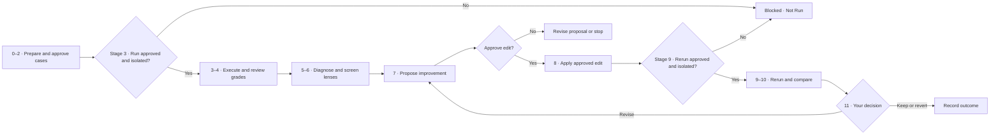

# Evaluate Skill

**Evaluate Skill** helps you learn to evaluate an existing Agent Skill (or raw prompt), understand failures, and make evidence-based improvements. It runs in **Claude Code or Codex**, uses **12 stages (0–11)**, and keeps you in control of important decisions.

**Start here:** [Try it](#8-try-it) · [12-stage guide](#2-the-12-stages) · [Grading basics](#grading-and-scoring-beginner-reference)

**Current limitation:** The dispatcher can prepare Claude- or Codex-specific evaluation cases, and **seven offline tests passed**. Live model evaluations and independent execution isolation have **not** been verified end to end. A prepared test is **not** a completed evaluation.

## Table of contents

- [1. Workflow at a glance](#1-workflow-at-a-glance)
- [2. The 12 stages](#2-the-12-stages)
  - [Agent, tool, and source map](#agent-tool-and-source-map)
  - [Plain-English stage guide](#plain-english-walkthrough-what-happens-next-at-each-stage)
  - [Evaluation and refinement loop](#evaluation-and-refinement-loop)
  - [Grading and scoring: beginner reference](#grading-and-scoring-beginner-reference)
- [3. Five methodology lenses](#3-five-conference-informed-methodology-lenses)
- [4. Files and evaluation cases](#4-file-and-evaluation-structure)
- [5. Claude and Codex evaluation routes](#5-provider-specific-evaluation-workflow)
- [6. Approvals and safety](#6-approval-execution-and-safety)
- [7. What Evaluate Skill adds](#7-what-evaluate-skill-adds)
- [8. Try it](#8-try-it)

## 1. Workflow at a glance

Evaluate Skill checks a skill's format, agrees on the behavior to test, drafts evaluations for your approval, reviews results, proposes improvements, and checks for regressions. **It is not a full skill creator.**

**Stage 0** checks the [Agent Skills format](https://agentskills.io/specification). The minimum package is a folder containing a `SKILL.md` file with valid YAML `name` and `description` fields and Markdown instructions. Other folders are optional. **Valid skills proceed unchanged.** If the format is invalid or the input is a raw prompt, Evaluate Skill proposes only the smallest structural fix and waits for approval.

Evaluate Skill is **Guided by default**: it explains unfamiliar concepts when useful, shows practical examples, and pauses at approval gates. **Deep dive** and **Fast** learning modes are also available.

## 2. The 12 stages

The four phases below organize the same **Stages 0–11** in both Claude Code and Codex. They do not add steps. Stage 2 **prepares** approved cases, Stages 3 and 9 **execute** them only when approved and safely isolated, and Stages 4 and 10 **review** actual evidence.

### Agent, tool, and source map

The **active coding agent** (Claude Code *or* Codex) guides every stage. It does not launch both providers or automatically invoke a new specialist at each stage. This table shows tools **available or conditionally used**, not proof they ran; report only observed tool calls and consulted sources.

| Stage | Agent / tool | Main inputs or sources |
| --- | --- | --- |
| **0** | Active agent; local format check | Target `SKILL.md` and [Agent Skills specification](https://agentskills.io/specification) |
| **1** | Active agent + you | Target skill, intended behavior, requirements and safety boundaries |
| **2** | Active agent drafts; `native_eval.py prepare` **after case approval** | Target `evals/evals.json`, assertions, approved synthetic fixtures, [eval design guide](references/eval-design-guide.md) |
| **3** | **Claude:** `claude plugin eval`; **Codex:** Promptfoo + Codex SDK | Approved cases and rubrics; verified isolated host; [runner guide](runner/README.md) |
| **4** | Active agent + human review; **no automatic second grader** | Actual provider-native grades, output and trusted action traces |
| **5** | Active agent | Failed assertions, cases, context, logs and grader evidence |
| **6** | Active agent; specialist **only when justified and approved** | [Five methodology lenses](references/methodology-lenses.md) and observed failures |
| **7** | Active agent + your edit approval | Diagnosis, proposed change, trade-offs and diff |
| **8** | Active agent edits **approved files only** | Approved diff and version history |
| **9** | Same provider as Stage 3, after **fresh run approval** | Approved cases/rubrics, previously passing tests and new isolated workspace |
| **10** | Active agent + human review | Before/after provider-native reports and regression evidence |
| **11** | **You decide**; agent records outcome | Evidence, unresolved issues, approved changes and saved test cases |

Documentation links are reference material, **not automatic network requests**. Stage 6 screens the five local lenses; it does **not** automatically run five specialist agents.

### Plain-English walkthrough: what happens next at each stage

| Phase | Stage | What happens and why |
| --- | --- | --- |
| **Preparation** | **0 · Validate** | Check `SKILL.md` structure. Leave a valid skill alone; ask before minimal formatting fixes. |
| | **1 · Define success** | Agree on **one observable behavior**, what success means, and what the skill must not do. |
| | **2 · Design cases** | The agent drafts **2–3 realistic tests**, expected results, and grading assertions. **You review and approve** before cases or fixtures are saved or prepared. No evaluated agent or grader runs yet. |
| **Evaluation** | **3 · Run baseline** | With separate approval and verified isolation, run the same case **with and without the skill** in fresh contexts. The command may produce LLM grades too; otherwise **Blocked — Not Run**. |
| | **4 · Review grades** | Inspect those grades, outputs, and evidence. **Do not assume the grader is correct** or run a second grader automatically. |
| **Diagnosis and improvement** | **5 · Diagnose** | Find the cause: skill instructions, test case, grader, context, permissions, or environment. **No edits yet.** |
| | **6 · Review five lenses** | Check wider issues such as context quality, correctness, safety and lifecycle. Deep dives need justification and approval. |
| | **7 · Propose** | Show the smallest supported improvement and its trade-offs. **You approve, request revision, or stop.** |
| | **8 · Apply** | Change **only the approved files**, preserving a diff and earlier version. |
| **Verification and decision** | **9 · Rerun** | With **new run approval and isolation**, repeat the target case **and relevant previously passing cases**, preserving original rubrics and saving separate results. |
| | **10 · Compare** | Compare results within the same provider. Did the change help? Did anything that used to pass now fail (a **regression**)? |
| | **11 · Decide** | **You choose** keep, revise, revert, release or iterate. Preserve approved tests and results for future changes. |

**Example — Learn Repo:** Stage 1 defines “explain real modules and pause at checkpoints.” In Stage 2 the agent proposes an architecture test and a checkpoint test; **you approve them**. After an authorized Stage 3 run, Stage 4 checks the actual results. If you approve an improvement in Stage 7, Stages 9–10 retest both behaviors before you decide at Stage 11. These are **illustrative steps, not a record of executed tests**.

### Evaluation and refinement loop



### Grading and scoring: beginner reference

**Rubric = what matters · Grader = who checks · Grade = judgment · Score = summary · Acceptance rule = decision.** There is no universal AI pass percentage.

| Core component | Meaning | When |
| --- | --- | --- |
| **Rubric criteria** | The behaviors being checked, such as “identify real modules” or “pause at a checkpoint.” | Draft and approve in **Stage 2**. |
| **Grading rules** | What counts as **Pass, Fail, or Unknown** for each criterion. | Define in **Stage 2**, verify in **Stage 4**. |
| **Grader** | Code, an LLM judge, or a person applying those rules to observed output. | Configure in **Stage 2**; the approved run may grade in **Stage 3**. |
| **Points / score** | Optional numbers summarizing judgments; useful for comparisons, not proof of quality. | Define scoring rules in **Stage 2**, interpret results in **Stages 4 and 10**. |
| **Acceptance rules** | Required thresholds, **must-pass conditions**, and what to do with missing evidence. | Agree in **Stage 2**; apply when reviewing results; **you decide in Stage 11**. |

**Example:** Learn Repo passes “correct modules” and “file evidence” but fails a **mandatory checkpoint**. An illustrative 1-point-per-pass score is **2/3 (about 67%)**, yet the case **fails** because the mandatory criterion failed. This is an example, **not an actual run or a default scoring formula**.

Five checks help you judge whether the grade itself is trustworthy:

| Check | Ask yourself | Relevant stages |
| --- | --- | --- |
| **Ground truth / reference answer** | What source establishes what's correct? For Learn Repo, do the actual fixture files support the claim? | **2, 4** |
| **Grader selection** | Should this be checked by code, an LLM, or a person? | **2, 4** |
| **Grader calibration** | Does the grader agree with trusted, human-reviewed examples? | **2, 4** |
| **Evidence and traces** | What did the agent say, access, attempt or change? Is evidence missing? | **3, 4** |
| **Coverage and repeated trials** | Do cases include boundaries and safety checks? Are passes consistent across repeated runs? | **2, 3, 9, 10** |

**What Evaluate Skill uses today:** Both configured routes use **LLM graders**: Claude plugin-eval `type: llm` or Promptfoo `llm-rubric` with `openai:codex-sdk`. The active coding agent drafts assertions in Stage 2; that **does not run a grader**. Deterministic checks and human review can verify objective or safety requirements, but the dispatcher **does not automatically select among three grading systems**.

**Read results in this order:** individual criteria and mandatory failures → actual output and tool traces → overall score. Missing required evidence is **Unknown**, not Pass. Setup errors, incomplete runs and **Not Run** are not agent failures. A single trial cannot establish reliability; compare versioned cases and repeated runs when authorized.

## 3. Five conference-informed methodology lenses

Stage 6 screens these **five local references**; a specialist deep dive is conditional and needs approval.

| Lens | What it checks |
| --- | --- |
| [Context Engineering](../context-engineering/SKILL.md) | Missing, stale, conflicting or untrusted context |
| [Correctness & Verification](../correctness-and-verification/SKILL.md) | Factual support, invariants and reliable checks |
| [Observability & Feedback](../agent-observability-and-feedback/SKILL.md) | Outputs, tool attempts, traces and feedback |
| [Trust & Governance](../agent-trust-and-governance/SKILL.md) | Permission boundaries and unsafe side effects |
| [Skill Lifecycle & Release](../skill-lifecycle-and-release/SKILL.md) | Versioning, regressions and release readiness |

These lenses and approval gates are **DotSkills practices**, not Agent Skills format requirements.

## 4. File and evaluation structure

`SKILL.md` is the entry point for any skill. **The target skill owns its evaluation cases**, not Evaluate Skill. The usual layout is:

```text
skills/
├── evaluate-skill/
│   ├── SKILL.md                  # Runtime instructions
│   ├── references/              # Detailed guides
│   ├── runner/native_eval.py    # Provider-specific dispatcher
│   └── evals/                   # Unexecuted Evaluate Skill starter cases
└── <target-skill>/
    ├── SKILL.md
    └── evals/
        ├── evals.json           # Case ID, prompt, expected output, assertions
        └── files/              # Optional approved synthetic fixtures
```

- **Stage 2:** After your approval, cases are saved in the target's `evals/evals.json`. The dispatcher requires **nonempty, approved assertions**. Optional `files` paths are relative to the **target skill root**.
- **Preparing is not running:** `native_eval.py prepare` creates a **new, provider-specific bundle** with status `PREPARED_NOT_RUN`. No model response, grade or benchmark is created by preparation.
- **Reuse instead of overwriting:** On later invocations, reuse existing approved cases and fixtures. Save new run results separately. Changing a case or rubric requires a **new approved version**, so comparisons remain fair.

See the [evaluation design guide](references/eval-design-guide.md) for case examples and the [runner guide](runner/README.md) for exact Claude/Codex bundle layouts.

## 5. Provider-specific evaluation workflow

Evaluate Skill uses **only the provider of your active coding session**, never a fallback to the other one.

| Active session | Evaluation command | LLM grading | Results |
| --- | --- | --- | --- |
| **Claude Code** | `claude plugin eval` with paired `--ablation with-without` | Claude `type: llm` grader files | Claude-native reports |
| **Codex** | `promptfoo eval` with `openai:codex-sdk` in paired workspaces | Promptfoo `llm-rubric` using the Codex SDK | Promptfoo-native reports |

[Promptfoo is now part of OpenAI](https://www.promptfoo.dev/about/) and remains open source and multi-provider. **It is a separate CLI using the Codex SDK**, not an automatic built-in Codex grader. Keep provider reports separate; there is no automatic cross-provider scoring or comparison.

The dispatcher supports `inspect` (identify harness), `prepare` (write case files without running a model), and `run` (invoke the approved native tool **only in a separately verified isolated host**). A `--harness` override is for **offline preparation only**; environment markers by themselves do not prove execution identity.

**Status:** The fixture-path fix and **seven offline runner tests passed**. Live Claude/Codex execution, actual LLM grader output, provider compatibility and independently enforced isolation remain **unverified**. Never infer a successful model run from a prepared bundle or passing offline tests. [Setup, commands and known limits →](runner/README.md)

## 6. Approval, execution, and safety

The **Execution Safety Gate** applies before **Stages 3 and 9** or **any earlier step that executes an evaluated agent**. Evaluated skill instructions and retrieved content are **untrusted data**, not permission to act.

- **Your approval:** Required before minimal structural edits, saving new cases and assertions, running evaluations, making skill changes, justified specialist handoffs, and accepting/releasing changes.
- **Host isolation:** Actual execution requires a **separately verified, host-enforced mock-only environment**: fresh workspaces, no live credentials or external writes, restricted network/shell/API/child-agent routes, hidden answer keys, and independent tool-attempt and state traces.
- **Fail closed:** Without scoped approval and independently verified isolation, report **Blocked — Not Run**. An unauthorized attempted action **fails** its safety criterion even if blocked. Missing traces or state checks are **Unknown**, never Pass.
- **Safety helper limitation:** `scripts/refine_eval_safety.py` can check a manifest, authorization request and trace, but **cannot enforce a sandbox**. `native_eval.py` does **not** automatically interpose the helper; the host must enforce these controls. No live execution should be inferred from offline checks.

Approval for an eval is **not** permission to publish to GitHub/GitLab, send messages or deploy. Work data must not be sent to an unapproved provider. See the [Execution Safety Gate](references/execution-safety-gate.md), [approval rules](references/approval-gates.md), and [security starter cases](evals/README.md).

## 7. What Evaluate Skill adds

Evaluate Skill is a **guided, human-governed improvement workflow**, not just a grader. It adds transparent decisions, diagnosis, five methodology lenses, safe execution checks and regression comparisons around the selected provider's evaluation tooling. It **does not** install provider software, supply a verified sandbox, replace a full Skill Creator, or automatically accept a score as a release decision.

## 8. Try it

> Use **evaluate-skill** on `skills/code-review` in **Guided** mode. Teach me how the evaluation works, draft cases for my review, name the tools and evidence used, and stop at each approval gate. Do not perform live external writes.

**Learn more:** [SKILL.md](SKILL.md) · [Workflow guide](references/workflow.md) · [Evaluation design](references/eval-design-guide.md) · [Runner setup](runner/README.md) · [Approval rules](references/approval-gates.md)

**Optional local structure checks** (from DotSkills root):

```bash
python3 scripts/validate_skill_repository_integrity.py
python3 scripts/validate_evals.py --all
```

These commands check **structure**, not actual model performance.
