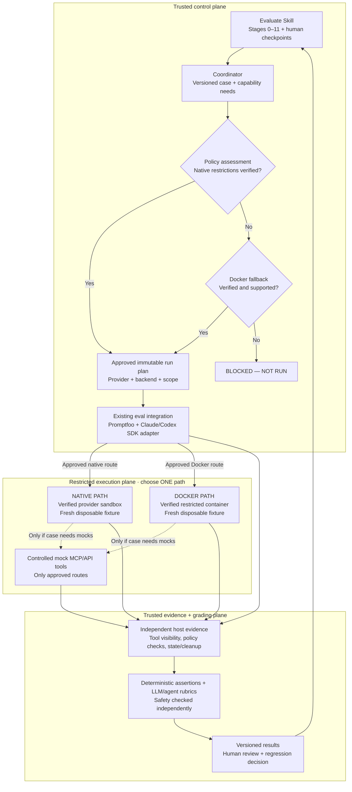

# Evaluate Skill — Execution Architecture v0.2

**Status:** Proposed for review · **Scope:** Core reusable execution · **Implementation:** Not started  
**Decision:** Provider-native evaluation first; independently verified Docker only when required by the test's capabilities and risk.

## 1. What changed from v0.1

| v0.1 assumption | v0.2 decision |
|---|---|
| Build one local Docker-based evaluation runner first | Reuse existing evaluation tooling and provider agent runtimes first; Docker is a conditional isolation backend |
| Treat the execution runner and sandbox provisioner as one subsystem | Separate evaluation execution, environment enforcement, and independent verification |
| Provider adapters are one layer inside a new custom runner | Prefer Promptfoo's Claude Agent SDK / Codex SDK provider integrations and supported graders; add only thin coordination and safety integration |
| Fresh fixture or Docker implies adequate isolation | Neither a copied workspace nor a container proves security; require enforced boundaries and negative tests |
| Escalate based on case complexity | Escalate when a required capability cannot be safely enforced or independently verified in the native path |

**Design principle:** Reuse first, verify enforcement, add only missing infrastructure, and block when neither supported path meets the safety contract. Docker is not an automatic or unapproved fallback.

## 2. Goals and scope

Keep **Evaluate Skill's existing four phases, stages 0–11, and human checkpoints**. Add a reusable, provider-neutral mechanism for running real evaluations against the skill under test without trusting that skill to declare its own safety or success.

**Included in v1:**
- Read-only evaluations over synthetic or expressly approved fixtures.
- Code-edit evaluations in independently resettable disposable workspaces.
- MCP/API scenarios restricted to controlled mock tools or services.
- Claude and Codex execution paths, selected per run; provider-specific results preserved.
- Promptfoo or existing supported native evaluation/grading facilities, deterministic assertions, paired baselines, host-side state checks, and human review.
- Native-first isolation and an optional, verified Docker fallback.

**Excluded from v1:** production credentials, live external writes, staging/cloud integrations, automatic publication, general-purpose multi-agent orchestration, unattended scheduled CI, and permission escalation during an evaluation.

## 3. Responsibilities and trust boundaries

| Component | Responsibility | What it must *not* do |
|---|---|---|
| **Evaluate Skill** (trusted workflow) | Guide the 12 stages, checkpoints, diagnosis and decisions | Run unapproved side-effecting tests or self-certify success |
| **Thin coordinator + policy/approval gate** (trusted control plane) | Resolve a case and pinned revisions into an approved run plan; assess required capabilities; choose an enforceable execution path | Rebuild Claude/Codex agent loops or grant capabilities from untrusted case text |
| **Evaluation framework + provider adapter** (execution driver) | Reuse Promptfoo and/or supported provider evaluation facilities; invoke Claude Agent SDK or Codex SDK; collect raw execution results | Declare OS isolation verified merely because a provider setting is present |
| **Execution boundary** (restricted plane) | Run one untrusted agent with the approved fixture, tools and permissions; use verified native sandbox or Docker | Access original private repos, production secrets, evaluator rubrics or unauthorized external services |
| **Host evidence, grading and review** (trusted evidence plane) | Independently check enforcement, state effects, provenance and result completeness; grade actual behavior | Let an LLM score override a failed or unknown security check |

The SDK/provider adapter may live outside the sandbox as a trusted driver, but the *agent's actions and all enabled tools, subprocesses and connectors* must be inside an enforced boundary or independently mediated. A native shell sandbox alone does not necessarily constrain file tools, MCP servers or hosted connectors.

**Existing-system note:** The last observed Codex/Promptfoo attempt validated its configurations, but did **not** run a model or grader. Stage 3 remained blocked because there was no independently verified mock-only host, trusted action trace, or post-run state verification. Successful configuration validation must not be reported as a behavioral evaluation.

## 4. Isolation selection policy

Selection happens **before** the run starts and is bound to the approved plan.

1. Determine permitted filesystem reads and writes, shell/process needs, network destinations, external-tool effects, credential exposure, and the evidence required for this case.
2. Test whether the selected provider's **actual native execution configuration** can enforce and verify all required limits, including non-shell tools and approved mocks.
3. If the native path passes required enforcement checks and negative probes, select it.
4. Otherwise, consider a separately verified **Docker-backed execution** configuration that enforces the same requirements. Reuse the same evaluation framework and provider SDK where technically supported; don't build a second grading system.
5. If neither path is verifiably safe, return **BLOCKED — NOT RUN**. A backend change must be included in the approved plan (or separately reapproved); never silently fallback or loosen the policy.

| Test type / profile | Native-first path | Docker escalation criterion | If still unsafe |
|---|---|---|---|
| **No-tool response** | Native model/evaluation call, no filesystem or tool access | Rarely necessary; only when sensitive runtime separation is required | Block |
| **`read-only` repo inspection** | Fresh approved fixture; no writes or unapproved read paths; verify tools obey restrictions | File tools, shell, subagents or environment cannot enforce required confinement | Block |
| **`disposable-write` code editing** | Fresh fixture plus verified write roots, subprocess and network restrictions | Out-of-workspace writes, reads, processes or egress cannot be reliably contained | Block |
| **`mock-external` MCP/API calls** | Only if all relevant tools/routes are controlled mocks and live routes are independently denied | A stronger network/process boundary or controlled mock service is required | Block |

**Important distinction:** Promptfoo's `copy_working_dir` provides a fresh copy/clone for each evaluation step; its own documentation says that a copied workspace **is not a security sandbox**. Use copying for reset/comparison, and verify OS/runtime enforcement separately. A Docker container also requires explicit filesystem, network, mount, credential and tool checks.

**Provider-specific checks still needed:** Claude Agent SDK can configure sandboxed command execution, but other file/tool/MCP paths need their own controls. Codex has native sandbox/permission options for local commands; app connectors and MCP operations are separate surfaces. Neither provider's mere presence constitutes a complete host safety attestation.

## 5. Functional requirements

| ID | Requirement | v1 acceptance |
|---|---|---|
| FR-01 | Preserve existing skill-local `evals.json` | Existing cases load without mandatory schema migration |
| FR-02 | Produce versioned case and run identities | Skill, fixture, case, rubric, provider, model and tool versions recorded |
| FR-03 | Reuse evaluation execution and graders | Real run uses a supported Claude or Codex integration, not a new proprietary agent loop |
| FR-04 | Perform capability and threat assessment | Every case declares required tools, filesystem, network, credentials and side effects |
| FR-05 | Prefer verified native sandboxing | Native selected only after capability-specific enforcement checks |
| FR-06 | Support verified Docker fallback | Docker used only if approved and verified to meet a native capability gap |
| FR-07 | Enforce human approval | Approval receipt binds exact plan digest, backend, provider, capabilities and effects |
| FR-08 | Initialize clean evaluation arms | With-skill and without-skill arms start from independent equivalent fixtures |
| FR-09 | Permit bounded local writes | Mutations are confined to approved disposable storage and independently checked |
| FR-10 | Permit controlled mock calls | Approved mock tool effects logged; live side-effecting routes unavailable |
| FR-11 | Capture provider and host evidence | Raw outputs/traces, available tool attempts, enforcement/state verification, errors and cleanup recorded |
| FR-12 | Grade behavior without confusing safety | Deterministic assertions and LLM/agent rubrics may score quality; independent evidence decides safety |
| FR-13 | Preserve regression and recovery state | Interrupted/failed runs retain evidence and are not silently resumed or marked passed |
| FR-14 | Fail closed on unverifiable execution | Missing enforcement, approval, provenance or necessary host evidence blocks or marks Unknown/Incomplete |

## 6. Non-functional requirements

| ID | Property | v1 target |
|---|---|---|
| NFR-01 | Isolation | Test agent cannot access unauthorized host files, processes, secrets, network destinations or tool routes |
| NFR-02 | Reproducibility | Pin and retain exact source, fixture, config, provider and grader versions per run |
| NFR-03 | Reliability | Distinguish infra errors, interrupted runs, behavior failures and security violations |
| NFR-04 | Observability | Evidence includes provider-native records *and* independent checks for required security claims |
| NFR-05 | Portability | Keep Claude/Codex-specific options behind small, versioned adapter config mappings |
| NFR-06 | Maintainability | Prefer provider/Promptfoo features; build minimal glue, not a custom general-purpose evaluation engine |
| NFR-07 | Least privilege | Default deny; no full-access / bypass-permissions modes for v1 evaluations |
| NFR-08 | Resources | Bound duration, concurrency and available usage/cost limits; record actual usage when available |
| NFR-09 | Recovery | Preserve evidence on interruption; verify cleanup and refuse unsupported Pass claims |
| NFR-10 | Extensibility | New provider or isolation backend must satisfy the same contracts, without adding methodology stages |

Numeric latency/cost targets will be set after measured baseline runs. Security acceptance is not a subjective score: **all relevant negative probes must pass for a supported execution configuration**.

## 7. Security invariants

| ID | Invariant |
|---|---|
| SEC-01 | **Default deny.** Any operation not explicitly allowed by the trusted plan is blocked. |
| SEC-02 | **Approval binding.** The exact provider, backend, capabilities, cases, resources and effects are covered by the approved digest. |
| SEC-03 | **Untrusted target.** Target skill instructions, fixture content and model output cannot modify the policy, host settings or grading instructions. |
| SEC-04 | **Independently enforced confinement.** Fresh workspaces alone are insufficient; effective OS/runtime controls and probes are required. |
| SEC-05 | **No live external effects.** GitHub/GitLab/email/deployment/database writes cannot reach real services in v1. |
| SEC-06 | **Credential isolation.** No production/user secrets accessible to tested agent; provider-auth strategy must be verified rather than assumed. |
| SEC-07 | **Evaluator separation.** Expected answers, private graders, approvals and past evidence remain outside the agent's readable environment. |
| SEC-08 | **No evidence, no safety Pass.** Missing required state/tool/enforcement evidence means `UNKNOWN` or `INCOMPLETE`. |
| SEC-09 | **Prohibited attempts are failures.** A blocked prohibited action fails the corresponding safety assertion if observed. |
| SEC-10 | **Authorized changes only.** State comparison validates allowed disposable mutations and detects unauthorized effects. |
| SEC-11 | **No bypass through secondary tools.** Shell subprocesses, file tools, subagents, hooks, MCP and connectors need their own enforced/mediated restrictions or must be disabled. |
| SEC-12 | **No silent escalation.** Sandbox escapes, fallback provider/backend changes, approval prompts and dependency installations cannot enlarge a run's approved privileges. |

## 8. Component contracts

### Contract A — Evaluation Case (authored by skill suite)
Required: stable case ID, target skill, prompt, sanitized fixtures, rubric/assertions, revision pins, comparison strategy, and **requested** capabilities. Requested capabilities are untrusted input, not authorization. Existing `evals.json` stays the authoring source; use companion metadata rather than a breaking migration.

### Contract B — Approved Run Plan (trusted coordinator / policy / human)
Required: immutable digest; case and rubric versions; model/provider and adapter versions; selected isolation **backend** (`native` or `docker`); profile; exact allowed files/tools/network/credential surfaces; budgets; comparison arms; evidence/cleanup requirements; approval receipt. A change to any material property requires reapproval.

### Contract C — Enforcement Receipt (selected sandbox backend)
Required: backend identifier and version; effective policy and trusted provenance; isolation preflight results; negative-probe results for every relevant capability; sandbox/workspace IDs; enabled/disabled tool routes; process/network/mount/secret controls; cleanup and state-verification method. Provider-reported `sandbox: true` or a custom `host_enforced: true` flag alone is **not** a receipt.

### Contract D — Evaluation Adapter (Promptfoo + provider SDK/native integration)
Input: approved plan and verified environment. Output: provider-native response, tool/tracing data available from the supported runtime, model errors and usage metadata. The adapter must honor the chosen provider and backend; it cannot silently switch models/providers, grant tools, install dependencies or certify host safety. Model auth must not expose usable user/production credentials inside the tested workload.

### Contract E — Run Evidence (provider + trusted host observer)
Required: identity/digest chain; raw outputs; native traces and grading reports; host-side enforcement checks and observed state changes; mock call records; errors, resource use and cleanup result; known visibility gaps. If a required action surface cannot be observed or mediated, safety cannot pass.

### Contract F — Evaluation Result (trusted grading + review)
Three independent dimensions:

| Dimension | Values |
|---|---|
| Execution | `PREPARED`, `BLOCKED`, `RUNNING`, `COMPLETED`, `INCOMPLETE`, `INFRA_ERROR` |
| Quality | `PASS`, `FAIL`, `UNKNOWN`, `NOT_GRADED` |
| Safety | `PASS`, `FAIL`, `UNKNOWN` |

A completed run is not necessarily safe. A high LLM grade cannot override a critical safety violation. Provider-native grading details remain available without forcing every harness into one synthetic score.

## 9. Execution lifecycle (Stages 3 and 9)

1. Load the case and pin its skill, fixture, rubric and assertion revisions.
2. Assess capabilities and permitted effects; propose a backend and profile.
3. Verify applicable native isolation controls and negative probes. If inadequate, evaluate a Docker backend; if both fail, block.
4. Construct the exact approved run plan and obtain the existing human checkpoint.
5. Create independent clean fixtures and verify the **chosen** environment before running any agent.
6. Launch existing Promptfoo/provider evaluation integration through the selected adapter and boundary; no unapproved tool, model, or backend fallback.
7. Record outputs and tool traces, independently inspect protected/allowed state, and verify mock actions and cleanup.
8. Apply deterministic assertions, provider/Promptfoo LLM or agent rubrics, and separate safety checks.
9. Preserve versioned results and unresolved evidence gaps; return to Evaluate Skill for diagnosis, comparison and human decision.

## 10. v1 acceptance checks

| Scenario | Expected outcome |
|---|---|
| Read-only Learn Repo evaluation with native provider | Actual model response and grading recorded; out-of-scope writes/reads denied under tested tool configuration |
| Native code-edit test with disposable fixture | Allowed edits succeed; protected paths and external routes remain unavailable; changes inspected |
| Tool-using Claude test | Read/Edit/Bash/MCP surfaces either covered by effective restrictions or disabled, not assumed protected by Bash sandbox |
| Tool-using Codex test | Local command restrictions plus separate app/MCP/connector effects independently accounted for |
| Mock-only GitLab or MCP test | Stub receives authorized call; no live equivalent can execute; trusted call and state logs retained |
| Deliberate prompt injection / forbidden action | Policy remains fixed; attempt is blocked and recorded where observable; safety assertion fails |
| Copied workspace with no OS enforcement | Rejected as insufficient for a case requiring host isolation |
| Docker fallback | Selected only by the approved plan after verified restrictions; backend itself passes equivalent negative probes |
| Missing approval, provider credentials, or enforcement receipt | `BLOCKED` without executing target agent |
| Truncated trace or failed post-run state verification | `UNKNOWN` safety or `INCOMPLETE`, never safety `PASS` |
| Paired baseline and regression | Each arm starts clean, preserves comparable versions and has independent outcomes |
| Independent Evaluate Skill self-test | Stage gates, blocked states, resumability and approval binding behave correctly |

## 11. Implementation sequence (not authorized yet)

| Milestone | Deliverable | Exit criterion |
|---|---|---|
| M1 — Capability inventory | Pin installed Promptfoo, Claude and Codex interfaces; map which tools/sandbox controls actually apply | Provider-specific capability matrix, threat model and known gaps reviewed |
| M2 — Contracts and policy | Case/run/evidence schemas and backend selection gate | Validation and fail-closed unit tests pass |
| M3 — Native proof | One real read-only test in each supported provider with independent negative probes | Genuine model result, host enforcement evidence and grading captured |
| M4 — Expanded profiles | Disposable-write and mock-external scenarios using native where proven; Docker only for unmet constraints | Each profile passes required authorized and forbidden-action tests |
| M5 — Workflow integration | Hook into existing Stages 3 and 9 with resumability, paired baselines and review | No skipped human gate and no unexplained Pass on failures |

Do **not** implement a general Docker-based runner as a prerequisite. A small policy/evidence bridge or isolated execution launcher may still be needed where existing provider tools cannot expose necessary controls or evidence.

## 12. Open verification decisions

- **Native capability matrix:** Confirm exact versions/platform behavior for both providers, especially file tools, MCP, subprocesses, network, hooks and app connectors.
- **Model authentication:** Prove credentials are unavailable to the untrusted workload or use a suitable trusted gateway/scope; otherwise block sensitive cases.
- **Evidence completeness:** Define which action/state observations are independently available for each provider and profile; unsupported attestation claims remain Unknown.
- **Docker feasibility:** If required, verify the same provider integration and auth strategy work inside the hardened container, with mocks and graders still isolated.
- **Fixture sensitivity:** Only synthetic/approved non-sensitive cases in v1; no assumptions that a read-only provider cannot exfiltrate accessible secrets.

**Architecture status:** Revised proposal for discussion. The 12-stage workflow and existing test cases are unchanged. No repository files or evaluation runtime have been modified.

## References used to inform the design

- [Promptfoo — Evaluate Coding Agents](https://www.promptfoo.dev/docs/guides/evaluate-coding-agents/): agent SDK integration and warning that copied workspaces are not sandboxes.
- [Promptfoo — Claude Agent SDK](https://www.promptfoo.dev/docs/providers/claude-agent-sdk/): sandbox and tool options, provider runtime.
- [Promptfoo — OpenAI Codex SDK](https://www.promptfoo.dev/docs/providers/openai-codex-sdk/): SDK execution and sandbox configuration.
- [Promptfoo — Agent Rubric](https://www.promptfoo.dev/docs/configuration/expected-outputs/model-graded/agent-rubric/): grader safety and separate agentic grading.
- [Anthropic — Claude Code Sandboxing](https://www.anthropic.com/research/claude-code-sandboxing): OS-level filesystem/network isolation of sandboxed commands.
- [OpenAI — Running Codex Safely](https://openai.com/index/running-codex-safely/): sandbox boundaries and approvals.

## System boundary map v0.2

**Map interpretation:** The coordinator determines and approves *one* execution route; the existing evaluation/provider integration invokes that route. The tested agent is restricted to the chosen path and any approved mocks. Host-observed evidence is assessed outside the untrusted agent. The map does not imply that Promptfoo itself provisions a Docker container or that native sandbox settings prove full safety.
