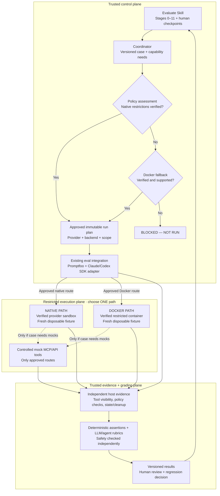

# Evaluate Skill — System Boundary Map v0.2

> **Historical:** The active canonical map is the
> [Docker-Only System Boundary Map v0.4](./evaluate_skill_system_boundary_map_v0_4.md).

**Status:** Offline control/evidence foundation implemented; live execution paths unverified and Blocked — Not Run.
**Scope:** Provider-native evaluation first; Docker only when independently verified native isolation is insufficient.

**Reading the map:** Evaluate Skill and the coordinator define and approve an immutable plan. The existing Claude/Codex evaluation integration executes through **one approved isolation path**, either a verified native sandbox or a verified Docker fallback. Only explicitly approved mock tools are available. Independent host evidence and grading inform the human review. The v0.2 repository implements the offline contracts, policy, probes, evidence audit, bounded/mock authorization interfaces and Stage 3/9 checkpoint gate; those interfaces do not interpose on tools by themselves, and the repository does not implement a verified live native host or Docker backend. When neither route can enforce the required restrictions, the run is **blocked**.

For detailed requirements, security invariants, and component contracts, see [Execution Architecture v0.2](./evaluate_skill_execution_architecture_v0_2.md).
