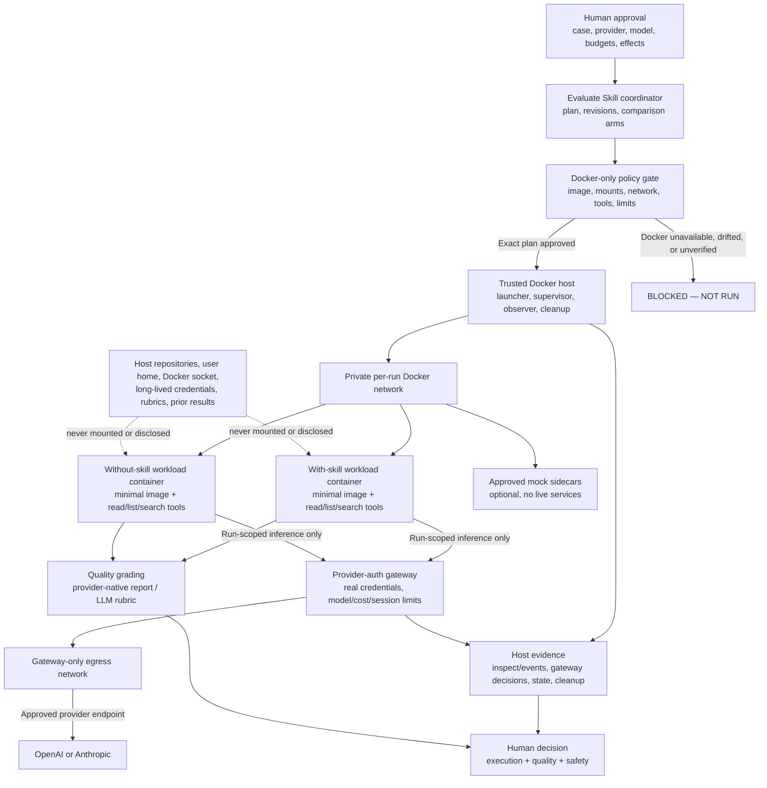

# Evaluate Skill — Docker-Only System Boundary Map v0.4

**Status:** Approved architecture; implementation pending

**Scope:** Every live evaluated-agent arm runs in a verified hardened Docker
boundary. Provider-native sandboxes are not accepted as execution backends.

## Reading the map

The coordinator approves one immutable run plan. The trusted Docker host then
launches two independent, ephemeral workload containers from the same
digest-pinned provider image and equivalent fixture snapshot. The with-skill
arm alone receives the approved skill snapshot. The workload receives no
Docker socket, host home, provider credential, evaluator rubric, prior result,
or direct external network route.

Provider inference crosses a private per-run network to a trusted gateway. The
gateway owns the real provider credential and accepts only the approved
provider, model, run nonce, request budget, session count, and expiry. If the
selected provider adapter cannot use that gateway, the run is blocked. The
workload has no external network route; only the gateway attaches to a separate
egress network. The initial Codex read-only route is shell-free and exposes
only bounded host-owned `list`, `read`, and `search` tools. The host observer
derives safety evidence from Docker configuration and lifecycle, gateway and
tool-broker decisions, runtime inventory, state snapshots, and cleanup—not from
model claims.

Quality grading and safety verification remain separate. A high rubric score
cannot override missing or failed boundary evidence.

For requirements and rationale, see
[Docker-Only Execution Architecture v0.4](./evaluate_skill_execution_architecture_v0_4.md).
