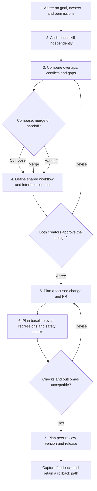

# Integrate Skills

**Status: Draft / placeholder — learning only.** This is a guided map for getting acquainted with **collaborative agent skill development and release**. It does not audit, edit, merge, evaluate, open PRs, or release skills.

**Catalog:** Skill development and assessment · **Runtime packaging:** disabled until the draft is developed and reviewed.

## Why this skill exists

When two developers each have a skill, the first decision is **not** how to combine their Markdown files. It is how their responsibilities fit together. Review each skill independently, agree on the shared workflow, then make any changes through an approved engineering process.

This draft describes that process using the previously compiled *Collaborative Agent Skill Development & Release* guide. It is a **recommended team workflow**, not an AAIF-mandated collaboration standard.

## Workflow diagram

This is an editable Mermaid version of the collaboration-and-release flowchart. **Stages 5–7 describe future work; this draft does not execute them.**



## The seven stages

| Stage | What you learn | Proposed output / checkpoint |
| --- | --- | --- |
| **1. Align** | Define the shared goal, maintainers, scope, and permission boundaries. | One-sentence goal; who may inspect or edit what? |
| **2. Audit separately** | Understand each skill's triggers, steps, inputs, outputs, tools, and restrictions. | Two short skill profiles; no changes. |
| **3. Compare & decide** | Locate unique, duplicated, conflicting, and missing responsibilities. | Choose **compose / merge / handoff**, with a reason. |
| **4. Design together** | Draw the flow, define data handoffs, stops, errors, and human gates. | One agreed workflow diagram and interface contract. |
| **5. Plan implementation** | Learn why small diffs, separate branches, and peer-reviewed PRs matter. | A hypothetical file-change plan (do not edit). |
| **6. Plan evaluation** | Compare baseline and proposed behavior, test full user journeys, safety, and portability. | Proposed cases and acceptance checks (do not run). |
| **7. Plan release** | Review evidence, decide when to ship, track versions, feedback, and rollback. | Draft release checklist (do not release). |

### The architectural decision: compose, merge, or handoff?

| Choice | Use it when | Key question |
| --- | --- | --- |
| **Compose** | The skills do different jobs but belong in one user journey. | How will the caller choose and coordinate them? |
| **Merge** | They duplicate the same responsibility or compete for the same trigger. | Which behavior and source of truth do we preserve? |
| **Handoff** | One skill's output becomes another skill's input. | What does the receiving skill require and verify? |

**Integration does not automatically mean merging.** A portable Agent Skill file cannot itself guarantee cross-skill invocation or consistent execution order in every harness; runtime orchestration must be designed and tested separately.

## Practice: walk through a hypothetical collaboration

Suppose **Skill A** gathers feature requirements and **Skill B** assesses work readiness.

At **Stage 2**, describe each one's input/output contract. At **Stage 3**, decide whether the skills have distinct responsibilities or conflicting questions. At **Stage 4**, sketch a handoff such as *requirements summary → readiness assessment*, including what happens when necessary details are missing. The remaining stages explain how to **plan** a PR, evaluation, and release without performing them.

You can jump to any stage. A useful starting request is:

> Walk me through Integrate Skills in Guided mode. Show the seven-stage map, then teach me Stage 1 with a hypothetical example and pause at the checkpoint. Do not edit or execute anything.

## Design-review notes (practice template)

```markdown
# Skill Collaboration Proposal — Draft
- Shared goal:
- Skill A and owner:
- Skill B and owner:
- What overlaps or conflicts:
- Proposed approach: compose | merge | handoff
- Why this approach:
- Input/output and error boundaries:
- Permissions and human approvals:
- Proposed evaluation cases:
- Proposed review and rollback plan:
```

## Where it fits in DotSkills

**Audit Skill** is for read-only exploration, auditing, and comparison. **Evaluate Skill** teaches evidence-based evaluation and improvement. **Integrate Skills** currently teaches the *design and collaboration process* that may eventually use those skills. It does **not** invoke either skill automatically. **Refine Requirements** may help define a new shared workflow contract later.

## Guidance that informed the draft

The [Agent Skills specification](https://agentskills.io/specification) defines the portable format, while its [evaluation guide](https://agentskills.io/skill-creation/evaluating-skills) discusses testing. The collaboration flow is a proposed team practice drawing on Git/PR review, plus saved AGNTCon/MCPCon 2026 sessions: Michael Larson's **Shipping Agent Skills Safely** (version → evaluate → review → release; scan → review → sandbox), Shub Argha's **Trustworthy Context Is Untrusted by Default**, and the **EvalBench** talk on whole-user-journey testing. These conference recommendations are **not** additional requirements of the Agent Skills format.

## Not implemented yet

Automated audits, diagram generation from live skills, integration edits, cross-skill orchestration, model evaluations, security sandboxing, PR creation, and releases are **out of scope**. A future version would need explicit collaboration gates, tool permissions, test coverage, and demonstrated behavior before it could be marked ready.
