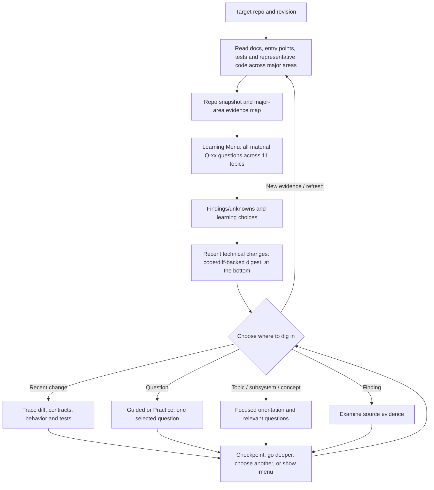

# Learn Repo

**`learn-repo` is a read-only, codebase-first tutorial that starts with the big picture.** Instead of automatically asking Question 1, it lists **all material planned questions** for the repository, then waits for you to choose which topic, concept, subsystem, or finding to explore.

The outcome is a practical understanding of a codebase's purpose, architecture, execution and data flows, algorithms, design choices, local workflow, and debugging paths—without forcing you through a fixed lesson order.

## Table of contents

- [Workflow at a glance](#workflow-at-a-glance)
- [Initial Learning Menu](#initial-learning-menu)
- [Recent Technical Changes](#recent-technical-changes)
- [Three stages and eleven topics](#three-stages-and-eleven-topics)
- [Learning modes and selection](#learning-modes-and-selection)
- [How to invoke](#how-to-invoke)
- [Evidence and safety](#evidence-and-safety)
- [Files](#files)

## Workflow at a glance



The initial inspection is **bounded but covers all major first-party areas** at a representative level. It isn't a line-by-line dump of the repository.

## Initial Learning Menu

The first response is **an overview only**, always including:

1. **Repository snapshot** — purpose, repo type, current revision, inspected scope, and relevant book lenses.
2. **Evidence and major-area map** — important packages/subsystems, their responsibilities, entry points, representative files and symbols, and verification status.
3. **Full question index** — *all material initial planned learning questions*, grouped by stage/topic, with stable `Q-xx` IDs, brief evidence, and relevant concepts. Every applicable topic is represented; unrelated topics are marked `NOT APPLICABLE`, and uninspected mechanisms `NOT VERIFIED`.
4. **Findings and unknowns** — an optional short index of interesting `F-xx` patterns, disagreements between docs/code, or evidence gaps (not automatically bugs).
5. **Choose what to explore** — select a question, topic, finding, recent change, subsystem, book concept, suggested learning order, or an updated menu.
6. **Recent Technical Changes (at the bottom)** — a concise, evidence-backed digest of the latest meaningful code/configuration changes: what changed technically, affected components, behavior/contract differences, tests and implications. Identify changes with stable `C-xx` IDs, show relevant paths and commit/diff links, then invite selection. If history is unavailable, explicitly mark it unverified.

**No worked answers or Problem Question 1 until you choose.** For a very large repository, group one-line questions by major subsystem to keep the full index skimmable. Newly discovered questions and changes can be appended later without renumbering existing ones. The Recent Technical Changes section is the **last content section** of the first response, not a recurring footer after each lesson.

### Illustrative menu excerpt

This example is hypothetical—not an audit of any actual repository.

| ID | Topic | Example question |
| --- | --- | --- |
| `Q-01` | `T-02` Architecture | Which module receives requests and which other packages does it call? |
| `Q-02` | `T-04` Flow | How does one request become a response, including the error path? |
| `Q-03` | `T-06` DDIA | Which data is authoritative and where does derived state come from? |
| `Q-04` | `T-08` APOSD | Which abstraction hides complexity, and what must its callers know? |
| `F-01` | Finding | The docs and code may describe different flows; investigate before concluding. |

## Recent Technical Changes

This is a **technical change analysis**, not a Git-log recap. On the initial overview, inspect recent history and the relevant diffs (typically the newest 10–20 commits, selecting up to five substantive code/configuration changes). Group related commits for the same mechanism, and prefer actual implementation changes over documentation-only edits. Give the history window and revision inspected; identify local uncommitted changes separately if accessible.

For each `C-xx` entry, explain **before → after behavior** when supported by the diff, affected files/symbols, and significant interface, data flow, schema, dependency, runtime, or deployment effects. Note related tests and whether they were only read or run. Distinguish observed facts from inferred consequences or unknowns, and provide the actual commit/diff link. Where no meaningful technical changes can be verified, say so rather than creating a narrative from commit messages.

This section appears **at the very bottom of the initial Learning Menu**, after the normal topic choices. You can choose a `C-xx` change for an evidence-based technical deep dive, without switching skills. It is refreshed on request or on new repository evidence, not repeated during every lesson.

## Three stages and eleven topics

| Stage | Topic | What it covers |
| --- | --- | --- |
| **1 — Build the repo map** | `T-01` Purpose and boundaries | Product/developer problems, inputs/outputs, external services |
| | `T-02` Architecture | Packages, responsibilities, entry points, interfaces |
| | `T-03` Local development | Build/test commands, CI, first reading path |
| **2 — Connect mechanisms** | `T-04` Representative flows | Request/data tracing, transformations, errors |
| | `T-05` FODE | Data sources, storage, transformations, consumers |
| | `T-06` DDIA | Models, queries, consistency, transactions, guarantees |
| | `T-07` Algorithmic Thinking | Algorithms, constraints, correctness, complexity |
| | `T-08` APOSD | Information hiding, interfaces, dependencies, change cost |
| **3 — Investigate** | `T-09` Reliability, security, performance | Failures, tests, bottlenecks, diagnostics |
| | `T-10` Trade-offs and summary | Existing design alternatives and book connections |
| | `T-11` Practical onboarding | Reading plan, teach-back prompts, read-only exercise |

Stage order is **recommended, never required**. Pick `T-06` directly if you want to learn about data consistency; the tutor explains any prerequisites and starts there.

## Learning modes and selection

**Guided (default):** after you select `Q-xx`, the skill teaches one question in plain English: what/why, code evidence, worked answer, small walkthrough, trade-offs, takeaway and learning checkpoint.

**Practice:** same full menu, but after selection you answer the question before seeing the worked response. **Complete tutorial:** only on explicit request, with the menu first and applicable lessons together. **Concise explanation:** a selected topic without the full teaching template.

You can select by ID or plain language, for example "Q-04", "T-08", "C-02", "the caching concept", "the authentication subsystem", or "F-01". The menu is preserved across turns; a checkpoint lets you go deeper, pick a different question, or refresh the index.

The five optional teaching lenses are **Designing Data-Intensive Applications (DDIA)**, **Fundamentals of Data Engineering (FODE)**, **System Design Interview**, **Algorithmic Thinking**, and **A Philosophy of Software Design (APOSD)**. Include only concepts supported by the actual repo.

## How to invoke

```text
Use learn-repo on this repository.

Start with a concise repository snapshot and evidence map,
then list ALL material initial learning questions grouped
across the 3 stages and 11 topics. Give each question a
stable Q-xx ID; list important findings/unknowns as F-xx.
At the very bottom, include Recent Technical Changes (C-xx):
inspect recent code/config diffs and explain technical effects,
not just the latest commit messages.

Stop and let me choose what to explore.
Don't begin a worked question until I select one.
Keep the work read-only.
```

The same workflow adapts to applications, libraries, CLIs, monorepos, and configuration repositories.

## Evidence and safety

- Inspect relevant source files and cite paths, symbols, tests, and available revision. Label **verified**, **inferred**, **unknown** and **not applicable** honestly.
- Cover major first-party areas before presenting the menu. Do not guess about inaccessible sources or manufacture book references.
- Commands inspected in docs are **not** commands actually run; example traces are **not** performance measurements or test results.
- Do not modify code, install packages, run production queries, trigger services, or post messages without a separate, authorized request.
- Track questions as pending, covered, unverified, or not applicable. On new evidence refresh the affected items and append IDs rather than silently reshuffle them.

**Status:** this README documents instructions, not evidence of a live behavioral evaluation.

## Files

| File | Purpose |
| --- | --- |
| [`SKILL.md`](SKILL.md) | Main overview-first learning and selection contract |
| [`references/master-repo-onboarding.md`](references/master-repo-onboarding.md) | Eleven topics, tutorial content, and five book lenses |
| [`references/context-quality-and-requirements.md`](references/context-quality-and-requirements.md) | Input sufficiency, evidence, boundaries, and completion checks |
