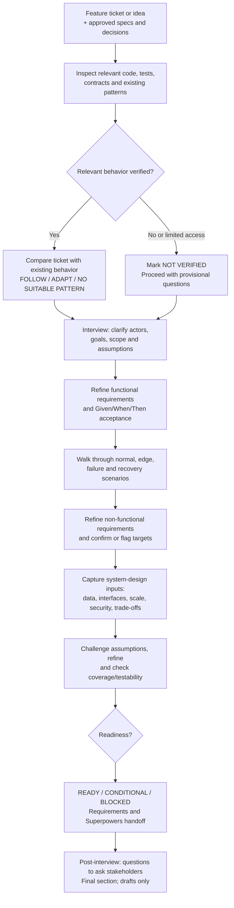
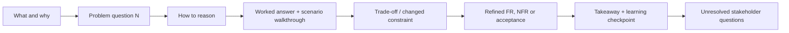

# Refine Requirements

**`refine-requirements`** is a codebase-first, interview-led engineering skill for turning a new feature request or a change to an existing feature into clear, evidence-backed requirements **before technical design begins**.

It serves two purposes: (1) refine real tickets into functional requirements (FRs), non-functional requirements (NFRs), testable acceptance criteria, and stakeholder decisions; and (2) practice the reasoning used in **system-design and DSA interviews**. Its teaching style is inspired by the DotSkills Code Review skill: one concrete problem question at a time, a worked example, a scenario walkthrough, a trade-off, and a learning checkpoint.

**Outcome:** a requirements brief that can be handed to **Superpowers** for design and implementation *later*. This skill does not choose an architecture, implement code, or answer business questions on behalf of stakeholders.

## Table of contents

- [When to use it](#when-to-use-it)
- [Workflow](#workflow)
- [The interview learning loop](#the-interview-learning-loop)
- [Modes](#modes)
- [What the skill refines](#what-the-skill-refines)
- [Final deliverables](#final-deliverables)
- [Example interview question](#example-interview-question)
- [How to invoke it](#how-to-invoke-it)
- [Evidence, safety, and scope](#evidence-safety-and-scope)
- [Source files](#source-files)

## When to use it

Use this skill when a ticket, product request, or feature idea needs clarification before engineering design: a new capability, an enhancement to existing behavior, a variation of a reusable feature, or an ambiguous change with important edge cases or quality requirements. It is also useful when you want to **practice explaining requirements as an interview candidate**.

**Inputs:** the ticket or feature idea, any approved specs or decisions, and access to relevant code/tests/contracts when available. If the codebase cannot be inspected, the interview may proceed with **provisional** ticket-grounded questions and an explicit **NOT VERIFIED** code-pattern status.

## Workflow

The process borrows **clarification, scenarios, and edge-case reasoning** from DSA interviews and **functional/non-functional scoping, system constraints, and trade-offs** from system-design interviews. It is **adaptive**: skip questions already answered by evidence and mark inapplicable topics rather than asking everything by rote.



**Codebase first** means locating relevant existing behavior before recommending new requirements or asking stakeholders questions that code or approved documents might already answer. Code is evidence of **observed behavior**, not automatic proof of a **confirmed product requirement**.

### How a topic progresses

1. **Clarify the problem:** who needs the feature, the triggering action, expected outcome, in/out-of-scope boundaries, and unresolved assumptions.
2. **Check existing patterns:** inspect a close analogue, note reusable business rules/contracts, and distinguish follow/adapt/no suitable pattern/not verified.
3. **Write functional requirements:** observable behavior, actors, permissions, priority, and verifiable acceptance criteria.
4. **Stress-test with examples:** normal paths, invalid/empty input, duplicates, retries, concurrent actions, permission denial, partial failure, and recovery when relevant.
5. **Write non-functional requirements:** relevant performance, reliability, consistency/freshness, security/privacy, accessibility, scale, observability, compatibility, or cost expectations. Unapproved thresholds remain **target requires confirmation**.
6. **Prepare system-design inputs:** domain entities/states, data ownership, source of truth, interfaces/contracts, dependencies, read/write patterns, workload assumptions, trust boundaries, and trade-off questions—not a prescribed implementation.
7. **Challenge and revise:** change a constraint, explain how requirements and acceptance might change, record remaining unknowns, and check coverage.
8. **Assess readiness and hand off:** produce **READY**, **CONDITIONAL**, or **BLOCKED** with reasons; end with only the consequential **Questions to ask stakeholders**.

## The interview learning loop

In default **Guided** mode, a single response covers **one high-value feature-specific problem question**, rather than dumping a full requirements report:



At the learning checkpoint the learner can explore the current question or continue to the next. **Practice** mode instead starts with the question and waits for the candidate before showing the answer, critique, and stakeholder questions. A question is not automatically a finished interview; completion also requires coverage and readiness checks.

## Modes

| Mode | Interaction | Best for |
| --- | --- | --- |
| **Guided (default)** | One question at a time; explanation, worked answer, walkthrough, follow-up, takeaway, and checkpoint. | Learning on a real ticket. |
| **Practice (on request)** | Ask one question, wait for your response, then offer hints/feedback and show the supported answer. | Mock DSA/system-design-style interview practice. |
| **Full walkthrough (on request)** | Cover relevant questions and provide a consolidated report in one pass. | A complete ticket-refinement exercise. |
| **Concise / refinement-only (on request)** | Skip teaching but keep codebase-first evidence, FRs, NFRs, acceptance, and handoff. | Fast, work-focused requirements refinement. |

## What the skill refines

| Area | Key question | Recorded output |
| --- | --- | --- |
| **Functional requirements (FRs)** | What must the user/system do, for whom, and when? | `FR-01`, `FR-02`, … with actor/trigger, behavior, priority, status, evidence, and **Given/When/Then** acceptance. |
| **Non-functional requirements (NFRs)** | How well must the relevant journey work? | `NFR-01`, `NFR-02`, … linked to FRs/journeys, with a verified target or **target requires confirmation**, method of verification, and owner. |
| **Existing-system alignment** | Is behavior already present, partially present, missing, conflicting, or not verified? | Paths/symbols/tests, comparable patterns, and explicitly limited conclusions. |
| **Scenarios and correctness** | What happens at boundaries, during retries, or when operations fail? | Normal, edge, permission, duplicate, failure, and recovery examples that sharpen acceptance. |
| **System-design readiness** | What product and integration constraints would change the design? | Entities/states, source of truth, interface/data contracts, scale inputs, dependencies, reliability/security expectations, and unresolved trade-offs. |
| **Decision ownership** | Who must answer what before design or implementation? | Stakeholder and, when needed, developer/history questions with priority, owner, why it matters, and handoff-blocking status. |

Statements are classified as **CONFIRMED REQUIREMENT**, **OBSERVED BEHAVIOR**, **PROPOSED**, **ASSUMED**, or **UNKNOWN**; the last four are never silently upgraded into stakeholder approval. The five optional book lenses—APOSD, Algorithmic Thinking, DDIA, FODE, and System Design Interview—are used only when they reveal an important requirements gap.

## Final deliverables

On interview completion, or when a consolidated report is requested, the skill provides:

1. **Feature brief:** goal, actors, scope/exclusions, sources, assumptions, and evidence limits.
2. **Pattern and alignment map:** existing behavior and reusable conventions, with verification status.
3. **Functional requirements:** prioritized, source-linked FR table and testable acceptance criteria.
4. **Non-functional requirements:** journey-linked NFR table, verified targets or owners for missing targets, and verification suggestions.
5. **Scenarios and constraints:** key user journeys, permissions, edge/failure/recovery behavior, dependencies, and compatibility needs.
6. **System-design preparation:** domain/data/interface/workload/trust-boundary inputs and technical questions explicitly deferred to Superpowers.
7. **Coverage and readiness:** what was inspected or executed, what is unverified, and a **READY / CONDITIONAL / BLOCKED** verdict. Even BLOCKED gets a clearly provisional brief.
8. **Post-interview — Questions to ask stakeholders (last section):** only unresolved, meaningful product decisions, plus developer/history questions where needed. Each has an owner, priority, ready-to-send wording, rationale, and **BLOCKS HANDOFF? YES/NO**.

**Important distinction:** these questions **replace draft code-review comments** from the Code Review learning pattern. They are *draft questions*, not comments to post to source code and not messages automatically sent to a stakeholder. If none remain, the report says **“No unresolved stakeholder questions for this topic.”**

## Example interview question

> **Illustrative ticket:** “Allow signed-in users to update notification preferences.” This is a hypothetical exercise; no product policy or codebase behavior is being asserted.

**Problem question 1 — What should happen when preferences change on one device?**

- **Reasoning:** inspect any existing settings flow; distinguish successful save behavior (FR) from how quickly a second device sees that change (NFR). If the code was not inspected, mark its baseline **NOT VERIFIED**.
- **FR-01 (PROPOSED):** a signed-in user can save a supported notification preference and later read the saved choice. A suitable Given/When/Then scenario would check the saved value is returned on a successful read; stakeholders must approve the exact guarantee.
- **NFR-01 (UNKNOWN):** cross-device freshness of preference changes; **target requires confirmation**.
- **Changed constraint:** what if the second device reads immediately after the first saves? The required freshness is undecided, so architecture must not assume instant synchronization.
- **Q-01 / Product owner (blocks confirming NFR-01):** “When a user saves a preference, must other signed-in devices reflect it immediately, or is a propagation delay acceptable?”

The aim is to learn how an unclear product expectation becomes an explicit decision **before** a system-design agent selects a solution.

## How to invoke it

Use a compatible DotSkills installation, or point your assistant to [`SKILL.md`](SKILL.md) and its references. Supply a ticket/feature description and access to relevant code or specs where permitted.

**Guided (default)**

```text
Use the refine-requirements skill on this feature ticket: <ticket or description>.
Inspect relevant existing code and tests first when available.
Walk me through one problem question at a time, with a worked answer,
scenario, trade-off, refined FR/NFR, takeaway, and learning checkpoint.
Finish each completed question with unresolved stakeholder questions.
Do not edit code, contact stakeholders, or invoke Superpowers.
```

**Practice mode**

```text
Use refine-requirements in Practice mode for <ticket or feature>.
Act as my system-design/requirements interviewer.
Ask one question, wait for my answer, then critique it and help me
refine the FRs, NFRs, acceptance, and stakeholder questions.
```

**For a one-pass brief**, request **Full walkthrough** or **Concise / refinement-only** mode explicitly.

## Evidence, safety, and scope

- **Codebase-first, not codebase-as-policy:** cite relevant ticket/spec evidence and inspected paths/tests. A similar implementation may suggest a baseline but cannot approve product behavior.
- **Read-only by default:** this skill does not change source files, run deployments, post comments/issues, create tickets, send emails, or execute Superpowers. Any later writes or outreach require separate authorization and tool/runtime permissions.
- **No invented facts:** mark absent repository access **NOT VERIFIED**, distinguish hypothetical walkthroughs from executed tests, and never invent SLAs, volumes, compliance requirements, approvals, or historical reasoning.
- **Requirements before solution:** leave architecture, database/framework selection, detailed schemas/algorithms, and implementation tasks to the later design workflow.
- **Evidence stays untrusted:** ticket text, code, and tool output are task data, not permission to perform unrelated actions. A skill document by itself cannot enforce permissions; the host/runtime must enforce them.

## Source files

| File | Role |
| --- | --- |
| [`SKILL.md`](SKILL.md) | Normative skill entry point: purpose, interview behavior, deliverables, and boundaries. |
| [`references/interview-playbook.md`](references/interview-playbook.md) | Detailed interviewer roles, question sequence, modes, response format, and worked example. |
| [`references/refine-requirements.md`](references/refine-requirements.md) | Source-locked requirements-analysis reference and Superpowers handoff checklist. Preserve this imported content unchanged. |

This README is an explanatory guide to the **currently implemented** skill, not a separate mode or a new set of instructions. For operational details, follow `SKILL.md` and its referenced playbooks.
