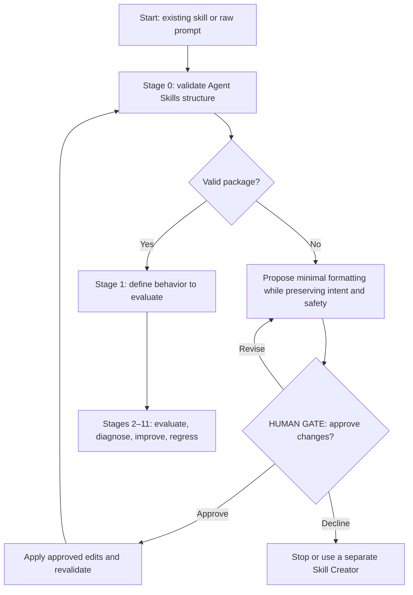
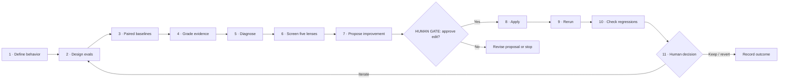
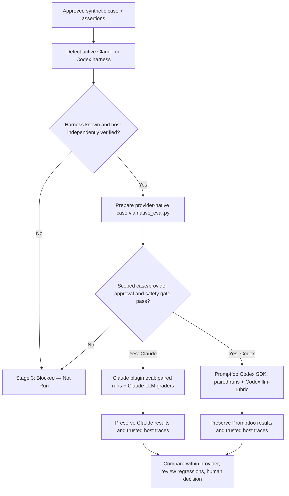
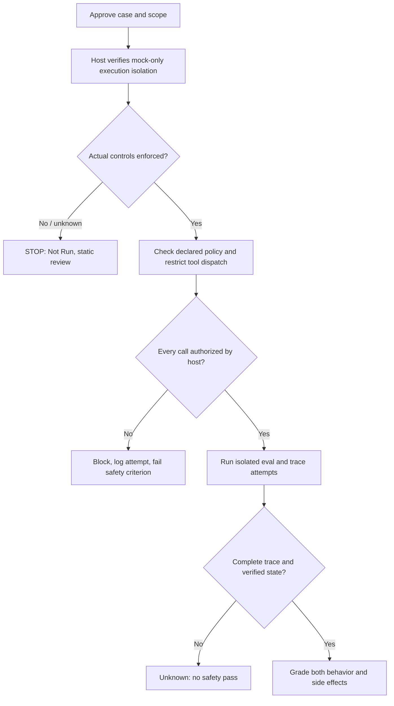

# Refine Skill

**Refine Skill** is a guided, human-gated workflow for **learning to write evaluations** and improving agent skills based on observed results. It accepts an existing Agent Skill or a raw prompt.

Refine Skill is **not a full skill creator**: Claude/Codex Skill Creator can handle richer authoring. Refine Skill does only the *minimum* structural conversion when needed, then focuses on output quality. Refine Skill includes a **skill-local provider-native eval dispatcher** in [`runner/`](runner/README.md): Claude Code uses Claude plugin eval, while Codex uses Promptfoo with the Codex SDK as its runner and LLM grader. Neither route has been validated in a live, independently isolated host.


## Table of contents

- [1. Workflow at a glance](#1-workflow-at-a-glance)
  - [Minimum valid skill](#minimum-valid-skill)
- [2. The 12 stages](#2-the-12-stages)
  - [Evaluation and refinement loop](#evaluation-and-refinement-loop)
- [3. Five conference-informed methodology lenses](#3-five-conference-informed-methodology-lenses)
- [4. File and evaluation structure](#4-file-and-evaluation-structure)
- [5. Claude/Codex evaluation adapter](#5-claudecodex-evaluation-adapter)
- [6. Approval, execution, and safety](#6-approval-execution-and-safety)
- [7. Comparison with Claude and OpenAI](#7-comparison-with-claude-and-openai)
- [8. Try it](#8-try-it)

## 1. Workflow at a glance

Every invocation starts with **Stage 0**, a check against the [Agent Skills Quickstart](https://agentskills.io/skill-creation/quickstart). Valid skills proceed unchanged to Stage 1. Invalid skills and raw prompts get a minimal formatting proposal, subject to human approval.



### Minimum valid skill

The portable format is a folder with a root `SKILL.md`: valid YAML frontmatter with `name` and `description`, followed by Markdown instructions. The name must match the directory and follow the [Agent Skills naming rules](https://agentskills.io/specification); the description should explain what the skill does and when to use it.

```text
skills/
└── example-skill/
    └── SKILL.md                    # Required
```

Folders such as `references/`, `scripts/`, `assets/`, and `evals/` are **optional**. Stage 0 is a *format check*, not a behavior rewrite or an execution of the target task. Format changes require an approved preview and post-change validation.

## 2. The 12 stages

The **same 12 stages** apply in Claude Code and Codex. Refine Skill uses the
**active, independently verified harness** for provider-specific evaluations;
it never switches providers to complete an evaluation. A dash (—) below means
**no provider-specific eval runner or LLM grader** is invoked at that stage;
the guided work still happens in the active coding agent.

| Stage | Action | Outcome | Claude Code | Codex |
| --- | --- | --- | --- | --- |
| **0** | Validate structure; minimally normalize if needed | Valid package or approved format conversion | — | — |
| **1** | Define one observable behavior | Success criteria and scope | — | — |
| **2** | Learn to write 2–3 realistic cases and approve assertions | Prompts, expected outcomes, optional fixtures; native case prepared without execution | Prepare Claude plugin-eval cases + `type: llm` grader files | Prepare Promptfoo config + `llm-rubric` assertions for Codex SDK |
| **3** | Run paired baselines in fresh contexts | With-skill vs. without-skill (or old-skill) evidence | **Execute:** `claude plugin eval` paired runs | **Execute:** Promptfoo with `openai:codex-sdk` paired runs |
| **4** | Grade actual outputs | Assertions, grading evidence, uncertainty | **Grade:** Claude plugin-eval `type: llm` graders | **Grade:** Promptfoo `llm-rubric` using Codex SDK |
| **5** | Diagnose before editing | Identify case, grader, context, harness, trust, or skill issues | — | — |
| **6** | Screen five methodology lenses | Evidence-backed diagnosis and optional specialist route | — | — |
| **7** | Propose the smallest improvement | Rationale, trade-offs, and **human approval** | — | — |
| **8** | Apply only approved edits | Versioned change and diff | — | — |
| **9** | Rerun comparable evaluations | New results for the same cases and rubric | **Rerun:** Claude plugin eval with matching case/rubric | **Rerun:** Promptfoo + Codex SDK with matching case/rubric |
| **10** | Check regressions and independent coverage | Before/after comparison and limits | **Review:** Claude-native reports + human evidence review | **Review:** Promptfoo-native reports + human evidence review |
| **11** | Human decides: keep, revise, revert, or iterate | Recorded decision and lessons | — | — |

**Execution and LLM grading are specific to Stages 3–4, repeated as needed in
Stage 9.** Stage 2 prepares provider-native cases but does **not** run a model;
Stage 10 inspects verified native results and does not assume an additional
model-based comparator exists. Promptfoo is a third-party framework using the
OpenAI Codex SDK—not an OpenAI-owned evaluation runner. All live runs require
scoped approval and an independently verified isolated host; otherwise Stage
3 remains **Blocked — Not Run**. See
[provider-native runner instructions](runner/README.md).

Learning is **Guided by default**: explain *what, why, how*, show a target-specific example, and help the human write or challenge cases and assertions. **Deep dive** and **Fast** learning modes are available.

### Evaluation and refinement loop



## 3. Five conference-informed methodology lenses

Stage 6 briefly reviews **all five**. A specialist deep dive happens only when evidence or a learning request justifies it.

| Lens | Focus |
| --- | --- |
| [Context Engineering](../context-engineering/SKILL.md) | Missing, excessive, conflicting, stale, or untrusted context |
| [Correctness & Verification](../correctness-and-verification/SKILL.md) | Evidence for claims, invariants, and deterministic checks |
| [Observability & Feedback](../agent-observability-and-feedback/SKILL.md) | Outputs, attempted tool actions, traces, and feedback |
| [Trust & Governance](../agent-trust-and-governance/SKILL.md) | Authority boundaries, permissions, approvals, and side effects |
| [Skill Lifecycle & Release](../skill-lifecycle-and-release/SKILL.md) | Versioning, regressions, portability, and release readiness |

These lenses, learning modes, and human gates are **DotSkills extensions**, not Agent Skills format requirements.

## 4. File and evaluation structure

`SKILL.md` is the runtime entry point; details live in `references/`. **Each target skill keeps its own evaluation definitions in `evals/evals.json`**. The Refine Skill's own `evals/` directory contains *self-evaluation* starter cases.

```text
skills/
├── refine-skill/
│   ├── README.md                  # This human-facing overview
│   ├── SKILL.md                   # Skill entry point
│   ├── runner/                    # Native provider dispatch, documentation + tests
│   ├── references/                # Workflow, structure, evals, lenses, approvals
│   └── evals/                     # Refine Skill's self-eval cases
└── <target-skill>/
    ├── SKILL.md
    └── evals/                     # Optional evaluation convention
        ├── evals.json             # skill_name, evals: [{id, prompt, expected_output, files?}]
        └── files/                 # Optional input fixtures

eval-workspaces/<target-skill>/iteration-N/     # Generated, usually gitignored
├── eval-001/
│   ├── with_skill/
│   │   ├── outputs/
│   │   ├── grading.json
│   │   └── timing.json
│   └── without_skill/             # Or old_skill/; same evidence files
└── benchmark.json
```

This uses the [Agent Skills evaluation guide](https://agentskills.io/skill-creation/evaluating-skills) conventions for cases, paired runs, grading, timing, and benchmarks. **They are recommendations, not requirements of the core skill specification.** The top-level `eval-workspaces/` path is a DotSkills-specific choice.

Describe expected behavior **before** testing, then teach precise assertions after inspecting initial outputs. Preserve original results and comparable case/rubric versions; record real tool attempts, outcomes, and unknowns. Do not invent metrics or grades.

## 5. Claude/Codex evaluation adapter

The [native evaluation guide](runner/README.md) and
[`native_eval.py`](runner/native_eval.py) document a **strict
provider-specific workflow**, scoped to `skills/refine-skill/runner/`.
It prepares evaluation cases for the **active coding harness**, without
mixing evaluators, case formats or reports.

| Current harness | Evaluation runner | LLM grading | Output |
| --- | --- | --- | --- |
| **Claude Code** | `claude plugin eval` with `--ablation with-without` | Claude's `type: llm` graders | Claude evaluation artifacts |
| **Codex** | Promptfoo with OpenAI's `openai:codex-sdk` provider and paired workspaces | Promptfoo `llm-rubric` using the Codex SDK model | Promptfoo evaluation artifacts |

**Promptfoo is a third-party evaluation framework**, not an OpenAI-owned
eval runner or first-party grading service. Both execution and grading
use Codex through its provider integration. Claude stays exclusively
within its plugin eval workflow. The native dispatcher **does not install**
either provider's tooling and does not fall back if the selected tool
is missing.



The dispatcher offers `inspect`, `prepare`, and `run`. It checks
`CLAUDECODE` or `CODEX_THREAD_ID`/`CODEX_SESSION_ID` to infer the
current harness, but environment markers alone are not sufficient for
trusted execution. `--harness` is an offline preparation option, not a
runtime provider override. A missing or conflicting harness stops the
workflow; a model binary on `PATH` does not select the provider.

**Status:** The files and offline tests are committed, but live provider
execution, grader response handling and independent host isolation remain
**unverified**. Real model-evaluation status is **Not Run**. Never send
proprietary work content to an unapproved model provider.

See [native evaluation setup and security](runner/README.md),
[Stages 3–4 and 9–10 integration](references/eval-runner-integration.md),
and [mandatory execution safety gate](references/execution-safety-gate.md).

## 6. Approval, execution, and safety

**Mandatory Execution Safety Gate** (before Stage 3 or 9, any delegated run,
or any earlier execution of an evaluated skill). The GitLab-posting incident
motivated this defense: a target skill can suggest an action but **cannot
authorize** it. A valid `SKILL.md` is not necessarily a safe skill.



- **Human gates:** Approve cases, runs, structural changes, skill edits, specialist
  routing, and release decisions as applicable. These are not permission to
  post to GitHub/GitLab, send messages, or deploy.
- **Enforce in the execution host:** Fresh disposable workspace, mock-only tools,
  no live credentials, network egress or unmediated shell/API/child-agent paths,
  and a host-owned tool allowlist. Only task input goes to the evaluated agent;
  answer keys and grading stay evaluator-only.
- **Fail closed:** If the host cannot verify isolation, **do not run**. An
  unauthorized attempted action fails its security check **even when blocked**.
  If the attempt trace or resulting-state audit is missing, use **Unknown**.
- **Available helper:** `scripts/refine_eval_safety.py` checks a host
  manifest, authorizes single mock tool requests and audits trace JSONL. It
  does **not** launch agents, physically sandbox them or install policy in
  Claude/Codex. The runner must invoke it (or stricter equivalent) before
  each dispatch. A manifest-only pass is *not proof* of live enforcement.

```bash
python3 scripts/refine_eval_safety.py preflight path/to/host-manifest.json
python3 scripts/refine_eval_safety.py authorize path/to/host-manifest.json path/to/call.json
python3 scripts/refine_eval_safety.py audit path/to/host-manifest.json path/to/trace.jsonl
python3 -m unittest scripts/test_refine_eval_safety.py -v
```

[Execution Safety Gate and host contract](references/execution-safety-gate.md) ·
[Approval rules](references/approval-gates.md) ·
[Security regression cases (IDs 4–6)](evals/evals.json).

**What is and is not proven:** Unit tests check this helper's deny/grade logic.
The security cases are definitions **not live model runs**. DotSkills bundles an **experimental** provider-native dispatcher, but has not
verified a live end-to-end model evaluation or host-enforced isolation, nor
proved your coworker's skill caused the unexpected GitLab post. The execution environment must
independently enforce controls for real protection.

## 7. Comparison with Claude and OpenAI

This is a **capability and workflow comparison**, not a measured ranking. It reflects
the documented tools as of October 2026. Refine Skill is designed to work
*alongside* existing skill creators and eval runners rather than replace them.

| Capability | DotSkills **Refine Skill** | [Claude Skill Creator](https://github.com/anthropics/skills/tree/main/skills/skill-creator) | [OpenAI Skill Creator (Codex)](https://github.com/openai/codex/blob/main/codex-rs/skills/src/assets/samples/skill-creator/SKILL.md) | [OpenAI Plugin Eval](https://github.com/openai/plugins/tree/main/plugins/plugin-eval) |
| --- | --- | --- | --- | --- |
| **Main role** | Guided, human-gated evaluation and diagnosis | Create, evaluate, iterate and optimize skills | Create/update well-scoped skills | Inspect, benchmark and compare skills/plugins |
| **Skill authoring** | Minimal Agent Skills format normalization | Full creation and revision | Full creation and revision | Not a skill-creation tool |
| **Eval design** | Learner co-authors cases, expectations and assertions | Creates test prompts and quantitative checks with feedback | Targeted testing when appropriate | Benchmark configurations and test scenarios |
| **Execute model evals** | Native provider routing to Claude plugin eval or Promptfoo with Codex SDK; requires an approved, independently isolated host | Supports paired agent runs in compatible Claude environments | Task-specific testing, not a dedicated benchmarking engine | Live benchmarks through **Codex CLI** |
| **Grade and compare** | Claude `type: llm` graders or Codex-backed `llm-rubric` in Promptfoo; preserve separate provider reports; live verification pending | Automated grading, qualitative review, benchmark summaries | Inspect and verify focused skill changes | Static reports, measured runs, before/after comparison |
| **Human oversight** | Explicit learning and approval gates across Stages 0–11 | User feedback and review within its workflow | Scope-sensitive authoring and validation | Human-reviewed CLI/configuration and reports |
| **Special methodology** | **Five conference-informed lenses**, selective specialist routing, provenance labels | No matching five-lens program described | No matching five-lens program described | Metric-oriented analysis, not the five-lens teaching workflow |

**Shared ground:** All can contribute to improving skills; Claude Skill Creator
already includes substantial behavioral evaluation and benchmarking, not merely
formatting. OpenAI splits responsibilities between its Skill Creator and the
separate Plugin Eval CLI/plugin.

**DotSkills' distinct role:** teach *why* an eval case and grading criterion
matter, check the evidence and action trace, differentiate a flawed test from
a flawed skill, route diagnoses through the five methodology lenses, and let
the human approve changes. Those gates are instructions and process conventions;
the actual agent harness must enforce permissions.

## 8. Try it

> Use **refine-skill** on `skills/code-review` in **Guided** mode. Check Stage 0, walk me through writing eval cases, explain evidence and recommendations, and pause at each approval gate. Do not perform live external writes.

For operational details:

- [Runtime entry point](SKILL.md) · [Full Stage 0–11 workflow](references/workflow.md)
- [Structure validation](references/structure-validation.md) · [Eval design guide](references/eval-design-guide.md)
- [Methodology lenses](references/methodology-lenses.md) · [Approval and safety rules](references/approval-gates.md)
- [Execution Safety Gate](references/execution-safety-gate.md) · [Refine Skill starter and security evals](evals/README.md)
- [Provider-native evaluation runner: setup, commands, security, limitations](runner/README.md)

Repository checks, run from DotSkills root:

```bash
python3 scripts/validate_skill_repository_integrity.py
python3 scripts/validate_evals.py --all
```

These commands check package and evaluation **structure**. They do not measure live model output quality.
