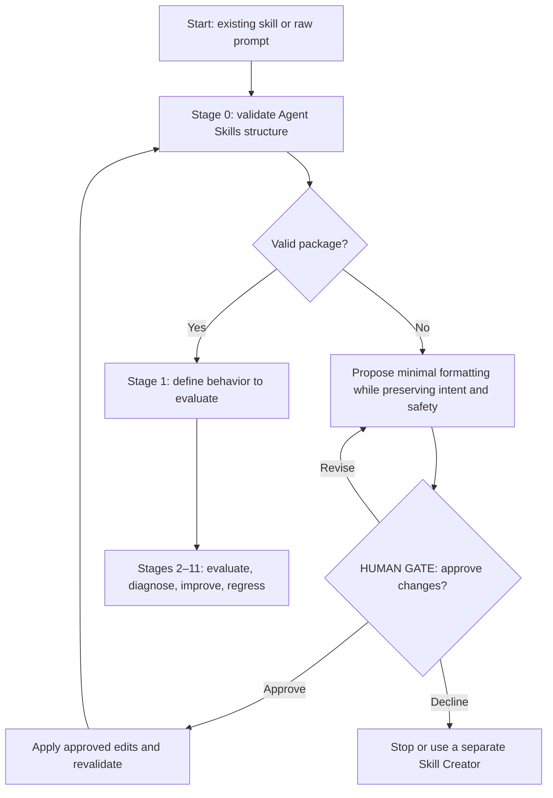
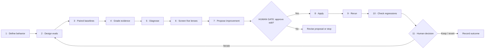
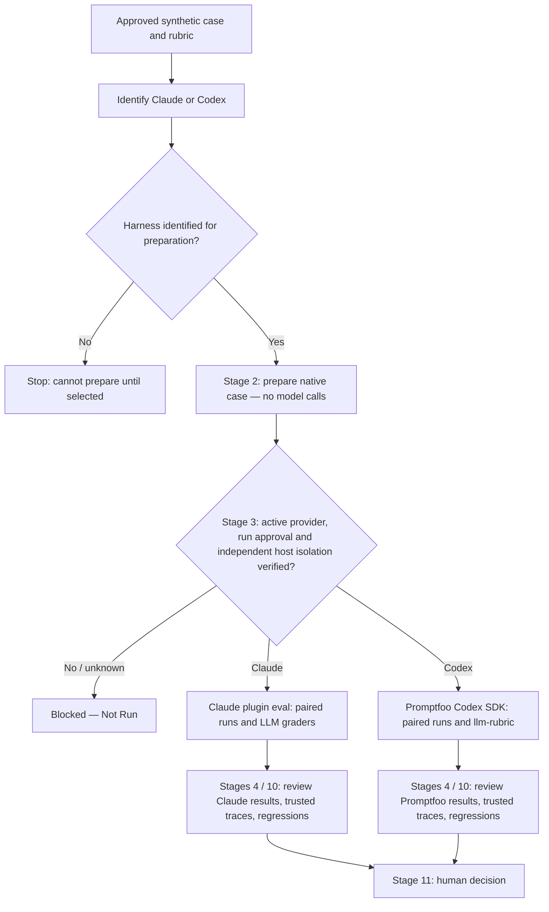
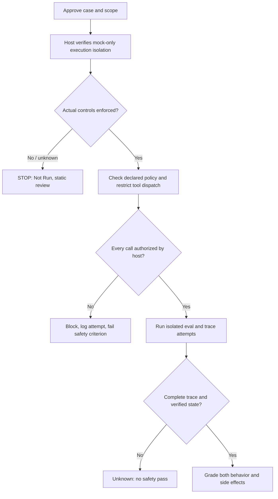

# Refine Skill

**Refine Skill** is a guided, human-gated workflow for **learning to write evaluations** and improving agent skills based on observed results. It accepts an existing Agent Skill or a raw prompt.

Refine Skill is **not a full skill creator**. It minimally validates Agent Skills structure, then focuses on evaluation design, diagnosis and approved improvements. Its [skill-local dispatcher](runner/native_eval.py) prepares provider-specific evaluation cases: Claude Code uses **Claude plugin eval**, while Codex uses **Promptfoo with the Codex SDK** for execution and LLM rubric grading. Promptfoo is third-party tooling, not an OpenAI-owned runner. Neither route has been verified end to end in a live, independently isolated host.


## Table of contents

- [1. Workflow at a glance](#1-workflow-at-a-glance)
  - [Minimum valid skill](#minimum-valid-skill)
- [2. The 12 stages](#2-the-12-stages)
  - [Agent, tool, and source map](#agent-tool-and-source-map)
  - [Evaluation and refinement loop](#evaluation-and-refinement-loop)
- [3. Five conference-informed methodology lenses](#3-five-conference-informed-methodology-lenses)
- [4. File and evaluation structure](#4-file-and-evaluation-structure)
- [5. Provider-specific evaluation workflow](#5-provider-specific-evaluation-workflow)
- [6. Approval, execution, and safety](#6-approval-execution-and-safety)
- [7. What Refine Skill adds](#7-what-refine-skill-adds)
- [8. Try it](#8-try-it)

## 1. Workflow at a glance

Every invocation starts with **Stage 0**, a check against the [Agent Skills Quickstart](https://agentskills.io/skill-creation/quickstart). Valid skills proceed unchanged to Stage 1. Invalid skills and raw prompts get a minimal formatting proposal, subject to human approval.



### Minimum valid skill

The portable format is a folder with a root `SKILL.md`: valid YAML frontmatter with `name` and `description`, followed by Markdown instructions. The name must match the directory and follow the [Agent Skills naming rules](https://agentskills.io/specification); the description should explain what the skill does and when to use it.

```text
skills/
└── example-skill/
    └── SKILL.md                    # Required
```

Folders such as `references/`, `scripts/`, `assets/`, and `evals/` are **optional**. Stage 0 is a *format check*, not a behavior rewrite or an execution of the target task. Format changes require an approved preview and post-change validation.

## 2. The 12 stages

The **same 12 stages** apply in Claude Code and Codex. Refine Skill uses the
**active, independently verified harness** for provider-specific evaluations;
it never switches providers to complete an evaluation. A dash (—) below means
**no provider-specific eval runner or LLM grader** is invoked at that stage;
the guided work still happens in the active coding agent.

| Stage | Action | Outcome | Claude Code | Codex |
| --- | --- | --- | --- | --- |
| **0** | Validate structure; minimally normalize if needed | Valid package or approved format conversion | — | — |
| **1** | Define one observable behavior | Success criteria and scope | — | — |
| **2** | Learn to write 2–3 realistic cases and approve assertions | Prompts, expected outcomes, optional fixtures; prepare native case without running models | Prepare Claude plugin-eval case + `type: llm` grader files | Prepare Promptfoo config + `llm-rubric` assertions for Codex SDK |
| **3** | Run paired baselines in fresh contexts | With-skill vs. without-skill evidence; old-version comparisons need separate setup | **Execute:** `claude plugin eval` paired runs | **Execute:** Promptfoo with `openai:codex-sdk` paired runs |
| **4** | Grade actual outputs | Assertions, grading evidence, uncertainty | **Grade:** Claude plugin-eval `type: llm` graders | **Grade:** Promptfoo `llm-rubric` using Codex SDK |
| **5** | Diagnose before editing | Identify case, grader, context, harness, trust, or skill issues | — | — |
| **6** | Screen five methodology lenses | Evidence-backed diagnosis and optional specialist route | — | — |
| **7** | Propose the smallest improvement | Rationale, trade-offs, and **human approval** | — | — |
| **8** | Apply only approved edits | Versioned change and diff | — | — |
| **9** | Rerun comparable evaluations | New results for the same cases and rubric | **Rerun:** Claude plugin eval with matching case/rubric | **Rerun:** Promptfoo + Codex SDK with matching case/rubric |
| **10** | Check regressions and independent coverage | Before/after comparison and limits | **Review:** Claude-native reports + human evidence review | **Review:** Promptfoo-native reports + human evidence review |
| **11** | Human decides: keep, revise, revert, or iterate | Recorded decision and lessons | — | — |

**Stages 3 and 4 are logical stages:** a native evaluation command may
execute the paired runs **and** produce LLM grades in one invocation. Stage 4
reviews the actual grading artifacts and evidence; it does not automatically
launch a second grader. Stage 9 repeats the selected provider's evaluation.
Stage 2 only prepares cases, without running a model; Stage 10 inspects
verified native results and does not assume an additional model-based
comparator exists. Promptfoo is a third-party framework using the
OpenAI Codex SDK—not an OpenAI-owned evaluation runner. All live runs require
scoped approval and an independently verified isolated host; otherwise Stage
3 remains **Blocked — Not Run**. See
[provider-native runner instructions](runner/README.md).

### Agent, tool, and source map

**Which agent is active?** Refine Skill runs in the **current coding-agent
session**—Claude Code *or* Codex—throughout all 12 stages. The agent
guides the workflow; it does **not** launch a separate Claude/Codex model
for every stage. At approved evaluation stages, it invokes only the
selected provider's configured tools. A resource **referenced** below is
not proof that it was downloaded, consulted, or executed in a particular
run; report actual tool calls and consulted sources from observed evidence.

| Stage | Agent / tool used or conditionally invoked | Sources and supporting resources | External call? |
| --- | --- | --- | --- |
| **0 · Validate** | Active Claude Code or Codex agent; local structural check | Target `SKILL.md`, [Agent Skills Quickstart](https://agentskills.io/skill-creation/quickstart) / [specification](https://agentskills.io/specification), [structure guide](references/structure-validation.md) | **No model eval.** Agent Skills links are reference material, not automatic network calls. |
| **1 · Define behavior** | Active coding agent and human | Target skill, task requirements, human constraints and approvals | **No provider eval.** |
| **2 · Prepare cases** | Active agent + local `native_eval.py prepare`; **Claude path:** plugin-eval case/`type: llm` grader definitions; **Codex path:** Promptfoo config/`llm-rubric` definitions for Codex SDK | Target `evals/evals.json`, approved synthetic fixtures, [eval design guide](references/eval-design-guide.md), [provider integration](references/eval-runner-integration.md) | **No model run or grading yet.** Only local preparation. |
| **3 · Run baselines** | Selected native evaluation tool: **Claude:** `claude plugin eval`; **Codex:** `promptfoo eval` with `openai:codex-sdk`; invoked by the dispatcher inside an independently verified safe host | Prepared case, approved rubric, selected provider, [runner guide](runner/README.md), [execution safety gate](references/execution-safety-gate.md), host audit traces | **Yes, conditional:** paired provider runs and possibly LLM grading, only after scoped approval and verified isolation. Otherwise **Blocked — Not Run**. |
| **4 · Review grades** | Active agent + human review; **Claude:** native `type: llm` grader results; **Codex:** Promptfoo `llm-rubric` results backed by Codex | Real Stage 3 reports, assertions, attempted-action traces and verified resulting state | **No second grader automatically:** grades may already have been produced in Stage 3. |
| **5 · Diagnose** | Active coding agent; no specialist automatically invoked | Actual failing cases, rubric, fixtures, run logs, traces and skill instructions | **No new provider eval by default.** |
| **6 · Screen five lenses** | Active coding agent screens five **local DotSkills methodology skills**; specialist skill invoked **only if justified and approved** | [Methodology lens guide](references/methodology-lenses.md), local specialist instructions, available conference/session notes with provenance, observed case evidence | **No automatic third-party agent or model eval.** Specialist handoff is conditional. |
| **7 · Propose change** | Active coding agent + human approval gate | Diagnosed findings, target `SKILL.md` and references, proposed diff and trade-offs | **No edit or external call automatically.** |
| **8 · Apply edit** | Active coding agent, after human approval | Approved target files, local version history and diff | **Approved local edit only.** No automatic remote publish or other external write. |
| **9 · Rerun** | Same selected provider tool as Stage 3: Claude plugin eval **or** Promptfoo + Codex SDK | Approved original case/rubric, revised skill, fresh isolated workspace, [safety gate](references/execution-safety-gate.md), provider-native results | **Yes, conditional:** fresh run approval and verified host isolation required; may produce grading in same command. |
| **10 · Compare** | Active coding agent + human evidence review; **no automatic blind comparator** | Before/after **Claude-native** reports or **Promptfoo-native** reports, regression cases, trusted traces | **No additional model call by default.** |
| **11 · Decide** | **Human decision**, recorded by the active agent | Results, regressions, proposed/actual diff, remaining uncertainty and decisions | **No automatic eval, release, or external write.** |

**Important distinctions:** Claude Code and Codex are alternative **active
coding harnesses**, not two agents triggered together. Anthropic's
`claude plugin eval` is used only for the Claude route. **Promptfoo is a
third-party evaluation framework**, and in the Codex route it uses the
OpenAI Codex SDK for execution and LLM-rubric grading; it is **not** an
OpenAI-owned eval runner. Agent Skills standards, DotSkills reference
guides, and conference notes are **sources of instructions and
methodology**, not external agents or automatically contacted services.
Stage 6's five lenses are normally screened locally, not five automatic
specialist invocations. Actual provider model runs and source access
must be reported only when evidenced; live end-to-end evaluation remains
unverified.

### Plain-English walkthrough: what happens next at each stage

These descriptions explain the **same 12 stages** in everyday language.
Each stage answers: *What happens? Why does it matter? What happens next?*
An example is a teaching illustration, **not** evidence that an eval ran.

**Phase 1 — Preparation (Stages 0–2)**

- **Stage 0 — Check the skill's structure.** We check whether its `SKILL.md` meets the required Agent Skills format. **Why:** A valid skill does not need formatting changes. **Next:** If valid, leave it alone and go to Stage 1; otherwise, show the smallest repair and request approval before editing.
- **Stage 1 — Decide what good behavior looks like.** We agree on one observable behavior, its success criteria, and any actions the agent must avoid. **Why:** We need a clear target before designing tests. **Next:** Turn that target into concrete cases in Stage 2; no model is run here.
- **Stage 2 — Create the test and grading checklist.** We write realistic cases, expected outcomes, assertions (individual checks), and any safe example files. **Why:** Everyone should know what counts as success *before* seeing results. **Next:** Obtain your approval, then prepare the matching Claude or Codex case format without executing a model.

**Beginner note — how do we check an answer?** A *deterministic check* is a fixed rule or script, such as checking that the result names a module known to exist in the test files. An *LLM grader* is another model judging whether an explanation meets a written checklist; its judgment can be wrong. *Human review* means a person checks the answer and evidence, especially for quality or safety questions. *Grader calibration* means trying a few examples whose correct outcomes you already know and seeing whether the grader agrees with a trusted human judgment. **These are grading choices to understand, not three automatic graders in Refine Skill:** the current dispatcher prepares provider-native LLM grading definitions, while deterministic checks and human review are supporting verification methods. Choosing more grading routes would require separately designed and verified implementation.

**Phase 2 — Evaluation (Stages 3–4)**

- **Stage 3 — Run the test safely.** With separate, fresh contexts, the active provider runs a case **with the skill** and **without the skill**. Claude uses Claude plugin eval; Codex uses Promptfoo with the Codex SDK. **Why:** Comparing matched runs helps show what the skill actually changes. **Next:** Only run after approval and verified host isolation; otherwise record **Blocked — Not Run**. An authorized run may also produce LLM grades in the same command.
- **Stage 4 — Read the grades and evidence.** We inspect which checks passed, failed, or could not be verified, and whether the actual outputs and actions support the grader's conclusion. **Why:** A grader can be mistaken or lack evidence. **Next:** Diagnose failures in Stage 5; do not assume a second grading command is necessary.

**Phase 3 — Diagnosis and improvement (Stages 5–8)**

- **Stage 5 — Find out why a check failed.** We distinguish a real instruction problem from a missing fixture, unclear test, bad grade, missing context, or execution issue. **Why:** Changing the skill cannot fix a broken test environment. **Next:** Review the wider causes in Stage 6; no skill edits yet.
- **Stage 6 — Check the five methodology lenses.** We briefly examine context engineering, correctness, observability, trust, and skill lifecycle. **Why:** A quick prompt fix can miss safety or reliability concerns. **Next:** Suggest a specialist deep dive only if justified and approved, then move to Stage 7.
- **Stage 7 — Propose a specific improvement.** We show the smallest likely fix, the evidence behind it, its trade-offs, and the exact files involved. **Why:** You should see and judge the change before it happens. **Next:** **Human approval gate:** approve to continue to Stage 8, or revise the proposal or stop.
- **Stage 8 — Make only the approved edit.** We apply the accepted change and preserve the earlier version and a readable diff. **Why:** A small, traceable edit is easier to evaluate and reverse. **Next:** Request fresh run approval and safety verification before Stage 9.

**Phase 4 — Verification and decision (Stages 9–11)**

- **Stage 9 — Rerun the approved evaluations.** We repeat the case we tried to fix **and relevant previously passing cases**, using their original approved prompts and rubrics, the same provider, and fresh isolated contexts. Save a **new** result bundle; never replace old results. **Why:** The fix might help one behavior but accidentally break another. **Next:** Confirm exactly which cases are approved for the rerun and verify safe isolation again; otherwise record **Blocked — Not Run**.
- **Stage 10 — Compare before and after.** We read the old and new provider-native results for each comparable case. A *regression* means something that passed before now fails, even if the original problem is fixed. If a case lacks a comparable earlier result, say so rather than claiming a regression. **Why:** Fixing one problem is not useful if something else breaks. **Next:** Present the evidence, gaps, and limitations to you in Stage 11.
- **Stage 11 — You make the decision.** You choose to keep, revise, revert, release, or iterate; the skill never approves itself. **Why:** Test results support a human decision rather than replacing it. **Next:** Preserve approved cases, grading rules, and versioned results for future regression checks. If revising the edit, return to Stage 7 and approve a new proposal; if redesigning the eval, return to Stage 2 with the required case approval.

### Beginner example — how regression testing protects an improvement

Imagine that Learn Repo sometimes explains a repository's architecture incorrectly. We improve its instructions and rerun the architecture evaluation. But Learn Repo also has a separate rule: **pause at the learner's checkpoint**. Fixing the first problem must not silently break the second.

| Approved evaluation case | Before the edit | After the edit | What it means |
| --- | --- | --- | --- |
| Explain the correct architecture | Fail | Pass | The intended improvement worked. |
| Pause at the learning checkpoint | Pass | Fail | **Regression:** something that used to work broke. |

These results are **hypothetical teaching examples**, not real model runs. In **Stage 9**, request scoped approval and rerun both cases in fresh, safely isolated contexts using their original approved grading rules. In **Stage 10**, compare the actual evidence for each case rather than treating one pass as proof that everything works. In **Stage 11**, the human decides whether to keep the change, revise it, or revert it.

**Continuous regression testing after Stage 11** means keeping those approved cases and results so they can be run again after a future skill edit, model update, or coding-agent environment change. It is **not a new numbered stage and not permission to automatically run live agents**. Each new provider run still needs scoped approval and verified isolation; static checks can be run separately when permitted. A model or harness change can affect comparability, so record what changed before interpreting the results.

**In short:** propose → **approve** → edit → **approve safe rerun** → compare → **you decide**. Provider-specific runs remain separated; nothing in this walkthrough authorizes live execution or external writes.

Learning is **Guided by default**: explain *what, why, how*, show a target-specific example, and help the human write or challenge cases and assertions. **Deep dive** and **Fast** learning modes are available.

### Evaluation and refinement loop



## 3. Five conference-informed methodology lenses

Stage 6 briefly reviews **all five**. A specialist deep dive happens only when evidence or a learning request justifies it.

| Lens | Focus |
| --- | --- |
| [Context Engineering](../context-engineering/SKILL.md) | Missing, excessive, conflicting, stale, or untrusted context |
| [Correctness & Verification](../correctness-and-verification/SKILL.md) | Evidence for claims, invariants, and deterministic checks |
| [Observability & Feedback](../agent-observability-and-feedback/SKILL.md) | Outputs, attempted tool actions, traces, and feedback |
| [Trust & Governance](../agent-trust-and-governance/SKILL.md) | Authority boundaries, permissions, approvals, and side effects |
| [Skill Lifecycle & Release](../skill-lifecycle-and-release/SKILL.md) | Versioning, regressions, portability, and release readiness |

These lenses, learning modes, and human gates are **DotSkills extensions**, not Agent Skills format requirements.

## 4. File and evaluation structure

`SKILL.md` remains the runtime entry point and `references/` holds
instructions. The **target skill** owns its case definitions in
`evals/evals.json`. Refine Skill's own `evals/` folder contains
self-evaluation starter cases, **not completed model runs**.

```text
skills/
├── refine-skill/
│   ├── SKILL.md
│   ├── README.md
│   ├── references/
│   ├── evals/                       # Refine Skill's unexecuted self-evals
│   └── runner/
│       ├── native_eval.py           # Only evaluation dispatcher
│       ├── test_native_eval.py      # Offline dispatch/preparation tests
│       └── README.md
└── <target-skill>/
    ├── SKILL.md
    └── evals/
        ├── evals.json               # Cases: id, prompt, expected_output,
        │                            # optional files; approved assertions for native grading
        └── files/                  # Optional approved synthetic fixtures
```

The dispatcher writes **a unique bundle per prepared case**, usually under
`eval-workspaces/`. These are *alternatives*, not two directories generated
by a single case:

```text
eval-workspaces/
├── claude-native-<case-id>-<unique>/        # Only when preparing for Claude
│   ├── manifest.json                       # PREPARED_NOT_RUN
│   └── plugin/
│       ├── .claude-plugin/plugin.json
│       ├── skills/<target-skill>/SKILL.md
│       └── evals/<case-id>/
│           ├── prompt.md
│           ├── graders/criterion-01.md
│           └── fixtures/evals/files/fixture.txt     # Only if an input fixture exists
└── codex-native-<case-id>-<unique>/         # Only when preparing for Codex
    ├── manifest.json                       # PREPARED_NOT_RUN
    └── codex/
        ├── promptfooconfig.yaml
        ├── with_skill/
        │   ├── .agents/skills/<target-skill>/SKILL.md
        │   └── inputs/evals/files/fixture.txt        # Only if a fixture exists
        └── without_skill/
            └── inputs/evals/files/fixture.txt        # Only if a fixture exists
```

**Preparing a bundle does not execute or grade anything.** The selected
provider's results (such as `claude-results.json` or `codex-results.json`)
are expected **only after a successful authorized native run**, not at
preparation time. The dispatcher does **not** create the older generic
per-arm grading/timing files or an aggregate benchmark as part of preparation.
Provider-native results must be reviewed without inventing missing metrics.

The [Agent Skills evaluation guide](https://agentskills.io/skill-creation/evaluating-skills)
informs the case-design method; its example output files are **conventions**,
not requirements of the Agent Skills core specification or the output layout
of this provider-native dispatcher.

Write expected behavior **before** testing and approve concrete
`assertions` **before native case preparation**, since the dispatcher
requires them to build provider-specific LLM graders. Revisit the rubric
after reviewing results only as a **new, approved revision**, applying any
change symmetrically to both evaluation arms; retain earlier evidence.
Never invent run results, grades, or tool-action traces.

## 5. Provider-specific evaluation workflow

The [native dispatcher](runner/native_eval.py) and
[setup guide](runner/README.md) describe the two separate paths.
`native_eval.py` has three operations: **`inspect`**, **`prepare`**,
and **`run`**; it does **not** install either provider's tooling.

| Active harness | Paired execution | LLM grading | Result format |
| --- | --- | --- | --- |
| **Claude Code** | `claude plugin eval` with `--ablation with-without` | Claude plugin-eval `type: llm` grader files | Claude-native evaluation artifacts |
| **Codex** | Promptfoo with `openai:codex-sdk` in with-skill and without-skill workspaces | Promptfoo `llm-rubric` with the Codex SDK provider | Promptfoo-native evaluation artifacts |

**Provider ownership is not interchangeable.** Promptfoo is a **third-party
evaluation framework**, not OpenAI's own evaluation runner or grading
service. The Codex SDK model performs Codex-path judgments through that
framework. The Claude path uses Claude's own evaluation workflow and
graders. No cross-provider fallbacks or shared output schema are supported.



`inspect` uses `CLAUDECODE` or
`CODEX_THREAD_ID`/`CODEX_SESSION_ID` to infer the active coding harness.
These environment variables are **not trusted identity proof**; the
execution host must independently verify the provider. The
`--harness` option is only for **offline preparation** when no harness
marker is available; it cannot override the provider for execution.
A missing or conflicting execution harness blocks instead of silently
using whichever CLI happens to be installed.

Stages 3 and 4 are **logical stages**. A native command may both
execute paired runs and produce LLM grades; Stage 4 reviews the
**actual** grading evidence rather than assuming a separate grader
command is necessary. Stage 9 reruns the matching provider and case/rubric.
Stage 10 reviews comparable, provider-native results—not an automatic
cross-provider benchmark or blind comparator.

**Status — fixture fix offline-tested; model evaluation Not Run:**
The skill-root-relative fixture mismatch is corrected and **seven
offline unit tests passed** for provider-specific preparation,
path-security checks and blocked execution. The existing
`evals/evals.json` authoring convention is unchanged. However, live
Claude/Codex native execution, actual grader behavior, provider output
compatibility, and independently enforced host isolation are **not yet
verified end to end**. See [runner testing and limitations](runner/README.md).
Do not describe a prepared case as a completed evaluation or send
workplace data to an unapproved provider.

See [native setup and security](runner/README.md),
[Stage 3–4 and 9–10 integration](references/eval-runner-integration.md),
and [mandatory execution safety gate](references/execution-safety-gate.md).

## 6. Approval, execution, and safety

**Mandatory Execution Safety Gate** (before Stage 3 or 9, any delegated run,
or any earlier execution of an evaluated skill). The GitLab-posting incident
motivated this defense: a target skill can suggest an action but **cannot
authorize** it. A valid `SKILL.md` is not necessarily a safe skill.



- **Human gates:** Approve cases, runs, structural changes, skill edits, specialist
  routing, and release decisions as applicable. These are not permission to
  post to GitHub/GitLab, send messages, or deploy.
- **Enforce in the execution host:** Fresh disposable workspace, mock-only tools,
  no live credentials, network egress or unmediated shell/API/child-agent paths,
  and a host-owned tool allowlist. Only task input goes to the evaluated agent;
  answer keys and grading stay evaluator-only.
- **Fail closed:** If the host cannot verify isolation, **do not run**. An
  unauthorized attempted action fails its security check **even when blocked**.
  If the attempt trace or resulting-state audit is missing, use **Unknown**.
- **Available helper:** `scripts/refine_eval_safety.py` can validate a
  host manifest and mock-tool requests, and audit trace JSONL. It does
  **not** launch agents or impose sandbox restrictions on Claude/Codex.
  **The current `native_eval.py` does not invoke this helper or
  interpose per-tool calls.** An independently configured execution
  host must enforce those restrictions before and throughout any run.
  Neither a successful preflight nor a manifest declaration proves that
  host enforcement exists.

```bash
python3 scripts/refine_eval_safety.py preflight path/to/host-manifest.json
python3 scripts/refine_eval_safety.py authorize path/to/host-manifest.json path/to/call.json
python3 scripts/refine_eval_safety.py audit path/to/host-manifest.json path/to/trace.jsonl
python3 -m unittest scripts/test_refine_eval_safety.py -v
```

[Execution Safety Gate and host contract](references/execution-safety-gate.md) ·
[Approval rules](references/approval-gates.md) ·
[Security regression cases (IDs 4–6)](evals/evals.json).

**What is and is not proven:** The safety helper has unit tests for
its own validation/audit logic; those tests do **not** certify the
`native_eval.py` dispatcher's host security. Refine Skill's security
cases remain **unexecuted examples**, not evidence of a live safety pass.
The provider-native dispatcher is experimental; no independently
verified host-enforced evaluation has been demonstrated. The earlier
unexpected GitLab posting is a motivation for these safeguards,
not an incident causally established by this evaluation.

## 7. What Refine Skill adds

**Refine Skill coordinates the same 12-stage, guided, human-gated
methodology regardless of coding harness:** define behavior, author
and approve cases, inspect actual evidence, diagnose causes, select a
minimal improvement, re-evaluate, and obtain the human decision.

The runtime evaluation tools do **only** what is supported by the
selected provider path. Claude uses Claude plugin eval and its
grading definitions; Codex uses **Promptfoo plus the Codex SDK**
and `llm-rubric`. The dispatcher converts approved case inputs to
the relevant format, but **does not implement** the providers' entire
skill-creation systems, install their packages, verify execution
isolation, normalize grading schemas, or supply an independent
cross-provider comparator.

DotSkills contributes the guided learning process, five methodology
lenses, explicit human approvals, source and fixture preservation,
diagnostic interpretation, and security-review requirements. Grader
judgments and provider reports never override the human approval
gate or a failed/unknown safety criterion.

## 8. Try it

> Use **refine-skill** on `skills/code-review` in **Guided** mode. Check Stage 0, walk me through writing eval cases, explain evidence and recommendations, and pause at each approval gate. Do not perform live external writes.

For operational details:

- [Runtime entry point](SKILL.md) · [Full Stage 0–11 workflow](references/workflow.md)
- [Structure validation](references/structure-validation.md) · [Eval design guide](references/eval-design-guide.md)
- [Methodology lenses](references/methodology-lenses.md) · [Approval and safety rules](references/approval-gates.md)
- [Execution Safety Gate](references/execution-safety-gate.md) · [Refine Skill starter and security evals](evals/README.md)
- [Provider-native evaluation runner: setup, commands, security, limitations](runner/README.md)

Repository checks, run from DotSkills root:

```bash
python3 scripts/validate_skill_repository_integrity.py
python3 scripts/validate_evals.py --all
```

These commands check package and evaluation **structure**. They do not measure live model output quality.
