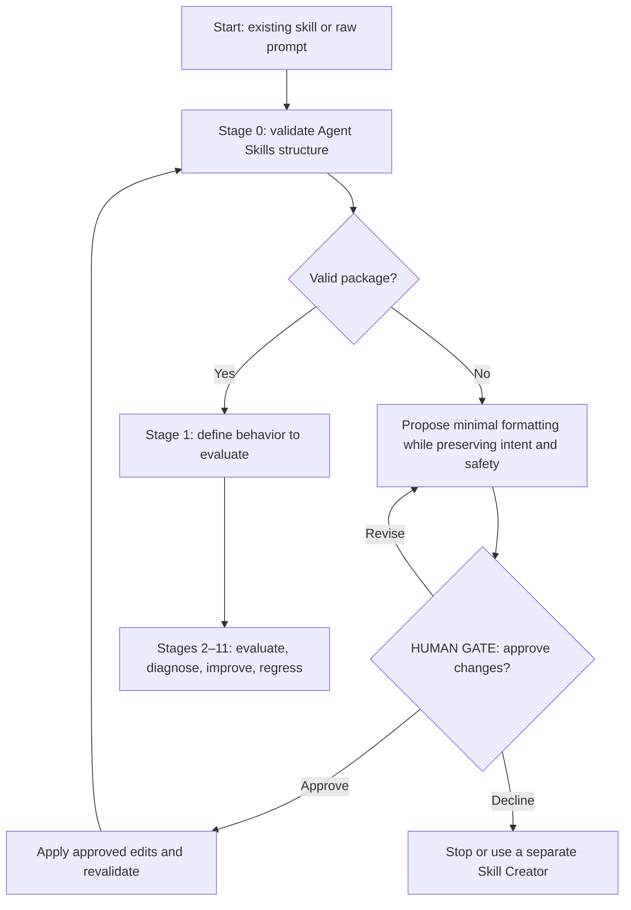
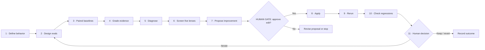

# Refine Skill

**Refine Skill** is a guided, human-gated workflow for **learning to write evaluations** and improving agent skills based on observed results. It accepts an existing Agent Skill or a raw prompt.

Refine Skill is **not a full skill creator**: Claude/Codex Skill Creator can handle richer authoring. Refine Skill does only the *minimum* structural conversion when needed, then focuses on output quality. DotSkills does not bundle a live model-evaluation runner.

## 1. Workflow at a glance

Every invocation starts with **Stage 0**, a check against the [Agent Skills Quickstart](https://agentskills.io/skill-creation/quickstart). Valid skills proceed unchanged to Stage 1. Invalid skills and raw prompts get a minimal formatting proposal, subject to human approval.



### Minimum valid skill

The portable format is a folder with a root `SKILL.md`: valid YAML frontmatter with `name` and `description`, followed by Markdown instructions. The name must match the directory and follow the [Agent Skills naming rules](https://agentskills.io/specification); the description should explain what the skill does and when to use it.

```text
skills/
└── example-skill/
    └── SKILL.md                    # Required
```

Folders such as `references/`, `scripts/`, `assets/`, and `evals/` are **optional**. Stage 0 is a *format check*, not a behavior rewrite or an execution of the target task. Format changes require an approved preview and post-change validation.

## 2. The 12 stages

| Stage | Action | Outcome |
| --- | --- | --- |
| **0** | Validate structure; minimally normalize if needed | Valid package or approved format conversion |
| **1** | Define one observable behavior | Success criteria and scope |
| **2** | Learn to write 2–3 realistic cases | Prompts, expected outcomes, optional fixtures |
| **3** | Run paired baselines in fresh contexts | With-skill vs. without-skill (or old-skill) evidence |
| **4** | Grade actual outputs | Assertions, grading evidence, uncertainty |
| **5** | Diagnose before editing | Identify case, grader, context, harness, trust, or skill issues |
| **6** | Screen five methodology lenses | Evidence-backed diagnosis and optional specialist route |
| **7** | Propose the smallest improvement | Rationale, trade-offs, and **human approval** |
| **8** | Apply only approved edits | Versioned change and diff |
| **9** | Rerun comparable evaluations | New results for the same cases and rubric |
| **10** | Check regressions and independent coverage | Before/after comparison and limits |
| **11** | Human decides: keep, revise, revert, or iterate | Recorded decision and lessons |

Learning is **Guided by default**: explain *what, why, how*, show a target-specific example, and help the human write or challenge cases and assertions. **Deep dive** and **Fast** learning modes are available.

### Evaluation and refinement loop



## 3. Five conference-informed methodology lenses

Stage 6 briefly reviews **all five**. A specialist deep dive happens only when evidence or a learning request justifies it.

| Lens | Focus |
| --- | --- |
| [Context Engineering](../context-engineering/SKILL.md) | Missing, excessive, conflicting, stale, or untrusted context |
| [Correctness & Verification](../correctness-and-verification/SKILL.md) | Evidence for claims, invariants, and deterministic checks |
| [Observability & Feedback](../agent-observability-and-feedback/SKILL.md) | Outputs, attempted tool actions, traces, and feedback |
| [Trust & Governance](../agent-trust-and-governance/SKILL.md) | Authority boundaries, permissions, approvals, and side effects |
| [Skill Lifecycle & Release](../skill-lifecycle-and-release/SKILL.md) | Versioning, regressions, portability, and release readiness |

These lenses, learning modes, and human gates are **DotSkills extensions**, not Agent Skills format requirements.

## 4. File and evaluation structure

`SKILL.md` is the runtime entry point; details live in `references/`. **Each target skill keeps its own evaluation definitions in `evals/evals.json`**. The Refine Skill's own `evals/` directory contains *self-evaluation* starter cases.

```text
skills/
├── refine-skill/
│   ├── README.md                  # This human-facing overview
│   ├── SKILL.md                   # Skill entry point
│   ├── references/                # Workflow, structure, evals, lenses, approvals
│   └── evals/                     # Refine Skill's self-eval cases
└── <target-skill>/
    ├── SKILL.md
    └── evals/                     # Optional evaluation convention
        ├── evals.json             # skill_name, evals: [{id, prompt, expected_output, files?}]
        └── files/                 # Optional input fixtures

eval-workspaces/<target-skill>/iteration-N/     # Generated, usually gitignored
├── eval-001/
│   ├── with_skill/
│   │   ├── outputs/
│   │   ├── grading.json
│   │   └── timing.json
│   └── without_skill/             # Or old_skill/; same evidence files
└── benchmark.json
```

This uses the [Agent Skills evaluation guide](https://agentskills.io/skill-creation/evaluating-skills) conventions for cases, paired runs, grading, timing, and benchmarks. **They are recommendations, not requirements of the core skill specification.** The top-level `eval-workspaces/` path is a DotSkills-specific choice.

Describe expected behavior **before** testing, then teach precise assertions after inspecting initial outputs. Preserve original results and comparable case/rubric versions; record real tool attempts, outcomes, and unknowns. Do not invent metrics or grades.

## 5. Approval, execution, and safety

- **Human gates:** Approve evaluation scope/cases, runs, specialist routing, structural changes, skill edits, and release decisions as applicable. Feedback is not automatic approval.
- **Isolated evaluations:** Use verified mock or disposable tools and workspaces. A skill or eval prompt is **not authorization** to post to GitHub/GitLab, send messages, deploy, or change real data. Live side effects need **separate, explicit, bounded authorization**.
- **Private evaluator data:** Keep expected answers, assertions, and grading materials outside the evaluated agent's readable environment; an `evals/` folder by itself is not access control.
- **Evidence limitations:** Drafted self-eval cases and passing schema checks are not successful model evaluations. Mark executions **Not Run** when isolation cannot be verified, and report missing evidence as **Unknown**.

## 6. Try it

> Use **refine-skill** on `skills/code-review` in **Guided** mode. Check Stage 0, walk me through writing eval cases, explain evidence and recommendations, and pause at each approval gate. Do not perform live external writes.

For operational details:

- [Runtime entry point](SKILL.md) · [Full Stage 0–11 workflow](references/workflow.md)
- [Structure validation](references/structure-validation.md) · [Eval design guide](references/eval-design-guide.md)
- [Methodology lenses](references/methodology-lenses.md) · [Approval and safety rules](references/approval-gates.md)
- [Refine Skill starter evals](evals/README.md)

Repository checks, run from DotSkills root:

```bash
python3 scripts/validate_skill_repository_integrity.py
python3 scripts/validate_evals.py --all
```

These commands check package and evaluation **structure**. They do not measure live model output quality.
