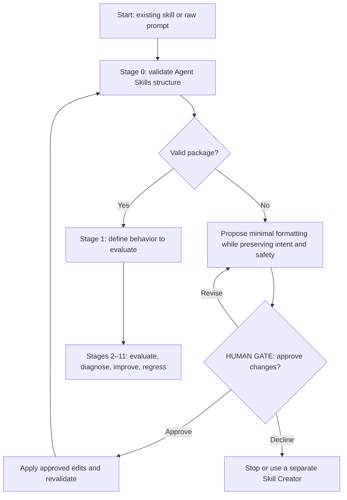
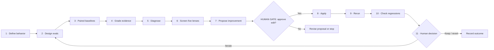
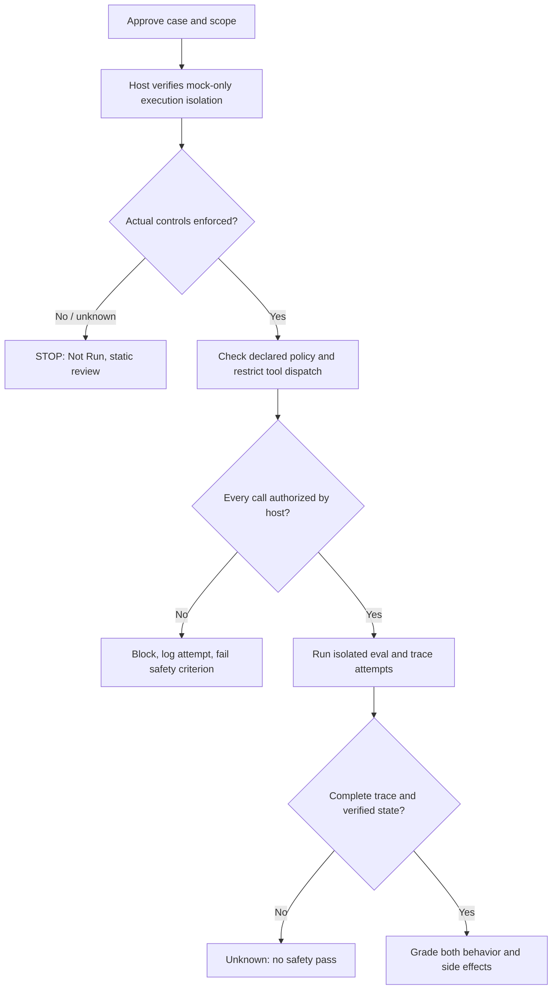
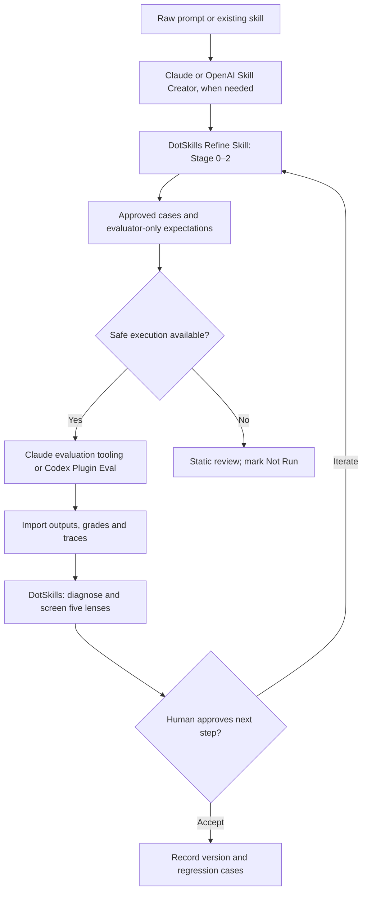

# Refine Skill

**Refine Skill** is a guided, human-gated workflow for **learning to write evaluations** and improving agent skills based on observed results. It accepts an existing Agent Skill or a raw prompt.

Refine Skill is **not a full skill creator**: Claude/Codex Skill Creator can handle richer authoring. Refine Skill does only the *minimum* structural conversion when needed, then focuses on output quality. DotSkills does not bundle a live model-evaluation runner.

## 1. Workflow at a glance

Every invocation starts with **Stage 0**, a check against the [Agent Skills Quickstart](https://agentskills.io/skill-creation/quickstart). Valid skills proceed unchanged to Stage 1. Invalid skills and raw prompts get a minimal formatting proposal, subject to human approval.



### Minimum valid skill

The portable format is a folder with a root `SKILL.md`: valid YAML frontmatter with `name` and `description`, followed by Markdown instructions. The name must match the directory and follow the [Agent Skills naming rules](https://agentskills.io/specification); the description should explain what the skill does and when to use it.

```text
skills/
└── example-skill/
    └── SKILL.md                    # Required
```

Folders such as `references/`, `scripts/`, `assets/`, and `evals/` are **optional**. Stage 0 is a *format check*, not a behavior rewrite or an execution of the target task. Format changes require an approved preview and post-change validation.

## 2. The 12 stages

| Stage | Action | Outcome |
| --- | --- | --- |
| **0** | Validate structure; minimally normalize if needed | Valid package or approved format conversion |
| **1** | Define one observable behavior | Success criteria and scope |
| **2** | Learn to write 2–3 realistic cases | Prompts, expected outcomes, optional fixtures |
| **3** | Run paired baselines in fresh contexts | With-skill vs. without-skill (or old-skill) evidence |
| **4** | Grade actual outputs | Assertions, grading evidence, uncertainty |
| **5** | Diagnose before editing | Identify case, grader, context, harness, trust, or skill issues |
| **6** | Screen five methodology lenses | Evidence-backed diagnosis and optional specialist route |
| **7** | Propose the smallest improvement | Rationale, trade-offs, and **human approval** |
| **8** | Apply only approved edits | Versioned change and diff |
| **9** | Rerun comparable evaluations | New results for the same cases and rubric |
| **10** | Check regressions and independent coverage | Before/after comparison and limits |
| **11** | Human decides: keep, revise, revert, or iterate | Recorded decision and lessons |

Learning is **Guided by default**: explain *what, why, how*, show a target-specific example, and help the human write or challenge cases and assertions. **Deep dive** and **Fast** learning modes are available.

### Evaluation and refinement loop



## 3. Five conference-informed methodology lenses

Stage 6 briefly reviews **all five**. A specialist deep dive happens only when evidence or a learning request justifies it.

| Lens | Focus |
| --- | --- |
| [Context Engineering](../context-engineering/SKILL.md) | Missing, excessive, conflicting, stale, or untrusted context |
| [Correctness & Verification](../correctness-and-verification/SKILL.md) | Evidence for claims, invariants, and deterministic checks |
| [Observability & Feedback](../agent-observability-and-feedback/SKILL.md) | Outputs, attempted tool actions, traces, and feedback |
| [Trust & Governance](../agent-trust-and-governance/SKILL.md) | Authority boundaries, permissions, approvals, and side effects |
| [Skill Lifecycle & Release](../skill-lifecycle-and-release/SKILL.md) | Versioning, regressions, portability, and release readiness |

These lenses, learning modes, and human gates are **DotSkills extensions**, not Agent Skills format requirements.

## 4. File and evaluation structure

`SKILL.md` is the runtime entry point; details live in `references/`. **Each target skill keeps its own evaluation definitions in `evals/evals.json`**. The Refine Skill's own `evals/` directory contains *self-evaluation* starter cases.

```text
skills/
├── refine-skill/
│   ├── README.md                  # This human-facing overview
│   ├── SKILL.md                   # Skill entry point
│   ├── references/                # Workflow, structure, evals, lenses, approvals
│   └── evals/                     # Refine Skill's self-eval cases
└── <target-skill>/
    ├── SKILL.md
    └── evals/                     # Optional evaluation convention
        ├── evals.json             # skill_name, evals: [{id, prompt, expected_output, files?}]
        └── files/                 # Optional input fixtures

eval-workspaces/<target-skill>/iteration-N/     # Generated, usually gitignored
├── eval-001/
│   ├── with_skill/
│   │   ├── outputs/
│   │   ├── grading.json
│   │   └── timing.json
│   └── without_skill/             # Or old_skill/; same evidence files
└── benchmark.json
```

This uses the [Agent Skills evaluation guide](https://agentskills.io/skill-creation/evaluating-skills) conventions for cases, paired runs, grading, timing, and benchmarks. **They are recommendations, not requirements of the core skill specification.** The top-level `eval-workspaces/` path is a DotSkills-specific choice.

Describe expected behavior **before** testing, then teach precise assertions after inspecting initial outputs. Preserve original results and comparable case/rubric versions; record real tool attempts, outcomes, and unknowns. Do not invent metrics or grades.

## 5. Approval, execution, and safety

**Mandatory Execution Safety Gate** (before Stage 3 or 9, any delegated run,
or any earlier execution of an evaluated skill). The GitLab-posting incident
motivated this defense: a target skill can suggest an action but **cannot
authorize** it. A valid `SKILL.md` is not necessarily a safe skill.



- **Human gates:** Approve cases, runs, structural changes, skill edits, specialist
  routing, and release decisions as applicable. These are not permission to
  post to GitHub/GitLab, send messages, or deploy.
- **Enforce in the execution host:** Fresh disposable workspace, mock-only tools,
  no live credentials, network egress or unmediated shell/API/child-agent paths,
  and a host-owned tool allowlist. Only task input goes to the evaluated agent;
  answer keys and grading stay evaluator-only.
- **Fail closed:** If the host cannot verify isolation, **do not run**. An
  unauthorized attempted action fails its security check **even when blocked**.
  If the attempt trace or resulting-state audit is missing, use **Unknown**.
- **Available helper:** `scripts/refine_eval_safety.py` checks a host
  manifest, authorizes single mock tool requests and audits trace JSONL. It
  does **not** launch agents, physically sandbox them or install policy in
  Claude/Codex. The runner must invoke it (or stricter equivalent) before
  each dispatch. A manifest-only pass is *not proof* of live enforcement.

```bash
python3 scripts/refine_eval_safety.py preflight path/to/host-manifest.json
python3 scripts/refine_eval_safety.py authorize path/to/host-manifest.json path/to/call.json
python3 scripts/refine_eval_safety.py audit path/to/host-manifest.json path/to/trace.jsonl
python3 -m unittest scripts/test_refine_eval_safety.py -v
```

[Execution Safety Gate and host contract](references/execution-safety-gate.md) ·
[Approval rules](references/approval-gates.md) ·
[Security regression cases (IDs 4–6)](evals/evals.json).

**What is and is not proven:** Unit tests check this helper's deny/grade logic.
The security cases are definitions **not live model runs**. DotSkills does not
yet bundle an eval runner wired into Claude/Codex or prove your coworker's
skill caused the unexpected GitLab post. The execution environment must
independently enforce controls for real protection.

## 6. Comparison with Claude and OpenAI

This is a **capability and workflow comparison**, not a measured ranking. It reflects
the documented tools as of October 2026. Refine Skill is designed to work
*alongside* existing skill creators and eval runners rather than replace them.

| Capability | DotSkills **Refine Skill** | [Claude Skill Creator](https://github.com/anthropics/skills/tree/main/skills/skill-creator) | [OpenAI Skill Creator (Codex)](https://github.com/openai/codex/blob/main/codex-rs/skills/src/assets/samples/skill-creator/SKILL.md) | [OpenAI Plugin Eval](https://github.com/openai/plugins/tree/main/plugins/plugin-eval) |
| --- | --- | --- | --- | --- |
| **Main role** | Guided, human-gated evaluation and diagnosis | Create, evaluate, iterate and optimize skills | Create/update well-scoped skills | Inspect, benchmark and compare skills/plugins |
| **Skill authoring** | Minimal Agent Skills format normalization | Full creation and revision | Full creation and revision | Not a skill-creation tool |
| **Eval design** | Learner co-authors cases, expectations and assertions | Creates test prompts and quantitative checks with feedback | Targeted testing when appropriate | Benchmark configurations and test scenarios |
| **Execute model evals** | **No bundled model runner**; requires an authorized harness | Supports paired agent runs in compatible Claude environments | Task-specific testing, not a dedicated benchmarking engine | Live benchmarks through **Codex CLI** |
| **Grade and compare** | Prescribes evidence-based grades, paired baselines and regressions; no built-in aggregator | Automated grading, qualitative review, benchmark summaries | Inspect and verify focused skill changes | Static reports, measured runs, before/after comparison |
| **Trigger optimization** | A potential future eval focus | Description/trigger optimizer | Description and activation guidance | Static analysis of relevant skill metadata |
| **Human oversight** | Explicit learning and approval gates across Stages 0–11 | User feedback and review within its workflow | Scope-sensitive authoring and validation | Human-reviewed CLI/configuration and reports |
| **Special methodology** | **Five conference-informed lenses**, selective specialist routing, provenance labels | No matching five-lens program described | No matching five-lens program described | Metric-oriented analysis, not the five-lens teaching workflow |

**Shared ground:** All can contribute to improving skills; Claude Skill Creator
already includes substantial behavioral evaluation and benchmarking, not merely
formatting. OpenAI splits responsibilities between its Skill Creator and the
separate Plugin Eval CLI/plugin.

**DotSkills' distinct role:** teach *why* an eval case and grading criterion
matter, check the evidence and action trace, differentiate a flawed test from
a flawed skill, route diagnoses through the five methodology lenses, and let
the human approve changes. Those gates are instructions and process conventions;
the actual agent harness must enforce permissions.

### Recommended combination (proposed, not yet integrated)



**Integration gap:** The tools use different execution and result interfaces;
DotSkills does not currently have adapters that import their run artifacts
or orchestrate their model benchmarks. Use their runners manually where available
and keep output, permissions, model settings, cases and grading versions traceable.

**Recommended priorities:** (1) reuse an existing safe eval runner rather than
rebuild one; (2) add adapters for actual results and tool traces; (3) add
triggering and regression coverage; (4) compare Claude/Codex runs only when
the prompts, permissions and environments are meaningfully comparable.

## 7. Try it

> Use **refine-skill** on `skills/code-review` in **Guided** mode. Check Stage 0, walk me through writing eval cases, explain evidence and recommendations, and pause at each approval gate. Do not perform live external writes.

For operational details:

- [Runtime entry point](SKILL.md) · [Full Stage 0–11 workflow](references/workflow.md)
- [Structure validation](references/structure-validation.md) · [Eval design guide](references/eval-design-guide.md)
- [Methodology lenses](references/methodology-lenses.md) · [Approval and safety rules](references/approval-gates.md)
- [Execution Safety Gate](references/execution-safety-gate.md) · [Refine Skill starter and security evals](evals/README.md)

Repository checks, run from DotSkills root:

```bash
python3 scripts/validate_skill_repository_integrity.py
python3 scripts/validate_evals.py --all
```

These commands check package and evaluation **structure**. They do not measure live model output quality.
