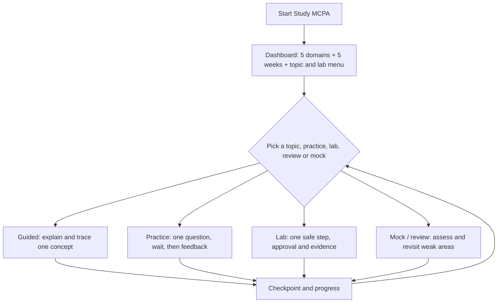

# Study MCPA

**Study MCPA** is an interactive study coach for the Linux Foundation's **Model Context Protocol Associate (MCPA)** certification. It combines the five official exam domains with a guided five-week plan and an **optional hands-on DotSkills MCP Server** project.

It uses the same learning philosophy that works in `learn-repo`: **overview first → choose a question → explore it → answer a checkpoint → pick what comes next.** It is not a giant linear tutorial and does not start quizzing you until you choose a question or mode.

## At a glance



## Five-week curriculum

| Week | Certification focus | Optional hands-on milestone |
| --- | --- | --- |
| 1 | Fundamentals (16%) and Architecture (14%) | L-01: curate two DotSkills packages and map boundaries |
| 2 | Interactions & Execution (26%) | L-02: local TypeScript MCP server using the Skills Extension |
| 3 | Security & Governance (24%) | L-03: authentication, deny-by-default tests, safe logging |
| 4 | Use Cases & Ecosystem (20%) | L-04: **optional** Fly.io remote deployment |
| 5 | Review, teach-back, original mock exams | L-05: compatible client testing and portability reflection |

The default learning rhythm is **30–45 minutes/day**, four or five days/week, with an optional 60–90-minute lab. The study calendar is adjustable; the official weights aren't.

The Linux Foundation lists the exam as a **90-minute, online-proctored, multiple-choice exam** and, as checked 2026-10-30, directs candidates to **MCP protocol version 2026-07-28**. [Official MCPA page](https://training.linuxfoundation.org/certification/model-context-protocol-associate-mcpa/).

## How to use

After installing this skill into a compatible harness, try:

```text
Use study-mcpa. Show the complete Study Dashboard for my
five-week MCPA plan and the DotSkills MCP Server labs.
Don't start a lesson until I choose an ID.
```

Then choose any curriculum item (for example `A-01`), mode, or lab:

```text
A-01 in Guided mode. Teach me host/client/server and ask one teach-back question.
```

```text
Quiz me on I-02 in Practice mode. Ask one question at a time
and don't reveal the answer until I attempt it.
```

```text
Start L-01 on my DotSkills repository. Show the architecture,
the approved skill allowlist and the first read-only checkpoint.
Do not change files or run anything yet.
```

```text
Review my missed Security questions, then give me a 20-question mock.
```

To install specifically this skill into another project using existing adapters:

```bash
python3 adapters/claude/install_claude.py --target ../my-project --skill study-mcpa --dry-run
python3 adapters/claude/install_claude.py --target ../my-project --skill study-mcpa
# OR Codex:
python3 adapters/openai/install_codex.py --target ../my-project --skill study-mcpa
```

The skill in the Git repository does **not** automatically become enabled in every client. The adapters install runtime files; check the harness's skill-loading behavior.

## What is in scope

- Official objectives, architecture and current-spec message flow, clear TypeScript-oriented examples, teach-back and scenario practice.
- Distinguishing mistakes and weak concepts; optional private progress file with explicit approval.
- A lab that curates **only explicitly approved** DotSkills skill packages and publishes their **read-only definitions** through an MCP server.
- Verification, security checks and an **optional** Fly.io deployment after a separate explicit decision.

## What is not in scope

- Automatically executing skills, evaluating real third-party write-capable actions, posting to GitLab/GitHub, deploying to a cloud provider, or storing secrets merely because a study lesson was selected.
- Publishing `evals/`, hidden catalog entries or user study scores.
- Claiming that remote skills are automatically activated by any MCP client.
- Claiming original practice items or score thresholds are official Linux Foundation exam material.

**Version note:** The Skills Extension is a separate ecosystem feature and useful lab, *not* an official exam domain. The TypeScript Skills Extension `attach` interface has been identified as experimental; check the installed SDK before implementation.

## Files

| File | Purpose |
| --- | --- |
| [SKILL.md](SKILL.md) | Activation, teaching workflow, dashboard, session boundaries |
| [references/curriculum.md](references/curriculum.md) | Official exam domain weights, 17 topic IDs, weekly roadmap |
| [references/teaching-and-progress.md](references/teaching-and-progress.md) | Guided/Practice/Mock/Review behavior, grading, progress |
| [references/dotskills-mcp-lab.md](references/dotskills-mcp-lab.md) | Five interactive build, security and deployment milestones |
| [references/progress-template.md](references/progress-template.md) | Optional learner-owned study progress template |
| [evals/evals.json](evals/evals.json) | Evaluator-only cases; **not shipped** by runtime adapters |

## Static checks

```bash
python3 scripts/validate_skill_repository_integrity.py
python3 scripts/validate_evals.py --all
```

These check package/JSON structure, not model teaching quality, deployed endpoint behavior, or real isolation. Run the `refine-skill` evaluation workflow with safe mock-only tooling before treating the skill as behaviorally tested.
